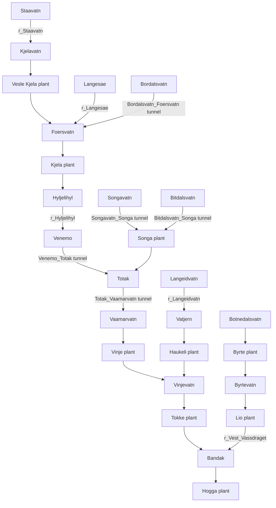

# Experiment history and report references

Consolidated on 2026-10-19. This is a historical record: references to old
development scripts and shell commands describe completed experiments. Those
one-off scripts were removed during cleanup and are not current entry points.
Use the standalone notebooks and README for current commands. Original sources
and the pre-cleanup project instructions are backed up in `outputs\cleanup\20261019T111523Z\before_cleanup.zip`.

## Contents

- [2026-10-09-blend-analysis](#note-2026-10-09-blend-analysis)
- [2026-10-09-decision-features](#note-2026-10-09-decision-features)
- [2026-10-09-jonas-branch-review](#note-2026-10-09-jonas-branch-review)
- [2026-10-13-lightgbm-setup](#note-2026-10-13-lightgbm-setup)
- [2026-10-14-autonomous-lightgbm-results](#note-2026-10-14-autonomous-lightgbm-results)
- [2026-10-14-ensemble-weight-audit](#note-2026-10-14-ensemble-weight-audit)
- [2026-10-14-jonas-latest-review](#note-2026-10-14-jonas-latest-review)
- [2026-10-14-lightgbm-optimization](#note-2026-10-14-lightgbm-optimization)
- [2026-10-14-literature-model-strategy](#note-2026-10-14-literature-model-strategy)
- [2026-10-14-tcn-plan](#note-2026-10-14-tcn-plan)
- [2026-10-14-tcn-results](#note-2026-10-14-tcn-results)
- [2026-10-14-topology-feature-rationale](#note-2026-10-14-topology-feature-rationale)
- [2026-10-14-xgboost-plan](#note-2026-10-14-xgboost-plan)
- [2026-10-14-xgboost-results](#note-2026-10-14-xgboost-results)

---

## 2026-10-09-blend-analysis

## Saved-prediction blend analysis

Compared fixed probability blends on the two existing purged development folds,
without fitting any models. Reference: `probability_logloss`. Candidate weights
were fixed at 0.25, 0.50 and 0.75 before evaluation; the reference receives the
remaining weight. The same weight is used for all generators and both years.

The audit checks completed validation status, matching raw-input manifests and
fold definitions, the current raw-label hash, prediction IDs/columns/probabilities,
and exact reproduction of both models' recorded micro AUC (within 1e-8).
It rejects folds extending beyond the reserved 2022 boundary.

| Candidate | Candidate weight | 2020 micro AUC | 2021 micro AUC |
|---|---:|---:|---:|
| Reference alone | 0 | 0.95766422 | 0.97857470 |
| baseline_auc | 0.25 | 0.95700979 | 0.97841608 |
| baseline_auc | 0.50 | 0.95516636 | 0.97812416 |
| baseline_auc | 0.75 | 0.95190290 | 0.97766616 |
| upstream_logloss | 0.25 | 0.95898008 | 0.97902994 |
| upstream_logloss | 0.50 | 0.95940715 | 0.97914061 |
| upstream_logloss | 0.75 | 0.95895231 | 0.97901217 |
| shared_logloss | 0.25 | **0.96031427** | **0.97941690** |
| shared_logloss | 0.50 | 0.95986889 | 0.97939043 |
| shared_logloss | 0.75 | 0.95672911 | 0.97863334 |

Although the shared model was weaker alone, mixing 25% shared with 75% separate
probability predictions improved both development years. The gains were 0.00265005
and 0.00084220 over the reference. This supports investigating complementary models;
it does not demonstrate an improvement on the reserved holdout or Kaggle. Selection
from these nine blends reuses development labels and requires frozen-candidate
confirmation. Do not tune additional weights repeatedly on the public leaderboard.

The original AUC-stopped baseline did not improve the reference at the tested
weights. Additional upstream features were inconsistent as a standalone candidate,
but all three tested blends with them improved both reference folds.

Reproduce with `analyze_catboost_blends.py`. Full precision results are saved at
`outputs/catboost_diagnostics/20261009_blend_comparison.csv`. This development script
is not a runtime dependency of the notebook and does not create submissions.

Next: finish the controlled decision-feature experiment. Keep the 75/25 separate/
shared blend as another candidate. A final blend requires both model strategies
refitted on the appropriate training partition with frozen configurations; existing
development models cannot be used as substitutes for full-data fits. Include both
strategies' preprocessing, fitting and prediction in the final runtime budget.

---

## 2026-10-09-decision-features

## Decision-context CatBoost experiment

### Evidence before the new experiment

The user reported Kaggle ROC-AUC **0.98417** for the latest submission and said it
was worse than the earlier submission. This is user-reported, not independently
retrieved; the previous Kaggle score and leaderboard partition are not recorded.

Existing completed local development runs:

| Preset | 2020 micro AUC | 2021 micro AUC | Recorded time |
|---|---:|---:|---:|
| baseline_auc | 0.946865 | 0.976947 | 21.1 min |
| probability_logloss | 0.957664 | 0.978575 | 23.1 min |
| upstream_logloss | 0.957444 | 0.978637 | 27.4 min |
| shared_logloss | 0.947842 | 0.976520 | 27.4 min |

Separate probability models remain the local reference. Neither extra upstream
features nor the tested shared model consistently improved on that reference.
These results do not establish which strategy would win after further tuning.

### Saved-prediction error audit (no training)

`analyze_catboost_errors.py` recomputes micro AUC from saved predictions, verifies
label-file hashes, aligns cases by Run No, verifies purged development dates and
reports generator, horizon-day, case-start-quarter and transition metrics.
The script rejects holdout, test, smoke and incomplete runs.

Output: `outputs/catboost_diagnostics/20261009_development_errors.csv`.
The output covers the original and probability presets on the same development folds.

Key findings for `probability_logloss`:

- Haukeli has the highest per-generator Brier error in both years: 0.233399
  (2020) and 0.113202 (2021). In 2020 its observed ON fraction is 0.244709,
  while its mean predicted probability is 0.531146. Its AUC is 0.857806.
- Haukeli's saved Logloss curves choose 5 trees in 2020 and 38 in 2021. The
  2020 validation loss increases with further training. More trees alone are
  therefore not a demonstrated remedy. Its frozen refit budget is 21 trees.
- For hours with a label change from the preceding horizon hour, Brier is
  0.240180/0.219875 (2020/2021), versus 0.083875/0.054488 for stable hours.
  These transitions account for only 0.56%/1.78% of evaluated hours after t0.
  Their high conditional error does not imply they dominate global micro AUC.
  Labels define these diagnostic groups only; they are never features.
- Errors do not consistently increase with horizon day. 2021 day 7 has better
  micro AUC (0.982923) than day 1 (0.975994).
- Performance varies by case-start quarter: 2020 Q3 micro AUC is 0.929370,
  while 2021 Q4 is 0.957520. This motivates checking seasonal robustness,
  but does not prove a particular cause or justify fitting to held-out labels.

These are descriptive results from overlapping cases, not independent samples
or statistical significance tests. Per-generator AUC is not an additive breakdown
of micro AUC. 2022 has not been used for this audit.

### New experiment

`decision_logloss` adds 23 features to the existing 193 (216 total), keeping
the same 14 models, chronological folds, seed, hyperparameters and Logloss stopping.

**Economics: 14 features.** Whole-horizon patterns in price minus the existing
capacity-weighted intake terminal water value: positive-margin streak length and
summed margin, distance to positive hours, remaining opportunities, normalized
margin and preceding/following 6h/24h mean margins. All windows include the current
hour and truncate at case boundaries. Distance 168 denotes no matching hour.
These are descriptors, not net-profit estimates: no efficiency, startup cost or
downstream marginal-water-value conversion is assumed.

**Water balance: 9 features.** Natural inflow against initial headroom, hypothetical
excess under zero release/transfer, and margins against supplied minimum volumes.
Compute reservoir excesses individually before aggregation to prevent cancellation.
Ratios use a 1%-capacity headroom floor and log1p. Use supplied maximum capacities,
initial volumes, in-horizon inflow integrated to Mm3 and minimum-volume requirements.
No realized future storage or inferred upstream dispatch is used. These proxies
are not a hydraulic simulation and do not imply mandatory turbine production.

`economics_logloss` (207 features) and `water_balance_logloss` (202 features) provide
group ablations. Compare the combined preset against the probability reference on
both years first; ablations identify whether either group helps or hurts.

### Verification and next action

No dependencies were added or installed. No models were fitted. Check-mode execution
passed for all presets. Tests cover hand-calculated streaks/windows and water
quantities, reservoir-wise excess, case isolation, label/metadata invariance,
invariance to realized future storage, CatBoost Pool construction, old feature
values/signatures, ablation equality and the existing target-order roundtrip.

The user should run `check`, then `smoke`, then `validate` for `decision_logloss`,
restarting the kernel between modes. Save results even if performance worsens.
Do not reuse an older preset's selected configuration with these features.
New training runtime and predictive performance are unmeasured. Preserve 2022
for frozen-candidate confirmation rather than repeatedly tuning against it.

### User-completed validation result

Run `20261009T085100_521077Z_validate_decision_logloss` completed in 1988.97 seconds
(33 min 9 s). Its input hashes, fold definitions and model parameters match the
probability reference exactly; feature engineering is the changed component.

| Preset | 2020 micro AUC | 2021 micro AUC |
|---|---:|---:|
| probability_logloss | 0.95766422 | 0.97857470 |
| decision_logloss | **0.96671334** | **0.98163615** |
| Difference | +0.00904912 | +0.00306146 |

Per-generator AUC improved for 12/14 generators in 2020 and 11/14 in 2021.
Haukeli improved from 0.857806 to 0.909452 (2020) and from 0.927213 to 0.942968
(2021), although its 2020 Brier worsened slightly. Lio worsened in 2021 from
0.955941 to 0.939166, and Vinje G1 worsened in both years. Overall mean Logloss
and Brier improved in both folds. No model hit the 1500-tree limit (largest retained
counts: 620 in 2020, 881 in 2021).

This is a measured improvement on reused development years, not independent
confirmation or a demonstrated Kaggle gain. The new preset is the strongest
standalone CatBoost development candidate so far. Keep its frozen configuration
for later confirmation and use the same data/folds as the reference for LightGBM.
Do not automatically replace individual generator models using these diagnostics.

### User-reported Kaggle result

The user completed full-data submission run
`20261009T093004_209176Z_submit_decision_logloss` in 718.99 seconds and reported
Kaggle ROC-AUC **0.98679**, compared with **0.98417** for the preceding probability
submission (+0.00262). The CSV was independently checked for 725 rows, exact
2353-column template schema/IDs and finite probabilities in [0, 1]. Scores were
reported by the user; leaderboard partition is unspecified. This supports retaining
the decision-feature setup as a reference, but is not private-score confirmation.
Preserve its selected configuration while comparing LightGBM on the same input
features and development folds.

---

## 2026-10-09-jonas-branch-review

## Jonas branch review: lessons for CatBoost

Reviewed the locally available `origin/jonas` at commit
`5fe43feadcb4cb22acdf458917bca20ddfd72a87`. No checkout, merge, installation or model
training was performed. Read-only notebook snapshots are under `outputs/jonas_review/`.

### Recorded scores and attribution

- The branch records **0.98722** for the original XGBoost `output.csv`.
- It records **0.98711 public** for `output2.csv`, the volpath + cyclic variant.
- Our user-reported decision-feature CatBoost score is **0.98679**.
- These are recorded/reported Kaggle scores, not independently retrieved. Small
  leaderboard differences do not identify which feature or hyperparameter caused them.
  Do not import the branch's asserted grade threshold as an authoritative grading rule.

### Verified similarities

`notebooks/xgboost_baseline.ipynb` and the baseline section of
`notebooks/kaggle_submission.ipynb` use 14 separate generator classifiers. Their
193 original features match our v1 baseline numerically, after renaming columns.
This was checked for all 14 generators on seven representative training/test cases.
Both align initial storage at S, terminal water value at S+168h, and hourly inputs
inside the 168-hour horizon. Our measured decision preset adds 23 features to this
shared baseline. Jonas's baseline has no additional source of input information.

XGBoost parameters: 400 maximum trees, learning rate 0.05, depth 7, row subsampling
0.8, feature subsampling `colsample_bytree=0.8`, histogram training, seed 0 and
AUC-based stopping with patience 25. Most retained counts are near 400; Songa is 133
in the saved baseline validation output.

### Transferable experiments, in priority order

1. **Feature subsampling:** retain the 216 decision features and test CatBoost
   `rsm=0.8` against its existing default of 1.0. This transfers the idea of feature
   sampling, not the exact XGBoost algorithm: CatBoost `rsm` samples at split
   selection rather than being identical to `colsample_bytree`. Keep all other
   settings and both purged development folds fixed.
2. **Cyclic hour/week encodings:** add four features for sin/cos of hour-of-day
   (period 24) and day-of-week (period 7), as a separate ablation. Our day-of-year
   sin/cos already exists; these four do not. They use prediction-time-known data.
   Jonas's second submission combines these with volpath, so its score does not
   isolate cyclic encoding and is not evidence it improves CatBoost.
3. **Refit tree-budget sensitivity:** compare a small predeclared fixed-budget
   experiment (e.g. 400 trees) with the current generator-specific early-stopped
   budgets on the same development years. This tests whether the median refit rule
   is too conservative for some units; it does not justify blindly increasing all
   counts. No current CatBoost fold hit its 1500-tree maximum. Learned budgets for
   an outer evaluation must come only from earlier training/inner development data.
4. **Optional tree-growth experiment:** CatBoost Depthwise can test a different
   tree structure with explicit depth/regularization. Depth 7 does not imply equal
   capacity in XGBoost and symmetric CatBoost. This is a lower-priority hypothesis,
   not a claim that copying the XGBoost hyperparameters will reproduce its score.

References: [CatBoost common parameters](https://catboost.ai/docs/en/references/training-parameters/common)
documents `rsm`, `grow_policy`, `min_data_in_leaf` and stopping-related settings.

### Protocol differences that should not be copied as clean evaluation

**Training-tail stopping is in-sample.** The branch defines `stop_cases` as the
last 90 days of `train_cases`, then fits on all of `train_cases` and monitors
`stop_cases`. Confirmed: every one of the 90 stopping IDs is in the fitting pool.
This is a training diagnostic, not a held-out early-stopping estimate. It does not
read outer-validation labels, but should not be described as independent validation.
Our use of development validation for early stopping is allowed model selection;
it means those development scores are not a final untouched-test estimate. A properly
purged inner stopping split and an outer evaluation serve different purposes.

**Six training cases overlap the 2022 boundary.** The branch selects training
cases by start <2022-01-01, admitting December 26-31, 2021 cases whose 168-hour
horizons extend into 2022. Our protocol removes these overlaps. Its 2022 score
cannot be directly compared with our 2020/2021 results or used as proof of model
superiority without rerunning on matched, purged folds.

**Volpath uses observed future reservoir storage.** The extra-feature function
reads `vol_wide` at S+1 through S+7 days. Those values are not initial storage at S,
and conflict with our prediction-time availability rule. Do not port them into
CatBoost. Supplied in-horizon prices/inflows and terminal water values have a
different availability status; future storage being present in a CSV does not by
itself authorize using it. The cyclic features can be isolated without volpath.

**Error interpretation is not proof of missing information.** The branch's
Haukeli/Lio regime diagnostics are useful leads. Whole-week errors and a failed GRU
do not establish a maintenance schedule as the cause or prove the available inputs
cannot explain the labels. Its in-sample 0.9985 is a fit measurement, not a forecast
ceiling or proof of deterministic labels from the features.

### Next action

Before implementing LightGBM, report these findings to the user. The highest-priority
CatBoost experiment suggested by the review is isolated `rsm=0.8` on decision
features, followed by isolated cyclic encoding. Preserve the 0.98679 configuration.
Any new models are trained by the user; new score and runtime are unmeasured.

---

## 2026-10-13-lightgbm-setup

## LightGBM setup and Jonas branch refresh

### Jonas refresh result

The user reported a new Jonas Kaggle score of 0.98848. On 2026-10-13:

- Ran `git fetch origin jonas` twice successfully.
- Queried remote branch heads: `refs/heads/jonas` remained
  `5fe43feadcb4cb22acdf458917bca20ddfd72a87`.
- Created a detached, read-only-for-review worktree at `outputs/jonas_checkout/`.
- Ran `git pull --ff-only origin jonas` inside that worktree; Git returned
  **Already up to date**. The user's fredrik branch was not merged with Jonas.

The published Jonas branch still records 0.98711 for output2.csv and 0.98722 for
output.csv. No published change explaining 0.98848 was available to inspect.
Treat 0.98848 as user-reported and unexplained until its commit/notebook is provided
or pushed. Do not attribute it to a guessed feature or hyperparameter. The previous
branch audit and its caveats remain at `2026-10-09-jonas-branch-review.md`.

### New LightGBM notebook

`lightgbm.ipynb` is self-contained and uses one binary classifier per generator,
the exact 216 decision features and purged 2020/2021 folds from CatBoost. It also
offers a 193-feature `baseline_logloss` input ablation. Initial mode is `check`;
other modes are `smoke`, `validate`, `holdout` and `submit`.

Starting parameters (not tuned or benchmarked): binary GBDT, 63 leaves, depth 7,
learning rate 0.05, minimum 200 child samples, L2 5, row and column sampling 0.8,
active bagging frequency 1, max_bin 127, deterministic CPU mode and four threads.
Different learners do not have equal capacity just because depth is equal.

Development validation uses binary Logloss early stopping (patience 100), at most
2000 trees; smoke uses at most 40 trees on 96 train/48 validation cases. Model
selection compares overall micro ROC-AUC. Frozen tree counts are the median best
counts from both folds; this refit rule remains a hypothesis rather than a tuned
optimum. Reserved 2022 holdout and submission do not access evaluation labels
during fitting and do not use early stopping.

Training outputs go under `outputs/lightgbm/<run>/`: metadata, hashes, versions,
models, curves, metrics, predictions and normalized gain importance. Only submit
exports `lightgbm_submission.csv` after verifying template IDs, columns and finite
probabilities. LightGBM configurations carry `model_family="lightgbm"`; CatBoost
configs are rejected even when the feature signature matches. No saved artifacts
or helper files are required to reproduce the notebook from raw inputs.

The final comparison reads completed development runs from both families and flags
matching input hashes, feature signature, folds and seed. Existing prediction-audit
and fixed-blend scripts accept explicit LightGBM run paths too; no ensemble or
submission is generated automatically by check mode.

### Verification and limitations

`tests/check_lightgbm_pipeline.py` passed without fitting models:

- Notebook JSON/schema and all check-mode cells.
- Exact numeric feature equivalence across all 14 generators on representative
  training and test cases, including the last test horizon.
- Identical chronological case IDs and purged boundaries.
- Mapping for all 725 template rows and all 2352 target columns.
- Equality with the supplied metric on reversed-order cases and synthetic probabilities.
- Rejection of a CatBoost frozen config before creating any training directory.
- The 193-feature ablation and input-hash comparison flags.

`lightgbm>=4.0,<5.0` was added to requirements.txt. It was not installed and was
not already available in the project venv. Actual fitting, native prediction,
model save/load behavior, training runtime and predictive quality remain unverified
until the user installs the dependency and runs smoke/validate. The authoring code
uses the current documented classifier/callback interfaces; this is not a substitute
for executing the native model.

References: [classifier API](https://lightgbm.readthedocs.io/en/stable/pythonapi/lightgbm.LGBMClassifier.html),
[early stopping](https://lightgbm.readthedocs.io/en/stable/pythonapi/lightgbm.early_stopping.html),
[parameter tuning](https://lightgbm.readthedocs.io/en/stable/Parameters-Tuning.html).

### User's next steps

Install the updated requirements into the project venv yourself. Open
lightgbm.ipynb with that kernel, run check, then smoke, then validate, restarting
the kernel between settings. Keep the CatBoost reference fixed. Do not reuse a
CatBoost selected configuration for a LightGBM submission. After both development
folds, compare standalone performance and fixed probability blends before deciding
whether the new family contributes useful complementary predictions.

### Completed user validation and exploratory blend results

The user installed LightGBM 4.7.0 and completed smoke and validation. Validation
run `20261013T214617_205062Z_validate_decision_logloss` took 688.43 seconds
(11 min 28 s); model fitting, prediction and model exports now executed in the
user's workflow. The assistant did not install packages or fit any model.

| Predictor | 2020 micro AUC | 2021 micro AUC |
|---|---:|---:|
| CatBoost RSM | 0.96784856 | 0.98274610 |
| LightGBM | 0.95854627 | 0.98290810 |
| 75% CatBoost + 25% LightGBM | 0.96795750 | 0.98369577 |
| 50% CatBoost + 50% LightGBM | 0.96600676 | 0.98393691 |
| 25% CatBoost + 75% LightGBM | 0.96272976 | 0.98371148 |

Fixed coarse blend weights were evaluated with the existing non-training audit
script, checking equal raw-input manifests/folds and reproducing both saved model
scores. Output: `outputs/catboost_diagnostics/20261013_catboost_lightgbm_blends.csv`.
LightGBM has better Lio and Vinje G1 per-generator AUC on both folds, but its 2020
Haukeli is substantially weaker (0.807399, 6 trees, versus CatBoost 0.897677).
The 75/25 combination improves both years; its 2020 gain is only 0.00010894,
while the 2021 gain is 0.00094966. This is exploratory development selection,
not independent confirmation or evidence of a Kaggle improvement.

Do not replace the CatBoost reference based on the 2021 score alone. A frozen
75/25 blend is a candidate for final confirmation. Both components must be
appropriately refitted with their own selected configs to create final predictions;
development models are not substitutes for full-data fits. No new submission was
produced during this analysis.

---

## 2026-10-14-autonomous-lightgbm-results

## Authorized LightGBM optimization results

The user explicitly delegated execution and experiment management, with a maximum
45-minute machine budget. The assistant used four training threads and sequential
jobs. No dependencies were installed. Hardware: Intel Core Ultra 7 258V, eight
physical/logical cores, about 31.5 GiB RAM, about 7.5 GiB initially available.

### Controlled development comparison

All candidates use the same 216 decision features, raw-input hashes, seed 42 and
purged 2020/2021 folds. Logloss selects iterations; micro ROC-AUC compares models.
The first LightGBM reference was previously trained by the user. The assistant
ran the following predeclared variations; the source notebook was snapshotted.

| Predictor | 2020 micro AUC | 2021 micro AUC | Validation time |
|---|---:|---:|---:|
| Original LightGBM | 0.95854627 | 0.98290810 | 11 min 28 s |
| Neutral initialization | **0.96435830** | 0.98337111 | 12 min 39 s |
| Smaller trees / stronger regularization | 0.95967193 | **0.98377707** | 13 min 42 s |
| CatBoost RSM reference | 0.96784856 | 0.98274610 | 26 min 33 s |

Neutral initialization changes only `boost_from_average=False`. Regularization
changes leaves 63->31, depth 7->6, min_child_samples 200->500 and L2 5->10 while
keeping the original prior. Both improve the initial LightGBM reference on both
years. Neutral is selected because it has the stronger mean and worst-year AUC;
regularized is slightly better on 2021. This is a tradeoff, not proof of a universally
optimal parameter set. A slower-learning-rate run was deferred because its projected
runtime would not fit the remaining budget safely.

For Haukeli in 2020, neutral initialization reduces mean predicted ON probability
from 0.702003 to 0.528276 (observed ON fraction 0.244709), improves Logloss from
0.960176 to 0.673958 and AUC from 0.807399 to 0.816475. Calibration improves but
the difficult generator remains unresolved. These findings do not prove an outage
variable is missing or that neutral initialization will improve the hidden test.

Runs:

- `20261013T221000_403663Z_smoke_decision_neutral_logloss` (10.76 s).
- `20261013T221012_065784Z_validate_decision_neutral_logloss`.
- `20261013T222254_245353Z_validate_decision_regularized_logloss`.

### Ensemble audit without extra fitting

Fixed LightGBM weights 0.25, 0.50 and 0.75 were compared with CatBoost RSM,
checking matching input/fold manifests and reproducing recorded metrics.

| Blend | 2020 micro AUC | 2021 micro AUC |
|---|---:|---:|
| 75% CatBoost + 25% neutral LightGBM | **0.96914276** | 0.98383669 |
| 50% CatBoost + 50% neutral LightGBM | 0.96875814 | **0.98419149** |
| 25% CatBoost + 75% neutral LightGBM | 0.96705647 | 0.98407654 |
| 75% CatBoost + 25% regularized LightGBM | 0.96806097 | 0.98382765 |

Selected 75/25 neutral blend improves both CatBoost folds and prioritizes stronger
worst-year performance. 50/50 neutral is another tradeoff, slightly stronger in
2021 but weaker in 2020. Development labels were reused to select candidates;
this is exploratory selection, not independent confirmation or a Kaggle score.
No 2022 holdout score was inspected during optimization. All labels, including
2022, are legitimately used only in the final full-data refit for test prediction.

### Full-data artifacts

Selected neutral LightGBM was refitted on all 2922 labeled cases with its frozen
median tree counts in 7 min 35 s. Run:
`outputs/lightgbm/20261013T223739_726671Z_submit_decision_neutral_logloss/`.
Pure CSV: `lightgbm_submission.csv` in that run folder.

The selected blend combines this CSV with the existing full-data CatBoost RSM run
`20261009T110904_307192Z_submit_decision_rsm_logloss`, not development models.
Their raw-input hashes, feature signatures and seeds match. Blended output:
`outputs/lightgbm_optimization/20261013T220956_594989Z/catboost_lightgbm_75_25_submission.csv`.
Its JSON manifest records exact component paths/hashes and weights.

Both CSVs were independently checked: 725 rows, 2353 columns, exact template
IDs/order/columns, finite probabilities in [0,1]. Blend arithmetic and roundtrip
were tested on synthetic fixtures before using real submissions. No Kaggle upload
was performed and neither new CSV has a measured Kaggle score.

`lightgbm.ipynb` now stores the selected neutral configuration inline and remains
in check mode. It can reproduce the pure CSV from raw inputs in submit mode;
the executed submission notebook is saved with the full-training batch logs.
The development blending helper reads generated CSVs; final short notebooks must
inline both raw-data training pipelines and blending, not depend on these artifacts.

### Runtime and process control

The development batch took 26.7 min including smoke; full-data refit took 7.6 min.
Including intermediate audits and artifact checks, elapsed from batch start was
about 38 min, inside the 45-minute user budget. Full-data peak process-tree RSS
was about 2.20 GiB. The first batch's actual memory peaks were captured by the
process-tree watchdog because Windows venv launcher RSS alone is misleading.
The initial batch metadata was corrected to distinguish launcher and actual
tree memory. The runner now monitors and terminates its own descendants under
wall-time/memory limits, without touching user notebook kernels.

Logs, executed notebooks, source snapshots, memory audit and optimization summary:

- `outputs/lightgbm_optimization/20261013T220956_594989Z/` (development and blend).
- `outputs/lightgbm_optimization/20261013T223736_013926Z/` (full-data refit).

No training remains running. Further training requires a new runtime budget or
explicit user instruction; dependency installation remains user-controlled.

---

## 2026-10-14-ensemble-weight-audit

## Direct ensemble weight comparison

The user questioned the nested 56.25/18.75/25 weights and requested a comparison
of LightGBM + TCN against all three model families. This audit fits no models,
installs no dependencies, and evaluates no 2022 predictions or Kaggle scores.
Existing full-data component predictions are reused to export candidate submissions.

### Protocol and controls

Use the same frozen RSM CatBoost, neutral LightGBM and wide TCN development runs.
Search the nonnegative simplex at increments of 5%, with weights summing to one:
231 distinct mixtures, including 21 LightGBM/TCN boundary mixtures. Also score the
original frozen hybrid. Select the highest equal mean of the two yearly global
micro ROC-AUC values. This is a bounded exploratory search, not an exhaustive
continuous optimum. Generator-specific weights, calibration and architecture
search are excluded.

The protocol was saved before scoring to
`outputs/tcn_experiments/weight_audit_20261014/protocol.json`. Raw-label/template
hashes, component input hashes, seeds, selected configurations, purged case counts,
prediction IDs/columns and original component metrics were checked. Only label
values before 2022 are loaded. The original freeze manifest remains byte-identical.

Implementation: `analyze_ensemble_weights.py`. Scoring and segment diagnostics
completed in 71.83 seconds on this machine; no new training occurred.

### Development results

| Mixture | CatBoost | LightGBM | TCN | 2020 micro AUC | 2021 micro AUC | Equal-year mean |
|---|---:|---:|---:|---:|---:|---:|
| Best LightGBM + TCN | 0% | 60% | 40% | .97193406 | .98545336 | .97869371 |
| Best unrestricted grid mixture | 35% | 30% | 35% | .97353569 | .98563532 | .97958551 |
| Original frozen hybrid | 56.25% | 18.75% | 25% | .97311196 | .98534257 | .97922726 |

The best three-family mixture beats the best two-family mixture by .00160164 in
2020 and .00018196 in 2021. It improves the original frozen hybrid by .00042374
and .00029276 respectively. These are selected development results, not new
independent confirmation or expected Kaggle gains.

The nearby 30/35/35 mixture has mean .97957361, only about .000012 below the winner.
Exact percentages should not be interpreted as identifiable universal optima.
The old percentages arose from nested blending, whereas this audit searches the
three weights directly.

### Stability diagnostics

Choose weights separately on one development year and apply them to the other:

| Search family | Selected on | CB/LGB/TCN weights | Other year | Other-year micro AUC |
|---|---|---|---|---:|
| LightGBM + TCN | 2020 | 0/55/45 | 2021 | .98523431 |
| Three-family grid | 2020 | 40/25/35 | 2021 | .98554539 |
| LightGBM + TCN | 2021 | 0/65/35 | 2020 | .97163634 |
| Three-family grid | 2021 | 25/45/30 | 2020 | .97301756 |

Both transfer directions favor retaining CatBoost. Because both years informed
earlier modeling and architecture selection, these are descriptive sensitivity
checks rather than untouched out-of-sample estimates. The three-family search
also has more opportunities to select favorable results than the two-family
boundary search.

At the common mean-selected weights, the three-family mixture improves within-unit
AUC for 10/14 generators in 2020 and 7/14 in 2021. It improves monthly micro AUC for
9/12 and 6/12 case-start months respectively. CatBoost's contribution is uneven;
the 2021 aggregate benefit is small. Within-generator/month AUC does not add up to
the official global micro AUC, which also compares probabilities across units.
No per-generator or month-specific weights were selected from these diagnostics.

Retaining CatBoost is supported by these two development years. Its measured
full-data refit adds about 9.5 minutes on this machine; the simpler two-family
mixture remains a legitimate runtime/maintenance alternative. This comparison
does not establish future-year superiority or justify .995/grade promises.

### Verified candidate artifacts

- Three-family candidate: `outputs/tcn_experiments/weight_audit_20261014/three_model_submission.csv`.
  SHA256 `c8efd6e79f6a72dca10090b30db43927124028fb40d4bae50bdf259ac4d0787d`.
- Two-family candidate: `outputs/tcn_experiments/weight_audit_20261014/lightgbm_tcn_submission.csv`.
  SHA256 `5cfbda0a25b9d094194649b4663bc00e98101cf16b5c998b62f9d5eb37eef339`.

Both have 725 rows and 2353 columns, exact template IDs/columns/order and finite
probabilities in [0,1]. Full-data selected model configurations match the original
frozen models exactly. Independent arithmetic checks reproduce both CSVs to
1.11e-16, and all six selected development scores match `kaggle_metric.py` to
1e-12. Proof: `verification.json`; accompanying CSV manifests record source hashes,
configurations, selection provenance and the absence of new 2022 confirmation.

The previous confirmed hybrid CSV and root notebook configuration are preserved.
The new candidate weights have not been independently evaluated on 2022; do not
attach the old hybrid's .98371184 confirmation score to either new candidate.
The root `hydro_ensemble.ipynb` still reproduces the original frozen weights.
To reproduce a new candidate later, refit the same frozen components and apply
its exact recorded weights; no separate refit was needed to construct these CSVs.
No Kaggle upload occurred. Scores there remain unknown.

Full tables: `weight_comparison.csv`, `scores_long.csv`, `segment_comparison.csv`,
`summary.json` in the audit directory. This audit is complete; it authorizes no
additional fitting or weight search against the confirmation period.

---

## 2026-10-14-jonas-latest-review

## Jonas branch refresh: the 0.98848 submission

### Refresh and attribution

At the user's request, fetched `origin/jonas` and ran
`git pull --ff-only origin jonas` in the existing clean, detached worktree
`outputs/jonas_checkout`. It advanced from `5fe43fe` to
`02c6340d86b35d5c91c0947dd56ea5f62edadd9d`. The active `fredrik` worktree was
not checked out, merged or reset. No dependencies were installed or models fitted.

The branch now explicitly attributes public Kaggle **0.98848** to `output8.csv`:
score-recording commit `1ee9a7b7712dc07d24058ed0dfa10cc10f6169cc` and the current
short notebook. This is branch-recorded public performance, not a score retrieved
independently from Kaggle. The October 14 latest commit updates delivery notebooks
and `output8.csv`; the earlier October 10 commit records the score. Do not infer
private performance, a universal grade cutoff or the effect of one change.

### What generated it

Three independently fitted feature variants of the same XGBoost approach, each
with 14 generator-specific classifiers: 42 models in total. Every arm uses:

- The original 193 features, previously checked against our baseline.
- 27 additional v2 columns: 17 initial reservoir levels interpolated from supplied
  volume/head curves, seven upstream descriptors, a local gross-head proxy and
  two economic suffix sums. The branch explicitly credits our earlier upstream
  feature work for this group; they are not all new ideas from Jonas.
- `reg_lambda=10`, 400 maximum estimators, learning rate .05, depth 7, row and
  per-tree feature subsampling .8, CPU histogram trees, seed 0 and AUC stopping
  with patience 25. These settings are not a measured optimum on our folds.

Each arm adds a different group:

| Artifact | Additional group | Branch-recorded public AUC |
|---|---|---:|
| output4 | Common v2 + stronger L2 regularization only | .98776 |
| output5 | Nine efficiency-adjusted margin and run-length descriptors | .98811 |
| output6 | Four water-value drift/history descriptors | .98813 |
| output7 | Four price-shape descriptors | .98829 |
| output8 | Equal mean of output5, output6 and output7 probabilities | **.98848** |

The baseline branch records .98722. These public comparisons do not isolate
causation or establish statistical certainty; submission choices also used public
feedback, so do not copy that workflow as independent validation.

The efficiency arm interpolates supplied turbine/generator curves, estimates
operating efficiency at five powers from p_min to p_max, and scales price by
initial-head/efficiency relative to a reference head. It adds positive-margin
streaks and remaining opportunities. These are approximate descriptors using
initial conditions, not exact net hydraulic head, true profit or a simulation of
storage/release trajectories. Our decision features already contain unadjusted
economic streaks and remaining opportunity context; the genuinely new element is
the efficiency/head adjustment.

The water arm uses intake-capacity-weighted values at S, S+7 days, S-7 and S-14:
forward drift, two backward changes, and drift relative to the week's mean price.
It does not use future observed storage. The data definitions describe daily
marginal water values in EUR/MWh and terminal alignment at S+168h; a port must
document the availability of every additional timestamp and handle missing
pre-2015 history explicitly.

The shape arm describes how attractive the current price is compared with prices
remaining in the same case: strict suffix rank, price minus suffix maximum, price
divided by abs(suffix maximum)+1, and price minus prefix maximum. These use the
provided planning price horizon, with no future labels/storage. Our baseline has
whole-week price rank and our decision context has a remaining-best-margin
descriptor, so test the incremental value rather than calling all four entirely
new information sources.

### Independent non-training checks

Checked output5/6/7/8 against the authoritative local template: every file is
725 x 2353, with exact IDs, column names/order and finite probabilities in [0,1].
Recomputed `(output5 + output6 + output7) / 3` in float32: **zero differing cells,
maximum difference 0**, matching the current output8 exactly. Proof and source
SHA256 hashes: `outputs/jonas_review/20261014_latest/submission_audit.json`.
The public score itself is not computable from these unlabeled submissions.

Read-only extracted source/output snapshots of both short notebooks, the Kaggle
notebook and the hyperparameter notebook are in the same review directory.
Only extracted feature functions were evaluated for diagnostics; no fit path ran.

### Protocol limitations and reproducibility

The current short notebook still selects training cases by start <2022-01-01,
allowing **six** horizons to cross the validation boundary. Its 90-day stopping
window is a subset of fitting cases: all **90** stopping cases are in training.
This is an in-sample stopping diagnostic, not independent validation stopping.
Using development data for stopping is legitimate model selection; do not repeat
the branch's claim that all validation-based early stopping is inherently leakage.

It repeatedly selects features/parameters on 2022. Its validation scores cannot
be compared directly with our purged development folds or described as untouched
confirmation. Full-train fitting on all labeled cases is itself appropriate.

The branch's earlier screen reports adopted/eff/water/shape/mean validation
.9823/.9827/.9824/.9826/.9830. Current short notebook outputs instead show
.9705/.9816/.9824/.9820/.9824. The branch attributes this to feature-column-order
sensitivity under subsampling and fragile train-tail stopping (Songa stops at
one tree for the adopted variant). We verified that these actual outputs and the
explanation are present; did not reproduce fits or validate the claimed causal
explanation. Preserve exact feature ordering and use our controlled protocol.

Water-history filling also needs correction in a port. The function performs
`reindex(requested_times).ffill().bfill()` across case rows. In a non-training
check, Haukeli's earliest case (2015-01-01) fails the finite-output assertion when
processed alone but succeeds in a 30-case batch. Missing pre-2015 history is
therefore filled using other case rows. Do not copy this batch-dependent filling;
use explicit time-aligned, prediction-time-safe fallback rules and missing flags.
Proof: `protocol_audit.json` in the review directory. This is an implementation
limitation, not proof that the public score is invalid.

The scored output8 path does not include the older volpath variant. Our previous
warning about future observed volumes remains applicable to that separate older
feature group; it should not be attributed to this latest ensemble.

### Controlled next experiment

XGBoost is now a motivated candidate, not an automatic fourth ensemble member.
The most useful lesson is feature diversity plus probability averaging, which
can work even within one model family. Comparing algorithms alone and comparing
feature groups are different experiments.

1. Implement one XGBoost reference using our exact 216 decision features and
   purged 2020/2021 folds, with the same IDs, seeds and global metric. This isolates
   the model family. Version/add the dependency without installing or fitting
   unless newly authorized.
2. Separately test a price-shape ablation. It has a clear opportunity-cost
   hypothesis and no new input availability assumptions. Preserve original order
   and keep the rest of the pipeline fixed.
3. If justified, test the upstream/head group with stronger regularization and
   then an efficiency descriptor ablation. Their improvement on Jonas's model
   is not proof of improvement on CatBoost/LightGBM.
4. Consider water history only after coverage and case-isolation fixes. Keep
   physics proxies distinct from an actual hydroeconomic simulator.
5. Test incremental ensemble contribution on matched saved development predictions
   with a small declared weight set. Retain XGBoost only if its contribution is
   consistent enough to justify complexity/runtime. Do not select via further
   inspection of the already used 2022 confirmation or repeated public probes.

This is a review and proposed experiment order, not implemented or trained XGBoost
on our branch. Existing models, frozen configs and submissions are preserved.

---

## 2026-10-14-lightgbm-optimization

## Controlled LightGBM optimization

Reference: `20261013T214617_205062Z_validate_decision_logloss`, micro AUC
0.95854627 (2020) and 0.98290810 (2021), runtime 11 min 28 s. The first
configuration has not been tuned, so optimization precedes final ensemble selection.

### Evidence motivating the first experiment

For Haukeli in the 2020 fold:

- Training ON fraction: 0.72663854; validation ON fraction: 0.24470899.
- Mean predicted ON probability: 0.70200306.
- Best validation Logloss occurs at iteration 6 (0.96017603); loss subsequently
  worsens, reaching 1.44041665 at iteration 106 when patience is exhausted.
- Saved native model parameters confirm `boost_from_average: 1`.

In 2021 its training ON fraction is 0.64527785, validation fraction 0.37743733,
and mean prediction 0.43517530; its retained tree count is 152. This indicates
year-dependent behavior. Class-prior initialization may matter when very early
stopping preserves a large initial bias, but these observations do not establish
initialization as the cause or guarantee a remedy.

### Predeclared presets

| Preset | Changes versus reference | Purpose |
|---|---|---|
| `decision_neutral_logloss` (first) | `boost_from_average=False` only | Test neutral probability 0.5 initialization rather than training label mean |
| `decision_regularized_logloss` | 31 leaves, depth 6, min_child_samples 500, L2 10 | Test a smaller, more regularized learner |
| `decision_slow_logloss` | learning rate 0.03 only | Test smaller boosting steps |

All retain the same 216 features, seed, four threads, purged folds, 2000-tree
maximum and Logloss patience 100. Presets are independent, not cumulative;
regularized/slow retain the original prior initialization. Slower learning may
need different stopping patience if curves warrant it; do not change it blindly.
Do not increase the maximum simply because it is available: reference models
retained at most 627 trees and none reached 2000.

The first experiment deliberately changes only one parameter. Keep both development
years and per-generator scores in the comparison; do not select on 2021 or public
Kaggle alone. These are development selection results, so final frozen-candidate
confirmation remains separate. Do not add repeated generator-specific corrections
using held-out ON rates as training targets.

The existing selected configuration is retained inline as
`LIGHTGBM_REFERENCE_CONFIG`, valid only with `EXPERIMENT="decision_logloss"`.
The active notebook is `decision_neutral_logloss` / `check`, `SELECTED_CONFIG=None`.
Every new preset must produce its own validation configuration before submission.

### Verification

All check-mode cells passed with model fitting explicitly blocked. Native classifier
construction recognizes `boost_from_average=False`; feature signature and exact
feature source are unchanged. Each preset changes only its declared parameters,
and restoring `decision_logloss` reproduces reference parameters. No dependency
installation or model fitting occurred. New runtime and predictive performance
remain unmeasured until the user runs smoke and validate.

Reference: [LightGBM objective parameters](https://lightgbm.readthedocs.io/en/stable/Parameters.html#objective-parameters)
documents the default label-mean initialization controlled by `boost_from_average`.

---

## 2026-10-14-literature-model-strategy

## Literature review and model-selection rationale

Reviewed on October 14, 2026. This note supports the report's reasoning; it does
not launch training, change configurations or assert a new predictive result.
Only primary research papers, a research institution's publication abstract and
the scheduler's official documentation inform the recommendations.

### Recommendation

Organize the study around a comparison of **physically informed gradient-boosted
trees and a full-horizon temporal convolutional network**. CatBoost, LightGBM and
XGBoost are implementation candidates within the tree family. They are not three
fundamentally different modeling hypotheses. Determine the final ensemble from
measured incremental contribution, rather than declaring a particular collection
of libraries to be the scientifically recommended architecture.

Suggested central research question:

> Can a temporal convolutional model of the complete planning week improve
> unit-commitment ranking beyond gradient-boosted trees with physically and
> economically informed features, under chronological validation?

This question is a project-specific synthesis of the evidence below, not a
conclusion already demonstrated by another paper on our exact Kaggle split.
The modeling work remains exploratory. This broader literature review followed
many of the experiments; do not claim the entire search was preregistered from
these references. The SINTEF abstract was already consulted before our TCN trials.

### Evidence and limits of transfer

#### Gradient boosting is a motivated tabular reference

Grinsztajn, Oyallon and Varoquaux benchmarked 45 tabular datasets and found tree
models particularly strong on medium-sized heterogeneous data. They discuss
robustness to uninformative variables and irregular target functions. This
supports a tree reference, not a claim that trees win every task or that our
overlapping generator-hour rows are independent samples.
[NeurIPS 2022 paper](https://papers.nips.cc/paper_files/paper/2022/hash/0378c7692da36807bdec87ab043cdadc-Abstract.html).

The more recent TabArena study compares tuning and ensembling as well as default
models. Trees remain competitive; neural methods become competitive with larger
budgets and ensembling, and cross-model ensembles can improve results. Its ordinary
tabular benchmarks do not establish an optimum for our temporally dependent UC
cases. Its findings also warn about validation overfitting. Treat this as support
for controlled comparisons, not a universal tree-versus-neural ranking or an
endorsement of our particular weights.
[TabArena, NeurIPS 2025](https://arxiv.org/html/2506.16791v2).

#### Convolutional networks have directly relevant hydro-UC evidence

Barjaktarevic, Kong, Yang and Naversen compare simple, convolutional, recurrent
and hybrid neural architectures on operationally generated UC data for a real
Norwegian watercourse, with 24-hour and 168-hour horizons. The abstract reports
F1 above 97.35% for all tested architectures, with convolutional architectures
most consistent across horizons. This is strong domain motivation for a temporal
CNN candidate. It does not identify our exact architecture, prove dataset/split
identity or imply a corresponding ROC-AUC. Full text could not be accessed through
the DOI or repository during this review.
[SINTEF, EEM 2026](https://www.sintef.no/en/publications/publication/019f93eb7024-9db6a5de-cdc7-4ad4-9d28-d051824cd633/).

#### Dilated residual convolutions are a defensible design choice

Bai, Kolter and Koltun provide a generic TCN reference, comparing convolutional
and recurrent models on several sequence tasks. Dilations extend receptive fields
and residual connections support deeper models. Their standard TCN uses causal
convolutions. Our network instead uses symmetric convolutions because the supplied
planning-week inputs are available for all 168 hours. Describe it as a
**TCN-inspired noncausal temporal CNN**, not an exact reproduction or a causal
forecasting model. The appropriate information boundary is available inputs, not
whether an input timestamp is later than the hour being classified.
[Bai et al., 2018](https://arxiv.org/abs/1803.01271).

#### Physical feature engineering has a concrete scheduling rationale

SHOP describes production as a nonlinear relationship among head, discharge and
turbine/generator efficiency, with operating limits and start/stop costs relevant
to commitment. These relationships motivate descriptors of initial head, water
pressure, economic opportunity and sustained favorable periods. They do not make
our simplified descriptors an exact hydraulic simulator.
[SHOP generator documentation](https://docs.shop.sintef.energy/objects/generator/generator.html),
[PQ-curve documentation](https://docs.shop.sintef.energy/examples/pq_curves/pq_curves.html).

SHOP also distinguishes local energy values from global water values and includes
downstream value when converting between energy and water units. Therefore a
capacity-weighted price-minus-water-value feature should be called an economic
descriptor. A physically exact net-profit or cascade opportunity-cost feature
would require the correct conversions and dependencies. The documentation
motivates careful feature definitions, not unconditional adoption of every
topology/efficiency feature.
[SHOP water values](https://docs.shop.sintef.energy/examples/water_values/water_values.html).

#### Model selection can itself overfit

Cawley and Talbot show how optimizing a noisy validation criterion can produce
selection bias comparable to differences among algorithms. Applied here, broad
weight searches and repeated feature decisions on the same years remain
development selection. A best development score is not an unbiased future-year
estimate. Preserve unsuccessful trials, separate stopping/selection/confirmation
roles, and do not keep adjusting models against 2022 or public leaderboard scores.
[JMLR 2010](https://www.jmlr.org/papers/v11/cawley10a.html).

#### New tabular foundation models do not establish a solution for this project

The 2026 TabPFN-3 technical report claims strong results against tuned alternatives
on its evaluated benchmarks. This prevents an outdated claim that trees are always
the best modern tabular method. Pretrained weights, offline reproduction,
prediction-time inputs, dependent UC rows and course data restrictions would need
separate assessment before adopting such a model. We have neither tested it nor
established its eligibility here; no claim is made that it is automatically
forbidden or would improve this competition.
[TabPFN-3 technical report](https://arxiv.org/abs/2605.13986).

### Roles of the existing implementations

| Implementation | Defensible role in this project | Claim to avoid |
|---|---|---|
| CatBoost | Tested gradient-boosted reference, with measured complementary predictions | Its categorical encoding is necessary here, or its ordered boosting replaces temporal purging |
| LightGBM | Alternative efficient tree implementation; test accuracy/runtime and contribution | It must beat CatBoost because there are many rows |
| XGBoost | Additional controlled tree comparison, motivated by Jonas's evidence | Jonas's public score or unmatched validation proves it beats our pipelines |
| Temporal CNN | Joint representation of the supplied 168-hour input horizon and all generators | SINTEF establishes this exact TCN as the optimal Kaggle architecture |
| Probability ensemble | Empirical combination retained when measured contributions justify it | More models or more weight trials necessarily improve generalization |

The original algorithm papers provide technical references, rather than a
dataset-specific ranking: [XGBoost](https://arxiv.org/abs/1603.02754),
[LightGBM](https://papers.nips.cc/paper/2017/hash/6449f44a102fde848669bdd9eb6b76fa-Abstract.html),
[CatBoost](https://arxiv.org/abs/1706.09516).

Our current generator-specific tree features are numeric. CatBoost's categorical
handling is consequently not the central rationale for choosing it. Do not infer
that our fitted configuration enabled every technique from its original paper.
Likewise, our LightGBM configuration is not evidence that we used GOSS. Cite the
actual pipeline settings when discussing implementation.

We have 2922 overlapping labeled planning cases, not millions of independent
planning problems. Input sources mix hourly sequences with initial conditions,
terminal economic values and system configuration. This motivates studying both
structured features and sequence representations. It does not by itself identify
the best learning algorithm. The CNN/tree pipelines use the same raw information
and folds but different feature representations; their comparison is a pipeline
comparison, not a perfectly isolated architecture-only experiment.

### Evidence already available from our experiments

The local experiment logs support the following factual claims:

- Economic and water-context features improved CatBoost on both development years;
  topology additions did not consistently help that earlier comparison.
- LightGBM and CatBoost have different per-generator errors. Neither has uniformly
  dominated the other across development years.
- Our CNNs were weaker standalone than the tree references. The selected wide CNN
  improved the tree mixture on both development years.
- The original 56.25/18.75/25 mixture was frozen before its 2022 confirmation,
  scoring .98371184 versus .98118467 for the fixed tree reference. This is an
  additional year, although 2022 had been used for older baseline evaluation/EDA.
- The subsequent 35/30/35 mixture beat the best tested LightGBM/CNN boundary
  mixture on 2020/2021. It has no separate 2022 confirmation. The larger search
  also offers more opportunities for favorable development selection.

These measured facts justify investigating complementarity; research does not
assign physical meaning to the percentage weights. Frozen epochs/tree counts,
architecture widths and blend weights remain empirically selected settings.

Sources: `2026-10-14-tcn-results.md`, `2026-10-14-ensemble-weight-audit.md` and their
recorded run manifests. Keep the confirmed original hybrid distinct from the
later exploratory weight candidate in tables and conclusions.

### Prospective experiment and reporting structure

The following is a proposed bounded extension, not a new training authorization:

1. Keep the existing fold-matched reference and completed results.
2. If proceeding with XGBoost, start with exactly the same 216 tree features and
   purged 2020/2021 case folds. State the tuning budget before fitting, record all
   settings and compare global micro AUC, unit-level diagnostics and runtime.
3. Test physically motivated groups separately with explicit hypotheses. For
   example, suffix price rank asks whether relative remaining opportunities add
   information beyond whole-week ranking. Fix the family and other parameters
   for that ablation; do not change model, features and stopping simultaneously.
4. Treat the temporal CNN as the distinct model-family comparison. Include its
   weaker standalone and stronger ensemble results. If new fitting is later
   authorized, controlled seed checks would address remaining single-seed limits.
5. Select a simple tree/CNN mixture as a starting candidate. Retain additional
   trees or feature variants only if component-removal checks support their
   contribution. Existing positive CatBoost/LightGBM contributions need not be
   discarded to make the story look simpler.
6. Use only development predictions to select weights. Already examined periods
   cannot be made untouched again; do not describe a reused 2022 score as fresh
   confirmation. Any additional temporal splits must be declared in advance and
   their prior exposure documented. The private Kaggle evaluation remains unknown.

Report actual development as **hypothesis -> isolated change -> evidence ->
decision**, with the hypothesis marked retrospective where appropriate. Explain
the failure of topology/regularization trials and the limitations of selecting
weights on two years. A comparative study is defensible even when the final
winner was not predictable before experimentation.

### Suggested report paragraph

> We investigated two modeling approaches for hydropower unit commitment:
> gradient-boosted classifiers using physically and economically informed features,
> and a temporal convolutional network using the complete planning horizon.
> Tabular-learning benchmarks motivated the tree reference, while hydro-UC research
> and generic sequence-modeling work motivated the convolutional candidate. CatBoost
> and LightGBM were evaluated as alternative implementations of the tree approach,
> rather than assumed to be necessary ensemble components. Their predictions and
> the neural predictions were combined only after chronological development
> evaluation showed complementary performance. The final weights were empirical
> hyperparameters, not values derived from hydropower physics. Our search was
> exploratory, and we distinguish development-selected results from the separately
> frozen candidate evaluated on the additional 2022 period.

Add the corresponding references to the report bibliography. The paragraph is a
draft based on completed work; revise it if the actual final selection changes.
It does not imply that XGBoost has already been fitted on our branch.

---

## 2026-10-14-tcn-plan

## TCN and tree ensemble experiment

The user authorized up to two hours of additional model execution and explicitly
authorized installing PyTorch into the existing project environment. This supersedes
the earlier user-only training and installation rules for this bounded experiment.
No Kaggle upload is authorized or needed.

Implement a self-contained, TCN-inspired residual convolutional model with shared
temporal representations and 14 hourly output probabilities. Whole-horizon supplied
inputs are known, so symmetric convolutions are appropriate; this is not a strictly
causal forecasting TCN. Use initial storage only and water values at the horizon end.
Reuse the verified tree feature formulas, with repeated generator intake groups
deduplicated by topology. Normalize only using each fitting fold.

Compare the purged 2020 and 2021 folds with the frozen CatBoost RSM and neutral
LightGBM references. Train unweighted binary cross entropy, select development
checkpoints using global micro ROC-AUC, and freeze the median selected epoch count
before full refitting. Do not tune on 2022, test labels or public leaderboard scores.
Evaluate a small predeclared grid of probability blends (TCN weights 0.1, 0.25, 0.5)
with LightGBM, CatBoost and the current 75/25 tree blend. Keep the tree reference if
the new component fails to improve both development folds.

SINTEF's 2026 abstract reports consistent convolutional results and F1 above 97.35%
for the compared networks. Full-text architecture, data identity and split details
were unavailable at review; it does not establish TCN superiority or a target ROC-AUC.
Source: https://www.sintef.no/en/publications/publication/019f93eb7024-9db6a5de-cdc7-4ad4-9d28-d051824cd633/

Progress and remaining work must be recorded here and in AGENTS.md so that automatic
context compaction does not restart completed experiments. Hard quota exhaustion
cannot be autonomously resumed by the agent.

### Execution progress

- Installed PyTorch 2.14.1+cpu from the official CPU index with explicit user consent.
- Replaced the sequence scaffold with an inlined, independently runnable pipeline.
  Features: 342 hourly channels and 118 static channels; nine distinct intake groups.
  Base model: 237,842 parameters, seven dilated residual blocks, width 64.
- Non-fitting data/model/mapping tests passed. Small synthetic blend arithmetic,
  CSV roundtrip, source manifests and frozen-refit rejection passed.
- Smoke completed: notebook 8.06 s, runner 10.09 s. No submission produced.
- Authorized execution started 2026-10-13 23:03:57 UTC. Global stop for additional
  jobs is 2026-10-14 00:58:37 UTC, leaving review margin within two hours. Do not reset
  this deadline when starting a new preset or refit. Job-specific limits may be earlier.
- Context validation running under `outputs/tcn_experiments/20261013T230423_248492Z_validate_tcn_context/`.
  First fold completed: 2020 micro AUC 0.9568474170, selected epoch 19 of 34 executed,
  254.35 s. Second fold in progress; do not treat an incomplete run as blend input.
  Artifacts under `outputs/tcn/20261013T230426_..._validate_tcn_context/` (read batch
  result/recorded run directory for the exact name rather than guessing).
- Next: complete context folds; test regularized and wider presets sequentially
  if budget permits; audit fixed-weight ensembles; freeze and refit a selected
  neural configuration and generate a blend only if development evidence supports it.

### Initial measured comparison and additional isolated features

Context validation completed in 560.47 s: micro AUC 0.9568474170 (2020) and
0.9633470464 (2021), selecting epochs 19 and 20 (frozen median 19).
Run `outputs/tcn/20261013T230426_238589Z_validate_tcn_context`.
The standalone network is weaker than the tree references overall, but improves
several individual generators and adds complementary predictions.

Predeclared 25% TCN + 75% existing 75/25 tree blend yields 0.97210406 / 0.98521736,
versus 0.96914276 / 0.98383669 for trees alone. Equivalent weights: 56.25% CatBoost,
18.75% LightGBM, 25% TCN. Results and residual correlations in
`outputs/tcn_experiments/context_ensembles.csv` and its complementarity CSV.
These are exploratory development gains, not independent confirmation.

A separate `tcn_topology` preset adds only supplied static volume-level curves,
capacity-weighted initial gross-head proxies, upstream storage/value aggregates
and cumulative/remaining upstream natural inflow descriptors. They are not net
head, routed water arrivals, future storage forecasts or simulated dispatch.
All new feature timestamp, future-volume invariance and unit tests passed without
fitting; the completed context signature and frozen configuration remain valid.
This additional feature experiment was proposed after observing context errors;
record this adaptation rather than calling it an entirely predeclared search.

After development selection, freeze weights and configuration before one 2022
confirmation. Refit each reference component on horizons ending by 2022-01-01
without early stopping on 2022. Report only the frozen candidate and reference,
not another weight search. No new candidate has yet been evaluated on 2022.
Budget remains the original two-hour limit; no job may extend it.

Regularized validation completed: 0.9587322418 / 0.9633703425, 766.71 s,
selected epochs24/36 (median30), run `20261013T231400_885386Z_validate_tcn_regularized`.
Its 25% contribution to the tree reference gives 0.97285399 / 0.98506981:
stronger 2020 but slightly weaker 2021 than the context hybrid, and higher mean
across years. Full comparison: outputs/tcn_experiments/context_regularized_ensembles.csv.
Topology validation started at23:27:20 UTC, still in progress. Wider preset remains
untrained. The tree-only inlined ensemble builder passed non-training execution;
final selected TCN/tree notebook is still pending. Pinned direct model dependencies
are recorded in requirements-models-pinned.txt; do not install them again automatically.

Topology validation completed in 481.45 s: 0.95259844 / 0.95582342, epochs17/20,
median18, run `20261013T232723_581145Z_validate_tcn_topology`. Its 25% contribution
gives 0.97290265 / 0.98456669. It improves the tree-only reference, but has lower
two-year mean than the regularized hybrid. Extra topology features did not improve
this network's standalone generalization. Do not claim physics features are
universally harmful based on one seed/two folds.

Wide validation started23:36:12 UTC under
outputs/tcn_experiments/20261013T233612_117275Z_validate_tcn_wide.
It changes only width64->96 (485,618 parameters). This is the final development
architecture experiment in this batch. Choose maximum mean micro AUC over both
development years among fixed blends that beat the existing tree reference on
both years, then freeze before inspecting new 2022 results.

After confirmation, execute the entire selected inlined hybrid from raw data,
including new refits of the tree components. This measures the reproducible total
runtime and verifies old tree outputs are replicated. It also produces the pure
TCN CSV, avoiding an unnecessary separate full TCN run. Keep the original deadline.

### Selection frozen before confirmation

Wide standalone AUC: 0.95586145 / 0.96460585, 536.47s, epochs6/14 (median10).
Its hybrid wins both development years among the tested candidates:
0.9731119557 / 0.9853425654. Frozen weights .5625 CatBoost, .1875 LightGBM, .25 TCN.
Manifest `outputs/tcn_experiments/frozen_hybrid_selection.json` created at
2026-10-13T23:46:53.708319+00:00, before any new2022score. Selection criterion:
maximum mean over the two years among fixed blends beating the existing tree
reference in both years. No further development trials or weight searches planned.

All 33 cells of hydro_ensemble.ipynb passed non-fitting execution. Its three inline
configurations and weights match the frozen manifest exactly. Sequence notebook
also has the wide selected configuration inline in check mode.

Frozen reference confirmations completed:

- CatBoost: `outputs/catboost/20261013T234700_643037Z_holdout_decision_rsm_logloss`,
  AUC0.9797031206, notebook545.44s / runner548.47s.
- LightGBM: `outputs/lightgbm/20261013T235637_229811Z_holdout_decision_neutral_logloss`,
  AUC0.9812162243, notebook267.15s / runner269.80s.
- TCN confirmation running under outputs/tcn_experiments/20261014T000149_257430Z_holdout_tcn_wide,
  ten fixed epochs. No stopping/selection on2022labels. Read recorded result for exact
  run directory when complete. Next: confirm frozen ensemble, then full raw-data reproduction.

Frozen TCN confirmation completed: run20261014T000152_259285Z_holdout_tcn_wide,
AUC0.9736352301,131.14s. The frozen hybrid confirms on2022:
0.9837118366 vs0.9811846717 for the fixed75/25 tree reference (+0.0025271649).
Logloss0.1531658 vs0.1683330. Approximate paired28-day block bootstrap49repeats
gives delta percentiles[0.0014153,0.0039781]. This is limited within-period evidence,
not a guarantee of future performance.2022had prior baseline evaluation/aggregate
EDA in project history, so it is not entirely unseen across the project.
Report: outputs/tcn_experiments/frozen_2022_confirmation.json.

Full raw-data reproduction started2026-10-14T00:05:33UTC under
outputs/tcn_experiments/20261014T000533_047986Z_submit_frozen_hybrid.
Job deadline00:45:33UTC, within original global00:58:37. All three components
are being refitted; source snapshot and executed notebook are independent of
helpers and old predictions. Await completion before claiming a new CSV exists.

---

## 2026-10-14-tcn-results

## TCN and tree hybrid: measured experiment results

The user authorized up to two hours of additional assistant execution and explicitly
authorized installation of PyTorch CPU. All training was sequential with four CPU
threads on the existing Intel Core Ultra 7 258V / 32 GB machine. No Kaggle upload,
external data, pretrained weights or further dependency upgrades were used.

### Architecture and data

One TCN-inspired network predicts 168 x 14 probabilities jointly. Symmetric dilated
convolutions can use the supplied entire planning week; this is not a strictly
causal forecasting network. Seven residual blocks have two kernel-3 convolutions
each, dilations 1,2,4,8,16,32,64, and a 509-hour receptive span. The network has a
static/pooled-input conditioning MLP and hourly linear skip. Layer normalization
operates across channels at each hour, without running train/validation estimates.

The default representation has 342 hourly and 118 static channels, deduplicating
the nine intake groups. It uses the existing verified economic/water-pressure
formulas, all supplied hourly operating inputs, initial storage at S, and terminal
water values at S+168h. Standardization uses fitting cases only, with clipping at
10 standard deviations. No future realized storage, UC labels or optimizer runtime
enters predictors. The topology variant adds static levels/head proxies and upstream
descriptors, not simulated releases or routed arrivals.

Unweighted BCEWithLogitsLoss, AdamW, learning rate .001 and epoch-based cosine
schedule with fixed denominator 100. Development early stopping uses global micro
ROC-AUC with patience 15. Full refits/confirmation use frozen median epoch counts.
The initial smoke completed in 8.06 notebook seconds; plumbing score is not a final
performance estimate.

### Controlled development trials

The same purged 2020/2021 case folds and raw-input hashes as the tree references.
1820/360 training/evaluation cases in 2020 and 2186/359 in 2021. Splits are made before
hour expansion; training horizons cannot overlap the validation start.

| TCN preset | Parameters | 2020 micro AUC | 2021 micro AUC | Validation seconds | Selected epochs |
|---|---:|---:|---:|---:|---:|
| Context, width 64/dropout .10 | 237842 | .95684742 | .96334705 | 560.47 | 19/20 |
| Regularized, dropout .25/weight decay .001 | 237842 | .95873224 | .96337034 | 766.71 | 24/36 |
| Added topology features, width 64 | 245108 | .95259844 | .95582342 | 481.45 | 17/20 |
| Wider, width 96 only | 485618 | .95586145 | .96460585 | 536.47 | 6/14 |

The standalone networks are weaker overall than the tree references. Larger capacity
does not improve both standalone years. Topology additions do not improve this tested
standalone model. These single-seed comparisons do not establish universal architecture
or feature superiority; unsuccessful trials are retained.

SINTEF's 2026 abstract supports investigating convolutional architectures over 168h,
but its F1 result cannot be translated to ROC-AUC. Full architecture, dataset identity
and splitting details were unavailable at review. Source:
https://www.sintef.no/en/publications/publication/019f93eb7024-9db6a5de-cdc7-4ad4-9d28-d051824cd633/

### Fixed probability ensemble search

Predeclared TCN weights .10/.25/.50 against CatBoost, LightGBM and the previously
selected 75/25 tree reference. Weights are shared across generators and years.
The topology feature trial was added after the initial diagnostics; document this
adaptation rather than describing the whole experiment as preregistered.

Select maximum mean 2020/2021 micro AUC among fixed blends beating the tree reference
on both years. No per-generator weight search, meta-learner or holdout tuning.

| Predictor | 2020 micro AUC | 2021 micro AUC |
|---|---:|---:|
| CatBoost RSM | .96784856 | .98274611 |
| Neutral LightGBM | .96435830 | .98337111 |
| Existing 75/25 tree reference | .96914276 | .98383669 |
| 25% context TCN + 75% tree reference | .97210406 | .98521736 |
| 25% regularized TCN + 75% tree reference | .97285399 | .98506981 |
| 25% topology TCN + 75% tree reference | .97290265 | .98456669 |
| **25% wide TCN + 75% tree reference** | **.97311196** | **.98534257** |

The wider model is selected for its ensemble contribution, not its standalone score.
Final frozen weights: **.5625 CatBoost RSM + .1875 neutral LightGBM + .25 wide TCN**.
The TCN epoch budget is 10 (median 6/14), with 485618 parameters. It complements the
tree errors. For the context network, residual correlations with the tree reference
are .768/.603; correlation is descriptive, not evidence of independent errors.

All 40 development combinations and residual diagnostics are saved under
outputs/tcn_experiments/all_development_ensembles*.csv. Their improvement is
development selection and is not an independent performance estimate.

### Single frozen 2022 confirmation

Selection was written at 2026-10-13T23:46:53.708319+00:00 to
outputs/tcn_experiments/frozen_hybrid_selection.json before any new 2022 score.
The three components refitted horizons ending by 2022-01-01 and predicted 365
cases starting in 2022. Neither stopping nor weights used 2022 labels. The period
had earlier seasonal-baseline evaluation and aggregate EDA in project history,
so do not describe it as entirely unseen across the project.

| Frozen predictor | 2022 micro AUC | Runtime seconds |
|---|---:|---:|
| CatBoost RSM | .97970312 | 545.44 |
| Neutral LightGBM | .98121622 | 267.15 |
| Wide TCN | .97363523 | 131.14 |
| Existing 75/25 tree reference | .98118467 | No extra fitting |
| **Frozen hybrid** | **.98371184** | No extra fitting |

Hybrid improvement +.00252716. Global Logloss improves .1683330->.1531658.
Approximate paired 28-day circular-block bootstrap with 49 repeats gives improvement
percentiles[.0014153,.0039781]. This limited within-period uncertainty diagnostic
does not guarantee future-year performance. No weight was changed after confirmation.
Proof/provenance: outputs/tcn_experiments/frozen_2022_confirmation.json.

### Completed raw-data reproduction and independent verification

hydro_ensemble.ipynb inlines all selected pipelines and exact frozen configurations;
all 33 cells passed with fitting blocked. No helper, other notebook, model artifact
or previous CSV is a runtime dependency. It generates temporary component artifacts
while refitting from raw data. sequence_model.ipynb also contains the frozen wide
configuration in check mode. Direct package versions: requirements-models-pinned.txt.

Full reproduction completed in **1024.27 s (17 min 4 s)**, including preprocessing,
all three refits, predictions and CSV export. Runner elapsed 1027.20 s; peak process
tree RSS **2.73 GiB**. Batch:
outputs/tcn_experiments/20261014T000533_047986Z_submit_frozen_hybrid.

Component runtimes: CatBoost 567.54 s, LightGBM 304.01 s, TCN 150.85 s. Both newly
refitted tree CSVs are byte-identical to the earlier full RSM/neutral submissions
(maximum probability difference 0). All components have exact frozen configurations,
input hashes and seed. Independent verification passed: 725 rows x 2353 columns,
template IDs/columns/order, finite probabilities in [0,1], and the frozen blend
arithmetic (maximum CSV roundtrip difference 1.11e-16).

Recommended hybrid CSV:
`outputs/hydro_ensemble/20261014T002236_840638Z_submit/ensemble_submission.csv`.
SHA256: `247ed79251e1603e8b86767348c3b80e2fdae1a11c9dbae13e13000066a663da`.
Pure TCN CSV:
`outputs/tcn/20261014T002007_814257Z_submit_tcn_wide/tcn_submission.csv`.
Verification: the full batch's verification.json. Root notebooks remain in check
mode with frozen configs inline; executed audit copies contain temporary deadlines
and are not the entry point for future reruns.

All child/runner jobs finished. Additional execution was about 79 minutes from the
first smoke to completed reproduction, with review still inside the two-hour cap.
The bounded authorization is completed; further training needs a new instruction
or budget. Model runtime was measured on this machine using four training threads;
allow for differences on other PCs. No Kaggle upload occurred.

Final course delivery still needs student/team metadata, the companion short notebook
and report/EDA. No new Kaggle score is known, and no grade or .995 AUC is promised.

---

## 2026-10-14-topology-feature-rationale

## Topology and hydraulic feature rationale

The supplied YAML and rendered system map were both inspected. The local dataset
documentation identifies SHOP 17.17.0 as the schedule generator. These are optimizer
decisions for separate overlapping plans, rather than measurements of one invariant
historical operation schedule.

### What is connected

The nine plants receive water through the following immediate intake connections.
The receiving reservoir is found by following the discharge path, stopping at the
first reservoir. Generator-to-plant edges indicate membership and are excluded
from hydraulic traversal.

| Plant | Intake reservoir(s) | First receiving reservoir |
|---|---|---|
| Hogga | Bandak | Outside the supplied system |
| Tokke | Vinjevatn | Bandak |
| Lio | Byrtevatn | Bandak, through r_Vest_Vassdraget |
| Byrte | Botnedalsvatn | Byrtevatn |
| Vinje | Vaamarvatn | Vinjevatn |
| Haukeli | Vatjern | Vinjevatn |
| Songa | Songavatn and Bitdalsvatn, through separate tunnels | Totak |
| Kjela | Foersvatn | Hyljelihyl |
| Vesle Kjela | Kjelavatn | Foersvatn |

The five explicit tunnels are Songavatn_Songa, Bitdalsvatn_Songa,
Totak_Vaamarvatn, Bordalsvatn_Foersvatn, and Venemo_Totak. The graph also includes
ordinary river reaches, bypass paths (`b_...`) and spill paths (`s_...`). Rivers and
tunnels must not be treated as additional reservoirs. Upstream sets describe
potential connectivity; summing their natural inflow does not establish how much
water actually arrives at a particular plant.

This simplified diagram shows generating paths and selected transfer reaches;
it deliberately omits the many alternative spill/bypass branches in the full YAML.

### Tested feature hypotheses

1. **Topology descriptors:** initial intake/receiving levels from supplied
   volume-head curves, gross head, upstream/remote storage and inflow summaries,
   downstream economic descriptors and river minimum-flow pressure. Receiving
   reservoir level matters for head; downstream water retains future value.
2. **Past-state history:** changes in initial storage and water values, plus
   previous-day natural inflow minus the observed storage change. That residual
   includes transfers, releases, spill and rounding; it is not an observed turbine
   discharge or an inferred UC label. Only timestamps at or before plan start
   enter history. Early missing history falls back to the same case's current state.
3. **Coarse allocation:** a deterministic, twelve-hour flow relaxation over the
   supplied graph estimates possible plant utilization and projected storage.
   XGBoost remains the only fitted predictor family. The relaxation is preprocessing,
   calculated without any UC target, not a trained teacher or a copy of SHOP.

The allocation enforces node water balance, supplied natural inflows, initial
storage and planning-period minimum flows. Production limits use initial gross
head and the supplied efficiency curves. Soft storage bounds expose exceptional
raw states and projected violations. Terminal energy values are approximately
converted into reservoir money values by adding the first generating stage and
the receiving water's value. The EUR/MWh convention motivates this interpretation,
but the local dataset PDF does not provide the exact schedule-generation script.

[SHOP water-value documentation](https://docs.shop.sintef.energy/examples/water_values/water_values.html)
explains the local-to-global conversion and use of best-point initial-head energy
equivalents. Our maximum-power equivalents and alternative-path approximation
are different; we do not claim to reproduce SHOP's exact marginal water values.

The relaxation deliberately does not impose full tunnel pressure balance, changing
head, head-loss equations, reservoir-dependent spill curves, flow penalties,
startup/shutdown costs or binary unit decisions. Although mass balance is checked,
it is not an exact physical simulation and should not be presented as one.
[SHOP tunnel documentation](https://docs.shop.sintef.energy/objects/tunnel/tunnel.html)
states that flow depends on pressure differences, opening elevations and friction.
Length is reserved for simulation rather than used directly in optimization.
[SHOP river documentation](https://docs.shop.sintef.energy/objects/river/river.html)
describes additional controlled-flow and spill relationships not modeled here.

### Availability, verification and experimental limits

For each plan, storage at S and terminal water values at S+168h are used. Price,
natural inflow and minimum constraints come from the supplied planning horizon.
Projected future storage is an output of the relaxation from those available inputs;
observed storage after S is never substituted into it. Case isolation and invariance
to changes in future observed storage were checked, including clearing the cache.

Twenty widely spaced cases passed finite/feasible flow and conservation tests; the
largest balance residual was about 6.1e-14 Mm3. All 3647 supplied train/test starts
were subsequently solved successfully in 229.51 seconds. This cache contains
deterministic raw-input features only; no fitted models or label-derived features.
Development snapshots guard both raw hashes and the feature implementation hash.
The standalone notebook computes the features itself and has no cache dependency.

Reference and topology-only trials share all model parameters and purged folds.
Topology-only was slightly worse on both development years. This negative result
means that connectivity descriptors alone did not improve this configuration;
it does not prove that topology is irrelevant. History and allocation are separate
feature hypotheses, with performance determined by their completed validation.
Implemented shape/efficiency/combined presets are not evidence of a trained result.

Development trials temporarily overlap on an eight-logical-CPU host to respect the
authorized two-hour budget. Each classifier uses at most four threads. Concurrent
wall-clock times are not controlled speed comparisons; final training runs alone.
No public/private Kaggle labels are read and the reported .99655 of another team
does not establish what that team implemented or what our approach can achieve.

---

## 2026-10-14-xgboost-plan

## Authorized XGBoost feature-engineering investigation

The user authorizes at most two hours of assistant execution, XGBoost-only training,
and installation of XGBoost in .venv. Started 2026-10-14T14:43:43 UTC; absolute
deadline 2026-10-14T16:43:43 UTC (18:43:43 Oslo). Stop earlier when the bounded study
and verified output are complete; do not extend the deadline automatically.

User-reported score .98877 belongs to three_model_submission.csv (35/30/35 CB/LGB/CNN).
Leaderboard partition has not been confirmed. User reports another team's .99655
with only XGBoost and says topology was emphasized. No code or features were supplied;
this is a motivation, not a reproduced result, grade threshold or promised ceiling.

Prior user-owned training restriction is overridden only for this bounded XGBoost
batch. No other family is fitted, and no Kaggle upload is authorized. Previous
submissions and frozen models remain preserved.

### Planned controlled sequence

Read the three local reference PDFs and raw input/topology meanings. Audit units,
timestamp coverage, graph directions and storage/water-value availability. Do not
use future realized reservoir volumes, optimizer runtime, held-out labels or
teacher/test predictions as features.

Reference: 14 generator-specific XGBoost classifiers with the existing exact216
decision features. Development2020/2021 with case-level horizon purging; Logloss
early stopping is selection, not an independent final test. Identical seed/folds/
parameters isolate feature changes. Reserve2022 for at most one fixed-configuration
diagnostic; it is already exposed in project history, not a fresh untouched test.

Candidate feature groups, implemented with isolation/units tests before fitting:

- Topology: immediate/downstream reservoirs, upstream groups, initial head corrected
  by receiving reservoir level, bottleneck storage, marginal gradients and local
  flow/constraint pressure. These are descriptors, not routed future-state forecasts.
- Price shape: relative remaining prices and favorable opportunities within the case.
- Physics: supplied turbine/generator efficiency curves and head-adjusted operating
  energy/water proxies, with honest limits on net hydraulic cost.
- History, only if coverage and prediction-time rules permit: past initial state and
  water-value trends. Missing earliest history is handled per timestamp/case, without
  future-case backfilling.

Screen feature groups separately, then consider one informed combination if measured
results and time allow. Do not exhaust a large four-model weight grid or tune to
the public leaderboard. An optional average of XGBoost feature variants is still
XGBoost-only and must show development complementarity before selection.

Complete with a frozen configuration, self-contained xgboost.ipynb, a full-data refit
and verified CSV if time allows. Record unsuccessful trials, exact feature signatures,
raw hashes, per-unit/global metrics, stopping counts, runtime and memory. Preserve
resources for final refit instead of using the entire budget on development search.

---

## 2026-10-14-xgboost-results

## XGBoost-only topology investigation

The user authorized two hours from 14:43:43 to 16:43:43 UTC on 2026-10-14.
XGBoost 3.4.1 was installed with explicit permission; SciPy 1.18.1 was already
present. No other predictor family was fitted and no Kaggle submission was uploaded.
The user-reported .98877 concerns the previous three-family CSV. The reported
.99655 of another team has no supplied code beyond a mention of topology.

### Data and domain investigation

All three supplied PDFs were extracted and read. The system map and grading page
were rendered and inspected. Raw tables were audited for timestamp uniqueness,
coverage, nonfinite values, units and object names. Notable findings include
above-regulated-capacity storage values, the assumed constant 50%-full small
reservoirs, and quarter-hour prices in the later 2025 section. UTC joins select
initial storage at S, terminal water values at S+168h and supplied weekly inputs.
No observed storage after S, optimizer runtime or target-derived predictor is used.

The [topology note](#note-2026-10-14-topology-feature-rationale) records the generating
paths, five tunnels, receiving reservoirs, alternative river routes, physical
assumptions and primary SHOP documentation. The implementation distinguishes
generator membership from hydraulic connections.

### Controlled development results

All complete trials use the same raw data, seed42, model parameters and case-level
purged folds:1820 training/360 validation cases in2020;2186/359 in2021. Histograms
use128bins, depth7, learning rate.05, minimum child weight5, L2=10, row/column
sampling.8, at most1200trees, and Logloss stopping with patience80. Tree budgets
for the final refit are the per-generator integer median of the two retained counts.
The structural parameters are an untuned starting configuration informed by the
existing XGBoost branch and regularized tree practice, held fixed to isolate feature
groups. This batch does not demonstrate an optimal depth/learning-rate/L2 setting.
Histogram binning and four threads control resources; the ceiling is not a target
tree count. No selected development model reached the1200tree ceiling. Further
hyperparameter experiments would require another bounded study, without retuning
against the public leaderboard or the previously exposed2022period.

| Feature preset | Features | 2020 micro AUC | 2021 micro AUC | Equal-year mean |
|---|---:|---:|---:|---:|
| Existing decision reference | 216 | .9632372220 | .9827852977 | .9730112599 |
| Topology descriptors | 279 | .9625373539 | .9823556500 | .9724465020 |
| Topology + allocation relaxation | 298 | .9829521212 | .9879182383 | .9854351798 |

Saved predictions were independently rescored, with matching input hashes, IDs,
fold definitions and seed. Selection maximizes the equal-year mean among complete
matched trials; no2022holdout or Kaggle labels/scores are used for this selection.
These are development-selected results, not independent confirmation or a private
leaderboard/grade guarantee. Earlier project work has already exposed2022.

The history362feature trial achieved approximately.963100 in2020, comparable to
the reference. Its first job hit the local25minute cap; a guarded continuation
reused retained boosters and fitted more2021models. It was stopped after the much
stronger allocation2020result to reserve resources. It has no complete2021score
and is not selected. Price-shape, efficiency and combined presets were checked
without fitting; they must not be reported as completed experiments.

Topology descriptors alone did not improve either year. Adding the19allocation
features improved2020micro AUC by.0197148992 and2021by.0051329407 relative to the
reference, and improved per-generator AUC for14/14 units in2020 and13/14 in2021.
Byrte's2021AUC decreased slightly by.000575. No feature or model parameter was
changed during a fitting run.

### What the useful features represent

The allocation is a deterministic twelve-hour network-flow relaxation, calculated
from raw inputs without fitting a model or consulting UC targets. It estimates
possible plant utilization, aggregate weekly utilization, remaining/elapsed
utilization and projected storage pressure through connected reservoirs. Each
XGBoost classifier still predicts hourly ON probabilities using original hourly
prices and context, alongside these coarse network descriptors.

Its strongest development gain features include local mean allocation, Tokke
allocation, local allocation and other connected-plant allocations. The allocation
group contributes53.61%/54.46% of mean normalized training split gain in2020/2021;
the descriptor-only topology group contributes3.44%/3.46%. Correlated features
share gain and gain is not causal importance. The matched feature-group comparison
provides performance evidence beyond importance alone.

Haukeli illustrates the effect:2020AUC increased from.797310 to.962022, Logloss
from.692377 to.235753, and mean probability moved from.526168 to.275038 against
an observed ON fraction.244709. Its2021AUC improved from about.947425 to.964685.
This supports exposing network-constrained water availability instead of assuming
that the electricity price versus one local water value fully explains operation.

The relaxation is not an exact hydraulic simulator or SHOP replacement. It omits
full tunnel pressure balance, changing head/head losses, reservoir-dependent spill
curves, flow penalties and startup/binary-unit physics. Initial-head maximum-power
equivalents approximate SHOP's best-point energy conversion. Alternative-path
water valuation is also approximate. All3647 supplied starts solved successfully,
and non-fitting conservation/isolation/future-volume-invariance tests passed.

### Runtime and reproducibility

Reference validation took1203.61s; topology validation1416.315s. Allocation
validation required the initial1800.287s time-capped job plus about203.93s of
continuation. Native complete notebook metadata reports2001.73s including the
previous job. The two totals differ because runner/setup overhead is accounted
separately. These times exclude the separately computed229.51s raw feature cache.
Some development trials overlapped on an eight-logical-CPU host, so they are not
controlled speed benchmarks. Each classifier uses four threads.

The guarded continuation reused only same-data/same-parameter retained boosters
for development evaluation. It did not change their stopping decisions. Final
submission training refits all14models on all2922labeled cases, with no development
boosters reused and no test early stopping. The deterministic raw-input feature
cache is reused during the bounded refit, with raw and implementation hash guards.
`xgboost.ipynb` is self-contained and recomputes those features from raw data;
it does not load the development cache, previous models or helper scripts.

The frozen selection is saved in outputs/xgboost_development/frozen_selection.json.
Final fitting, CSV verification and measured refit timing are recorded there and
in the native run after completion. `verify_xgboost_run.py` checks all14tree budgets,
template725x2353schema/order/IDs and finite[0,1]probabilities. It also reconstructs
three test cases directly from raw tables and compares every generator's saved
booster predictions with the exported CSV, without reading the feature cache.

The final source defaults to check with the exact selected dictionary inline.
Setting RUN_MODE="submit" reproduces the selected training and output mapping.
Student/team metadata, final short-notebook packaging and the full course report
remain separate unfinished project work. No .995 or A grade is promised.

### Completed submission artifact

CSV: outputs/xgboost/20261014T162856_740453Z_submit_topology_allocation/xgboost_submission.csv.
All14models were refitted in840.91s (14min1s); runner843.14s, peak2.246GiB.
The separately computed229.51s deterministic preprocessing brings the sum of stage
times to about17min50s. This sum is not a measured fully uncached end-to-end rerun.
Independent verification passed725x2353shape, exact IDs/columns/order, frozen tree
counts and finite probabilities from1.38e-06 to.9999982. Three raw-input test-case
reconstructions matched exported probabilities within2.98e-08, consistent with
float/CSV rounding. SHA25699f6132d9befa4370dabbeb395f1c8d9a02b9c3943c61919c495b3924c1078de.
The bounded batch finished before the original deadline with no training left
running. No Kaggle score is known for this new candidate.

