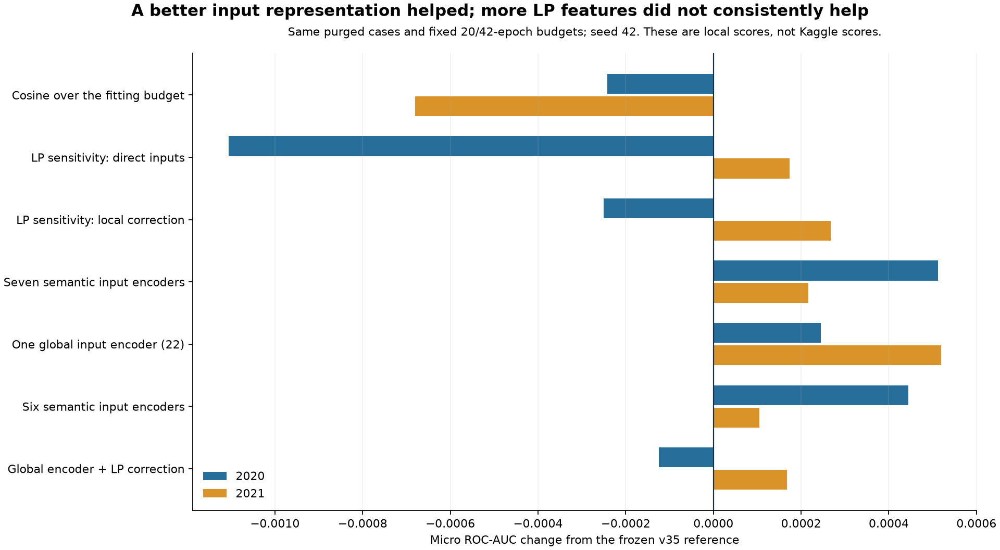
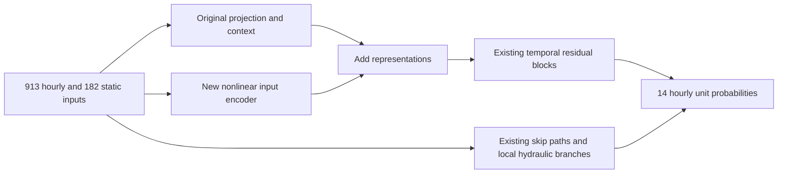
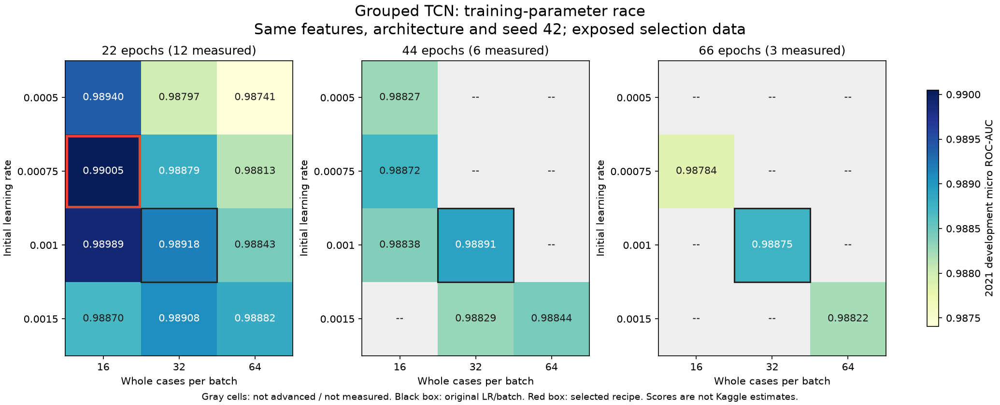

# Experiment record

For the short round-by-round explanation of features, motivation and results,
read [Development journey](development_summary.md).

For year-shift EDA, partition audits and the subsequent trained LOYO diagnostic, see
[Validation years](validation_years.md), including the subsequent trained fixed-recipe LOYO diagnostic.

The complete original 5,246-line chronology is preserved in
[experiments_history.md](experiments_history.md). This file is the concise current
index; the history retains the original narrative, including obsolete entry points
and superseded decisions. Use this index and the active notebook for current settings.

## Current decision

Use `sequence_model.ipynb` for the **standalone TCN with 6-hour allocation
features** (`terminal_resolution_6h`, v35). It produces one probability for
each of 14 units and 168 planning hours. There is no ensemble.

- Best user-reported TCN public score: **0.99334**, tuned grouped alternative in
  `analysis/tcn_tuned_alternative_20261029.ipynb`; tuned main scored **0.99333**.
- October 30 local study: retain that scored alternative's LR .0005 / batch 8 /
  22 epochs / cosine denominator 100. No tested replacement passed the full
  decision checks; see [the dense study](tcn_local_parameters_20261030.md).
- Preserved v35 reference public score: **0.99261**; the following configuration
  and development values describe that unchanged reference.
- Development micro ROC-AUC: **0.9809209327 (2020)** and **0.9892533563 (2021)**.
- One network, **343,034 parameters**, **913 hourly and 182 static channels**.
- Final fit: **22 epochs on all 2,922 labeled 2015–2022 cases**.
- Known submission: `outputs/tcn_candidates_20261027_resolution/terminal_resolution_6h_submission.csv`.
- Submission SHA256: `7afc5ebf0daffd0a482b668f18b19bbd70f7ffe151c49f4b2db3e3c2e2231ede`.

Public scores below were reported by the user, not independently retrieved.
Private performance is unknown. The target above 0.99350 is aspirational;
no fixed ROC-AUC threshold establishes an A grade.

## October 28: test how the network represents the existing features

The scored v35 notebook above is preserved. A bounded new round tests whether
the existing physical/economic inputs need better nonlinear mixing before the
temporal convolutions. Two standalone candidates, frozen before public feedback, are in
[the primary notebook](../analysis/tcn_candidate_20261028.ipynb) and
[the alternative notebook](../analysis/tcn_alternative_20261028.ipynb).
Each fits one shared network; these are separate submissions, not an ensemble.

### Public feedback reported October 29

| Recipe | User-reported public AUC | Difference from v35 |
|---|---:|---:|
| v35 reference | .99261 | Reference |
| Grouped semantic encoders | **.99271** | **+.00010** |
| Global encoder | .99264 | +.00003 |

The grouped candidate leads the global candidate by .00007. This is consistent
with its stronger locked seed17/2022 diagnostics, but the small public differences
do not establish private superiority or isolate a causal benefit of grouping.
The remaining gap to .99350 is .00079. Scores are user reports, not independently
retrieved results. The public/private partition and private scores remain unknown.
The original notebooks and their CSV hashes are preserved; their pre-feedback
"unscored" prose records the state at freezing. No model was fitted for this update.

### Matched development comparisons

All rows use the same purged chronological cases, fitting-only preprocessing,
seed 42 and inherited 20/42-epoch budgets. The 2020/2021 fitting/scoring counts
are 1,820/360 and 2,186/359. Raw-input hashes, versions and exact case IDs were
checked against the reference. The mean gives the two years equal weight; it
is a selection summary, not the official pooled Kaggle metric.

| Trial | 2020 micro AUC | 2021 micro AUC | Decision |
|---|---:|---:|---|
| Existing v35, 6-hour LP | .980920933 | .989253356 | Scored reference |
| Fit-budget cosine schedule | .980679240 | .988573504 | Worse in both years; retain the original schedule |
| Add 54 LP sensitivity channels | .979814916 | .989426721 | Annual tradeoff; do not retain |
| Seven semantic input encoders, width 16 | .981433309 | .989470418 | Improve both years; alternative |
| Isolated local heads for the 54 channels | .980670860 | .989521042 | Nearly tied mean, loses 2020 |
| One global input encoder, width 22 | .981165623 | .989772729 | Improve both years; primary |
| Semantic encoder with its extra economics path removed | .981364976 | .989358244 | Loses both years against its parent |
| Global encoder plus isolated sensitivity heads | .980796032 | .989420582 | Loses both years against its parent |

The global and semantic encoders differ in equal-year mean by only **.0000173**.
Their annual tradeoff supports retaining an alternative; it does not establish
one as generally superior. An additional curve-bounded LP prototype passed
all 3,647 case solves without artificial storage slack but was **not fitted**:
its prospective fallback condition was not met. No AUC belongs to that prototype.

At seed 42, the global encoder improves per-unit AUC for 11/14 units in 2020
and 14/14 in 2021; the semantic encoder improves 12/14 and 8/14. These are
diagnostics, not the official objective. In particular, per-unit AUC changes
cannot be averaged to recover micro AUC, which includes cross-unit rankings.

### What changed, and why

Both retained candidates keep the exact **913 hourly / 182 static** inputs in
[the feature inventory](tcn_features.csv), including all topology-derived LP,
river, hydraulic and binary-persistence context. The new component is a small
nonlinear residual input encoder, running in parallel with the original linear
input projection and adding its output before the temporal blocks. All existing
skip paths and nine local hydraulic branches remain jointly trainable.

The primary uses one width-22 encoder over all input coordinates (**368,662
parameters**). The alternative uses seven width-16 encoders for allocation,
calendar, economics, persistence, physics, rivers and water (**368,506
parameters**). Width 22 was calculated to approximately match the semantic
extension's parameter count: 25,628 versus 25,472 added parameters. It was not
chosen from a broad width grid. Zero-initialized final layers and isolated RNG
construction preserve the reference's initial logits, common weights and
post-construction RNG state exactly. Those comparisons passed against the actual
v35 implementation. Additional capacity and grouping remain bundled hypotheses;
the experiment does not prove that grouping is intrinsically necessary.

The alternative's groups partition the existing input coordinates exactly once:

| Encoder group | Hourly coordinates | Static coordinates |
|---|---:|---:|
| Allocation | 125 | 9 |
| Calendar | 11 | 0 |
| Economics | 202 | 48 |
| Persistence | 108 | 0 |
| Physics | 153 | 0 |
| Rivers | 141 | 36 |
| Water | 173 | 89 |
| **Total** | **913** | **182** |

This is a named-input design choice, not a learned causal partition. The primary
instead exposes all 1,095 coordinates together to its single extra encoder.

The rejected LP sensitivity extension re-solved each six-hour allocation with
terminal-value multipliers .9 and 1.1. Per plant it described changes in dispatch,
dispatch span, an activity vote and changes in intake storage. Its 54 new channels
increased the hourly input count to 967. Original 913/182 values were unchanged;
an identity-multiplier check returned zero changes, and conservation/slack audits
passed. These are approximate optimizer responses, not observed future storage.
Feasible feature construction alone did not establish predictive improvement.

A conditional path-removal diagnostic on the fitted semantic encoder improved
both years when its extra economics path was zeroed. A predeclared fresh-refit
follow-up nevertheless lost against the complete semantic model in both years.
Raw economics remained available throughout. This demonstrates why inference-time
path removal is conditional sensitivity, not causal feature importance or a
guarantee that retraining without the path will help.

### Fixed choices, uncertainty and selection exposure

BCE/AdamW, learning rate .001, weight decay .0001, dropout .1, batch 32, gradient
clip 1 and four neural CPU threads remain inherited settings. The cosine
denominator remains 100; the matched control that completed the schedule within
each fit lost both years. Final fitting remains 22 epochs, fixed before this
round and **not newly selected for the encoders**. Seed 17 and exposed-2022
comparisons are diagnostics; they do not select final seeds or epoch counts.

The inherited 2022 diagnostic fits 2,551 cases and scores all 365 daily starts
in 2022, so its final planning horizons extend into early January 2023. The
2020/2021 development periods instead trim starts whose horizons cross their
calendar-year end. Within each comparison the exact cases are matched; these
different scoring-period definitions should not be hidden when comparing years.

The two recipes were locked at **03:40:51 UTC on October 28**, before new 2022
results. Repeated use of 2020/2021 and prior project exposure of 2022 still apply.
Circular case-block resampling (128 replicates; 7, 14 and 28 days) on fixed
seed-42 predictions gave positive equal-year-mean 2.5th percentiles against v35
for both retained encoders. Direct primary-versus-alternative intervals included
zero at all three block sizes. These conditional resampling ranges do **not**
cover training-seed, model-selection or private-leaderboard uncertainty.

The locked additional-initialization and exposed-2022 comparisons all completed:

| Recipe | 2020, seed 17 | 2021, seed 17 | Exposed 2022, seed 42 |
|---|---:|---:|---:|
| v35 reference | .980640964 | .989788417 | .989252559 |
| Global encoder, locked primary | .980542873 | .989600511 | .989334884 |
| Semantic encoders, locked alternative | .980881975 | .990207193 | .989619034 |

The global extension loses both years at seed 17: its seed-42 improvement is
not stable across these two initializations. The semantic extension improves
both years at both seeds and improves exposed 2022 by **+.0003665**. It therefore
has more consistent diagnostic support than the locked primary. Two seeds and
previously exposed years are still limited evidence. The primary/alternative
names record the earlier selection, not universal superiority. Final source
settings remain locked; no post-diagnostic seed or epoch tuning is performed.
These results justify experimental submissions, not a private-score guarantee.
For interpretation only, the semantic encoder improves all four 2022 start-season
subsets, with its largest difference on summer starts (.985291542 versus
.983810141). The global encoder loses the winter subset. These conditional
subsets overlap in absolute forecast hours; they are not independent replications,
and their AUCs must not be averaged to reconstruct the full micro AUC.

### Completed raw-input reproduction

Each exported candidate was fitted twice in fresh processes from the supplied raw
resources, with pretrained loading blocked and no feature-cache loading. Each
pair produced identical CSV bytes. These are deterministic reproduction checks,
not additional seeds or independent quality tests. All fits use one network,
22 epochs, all 2,922 labeled cases and 725 prediction cases.

| Recipe | Raw seconds, run 1 / 2 | Peak main-process RSS, GiB | CSV |
|---|---:|---:|---|
| `global_encoder22_6h` | 494.75 / 490.43 | 9.11 / 9.12 | `outputs/tcn_submission_20261028.csv` |
| `typed_encoder6h` | 509.40 / 506.92 | 9.11 / 9.11 | `outputs/tcn_alternative_20261028.csv` |

Every raw run solved all 3,647 case LPs without artificial storage slack; maximum
balance residual was below 1.6e-13. Output checks require the exact 725 x 2353
template schema, IDs/order, finite probabilities in [0,1], all fitting/prediction
case IDs, actual model counts, frozen raw hashes and package versions. The
retained non-fitting pipeline check passed for the original and both new
notebooks. Runtime includes input processing, fitting and export in this
environment. LP precomputation uses up to four thread workers within the same
process; RSS includes these workers but is not whole-system RAM.
These are measurements, not guarantees for another PC.

- `global_encoder22_6h` CSV SHA256: `ab2f6e8c54657a9f238e55b74f8ca9359c01ccc7a0379188d5e96c92ee014e4b`.
- `typed_encoder6h` CSV SHA256: `b0ac7be382412d661c461ef4a2944f16e32d9f83bebe5b02f0f68b74bb82b04a`.

`deliverables.json` and `final_integrity.json` in the round evidence directory
identify exact source/implementation hashes and verified aliases. The original
.99261 source and CSV remain preserved. No Kaggle upload or score retrieval
was performed; .99350 is not established by these local results.

Native evidence is in
`outputs/tcn_development/20261028T015909Z_regime_learning/`: matched scores and
per-unit comparisons, initialization checks, LP audits, conditional path removal,
block resampling, the timestamped selection lock and frozen configurations.
Final raw-input refit and diagnostic results are recorded with their own sources
and hashes. `leaderboard_feedback_20261029.json` records the subsequent user reports
against the verified CSV hashes; private performance remains unknown.

## October 29: bounded grouped-TCN training-parameter search

This authorized round keeps the .99271 grouped model's architecture and exact
913/182 feature inventory fixed. It tests the previously inherited training
settings instead of adding further physical inputs. Existing sources and CSVs
remain preserved. Search evidence is under
`outputs/tcn_development/20261029T000528Z_hyperparameters/`.

The planned small grid crosses learning rates **.0005/.00075/.001/.0015** with
batch sizes **16/32/64 whole planning cases**. Cosine denominator 100, floor .1,
dropout .1, weight decay .0001, gradient clip 1, BCE/AdamW, seed 42 and four neural
threads are fixed. Duration is searched at **22/44/66 epochs**. A batch contains
complete 168-hour cases, not independent hourly observations; changing its size
also changes optimizer steps and effective regularization per epoch.

Budget allocation is a protected successive-halving-style race: 12 candidates
reach 22 epochs; 6 reach 44; 3 reach 66. At the first cut the reference and the best
candidate at each learning rate are protected, then remaining slots follow 2021
micro AUC. At the second cut the reference and two highest-scoring other
candidates continue. This reduces early preference for fast-learning settings,
but does not guarantee recovery of every late-improving candidate. Epochs from
earlier rungs remain eligible: longer training does not automatically win.
Resource allocation is inspired by [Li et al.,2018](https://jmlr.org/papers/v18/16-558.html);
this fixed-grid/protected procedure is not a full Hyperband implementation.

Normalized arrays are reused **within one fold**, with scaling fitted only on
that fold's fitting cases. Each newly initialized trial retains its own optimizer,
shuffle RNG and dropout RNG between rungs. A small two-epoch proof matched the
original trainer's weights and predictions bitwise after interrupted/resumed
training for batch 16/seed 42 and batch 32/seed 17. These are implementation checks,
not model-quality or seed-stability measurements. Final notebooks fit fresh from
raw inputs and do not read the research caches or saved trial weights.

2021 is the primary search period. Two distinct shortlisted recipes receive
matched 2020/2022 controls against a **fresh 22-epoch reference** where time permits;
seed 17 checks are prospectively time-gated. New controls trim all horizons to
their scoring year: 2020 has 360 starts, 2021 has 359, and 2022 has 359. Fitting counts
remain 1820/2186/2551. Thus the old 20/42-epoch development values and 365-start 2022
scores are not matched controls for this search. All years already have exposure.

Final ranking prefers complete three-year recipes improving at least two years
and positive equal-year-mean improvement. Selection rules, thresholds, deadlines
and individual results are recorded in `plan.json` and the timestamped locks.
The seed remains 42; public feedback does not select new settings. New portable
sources must generate their own frozen dictionaries and strict signatures.
Their validation budgets match the selected final duration, replacing the old
20/42 outer / 22 final convention for these sources only.

After the longer coarse fits lost 2021 development AUC, a conditional local
refinement was specified before any refinement fit. If the batch-16/22-epoch
winner finished its coarse controls with sufficient export-time margin, the
additional LR/batch pairs were (.000375,8),(.0005,8),(.0006,16),(.0009,16).
They are scored at 11/22 epochs, with a possible extension of the best 22-epoch
recipe to 33. This brackets the short winner and checks the lower batch boundary.
Only durations with complete matched temporal controls may join final selection.
This is adaptive exploration, not a claim that the whole search was preregistered.
The refinement has its own soft cutoff; the original four-hour authorization
and hard fitting cutoff remain unchanged. A prospectively time-gated, fixed
post-freeze seed check may use leftover time, without changing any export.

A non-fitting prototype check caught the old function's reserved 2022 boundary.
The corrected protocol permits an explicit 2023-01-01 exclusive boundary and
retains all original purge/coverage checks; its retained orchestration check
passed. Fabricated .5 values in the protocol fixture are **not** model scores or
selection inputs. Completed candidate performance and final artifacts are recorded below;
.99350 remains an unverified public target.

### Completed search results

All AUCs in the following race tables use the same exposed 2021 scoring cases and seed 42. Missing values were not measured, not imputed.

| Initial LR | Batch | 22 epochs | 44 epochs | 66 epochs |
|---|---:|---:|---:|---:|
| 0.0005 | 16 | 0.989398904 | 0.988268135 | -- |
| 0.0005 | 32 | 0.987969739 | -- | -- |
| 0.0005 | 64 | 0.987407878 | -- | -- |
| 0.00075 | 16 | 0.990047406 | 0.988720243 | 0.987836876 |
| 0.00075 | 32 | 0.988793196 | -- | -- |
| 0.00075 | 64 | 0.988134772 | -- | -- |
| 0.001 | 16 | 0.989893732 | 0.988378737 | -- |
| 0.001 | 32 | 0.989177380 | 0.988905526 | 0.988754156 |
| 0.001 | 64 | 0.988430894 | -- | -- |
| 0.0015 | 16 | 0.988695729 | -- | -- |
| 0.0015 | 32 | 0.989077451 | 0.988289702 | -- |
| 0.0015 | 64 | 0.988824209 | 0.988438536 | 0.988219500 |

The conditional local refinement completed the following checkpoints:

| Initial LR | Batch | 11 epochs | 22 epochs | 33 epochs |
|---|---:|---:|---:|---:|
| 0.000375 | 8 | 0.988000577 | 0.989540417 | -- |
| 0.0005 | 8 | 0.988065074 | 0.990057626 | 0.988538125 |
| 0.0006 | 16 | 0.988091238 | 0.989736238 | -- |
| 0.0009 | 16 | 0.988087641 | 0.989952736 | -- |

Longer coarse training did not beat the strongest 22-epoch 2021 result. Falling training loss alone did not justify more epochs. Reference loss/learning-rate prefixes matched the original full-fold trajectory exactly through 22 and then 42 epochs, including continuation after other candidates.

The initial 22-epoch checkpoint came from the inherited final training budget;
22/44/66 then formed the coarse resource rungs. It has no physical significance
and was not found by testing every epoch. For the final main LR/batch recipe,
22 beat the measured 44/66 checkpoints; for the alternative, 22 beat 11/33.
This supports 22 among the tested budgets, not an exact optimum: nearby values
such as 20, 21, 23 or 24 were not compared for these selected recipes. A lower
training loss at later epochs did not imply higher held-out micro AUC. The same
selected epoch count was used for final all-case fitting, with the unchanged
cosine denominator 100; this is a transfer rule, not a separately validated
optimum for the larger fitting set.

2021 was the initial screening year, not the only validation year. For the
final batch-8/.0005 alternative, all three 11/22/33 budgets were subsequently
scored on 2020 and 2022 as well; 22 had the highest AUC in each of those years
too. These exposed controls participated in selection. The later eight-year
LOYO round held 22 fixed and did not search for a new best epoch per fold.

Local refinement settings outside the original grid are listed in the separate table.

### Selected artifacts and matched controls

| Recipe | LR | Batch | Epochs | 2020 | 2021 | 2022 |
|---|---:|---:|---:|---:|---:|---:|
| Reference recipe | .001 | 32 | 22 | 0.980174788 | 0.989177380 | 0.989507516 |
| `candidate` | 0.00075 | 16 | 22 | 0.980650427 | 0.990047406 | 0.990271590 |
| `alternative` | 0.0005 | 8 | 22 | 0.980729514 | 0.990057626 | 0.990136901 |

These compare complete training recipes with a matched 22-epoch baseline. They do not claim superiority at every possible stopping epoch. The grouped parent's historical 20/42-epoch scores were .981433309/.989470418; its 20-epoch 2020 result exceeds the new 22-epoch baseline. Therefore a gain against the matched baseline must not be presented as beating every historical result. The 2021 race proposes checkpoints; final ranking also uses the repeatedly exposed 2020/2022 controls. All years have selection exposure. Seed17 findings are recorded separately, never used to select final seed42.

| Recipe/year | Units with higher AUC | Units with lower AUC | Micro AUC change | Within-unit pair contribution change | Cross-unit pair contribution change |
|---|---:|---:|---:|---:|---:|
| `candidate` / 2020 | 4/14 | 10/14 | +0.000475639 | -0.000010774 | +0.000486413 |
| `candidate` / 2021 | 10/14 | 4/14 | +0.000870026 | +0.000055828 | +0.000814198 |
| `candidate` / 2022 | 11/14 | 3/14 | +0.000764074 | +0.000079217 | +0.000684857 |
| `alternative` / 2020 | 4/14 | 10/14 | +0.000554726 | -0.000035662 | +0.000590388 |
| `alternative` / 2021 | 7/14 | 7/14 | +0.000880246 | +0.000047250 | +0.000832996 |
| `alternative` / 2022 | 11/14 | 3/14 | +0.000629385 | +0.000044562 | +0.000584822 |

These are post-selection diagnostics. Per-unit AUC means do not recover the official micro AUC. Positive/negative pair contributions give an exact decomposition: the within-unit change is `sum(P_g * N_g * delta_AUC_g) / (P * N)`, using the common observed class counts; the cross-unit change is the remaining micro-AUC change. This describes which comparison pairs changed, not a causal explanation or evidence of private generalization.

For the main candidate on 2020, the within-unit contribution decreases slightly: the aggregate micro gain comes from cross-unit rankings. This must not be described as uniformly improving the individual generators.

| 2021 seed17 recipe | Epochs | Micro AUC |
|---|---:|---:|
| `reference22_seed17` | 22 | 0.988702190 |
| `lr0.00075_b16_seed17` | 22 | 0.989657166 |
| `lr0.001_b16_seed17` | 22 | 0.989246591 |

Locked post-freeze diagnostic status: `complete` for `alternative`. Candidate AUC 0.989836348, matched reference 0.988702190. This diagnostic cannot change frozen parameters, final seed or CSVs. A notebook's seed paragraph describes evidence available at source freezing; later results are recorded here without modifying its source/hash. Two seeds remain limited evidence and do not cover selection uncertainty or private performance.

| Artifact | Fresh raw seconds | Peak main-process RSS GiB | Actual AdamW updates |
|---|---:|---:|---:|
| `outputs/tcn_tuned_20261029.csv` | 560.26 | 9.11 | 4026 |
| `outputs/tcn_tuned_alternative_20261029.csv` | 631.82 | 9.11 | 8052 |

Each source performed **one** fresh raw-input fit on all 2,922 cases and predicted 725 cases, with weight loading blocked. No two-refit CSV-reproduction claim belongs to this round. Full schema, IDs, probability bounds, hashes/versions, one-network count, parameter count and actual optimizer updates passed final integrity checks. Every raw run solved all 3,647 LPs without artificial storage slack. RSS includes the in-process LP worker threads but is not whole-system RAM; research timings are not controlled hardware benchmarks.

- `candidate` source: `analysis/tcn_tuned_20261029.ipynb`; CSV SHA256 `c9b507693edc5865a792c638d40f1ab56ce14ef5023da0c54660ee6f81973795`.
- `alternative` source: `analysis/tcn_tuned_alternative_20261029.ipynb`; CSV SHA256 `84a83f1df1206acfbb69b32c9ec831e4b12fa7c6c64affd9ac1bcac88613c693`.

The first non-fitting fixture caught the old reserved-2022 endpoint guard. The initial already-loaded research process later reached that guard after valid 2020 fits; the continuation preserved those results and ran correctly trimmed 2022 controls. No invalid 2022 score entered selection, no completed fit was repeated for this correction, and the corrected retained protocol check passed. Individual incomplete/skipped stages and source signatures are preserved in the round evidence.

No Kaggle upload, dependency installation, ensemble, commit or push occurred during the research round. Scores were unknown at export freezing. The .99271 grouped reference, v35, XGBoost sources, requirements and complete 5,246-line chronology are unchanged.

### Subsequent user-reported public scores

| Export | Public AUC | Change from grouped parent .99271 |
|---|---:|---:|
| Main: LR .00075 / batch 16 / 22 epochs | .99333 | +.00062 |
| Alternative: LR .0005 / batch 8 / 22 epochs | **.99334** | +.00063 |

These scores were supplied by the user after the frozen exports, not retrieved
independently. The .00001 public difference does not establish private
superiority. Private scores remain unknown; the target above .99350 has not
been reached by either reported score. The original source notebooks and CSVs
remain unchanged, including their prose recording the unscored state at freezing.
No model was fitted for this feedback update.

## October 29: fixed-recipe LOYO diagnostic

The user requested eight cold LOYO fits of the unchanged .99334 public alternative: LR .0005, batch 8, 22 epochs, seed 42, one shared network and the same 913 hourly/182 static features. No tuning, stopping on the held year, ensemble or new submission was performed. All fitting horizons were purged against the held-out calendar year, and each scaler was fitted on its own fitting partition.

| Held-out year | Fitting cases | Scoring cases | Micro AUC |
|---|---:|---:|---:|
| 2015 | 2557 | 359 | 0.989841487 |
| 2016 | 2550 | 360 | 0.992877718 |
| 2017 | 2551 | 359 | 0.991587756 |
| 2018 | 2551 | 359 | 0.986328212 |
| 2019 | 2551 | 359 | 0.991616129 |
| 2020 | 2550 | 360 | 0.979700929 |
| 2021 | 2551 | 359 | 0.993012253 |
| 2022 | 2551 | 359 | 0.990136901 |

Equal-year mean **0.989387673**; worst year **2020**, **0.979700929**. Pooled OOF micro AUC **0.989793683** on 2,874 cases also compares probability scales across fitted fold models, and is not the mean annual AUC or a private-score estimate.

[The full LOYO report](validation_years.md#trained-loyo-diagnostic-on-the-99334-public-recipe) contains annual/per-unit plots, same-case forward comparisons, horizon checks and limitations. 2022 reproduces the existing forward probabilities bitwise, since no later labeled year exists. Earlier LOYO folds add future observations and more fitting data. All years have project exposure; these are diagnostics rather than independent future confirmation.

Combined active-window time **112.14 minutes**, excluding the user pause; peak process RSS **8.20 GiB**, four neural threads. The initial non-fitting count audit was corrected for two unlabeled source-schema probes; its failed log/source are preserved. The user pause retained completed 2022 by hash, and an explicit resume cold-started only seven remaining years after archiving the partial five-epoch 2020 fit. All eight completed fixed fits, update counts, official annual/pooled metrics and original hashes passed final integrity. Evidence is indexed by `outputs/tcn_loyo/latest.json`; original model notebooks/submissions remain unchanged.

## October 30: dense local training-parameter study

The authorized four-hour study completed 20 primary cold trajectories and six
diagnostic trajectories, excluding small functional proofs: **71 distinct
LR/batch/schedule/epoch recipes**, each scored on matched forward 2020/2021
cases, with **158 unique saved checkpoint scores** independently audited.
Features (913 hourly/182 static), one 368,506-parameter network, fitting-only
normalization and original update code remained fixed. All years are exposed.

The first grid used LR/batch (.0005,8),(.0004,8),(.0006,8),(.000625,16) and
epochs 16/18/20/22/24/26/28. A conditional fine stage used
(.0005,8),(.00045,8),(.00055,8),(.00025,4) at every epoch 18-26. The 25-epoch
reference peaked at .981599354 on 2020 but fell to .988979922 on 2021.
The dense-stage winner was LR .00025 / batch 4 / 22 epochs:

| Year/check | Existing .99334 recipe | Batch-4 proposal |
|---|---:|---:|
| Forward 2020, seed 42 | .980729514 | .980747816 |
| Forward 2021, seed 42 | .990057626 | .990309033 |
| Exposed 2022, seed 42 | .990136901 | .990656324 |
| Matched 2021, seed 17 | .989836348 | .989305079 |

Despite three seed-42 gains, the fixed seed-stability gate rejected that proposal.
A separately declared decay stage held initial LR .0005/batch 8 fixed and tested
cosine denominators 30/40 against 100 at epochs 18/20/22/24/26/28. An overly strict
gate initially compared with the unsupported fine-stage peak. A **post-screen
amendment**, declared before the new-recipe diagnostic scores, corrected
eligibility to the actually supported incumbent without changing the already
locked denominator-40/22-epoch proposal. This is adaptive development, not a
preregistered or independent confirmation. The original gate decision survives.

That proposal's deltas versus the incumbent were +.000246568 / -.000182727 /
-.000134069 on 2020/2021/2022 (mean **-.000023409**), and -.000029945 on the
matched 2021 seed-17 check. It was also rejected. No new all-data fit, model
notebook, Kaggle submission, install, ensemble, upload, commit or push followed.
The best reported public score remains .99334; private performance is unknown.

[The complete study](tcn_local_parameters_20261030.md) contains both curve figures,
resource costs, per-unit comparisons and limitations. Native plan revisions,
source/data identities, all scalers/partitions/predictions, interrupted helper
evidence and final integrity checks are under
`outputs/tcn_development/20261030T000742Z_local_parameters/`. No old model,
submission, environment or 5,246-line history was overwritten. The retained
check now chooses an invalid epoch relative to the actual selected duration,
so a legitimate future 23-epoch recipe is not mistaken for a failed guard test;
the original canonical check passed with optimizer updates blocked.

## How to read the evidence

This is a retrospective summary, not a claim that the complete search was
preregistered. Earlier public feedback influenced subsequent starting references.
Within the later rounds, candidate selection used local chronological results;
reported public feedback arrived after the respective frozen exports.

The original detailed log, old notebooks and earlier instructions are preserved
in the verified local cleanup archive identified by `outputs/cleanup/latest.json`.
Native experiment evidence and all submissions remain under `outputs/`.
These ignored local files are not pushed to Git and are not runtime dependencies.
The summary here retains the decisions, numerical results and unsuccessful trials
needed to write the report.

## Data and evaluation protocol

A case starts at midnight UTC and covers 168 hours. Adjacent daily cases overlap.
The 2,922 labeled cases start in 2015–2022. The 725 test cases start on
2023-01-01 through 2024-12-25. The public/private partition is not established;
do not equate 2023 with public and 2024 with private.

For start S use storage at S, price/inflow/constraints during [S, S+168h), and
terminal water values at S+168h. Future observed storage and optimizer calculation
time are excluded. Timestamp joins use named objects and UTC.

The official score is micro ROC-AUC over all case/unit/hour entries, including
cross-unit ranking. It is not accuracy or the average of unit-specific AUCs.
Cases are split before expansion. Training horizons must end by the scoring
start: training_start + 168h <= scoring_start. Preprocessing learns only from
fitting cases. Millions of overlapping binary labels are not independent samples.

| Scoring year | Fitting cases | Scoring cases | Fixed outer epochs in unchanged v35 |
|---|---:|---:|---:|
| 2020 | 1,820 | 360 | 20 |
| 2021 | 2,186 | 359 | 42 |

The unchanged v35 6-hour recipe reuses earlier v32 duration choices: 20/42 outer
budgets and 22 final epochs. Its `validate` mode fits two models without new
inner stopping; `freeze` records the existing 22-epoch budget without fitting.
These fixed-budget comparisons do not establish each recipe's separately tuned
optimum. Earlier experiments used inner stopping on 2019/2020 and fresh outer
refits. The development years have repeated exposure. **2022 also has prior
project exposure** and is not an untouched confirmation set. It is included in
final submission training. No new 2022 scoring selected the 6-hour model or the
later curve-bound control.

The October 29 tuned notebooks instead use 22 epochs on each validation fold
and for the final fit. Their calendar-bounded 2022 diagnostic has 359 starts;
the older optional v35 diagnostic retained 365. The newer 2022 controls were
used in ranking exposed candidate recipes, as documented above.

## Main development path

| TCN stage | 2020 AUC | 2021 AUC | User-reported public AUC | Interpretation |
|---|---:|---:|---:|---|
| Dense river features | .9749072383 | .9841080911 | .98895 | Useful hydraulic/river reference |
| Binary transition-cost scenarios (v8) | .9763825881 | .9842951006 | .98966 | Improved both local years |
| Quantity/count descriptors | .9781826445 | .9853343721 | .98875 | Local gains did not transfer to reported public score |
| Energy/count descriptors | .9777192732 | .9857195687 | .98928 | Alternative annual tradeoff |
| Graph input routing | .9786063608 | .9876630481 | .99159 | Better local scores than local-only control |
| Local plant routing | .9782461670 | .9862995905 | .99176 | Public ordering reversed the local comparison |
| Local hydraulic context (v22) | .9788354325 | .9879521391 | .99197 | Adjacent reservoir/river/tunnel inputs routed locally |
| Initial-head best-point terminal conversion (v32) | .9806587999 | .9891596511 | .99240 | Large improvement on both development years |
| **6-hour allocation (v35)** | **.9809209327** | **.9892533563** | **.99261** | **Current reference** |
| Curve-bound operating descriptors | .9809822430 | .9892376461 | .99254 | Tiny mean gain, one-year regression; not promoted |

These are feature-pipeline comparisons. Inputs and sometimes frontend capacity
change, so the table does not isolate causal architectural effects. The
public ordering of graph/local and count variants is a reason to avoid choosing
models from public feedback alone.

### Why the 6-hour interval was kept

The original 12-hour LP interval was a computational approximation, not a
physical time constant. Retesting with the v32 terminal conversion gave:

| LP interval | 2020 AUC | 2021 AUC | Equal-year mean |
|---|---:|---:|---:|
| 12 hours | .9806587999 | .9891596511 | .9849092255 |
| **6 hours** | **.9809209327** | **.9892533563** | **.9850871445** |
| 1 hour | .9804206958 | .9891709601 | .9847958279 |

Network, input dimensions, seed and training budgets were held fixed. Six hours
won both years. All 2,547 required/probe LP cases solved. Hourly LPs nevertheless
needed up to 29.1601 million m3 of artificial storage slack; solver success does
not imply physical feasibility. Six-hour cases had zero artificial storage
slack. The TCN still consumes and predicts **all 168 individual hours**.

### Topology and physical features

The supplied network has 17 reservoirs, 9 plants, 14 units, 37 rivers and 5 tunnels.
A conservative-flow LP uses the named directed connections to couple releases,
reservoir storage and downstream opportunities. It supplies allocation, projected
storage and dual sensitivities. The model routes adjacent reservoir, tunnel,
river and economic descriptors into nine local plant encoders, alongside a
shared temporal encoder. The selected recipe has **no neural graph-message
passing and no learned reservoir-ID embedding table**.

Terminal local EUR/MWh values are converted using a 33-point best-operating-point
proxy at initial head and preferred generating/main-waterway routes. Receiving
reservoir values are added downstream. This was useful empirically but remains
an approximation to SHOP. Full tunnel-pressure balance, changing-head optimization,
spill behavior and binary commitment are not solved exactly.

The 54 binary DP features are 9 plants x 3 relative transition-cost scales x
2 initial-state assumptions. They describe persistence opportunities, not feasible
unit schedules or exact currency-converted startup profits.

## Other predictor types

XGBoost is Jonas's active tree-model direction; the user's active model is TCN.
Earlier CatBoost, LightGBM and blends are historical comparisons, not required
for running the selected TCN. Their notebooks are archived locally.

| Pipeline | 2020 micro AUC | 2021 micro AUC |
|---|---:|---:|
| CatBoost decision RSM | .9678485591 | .9827461050 |
| Neutral LightGBM | .9643583 | .9833711 |
| Earlier wide temporal CNN | .95586145 | .96460585 |
| Original frozen three-family blend | .9731119557 | .9853425654 |
| Later 35/30/35 development-selected blend | .9735356938 | .9856353219 |
| XGBoost decision reference, 216 features | .9632372220 | .9827852977 |
| XGBoost topology descriptors, 279 features | .9625373539 | .9823556500 |
| XGBoost topology + allocation, 298 features | .9829521212 | .9879182383 |

Topology descriptors alone lost both years in XGBoost; allocation features helped.
The user's .98877 score belongs to `three_model_submission.csv`, not to the
later selected pure XGBoost CSV. No public score is recorded for that pure CSV.
The original blend's .9837118366 confirmation on previously exposed 2022 belongs
to the original frozen blend, not the later 35/30/35 weights.

## Unsuccessful, partial and unfitted experiments

- Fourteen independent TCNs: .9745214599/.9815896016, below the contemporary shared
  river reference .9749072383/.9841080911. Independent models filled separate
  columns; they were not averaged.
- Wider/global/local-history, auxiliary count loss, pair loss, loading, water
  windows, pressure and buffer features were not consistently beneficial. The
  complete measured records appear in the table below.
- Best-point-only and local-temporal controls in the v32 round were checked but
  not fitted before its time gate. No negative scores are inferred for them.
- In the latest round, direct augmentation with 63 legal-range descriptors
  completed 2020 at .9799966525; its 2021 fit was abandoned. It has no completed
  two-year mean. The curve-limited LP prototype was checked, never fitted.
- A neutral curve-only correction preserved initial baseline parameters,
  outputs and RNG exactly, yet scored .9809258249/.9890665743. Mathematical
  consistency and controlled initialization did not guarantee better AUC.

The latest round produced no candidate improving both development years. A
separate **post-hoc exploratory export** selected the mean-positive curve-bound
control: +.0000613103 in 2020 and -.0000157101 in 2021, mean +.0000228001.
Its user-reported public score .99254 is .00007 below the .99261 reference.
The reference remains unchanged. Paired 128-replicate case-block intervals for
the mean difference include zero: 7-day [-.000217464, +.000268637],
28-day [-.000398131, +.000325543]. These exposed-year, fixed-prediction diagnostics
are not independent confirmation, training-seed uncertainty or private evidence.

## Completed twofold TCN trial inventory

Rows below come from completed local JSON reports. Scores are micro AUC for
2020/2021, not Kaggle scores. Repeated rows from different feature generations
are not interchangeable. Numerical precision supports matching source records,
not a claim that tiny differences are meaningful.

| Round | Recipe | 2020 | 2021 |
|---|---|---:|---:|
| 20261022T005535Z_specialization | `river_1h` | 0.9739198509 | 0.9824438151 |
| 20261022T005535Z_specialization | `river_6h` | 0.9751435010 | 0.9837498326 |
| 20261022T005535Z_specialization | `river_commitment_dp` | 0.9763825881 | 0.9842951006 |
| 20261022T005535Z_specialization | `river_dispatch` | 0.9765040808 | 0.9827344389 |
| 20261022T005535Z_specialization | `river_heads` | 0.9707177514 | 0.9766748976 |
| 20261022T005535Z_specialization | `river_multiscale6` | 0.9753724783 | 0.9840399946 |
| 20261022T230854Z_refinement | `commitment_auxcount` | 0.9768418007 | 0.9810702188 |
| 20261022T230854Z_refinement | `commitment_counts` | 0.9781826445 | 0.9853343721 |
| 20261022T230854Z_refinement | `commitment_energy` | 0.9777192732 | 0.9857195687 |
| 20261022T230854Z_refinement | `commitment_rank` | 0.9760776049 | 0.9840488446 |
| 20261022T230854Z_refinement | `commitment_sensitivity` | 0.9757406783 | 0.9847173124 |
| 20261022T230854Z_refinement | `commitment_wide` | 0.9758677242 | 0.9857489299 |
| 20261024T235757Z_direct_search | `river_global16` | 0.9774359998 | 0.9848958063 |
| 20261024T235757Z_direct_search | `river_graph16` | 0.9786063608 | 0.9876630481 |
| 20261024T235757Z_direct_search | `river_history_all` | 0.9757418391 | 0.9832377522 |
| 20261024T235757Z_direct_search | `river_history_storage` | 0.9748458141 | 0.9850477147 |
| 20261024T235757Z_direct_search | `river_local16` | 0.9782461670 | 0.9862995905 |
| 20261024T235757Z_direct_search | `river_local32` | 0.9785984593 | 0.9855973952 |
| 20261024T235757Z_direct_search | `river_local_history16` | 0.9785503695 | 0.9857547697 |
| 20261024T235757Z_direct_search | `river_local_temporal16` | 0.9775271625 | 0.9864086228 |
| 20261026T014506Z_local_physics | `graph_gated16` | 0.9783770799 | 0.9874224163 |
| 20261026T014506Z_local_physics | `local_hydraulic16` | 0.9788354325 | 0.9879521391 |
| 20261026T014506Z_local_physics | `local_loading16` | 0.9775500454 | 0.9878627863 |
| 20261026T014506Z_local_physics | `local_loading_only16` | 0.9772778671 | 0.9849239179 |
| 20261026T014506Z_local_physics | `local_water_windows16` | 0.9784014705 | 0.9875606194 |
| 20261027T001630Z_resolution | `local_buffers16` | 0.9791091494 | 0.9874526770 |
| 20261027T001630Z_resolution | `local_hydraulic6h` | 0.9785399123 | 0.9866797995 |
| 20261027T001630Z_resolution | `local_pressure16` | 0.9789281828 | 0.9870578905 |
| 20261027T001630Z_resolution | `local_terminal_bestpoint16` | 0.9806587999 | 0.9891596511 |
| 20261027T064625Z_time_resolution | `terminal_resolution_1h` | 0.9804206958 | 0.9891709601 |
| 20261027T064625Z_time_resolution | `terminal_resolution_6h` | 0.9809209327 | 0.9892533563 |
| 20261027T083654Z_dynamic_head | `bestpoint_economics6h` | 0.9809172333 | 0.9891923625 |
| 20261027T083654Z_dynamic_head | `curve_bounded_physics6h` | 0.9809822430 | 0.9892376461 |
| 20261027T083654Z_dynamic_head | `curve_neutral_residual6h` | 0.9809258249 | 0.9890665743 |
| 20261027T083654Z_dynamic_head | `dynamic_consistent6h` | 0.9804872566 | 0.9896390857 |
| 20261027T083654Z_dynamic_head | `dynamic_dispatch6h` | 0.9805214441 | 0.9896339250 |

## Reproduction and evidence

The selected 6-hour raw-data refits took **500.19 / 476.59 seconds**, with peaks
**9.11 / 9.11 GiB**, four CPU threads and identical CSV hashes. The rejected
curve-bound control also reproduced exactly: **579.98 / 770.99 seconds**,
**9.13 / 9.13 GiB**. These are fresh-process raw-input runs, not independent seeds;
OS caching and concurrent development work prevent controlled speed comparisons.

The v32 recipe had a locked, previously exposed 2022 comparison
(.9890916613 vs v22 .9872446952) and matched-budget seed17 gains on both development
years. Those results do **not** belong to the later 6-hour recipe. Earlier routing
checks on seed17/2019 similarly concern their own source versions, not proof of
private superiority of every descendant.

| Evidence | Local directory under `outputs/tcn_development/` |
|---|---|
| River features | `20261020T224435Z_feature_search/` |
| Shared/independent and binary DP | `20261022T005535Z_specialization/` |
| Count/energy/loss controls | `20261022T230854Z_refinement/` |
| Graph/local/history controls | `20261024T235757Z_direct_search/` |
| Local hydraulic routing | `20261026T014506Z_local_physics/` |
| Best-point terminal conversion | `20261027T001630Z_resolution/` |
| Selected 1/6/12-hour comparison | `20261027T064625Z_time_resolution/` |
| Later physics controls | `20261027T083654Z_dynamic_head/` |

Native reports preserve case partitions, raw hashes, per-unit/season/horizon
metrics, parameters, runtimes and selected configurations. Gradient sensitivity
summaries cover small input subsets; they are not causal or population-wide
feature importance. The raw-input, frozen-config and mapping checks fit no models.

The cleanup promotes the frozen .99261 recipe into `sequence_model.ipynb`,
clarifies its configuration and prose, and adds an exhaustive feature catalog.
No training is authorized during cleanup. Model-function fingerprints, frozen
parameters, feature arrays, scalers and initial predictions must match the
preserved recipe; new raw-refit timing or Kaggle quality is not remeasured here.

## References and report limits

- [Bai, Kolter and Koltun, 2018](https://arxiv.org/abs/1803.01271): motivation for
  dilated residual temporal convolutions. Our padding is symmetric/noncausal,
  because the complete planning-week exogenous inputs are supplied; this is a
  TCN-inspired temporal CNN, not an exact causal implementation from the paper.
- [SINTEF hydro UC study, EEM 2026](https://www.sintef.no/en/publications/publication/019f93eb7024-9db6a5de-cdc7-4ad4-9d28-d051824cd633/): domain motivation for convolutional
  models. Reported F1 cannot be converted into this competition's micro AUC.
- [SHOP water values](https://docs.shop.sintef.energy/examples/water_values/water_values.html),
  [generators](https://docs.shop.sintef.energy/objects/generator/generator.html),
  [tunnels](https://docs.shop.sintef.energy/objects/tunnel/tunnel.html) and
  [rivers](https://docs.shop.sintef.energy/objects/river/river.html): physical
  definitions, not proof that the simplified LP reconstructs all SHOP settings.
- [Cawley and Talbot, 2010](https://www.jmlr.org/papers/v11/cawley10a.html):
  model-selection bias motivates reporting repeated-year exposure and failures.

At least two predictor types, four EDA activities, feature engineering,
interpretation and hyperparameter reasoning must be documented in the final
report. The separate report, student/team metadata and two official offline
Short notebooks remain unfinished. Each final notebook has a 12-hour ceiling
on a normal PC (up to four CPU cores and 32 GB RAM); it must fit from supplied
raw resources without separate source helpers or pretrained artifacts.
