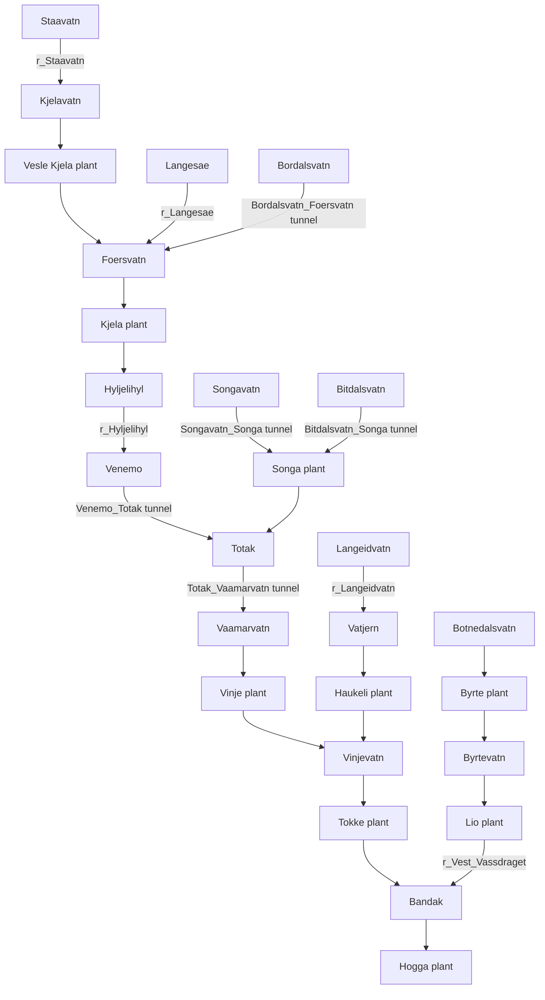

# Experiment history and report references

Consolidated on 2026-10-19. Historical sections record completed work; later
prospective sections explicitly describe plans rather than measured results. References to old
development scripts and shell commands describe completed experiments. Those
one-off scripts were removed during cleanup and are not current entry points.
Use the standalone notebooks and README for current commands. Original sources
and the pre-cleanup project instructions are backed up in `outputs\cleanup\20261019T111523Z\before_cleanup.zip`.

## Contents

- [2026-10-09-blend-analysis](#note-2026-10-09-blend-analysis)
- [2026-10-09-decision-features](#note-2026-10-09-decision-features)
- [2026-10-09-jonas-branch-review](#note-2026-10-09-jonas-branch-review)
- [2026-10-13-lightgbm-setup](#note-2026-10-13-lightgbm-setup)
- [2026-10-14-autonomous-lightgbm-results](#note-2026-10-14-autonomous-lightgbm-results)
- [2026-10-14-ensemble-weight-audit](#note-2026-10-14-ensemble-weight-audit)
- [2026-10-14-jonas-latest-review](#note-2026-10-14-jonas-latest-review)
- [2026-10-14-lightgbm-optimization](#note-2026-10-14-lightgbm-optimization)
- [2026-10-14-literature-model-strategy](#note-2026-10-14-literature-model-strategy)
- [2026-10-14-tcn-plan](#note-2026-10-14-tcn-plan)
- [2026-10-14-tcn-results](#note-2026-10-14-tcn-results)
- [2026-10-14-topology-feature-rationale](#note-2026-10-14-topology-feature-rationale)
- [2026-10-14-xgboost-plan](#note-2026-10-14-xgboost-plan)
- [2026-10-14-xgboost-results](#note-2026-10-14-xgboost-results)
- [2026-10-19-standalone-tcn-plan](#note-2026-10-19-standalone-tcn-plan)
- [2026-10-19-standalone-tcn-implementation](#note-2026-10-19-standalone-tcn-implementation)
- [2026-10-19-tcn-feature-audit](#note-2026-10-19-tcn-feature-audit)
- [2026-10-20-tcn-physical-features](#note-2026-10-20-tcn-physical-features)

---

## 2026-10-09-blend-analysis

## Saved-prediction blend analysis

Compared fixed probability blends on the two existing purged development folds,
without fitting any models. Reference: `probability_logloss`. Candidate weights
were fixed at 0.25, 0.50 and 0.75 before evaluation; the reference receives the
remaining weight. The same weight is used for all generators and both years.

The audit checks completed validation status, matching raw-input manifests and
fold definitions, the current raw-label hash, prediction IDs/columns/probabilities,
and exact reproduction of both models' recorded micro AUC (within 1e-8).
It rejects folds extending beyond the reserved 2022 boundary.

| Candidate | Candidate weight | 2020 micro AUC | 2021 micro AUC |
|---|---:|---:|---:|
| Reference alone | 0 | 0.95766422 | 0.97857470 |
| baseline_auc | 0.25 | 0.95700979 | 0.97841608 |
| baseline_auc | 0.50 | 0.95516636 | 0.97812416 |
| baseline_auc | 0.75 | 0.95190290 | 0.97766616 |
| upstream_logloss | 0.25 | 0.95898008 | 0.97902994 |
| upstream_logloss | 0.50 | 0.95940715 | 0.97914061 |
| upstream_logloss | 0.75 | 0.95895231 | 0.97901217 |
| shared_logloss | 0.25 | **0.96031427** | **0.97941690** |
| shared_logloss | 0.50 | 0.95986889 | 0.97939043 |
| shared_logloss | 0.75 | 0.95672911 | 0.97863334 |

Although the shared model was weaker alone, mixing 25% shared with 75% separate
probability predictions improved both development years. The gains were 0.00265005
and 0.00084220 over the reference. This supports investigating complementary models;
it does not demonstrate an improvement on the reserved holdout or Kaggle. Selection
from these nine blends reuses development labels and requires frozen-candidate
confirmation. Do not tune additional weights repeatedly on the public leaderboard.

The original AUC-stopped baseline did not improve the reference at the tested
weights. Additional upstream features were inconsistent as a standalone candidate,
but all three tested blends with them improved both reference folds.

Reproduce with `analyze_catboost_blends.py`. Full precision results are saved at
`outputs/catboost_diagnostics/20261009_blend_comparison.csv`. This development script
is not a runtime dependency of the notebook and does not create submissions.

Next: finish the controlled decision-feature experiment. Keep the 75/25 separate/
shared blend as another candidate. A final blend requires both model strategies
refitted on the appropriate training partition with frozen configurations; existing
development models cannot be used as substitutes for full-data fits. Include both
strategies' preprocessing, fitting and prediction in the final runtime budget.

---

## 2026-10-09-decision-features

## Decision-context CatBoost experiment

### Evidence before the new experiment

The user reported Kaggle ROC-AUC **0.98417** for the latest submission and said it
was worse than the earlier submission. This is user-reported, not independently
retrieved; the previous Kaggle score and leaderboard partition are not recorded.

Existing completed local development runs:

| Preset | 2020 micro AUC | 2021 micro AUC | Recorded time |
|---|---:|---:|---:|
| baseline_auc | 0.946865 | 0.976947 | 21.1 min |
| probability_logloss | 0.957664 | 0.978575 | 23.1 min |
| upstream_logloss | 0.957444 | 0.978637 | 27.4 min |
| shared_logloss | 0.947842 | 0.976520 | 27.4 min |

Separate probability models remain the local reference. Neither extra upstream
features nor the tested shared model consistently improved on that reference.
These results do not establish which strategy would win after further tuning.

### Saved-prediction error audit (no training)

`analyze_catboost_errors.py` recomputes micro AUC from saved predictions, verifies
label-file hashes, aligns cases by Run No, verifies purged development dates and
reports generator, horizon-day, case-start-quarter and transition metrics.
The script rejects holdout, test, smoke and incomplete runs.

Output: `outputs/catboost_diagnostics/20261009_development_errors.csv`.
The output covers the original and probability presets on the same development folds.

Key findings for `probability_logloss`:

- Haukeli has the highest per-generator Brier error in both years: 0.233399
  (2020) and 0.113202 (2021). In 2020 its observed ON fraction is 0.244709,
  while its mean predicted probability is 0.531146. Its AUC is 0.857806.
- Haukeli's saved Logloss curves choose 5 trees in 2020 and 38 in 2021. The
  2020 validation loss increases with further training. More trees alone are
  therefore not a demonstrated remedy. Its frozen refit budget is 21 trees.
- For hours with a label change from the preceding horizon hour, Brier is
  0.240180/0.219875 (2020/2021), versus 0.083875/0.054488 for stable hours.
  These transitions account for only 0.56%/1.78% of evaluated hours after t0.
  Their high conditional error does not imply they dominate global micro AUC.
  Labels define these diagnostic groups only; they are never features.
- Errors do not consistently increase with horizon day. 2021 day 7 has better
  micro AUC (0.982923) than day 1 (0.975994).
- Performance varies by case-start quarter: 2020 Q3 micro AUC is 0.929370,
  while 2021 Q4 is 0.957520. This motivates checking seasonal robustness,
  but does not prove a particular cause or justify fitting to held-out labels.

These are descriptive results from overlapping cases, not independent samples
or statistical significance tests. Per-generator AUC is not an additive breakdown
of micro AUC. 2022 has not been used for this audit.

### New experiment

`decision_logloss` adds 23 features to the existing 193 (216 total), keeping
the same 14 models, chronological folds, seed, hyperparameters and Logloss stopping.

**Economics: 14 features.** Whole-horizon patterns in price minus the existing
capacity-weighted intake terminal water value: positive-margin streak length and
summed margin, distance to positive hours, remaining opportunities, normalized
margin and preceding/following 6h/24h mean margins. All windows include the current
hour and truncate at case boundaries. Distance 168 denotes no matching hour.
These are descriptors, not net-profit estimates: no efficiency, startup cost or
downstream marginal-water-value conversion is assumed.

**Water balance: 9 features.** Natural inflow against initial headroom, hypothetical
excess under zero release/transfer, and margins against supplied minimum volumes.
Compute reservoir excesses individually before aggregation to prevent cancellation.
Ratios use a 1%-capacity headroom floor and log1p. Use supplied maximum capacities,
initial volumes, in-horizon inflow integrated to Mm3 and minimum-volume requirements.
No realized future storage or inferred upstream dispatch is used. These proxies
are not a hydraulic simulation and do not imply mandatory turbine production.

`economics_logloss` (207 features) and `water_balance_logloss` (202 features) provide
group ablations. Compare the combined preset against the probability reference on
both years first; ablations identify whether either group helps or hurts.

### Verification and next action

No dependencies were added or installed. No models were fitted. Check-mode execution
passed for all presets. Tests cover hand-calculated streaks/windows and water
quantities, reservoir-wise excess, case isolation, label/metadata invariance,
invariance to realized future storage, CatBoost Pool construction, old feature
values/signatures, ablation equality and the existing target-order roundtrip.

The user should run `check`, then `smoke`, then `validate` for `decision_logloss`,
restarting the kernel between modes. Save results even if performance worsens.
Do not reuse an older preset's selected configuration with these features.
New training runtime and predictive performance are unmeasured. Preserve 2022
for frozen-candidate confirmation rather than repeatedly tuning against it.

### User-completed validation result

Run `20261009T085100_521077Z_validate_decision_logloss` completed in 1988.97 seconds
(33 min 9 s). Its input hashes, fold definitions and model parameters match the
probability reference exactly; feature engineering is the changed component.

| Preset | 2020 micro AUC | 2021 micro AUC |
|---|---:|---:|
| probability_logloss | 0.95766422 | 0.97857470 |
| decision_logloss | **0.96671334** | **0.98163615** |
| Difference | +0.00904912 | +0.00306146 |

Per-generator AUC improved for 12/14 generators in 2020 and 11/14 in 2021.
Haukeli improved from 0.857806 to 0.909452 (2020) and from 0.927213 to 0.942968
(2021), although its 2020 Brier worsened slightly. Lio worsened in 2021 from
0.955941 to 0.939166, and Vinje G1 worsened in both years. Overall mean Logloss
and Brier improved in both folds. No model hit the 1500-tree limit (largest retained
counts: 620 in 2020, 881 in 2021).

This is a measured improvement on reused development years, not independent
confirmation or a demonstrated Kaggle gain. The new preset is the strongest
standalone CatBoost development candidate so far. Keep its frozen configuration
for later confirmation and use the same data/folds as the reference for LightGBM.
Do not automatically replace individual generator models using these diagnostics.

### User-reported Kaggle result

The user completed full-data submission run
`20261009T093004_209176Z_submit_decision_logloss` in 718.99 seconds and reported
Kaggle ROC-AUC **0.98679**, compared with **0.98417** for the preceding probability
submission (+0.00262). The CSV was independently checked for 725 rows, exact
2353-column template schema/IDs and finite probabilities in [0, 1]. Scores were
reported by the user; leaderboard partition is unspecified. This supports retaining
the decision-feature setup as a reference, but is not private-score confirmation.
Preserve its selected configuration while comparing LightGBM on the same input
features and development folds.

---

## 2026-10-09-jonas-branch-review

## Jonas branch review: lessons for CatBoost

Reviewed the locally available `origin/jonas` at commit
`5fe43feadcb4cb22acdf458917bca20ddfd72a87`. No checkout, merge, installation or model
training was performed. Read-only notebook snapshots are under `outputs/jonas_review/`.

### Recorded scores and attribution

- The branch records **0.98722** for the original XGBoost `output.csv`.
- It records **0.98711 public** for `output2.csv`, the volpath + cyclic variant.
- Our user-reported decision-feature CatBoost score is **0.98679**.
- These are recorded/reported Kaggle scores, not independently retrieved. Small
  leaderboard differences do not identify which feature or hyperparameter caused them.
  Do not import the branch's asserted grade threshold as an authoritative grading rule.

### Verified similarities

`notebooks/xgboost_baseline.ipynb` and the baseline section of
`notebooks/kaggle_submission.ipynb` use 14 separate generator classifiers. Their
193 original features match our v1 baseline numerically, after renaming columns.
This was checked for all 14 generators on seven representative training/test cases.
Both align initial storage at S, terminal water value at S+168h, and hourly inputs
inside the 168-hour horizon. Our measured decision preset adds 23 features to this
shared baseline. Jonas's baseline has no additional source of input information.

XGBoost parameters: 400 maximum trees, learning rate 0.05, depth 7, row subsampling
0.8, feature subsampling `colsample_bytree=0.8`, histogram training, seed 0 and
AUC-based stopping with patience 25. Most retained counts are near 400; Songa is 133
in the saved baseline validation output.

### Transferable experiments, in priority order

1. **Feature subsampling:** retain the 216 decision features and test CatBoost
   `rsm=0.8` against its existing default of 1.0. This transfers the idea of feature
   sampling, not the exact XGBoost algorithm: CatBoost `rsm` samples at split
   selection rather than being identical to `colsample_bytree`. Keep all other
   settings and both purged development folds fixed.
2. **Cyclic hour/week encodings:** add four features for sin/cos of hour-of-day
   (period 24) and day-of-week (period 7), as a separate ablation. Our day-of-year
   sin/cos already exists; these four do not. They use prediction-time-known data.
   Jonas's second submission combines these with volpath, so its score does not
   isolate cyclic encoding and is not evidence it improves CatBoost.
3. **Refit tree-budget sensitivity:** compare a small predeclared fixed-budget
   experiment (e.g. 400 trees) with the current generator-specific early-stopped
   budgets on the same development years. This tests whether the median refit rule
   is too conservative for some units; it does not justify blindly increasing all
   counts. No current CatBoost fold hit its 1500-tree maximum. Learned budgets for
   an outer evaluation must come only from earlier training/inner development data.
4. **Optional tree-growth experiment:** CatBoost Depthwise can test a different
   tree structure with explicit depth/regularization. Depth 7 does not imply equal
   capacity in XGBoost and symmetric CatBoost. This is a lower-priority hypothesis,
   not a claim that copying the XGBoost hyperparameters will reproduce its score.

References: [CatBoost common parameters](https://catboost.ai/docs/en/references/training-parameters/common)
documents `rsm`, `grow_policy`, `min_data_in_leaf` and stopping-related settings.

### Protocol differences that should not be copied as clean evaluation

**Training-tail stopping is in-sample.** The branch defines `stop_cases` as the
last 90 days of `train_cases`, then fits on all of `train_cases` and monitors
`stop_cases`. Confirmed: every one of the 90 stopping IDs is in the fitting pool.
This is a training diagnostic, not a held-out early-stopping estimate. It does not
read outer-validation labels, but should not be described as independent validation.
Our use of development validation for early stopping is allowed model selection;
it means those development scores are not a final untouched-test estimate. A properly
purged inner stopping split and an outer evaluation serve different purposes.

**Six training cases overlap the 2022 boundary.** The branch selects training
cases by start <2022-01-01, admitting December 26-31, 2021 cases whose 168-hour
horizons extend into 2022. Our protocol removes these overlaps. Its 2022 score
cannot be directly compared with our 2020/2021 results or used as proof of model
superiority without rerunning on matched, purged folds.

**Volpath uses observed future reservoir storage.** The extra-feature function
reads `vol_wide` at S+1 through S+7 days. Those values are not initial storage at S,
and conflict with our prediction-time availability rule. Do not port them into
CatBoost. Supplied in-horizon prices/inflows and terminal water values have a
different availability status; future storage being present in a CSV does not by
itself authorize using it. The cyclic features can be isolated without volpath.

**Error interpretation is not proof of missing information.** The branch's
Haukeli/Lio regime diagnostics are useful leads. Whole-week errors and a failed GRU
do not establish a maintenance schedule as the cause or prove the available inputs
cannot explain the labels. Its in-sample 0.9985 is a fit measurement, not a forecast
ceiling or proof of deterministic labels from the features.

### Next action

Before implementing LightGBM, report these findings to the user. The highest-priority
CatBoost experiment suggested by the review is isolated `rsm=0.8` on decision
features, followed by isolated cyclic encoding. Preserve the 0.98679 configuration.
Any new models are trained by the user; new score and runtime are unmeasured.

---

## 2026-10-13-lightgbm-setup

## LightGBM setup and Jonas branch refresh

### Jonas refresh result

The user reported a new Jonas Kaggle score of 0.98848. On 2026-10-13:

- Ran `git fetch origin jonas` twice successfully.
- Queried remote branch heads: `refs/heads/jonas` remained
  `5fe43feadcb4cb22acdf458917bca20ddfd72a87`.
- Created a detached, read-only-for-review worktree at `outputs/jonas_checkout/`.
- Ran `git pull --ff-only origin jonas` inside that worktree; Git returned
  **Already up to date**. The user's fredrik branch was not merged with Jonas.

The published Jonas branch still records 0.98711 for output2.csv and 0.98722 for
output.csv. No published change explaining 0.98848 was available to inspect.
Treat 0.98848 as user-reported and unexplained until its commit/notebook is provided
or pushed. Do not attribute it to a guessed feature or hyperparameter. The previous
branch audit and its caveats remain at `2026-10-09-jonas-branch-review.md`.

### New LightGBM notebook

`lightgbm.ipynb` is self-contained and uses one binary classifier per generator,
the exact 216 decision features and purged 2020/2021 folds from CatBoost. It also
offers a 193-feature `baseline_logloss` input ablation. Initial mode is `check`;
other modes are `smoke`, `validate`, `holdout` and `submit`.

Starting parameters (not tuned or benchmarked): binary GBDT, 63 leaves, depth 7,
learning rate 0.05, minimum 200 child samples, L2 5, row and column sampling 0.8,
active bagging frequency 1, max_bin 127, deterministic CPU mode and four threads.
Different learners do not have equal capacity just because depth is equal.

Development validation uses binary Logloss early stopping (patience 100), at most
2000 trees; smoke uses at most 40 trees on 96 train/48 validation cases. Model
selection compares overall micro ROC-AUC. Frozen tree counts are the median best
counts from both folds; this refit rule remains a hypothesis rather than a tuned
optimum. Reserved 2022 holdout and submission do not access evaluation labels
during fitting and do not use early stopping.

Training outputs go under `outputs/lightgbm/<run>/`: metadata, hashes, versions,
models, curves, metrics, predictions and normalized gain importance. Only submit
exports `lightgbm_submission.csv` after verifying template IDs, columns and finite
probabilities. LightGBM configurations carry `model_family="lightgbm"`; CatBoost
configs are rejected even when the feature signature matches. No saved artifacts
or helper files are required to reproduce the notebook from raw inputs.

The final comparison reads completed development runs from both families and flags
matching input hashes, feature signature, folds and seed. Existing prediction-audit
and fixed-blend scripts accept explicit LightGBM run paths too; no ensemble or
submission is generated automatically by check mode.

### Verification and limitations

`tests/check_lightgbm_pipeline.py` passed without fitting models:

- Notebook JSON/schema and all check-mode cells.
- Exact numeric feature equivalence across all 14 generators on representative
  training and test cases, including the last test horizon.
- Identical chronological case IDs and purged boundaries.
- Mapping for all 725 template rows and all 2352 target columns.
- Equality with the supplied metric on reversed-order cases and synthetic probabilities.
- Rejection of a CatBoost frozen config before creating any training directory.
- The 193-feature ablation and input-hash comparison flags.

`lightgbm>=4.0,<5.0` was added to requirements.txt. It was not installed and was
not already available in the project venv. Actual fitting, native prediction,
model save/load behavior, training runtime and predictive quality remain unverified
until the user installs the dependency and runs smoke/validate. The authoring code
uses the current documented classifier/callback interfaces; this is not a substitute
for executing the native model.

References: [classifier API](https://lightgbm.readthedocs.io/en/stable/pythonapi/lightgbm.LGBMClassifier.html),
[early stopping](https://lightgbm.readthedocs.io/en/stable/pythonapi/lightgbm.early_stopping.html),
[parameter tuning](https://lightgbm.readthedocs.io/en/stable/Parameters-Tuning.html).

### User's next steps

Install the updated requirements into the project venv yourself. Open
lightgbm.ipynb with that kernel, run check, then smoke, then validate, restarting
the kernel between settings. Keep the CatBoost reference fixed. Do not reuse a
CatBoost selected configuration for a LightGBM submission. After both development
folds, compare standalone performance and fixed probability blends before deciding
whether the new family contributes useful complementary predictions.

### Completed user validation and exploratory blend results

The user installed LightGBM 4.7.0 and completed smoke and validation. Validation
run `20261013T214617_205062Z_validate_decision_logloss` took 688.43 seconds
(11 min 28 s); model fitting, prediction and model exports now executed in the
user's workflow. The assistant did not install packages or fit any model.

| Predictor | 2020 micro AUC | 2021 micro AUC |
|---|---:|---:|
| CatBoost RSM | 0.96784856 | 0.98274610 |
| LightGBM | 0.95854627 | 0.98290810 |
| 75% CatBoost + 25% LightGBM | 0.96795750 | 0.98369577 |
| 50% CatBoost + 50% LightGBM | 0.96600676 | 0.98393691 |
| 25% CatBoost + 75% LightGBM | 0.96272976 | 0.98371148 |

Fixed coarse blend weights were evaluated with the existing non-training audit
script, checking equal raw-input manifests/folds and reproducing both saved model
scores. Output: `outputs/catboost_diagnostics/20261013_catboost_lightgbm_blends.csv`.
LightGBM has better Lio and Vinje G1 per-generator AUC on both folds, but its 2020
Haukeli is substantially weaker (0.807399, 6 trees, versus CatBoost 0.897677).
The 75/25 combination improves both years; its 2020 gain is only 0.00010894,
while the 2021 gain is 0.00094966. This is exploratory development selection,
not independent confirmation or evidence of a Kaggle improvement.

Do not replace the CatBoost reference based on the 2021 score alone. A frozen
75/25 blend is a candidate for final confirmation. Both components must be
appropriately refitted with their own selected configs to create final predictions;
development models are not substitutes for full-data fits. No new submission was
produced during this analysis.

---

## 2026-10-14-autonomous-lightgbm-results

## Authorized LightGBM optimization results

The user explicitly delegated execution and experiment management, with a maximum
45-minute machine budget. The assistant used four training threads and sequential
jobs. No dependencies were installed. Hardware: Intel Core Ultra 7 258V, eight
physical/logical cores, about 31.5 GiB RAM, about 7.5 GiB initially available.

### Controlled development comparison

All candidates use the same 216 decision features, raw-input hashes, seed 42 and
purged 2020/2021 folds. Logloss selects iterations; micro ROC-AUC compares models.
The first LightGBM reference was previously trained by the user. The assistant
ran the following predeclared variations; the source notebook was snapshotted.

| Predictor | 2020 micro AUC | 2021 micro AUC | Validation time |
|---|---:|---:|---:|
| Original LightGBM | 0.95854627 | 0.98290810 | 11 min 28 s |
| Neutral initialization | **0.96435830** | 0.98337111 | 12 min 39 s |
| Smaller trees / stronger regularization | 0.95967193 | **0.98377707** | 13 min 42 s |
| CatBoost RSM reference | 0.96784856 | 0.98274610 | 26 min 33 s |

Neutral initialization changes only `boost_from_average=False`. Regularization
changes leaves 63->31, depth 7->6, min_child_samples 200->500 and L2 5->10 while
keeping the original prior. Both improve the initial LightGBM reference on both
years. Neutral is selected because it has the stronger mean and worst-year AUC;
regularized is slightly better on 2021. This is a tradeoff, not proof of a universally
optimal parameter set. A slower-learning-rate run was deferred because its projected
runtime would not fit the remaining budget safely.

For Haukeli in 2020, neutral initialization reduces mean predicted ON probability
from 0.702003 to 0.528276 (observed ON fraction 0.244709), improves Logloss from
0.960176 to 0.673958 and AUC from 0.807399 to 0.816475. Calibration improves but
the difficult generator remains unresolved. These findings do not prove an outage
variable is missing or that neutral initialization will improve the hidden test.

Runs:

- `20261013T221000_403663Z_smoke_decision_neutral_logloss` (10.76 s).
- `20261013T221012_065784Z_validate_decision_neutral_logloss`.
- `20261013T222254_245353Z_validate_decision_regularized_logloss`.

### Ensemble audit without extra fitting

Fixed LightGBM weights 0.25, 0.50 and 0.75 were compared with CatBoost RSM,
checking matching input/fold manifests and reproducing recorded metrics.

| Blend | 2020 micro AUC | 2021 micro AUC |
|---|---:|---:|
| 75% CatBoost + 25% neutral LightGBM | **0.96914276** | 0.98383669 |
| 50% CatBoost + 50% neutral LightGBM | 0.96875814 | **0.98419149** |
| 25% CatBoost + 75% neutral LightGBM | 0.96705647 | 0.98407654 |
| 75% CatBoost + 25% regularized LightGBM | 0.96806097 | 0.98382765 |

Selected 75/25 neutral blend improves both CatBoost folds and prioritizes stronger
worst-year performance. 50/50 neutral is another tradeoff, slightly stronger in
2021 but weaker in 2020. Development labels were reused to select candidates;
this is exploratory selection, not independent confirmation or a Kaggle score.
No 2022 holdout score was inspected during optimization. All labels, including
2022, are legitimately used only in the final full-data refit for test prediction.

### Full-data artifacts

Selected neutral LightGBM was refitted on all 2922 labeled cases with its frozen
median tree counts in 7 min 35 s. Run:
`outputs/lightgbm/20261013T223739_726671Z_submit_decision_neutral_logloss/`.
Pure CSV: `lightgbm_submission.csv` in that run folder.

The selected blend combines this CSV with the existing full-data CatBoost RSM run
`20261009T110904_307192Z_submit_decision_rsm_logloss`, not development models.
Their raw-input hashes, feature signatures and seeds match. Blended output:
`outputs/lightgbm_optimization/20261013T220956_594989Z/catboost_lightgbm_75_25_submission.csv`.
Its JSON manifest records exact component paths/hashes and weights.

Both CSVs were independently checked: 725 rows, 2353 columns, exact template
IDs/order/columns, finite probabilities in [0,1]. Blend arithmetic and roundtrip
were tested on synthetic fixtures before using real submissions. No Kaggle upload
was performed and neither new CSV has a measured Kaggle score.

`lightgbm.ipynb` now stores the selected neutral configuration inline and remains
in check mode. It can reproduce the pure CSV from raw inputs in submit mode;
the executed submission notebook is saved with the full-training batch logs.
The development blending helper reads generated CSVs; final short notebooks must
inline both raw-data training pipelines and blending, not depend on these artifacts.

### Runtime and process control

The development batch took 26.7 min including smoke; full-data refit took 7.6 min.
Including intermediate audits and artifact checks, elapsed from batch start was
about 38 min, inside the 45-minute user budget. Full-data peak process-tree RSS
was about 2.20 GiB. The first batch's actual memory peaks were captured by the
process-tree watchdog because Windows venv launcher RSS alone is misleading.
The initial batch metadata was corrected to distinguish launcher and actual
tree memory. The runner now monitors and terminates its own descendants under
wall-time/memory limits, without touching user notebook kernels.

Logs, executed notebooks, source snapshots, memory audit and optimization summary:

- `outputs/lightgbm_optimization/20261013T220956_594989Z/` (development and blend).
- `outputs/lightgbm_optimization/20261013T223736_013926Z/` (full-data refit).

No training remains running. Further training requires a new runtime budget or
explicit user instruction; dependency installation remains user-controlled.

---

## 2026-10-14-ensemble-weight-audit

## Direct ensemble weight comparison

The user questioned the nested 56.25/18.75/25 weights and requested a comparison
of LightGBM + TCN against all three model families. This audit fits no models,
installs no dependencies, and evaluates no 2022 predictions or Kaggle scores.
Existing full-data component predictions are reused to export candidate submissions.

### Protocol and controls

Use the same frozen RSM CatBoost, neutral LightGBM and wide TCN development runs.
Search the nonnegative simplex at increments of 5%, with weights summing to one:
231 distinct mixtures, including 21 LightGBM/TCN boundary mixtures. Also score the
original frozen hybrid. Select the highest equal mean of the two yearly global
micro ROC-AUC values. This is a bounded exploratory search, not an exhaustive
continuous optimum. Generator-specific weights, calibration and architecture
search are excluded.

The protocol was saved before scoring to
`outputs/tcn_experiments/weight_audit_20261014/protocol.json`. Raw-label/template
hashes, component input hashes, seeds, selected configurations, purged case counts,
prediction IDs/columns and original component metrics were checked. Only label
values before 2022 are loaded. The original freeze manifest remains byte-identical.

Implementation: `analyze_ensemble_weights.py`. Scoring and segment diagnostics
completed in 71.83 seconds on this machine; no new training occurred.

### Development results

| Mixture | CatBoost | LightGBM | TCN | 2020 micro AUC | 2021 micro AUC | Equal-year mean |
|---|---:|---:|---:|---:|---:|---:|
| Best LightGBM + TCN | 0% | 60% | 40% | .97193406 | .98545336 | .97869371 |
| Best unrestricted grid mixture | 35% | 30% | 35% | .97353569 | .98563532 | .97958551 |
| Original frozen hybrid | 56.25% | 18.75% | 25% | .97311196 | .98534257 | .97922726 |

The best three-family mixture beats the best two-family mixture by .00160164 in
2020 and .00018196 in 2021. It improves the original frozen hybrid by .00042374
and .00029276 respectively. These are selected development results, not new
independent confirmation or expected Kaggle gains.

The nearby 30/35/35 mixture has mean .97957361, only about .000012 below the winner.
Exact percentages should not be interpreted as identifiable universal optima.
The old percentages arose from nested blending, whereas this audit searches the
three weights directly.

### Stability diagnostics

Choose weights separately on one development year and apply them to the other:

| Search family | Selected on | CB/LGB/TCN weights | Other year | Other-year micro AUC |
|---|---|---|---|---:|
| LightGBM + TCN | 2020 | 0/55/45 | 2021 | .98523431 |
| Three-family grid | 2020 | 40/25/35 | 2021 | .98554539 |
| LightGBM + TCN | 2021 | 0/65/35 | 2020 | .97163634 |
| Three-family grid | 2021 | 25/45/30 | 2020 | .97301756 |

Both transfer directions favor retaining CatBoost. Because both years informed
earlier modeling and architecture selection, these are descriptive sensitivity
checks rather than untouched out-of-sample estimates. The three-family search
also has more opportunities to select favorable results than the two-family
boundary search.

At the common mean-selected weights, the three-family mixture improves within-unit
AUC for 10/14 generators in 2020 and 7/14 in 2021. It improves monthly micro AUC for
9/12 and 6/12 case-start months respectively. CatBoost's contribution is uneven;
the 2021 aggregate benefit is small. Within-generator/month AUC does not add up to
the official global micro AUC, which also compares probabilities across units.
No per-generator or month-specific weights were selected from these diagnostics.

Retaining CatBoost is supported by these two development years. Its measured
full-data refit adds about 9.5 minutes on this machine; the simpler two-family
mixture remains a legitimate runtime/maintenance alternative. This comparison
does not establish future-year superiority or justify .995/grade promises.

### Verified candidate artifacts

- Three-family candidate: `outputs/tcn_experiments/weight_audit_20261014/three_model_submission.csv`.
  SHA256 `c8efd6e79f6a72dca10090b30db43927124028fb40d4bae50bdf259ac4d0787d`.
- Two-family candidate: `outputs/tcn_experiments/weight_audit_20261014/lightgbm_tcn_submission.csv`.
  SHA256 `5cfbda0a25b9d094194649b4663bc00e98101cf16b5c998b62f9d5eb37eef339`.

Both have 725 rows and 2353 columns, exact template IDs/columns/order and finite
probabilities in [0,1]. Full-data selected model configurations match the original
frozen models exactly. Independent arithmetic checks reproduce both CSVs to
1.11e-16, and all six selected development scores match `kaggle_metric.py` to
1e-12. Proof: `verification.json`; accompanying CSV manifests record source hashes,
configurations, selection provenance and the absence of new 2022 confirmation.

The previous confirmed hybrid CSV and root notebook configuration are preserved.
The new candidate weights have not been independently evaluated on 2022; do not
attach the old hybrid's .98371184 confirmation score to either new candidate.
The root `hydro_ensemble.ipynb` still reproduces the original frozen weights.
To reproduce a new candidate later, refit the same frozen components and apply
its exact recorded weights; no separate refit was needed to construct these CSVs.
No Kaggle upload occurred. Scores there remain unknown.

Full tables: `weight_comparison.csv`, `scores_long.csv`, `segment_comparison.csv`,
`summary.json` in the audit directory. This audit is complete; it authorizes no
additional fitting or weight search against the confirmation period.

---

## 2026-10-14-jonas-latest-review

## Jonas branch refresh: the 0.98848 submission

### Refresh and attribution

At the user's request, fetched `origin/jonas` and ran
`git pull --ff-only origin jonas` in the existing clean, detached worktree
`outputs/jonas_checkout`. It advanced from `5fe43fe` to
`02c6340d86b35d5c91c0947dd56ea5f62edadd9d`. The active `fredrik` worktree was
not checked out, merged or reset. No dependencies were installed or models fitted.

The branch now explicitly attributes public Kaggle **0.98848** to `output8.csv`:
score-recording commit `1ee9a7b7712dc07d24058ed0dfa10cc10f6169cc` and the current
short notebook. This is branch-recorded public performance, not a score retrieved
independently from Kaggle. The October 14 latest commit updates delivery notebooks
and `output8.csv`; the earlier October 10 commit records the score. Do not infer
private performance, a universal grade cutoff or the effect of one change.

### What generated it

Three independently fitted feature variants of the same XGBoost approach, each
with 14 generator-specific classifiers: 42 models in total. Every arm uses:

- The original 193 features, previously checked against our baseline.
- 27 additional v2 columns: 17 initial reservoir levels interpolated from supplied
  volume/head curves, seven upstream descriptors, a local gross-head proxy and
  two economic suffix sums. The branch explicitly credits our earlier upstream
  feature work for this group; they are not all new ideas from Jonas.
- `reg_lambda=10`, 400 maximum estimators, learning rate .05, depth 7, row and
  per-tree feature subsampling .8, CPU histogram trees, seed 0 and AUC stopping
  with patience 25. These settings are not a measured optimum on our folds.

Each arm adds a different group:

| Artifact | Additional group | Branch-recorded public AUC |
|---|---|---:|
| output4 | Common v2 + stronger L2 regularization only | .98776 |
| output5 | Nine efficiency-adjusted margin and run-length descriptors | .98811 |
| output6 | Four water-value drift/history descriptors | .98813 |
| output7 | Four price-shape descriptors | .98829 |
| output8 | Equal mean of output5, output6 and output7 probabilities | **.98848** |

The baseline branch records .98722. These public comparisons do not isolate
causation or establish statistical certainty; submission choices also used public
feedback, so do not copy that workflow as independent validation.

The efficiency arm interpolates supplied turbine/generator curves, estimates
operating efficiency at five powers from p_min to p_max, and scales price by
initial-head/efficiency relative to a reference head. It adds positive-margin
streaks and remaining opportunities. These are approximate descriptors using
initial conditions, not exact net hydraulic head, true profit or a simulation of
storage/release trajectories. Our decision features already contain unadjusted
economic streaks and remaining opportunity context; the genuinely new element is
the efficiency/head adjustment.

The water arm uses intake-capacity-weighted values at S, S+7 days, S-7 and S-14:
forward drift, two backward changes, and drift relative to the week's mean price.
It does not use future observed storage. The data definitions describe daily
marginal water values in EUR/MWh and terminal alignment at S+168h; a port must
document the availability of every additional timestamp and handle missing
pre-2015 history explicitly.

The shape arm describes how attractive the current price is compared with prices
remaining in the same case: strict suffix rank, price minus suffix maximum, price
divided by abs(suffix maximum)+1, and price minus prefix maximum. These use the
provided planning price horizon, with no future labels/storage. Our baseline has
whole-week price rank and our decision context has a remaining-best-margin
descriptor, so test the incremental value rather than calling all four entirely
new information sources.

### Independent non-training checks

Checked output5/6/7/8 against the authoritative local template: every file is
725 x 2353, with exact IDs, column names/order and finite probabilities in [0,1].
Recomputed `(output5 + output6 + output7) / 3` in float32: **zero differing cells,
maximum difference 0**, matching the current output8 exactly. Proof and source
SHA256 hashes: `outputs/jonas_review/20261014_latest/submission_audit.json`.
The public score itself is not computable from these unlabeled submissions.

Read-only extracted source/output snapshots of both short notebooks, the Kaggle
notebook and the hyperparameter notebook are in the same review directory.
Only extracted feature functions were evaluated for diagnostics; no fit path ran.

### Protocol limitations and reproducibility

The current short notebook still selects training cases by start <2022-01-01,
allowing **six** horizons to cross the validation boundary. Its 90-day stopping
window is a subset of fitting cases: all **90** stopping cases are in training.
This is an in-sample stopping diagnostic, not independent validation stopping.
Using development data for stopping is legitimate model selection; do not repeat
the branch's claim that all validation-based early stopping is inherently leakage.

It repeatedly selects features/parameters on 2022. Its validation scores cannot
be compared directly with our purged development folds or described as untouched
confirmation. Full-train fitting on all labeled cases is itself appropriate.

The branch's earlier screen reports adopted/eff/water/shape/mean validation
.9823/.9827/.9824/.9826/.9830. Current short notebook outputs instead show
.9705/.9816/.9824/.9820/.9824. The branch attributes this to feature-column-order
sensitivity under subsampling and fragile train-tail stopping (Songa stops at
one tree for the adopted variant). We verified that these actual outputs and the
explanation are present; did not reproduce fits or validate the claimed causal
explanation. Preserve exact feature ordering and use our controlled protocol.

Water-history filling also needs correction in a port. The function performs
`reindex(requested_times).ffill().bfill()` across case rows. In a non-training
check, Haukeli's earliest case (2015-01-01) fails the finite-output assertion when
processed alone but succeeds in a 30-case batch. Missing pre-2015 history is
therefore filled using other case rows. Do not copy this batch-dependent filling;
use explicit time-aligned, prediction-time-safe fallback rules and missing flags.
Proof: `protocol_audit.json` in the review directory. This is an implementation
limitation, not proof that the public score is invalid.

The scored output8 path does not include the older volpath variant. Our previous
warning about future observed volumes remains applicable to that separate older
feature group; it should not be attributed to this latest ensemble.

### Controlled next experiment

XGBoost is now a motivated candidate, not an automatic fourth ensemble member.
The most useful lesson is feature diversity plus probability averaging, which
can work even within one model family. Comparing algorithms alone and comparing
feature groups are different experiments.

1. Implement one XGBoost reference using our exact 216 decision features and
   purged 2020/2021 folds, with the same IDs, seeds and global metric. This isolates
   the model family. Version/add the dependency without installing or fitting
   unless newly authorized.
2. Separately test a price-shape ablation. It has a clear opportunity-cost
   hypothesis and no new input availability assumptions. Preserve original order
   and keep the rest of the pipeline fixed.
3. If justified, test the upstream/head group with stronger regularization and
   then an efficiency descriptor ablation. Their improvement on Jonas's model
   is not proof of improvement on CatBoost/LightGBM.
4. Consider water history only after coverage and case-isolation fixes. Keep
   physics proxies distinct from an actual hydroeconomic simulator.
5. Test incremental ensemble contribution on matched saved development predictions
   with a small declared weight set. Retain XGBoost only if its contribution is
   consistent enough to justify complexity/runtime. Do not select via further
   inspection of the already used 2022 confirmation or repeated public probes.

This is a review and proposed experiment order, not implemented or trained XGBoost
on our branch. Existing models, frozen configs and submissions are preserved.

---

## 2026-10-14-lightgbm-optimization

## Controlled LightGBM optimization

Reference: `20261013T214617_205062Z_validate_decision_logloss`, micro AUC
0.95854627 (2020) and 0.98290810 (2021), runtime 11 min 28 s. The first
configuration has not been tuned, so optimization precedes final ensemble selection.

### Evidence motivating the first experiment

For Haukeli in the 2020 fold:

- Training ON fraction: 0.72663854; validation ON fraction: 0.24470899.
- Mean predicted ON probability: 0.70200306.
- Best validation Logloss occurs at iteration 6 (0.96017603); loss subsequently
  worsens, reaching 1.44041665 at iteration 106 when patience is exhausted.
- Saved native model parameters confirm `boost_from_average: 1`.

In 2021 its training ON fraction is 0.64527785, validation fraction 0.37743733,
and mean prediction 0.43517530; its retained tree count is 152. This indicates
year-dependent behavior. Class-prior initialization may matter when very early
stopping preserves a large initial bias, but these observations do not establish
initialization as the cause or guarantee a remedy.

### Predeclared presets

| Preset | Changes versus reference | Purpose |
|---|---|---|
| `decision_neutral_logloss` (first) | `boost_from_average=False` only | Test neutral probability 0.5 initialization rather than training label mean |
| `decision_regularized_logloss` | 31 leaves, depth 6, min_child_samples 500, L2 10 | Test a smaller, more regularized learner |
| `decision_slow_logloss` | learning rate 0.03 only | Test smaller boosting steps |

All retain the same 216 features, seed, four threads, purged folds, 2000-tree
maximum and Logloss patience 100. Presets are independent, not cumulative;
regularized/slow retain the original prior initialization. Slower learning may
need different stopping patience if curves warrant it; do not change it blindly.
Do not increase the maximum simply because it is available: reference models
retained at most 627 trees and none reached 2000.

The first experiment deliberately changes only one parameter. Keep both development
years and per-generator scores in the comparison; do not select on 2021 or public
Kaggle alone. These are development selection results, so final frozen-candidate
confirmation remains separate. Do not add repeated generator-specific corrections
using held-out ON rates as training targets.

The existing selected configuration is retained inline as
`LIGHTGBM_REFERENCE_CONFIG`, valid only with `EXPERIMENT="decision_logloss"`.
The active notebook is `decision_neutral_logloss` / `check`, `SELECTED_CONFIG=None`.
Every new preset must produce its own validation configuration before submission.

### Verification

All check-mode cells passed with model fitting explicitly blocked. Native classifier
construction recognizes `boost_from_average=False`; feature signature and exact
feature source are unchanged. Each preset changes only its declared parameters,
and restoring `decision_logloss` reproduces reference parameters. No dependency
installation or model fitting occurred. New runtime and predictive performance
remain unmeasured until the user runs smoke and validate.

Reference: [LightGBM objective parameters](https://lightgbm.readthedocs.io/en/stable/Parameters.html#objective-parameters)
documents the default label-mean initialization controlled by `boost_from_average`.

---

## 2026-10-14-literature-model-strategy

## Literature review and model-selection rationale

Reviewed on October 14, 2026. This note supports the report's reasoning; it does
not launch training, change configurations or assert a new predictive result.
Only primary research papers, a research institution's publication abstract and
the scheduler's official documentation inform the recommendations.

### Recommendation

Organize the study around a comparison of **physically informed gradient-boosted
trees and a full-horizon temporal convolutional network**. CatBoost, LightGBM and
XGBoost are implementation candidates within the tree family. They are not three
fundamentally different modeling hypotheses. Determine the final ensemble from
measured incremental contribution, rather than declaring a particular collection
of libraries to be the scientifically recommended architecture.

Suggested central research question:

> Can a temporal convolutional model of the complete planning week improve
> unit-commitment ranking beyond gradient-boosted trees with physically and
> economically informed features, under chronological validation?

This question is a project-specific synthesis of the evidence below, not a
conclusion already demonstrated by another paper on our exact Kaggle split.
The modeling work remains exploratory. This broader literature review followed
many of the experiments; do not claim the entire search was preregistered from
these references. The SINTEF abstract was already consulted before our TCN trials.

### Evidence and limits of transfer

#### Gradient boosting is a motivated tabular reference

Grinsztajn, Oyallon and Varoquaux benchmarked 45 tabular datasets and found tree
models particularly strong on medium-sized heterogeneous data. They discuss
robustness to uninformative variables and irregular target functions. This
supports a tree reference, not a claim that trees win every task or that our
overlapping generator-hour rows are independent samples.
[NeurIPS 2022 paper](https://papers.nips.cc/paper_files/paper/2022/hash/0378c7692da36807bdec87ab043cdadc-Abstract.html).

The more recent TabArena study compares tuning and ensembling as well as default
models. Trees remain competitive; neural methods become competitive with larger
budgets and ensembling, and cross-model ensembles can improve results. Its ordinary
tabular benchmarks do not establish an optimum for our temporally dependent UC
cases. Its findings also warn about validation overfitting. Treat this as support
for controlled comparisons, not a universal tree-versus-neural ranking or an
endorsement of our particular weights.
[TabArena, NeurIPS 2025](https://arxiv.org/html/2506.16791v2).

#### Convolutional networks have directly relevant hydro-UC evidence

Barjaktarevic, Kong, Yang and Naversen compare simple, convolutional, recurrent
and hybrid neural architectures on operationally generated UC data for a real
Norwegian watercourse, with 24-hour and 168-hour horizons. The abstract reports
F1 above 97.35% for all tested architectures, with convolutional architectures
most consistent across horizons. This is strong domain motivation for a temporal
CNN candidate. It does not identify our exact architecture, prove dataset/split
identity or imply a corresponding ROC-AUC. Full text could not be accessed through
the DOI or repository during this review.
[SINTEF, EEM 2026](https://www.sintef.no/en/publications/publication/019f93eb7024-9db6a5de-cdc7-4ad4-9d28-d051824cd633/).

#### Dilated residual convolutions are a defensible design choice

Bai, Kolter and Koltun provide a generic TCN reference, comparing convolutional
and recurrent models on several sequence tasks. Dilations extend receptive fields
and residual connections support deeper models. Their standard TCN uses causal
convolutions. Our network instead uses symmetric convolutions because the supplied
planning-week inputs are available for all 168 hours. Describe it as a
**TCN-inspired noncausal temporal CNN**, not an exact reproduction or a causal
forecasting model. The appropriate information boundary is available inputs, not
whether an input timestamp is later than the hour being classified.
[Bai et al., 2018](https://arxiv.org/abs/1803.01271).

#### Physical feature engineering has a concrete scheduling rationale

SHOP describes production as a nonlinear relationship among head, discharge and
turbine/generator efficiency, with operating limits and start/stop costs relevant
to commitment. These relationships motivate descriptors of initial head, water
pressure, economic opportunity and sustained favorable periods. They do not make
our simplified descriptors an exact hydraulic simulator.
[SHOP generator documentation](https://docs.shop.sintef.energy/objects/generator/generator.html),
[PQ-curve documentation](https://docs.shop.sintef.energy/examples/pq_curves/pq_curves.html).

SHOP also distinguishes local energy values from global water values and includes
downstream value when converting between energy and water units. Therefore a
capacity-weighted price-minus-water-value feature should be called an economic
descriptor. A physically exact net-profit or cascade opportunity-cost feature
would require the correct conversions and dependencies. The documentation
motivates careful feature definitions, not unconditional adoption of every
topology/efficiency feature.
[SHOP water values](https://docs.shop.sintef.energy/examples/water_values/water_values.html).

#### Model selection can itself overfit

Cawley and Talbot show how optimizing a noisy validation criterion can produce
selection bias comparable to differences among algorithms. Applied here, broad
weight searches and repeated feature decisions on the same years remain
development selection. A best development score is not an unbiased future-year
estimate. Preserve unsuccessful trials, separate stopping/selection/confirmation
roles, and do not keep adjusting models against 2022 or public leaderboard scores.
[JMLR 2010](https://www.jmlr.org/papers/v11/cawley10a.html).

#### New tabular foundation models do not establish a solution for this project

The 2026 TabPFN-3 technical report claims strong results against tuned alternatives
on its evaluated benchmarks. This prevents an outdated claim that trees are always
the best modern tabular method. Pretrained weights, offline reproduction,
prediction-time inputs, dependent UC rows and course data restrictions would need
separate assessment before adopting such a model. We have neither tested it nor
established its eligibility here; no claim is made that it is automatically
forbidden or would improve this competition.
[TabPFN-3 technical report](https://arxiv.org/abs/2605.13986).

### Roles of the existing implementations

| Implementation | Defensible role in this project | Claim to avoid |
|---|---|---|
| CatBoost | Tested gradient-boosted reference, with measured complementary predictions | Its categorical encoding is necessary here, or its ordered boosting replaces temporal purging |
| LightGBM | Alternative efficient tree implementation; test accuracy/runtime and contribution | It must beat CatBoost because there are many rows |
| XGBoost | Additional controlled tree comparison, motivated by Jonas's evidence | Jonas's public score or unmatched validation proves it beats our pipelines |
| Temporal CNN | Joint representation of the supplied 168-hour input horizon and all generators | SINTEF establishes this exact TCN as the optimal Kaggle architecture |
| Probability ensemble | Empirical combination retained when measured contributions justify it | More models or more weight trials necessarily improve generalization |

The original algorithm papers provide technical references, rather than a
dataset-specific ranking: [XGBoost](https://arxiv.org/abs/1603.02754),
[LightGBM](https://papers.nips.cc/paper/2017/hash/6449f44a102fde848669bdd9eb6b76fa-Abstract.html),
[CatBoost](https://arxiv.org/abs/1706.09516).

Our current generator-specific tree features are numeric. CatBoost's categorical
handling is consequently not the central rationale for choosing it. Do not infer
that our fitted configuration enabled every technique from its original paper.
Likewise, our LightGBM configuration is not evidence that we used GOSS. Cite the
actual pipeline settings when discussing implementation.

We have 2922 overlapping labeled planning cases, not millions of independent
planning problems. Input sources mix hourly sequences with initial conditions,
terminal economic values and system configuration. This motivates studying both
structured features and sequence representations. It does not by itself identify
the best learning algorithm. The CNN/tree pipelines use the same raw information
and folds but different feature representations; their comparison is a pipeline
comparison, not a perfectly isolated architecture-only experiment.

### Evidence already available from our experiments

The local experiment logs support the following factual claims:

- Economic and water-context features improved CatBoost on both development years;
  topology additions did not consistently help that earlier comparison.
- LightGBM and CatBoost have different per-generator errors. Neither has uniformly
  dominated the other across development years.
- Our CNNs were weaker standalone than the tree references. The selected wide CNN
  improved the tree mixture on both development years.
- The original 56.25/18.75/25 mixture was frozen before its 2022 confirmation,
  scoring .98371184 versus .98118467 for the fixed tree reference. This is an
  additional year, although 2022 had been used for older baseline evaluation/EDA.
- The subsequent 35/30/35 mixture beat the best tested LightGBM/CNN boundary
  mixture on 2020/2021. It has no separate 2022 confirmation. The larger search
  also offers more opportunities for favorable development selection.

These measured facts justify investigating complementarity; research does not
assign physical meaning to the percentage weights. Frozen epochs/tree counts,
architecture widths and blend weights remain empirically selected settings.

Sources: `2026-10-14-tcn-results.md`, `2026-10-14-ensemble-weight-audit.md` and their
recorded run manifests. Keep the confirmed original hybrid distinct from the
later exploratory weight candidate in tables and conclusions.

### Prospective experiment and reporting structure

The following is a proposed bounded extension, not a new training authorization:

1. Keep the existing fold-matched reference and completed results.
2. If proceeding with XGBoost, start with exactly the same 216 tree features and
   purged 2020/2021 case folds. State the tuning budget before fitting, record all
   settings and compare global micro AUC, unit-level diagnostics and runtime.
3. Test physically motivated groups separately with explicit hypotheses. For
   example, suffix price rank asks whether relative remaining opportunities add
   information beyond whole-week ranking. Fix the family and other parameters
   for that ablation; do not change model, features and stopping simultaneously.
4. Treat the temporal CNN as the distinct model-family comparison. Include its
   weaker standalone and stronger ensemble results. If new fitting is later
   authorized, controlled seed checks would address remaining single-seed limits.
5. Select a simple tree/CNN mixture as a starting candidate. Retain additional
   trees or feature variants only if component-removal checks support their
   contribution. Existing positive CatBoost/LightGBM contributions need not be
   discarded to make the story look simpler.
6. Use only development predictions to select weights. Already examined periods
   cannot be made untouched again; do not describe a reused 2022 score as fresh
   confirmation. Any additional temporal splits must be declared in advance and
   their prior exposure documented. The private Kaggle evaluation remains unknown.

Report actual development as **hypothesis -> isolated change -> evidence ->
decision**, with the hypothesis marked retrospective where appropriate. Explain
the failure of topology/regularization trials and the limitations of selecting
weights on two years. A comparative study is defensible even when the final
winner was not predictable before experimentation.

### Suggested report paragraph

> We investigated two modeling approaches for hydropower unit commitment:
> gradient-boosted classifiers using physically and economically informed features,
> and a temporal convolutional network using the complete planning horizon.
> Tabular-learning benchmarks motivated the tree reference, while hydro-UC research
> and generic sequence-modeling work motivated the convolutional candidate. CatBoost
> and LightGBM were evaluated as alternative implementations of the tree approach,
> rather than assumed to be necessary ensemble components. Their predictions and
> the neural predictions were combined only after chronological development
> evaluation showed complementary performance. The final weights were empirical
> hyperparameters, not values derived from hydropower physics. Our search was
> exploratory, and we distinguish development-selected results from the separately
> frozen candidate evaluated on the additional 2022 period.

Add the corresponding references to the report bibliography. The paragraph is a
draft based on completed work; revise it if the actual final selection changes.
It does not imply that XGBoost has already been fitted on our branch.

---

## 2026-10-14-tcn-plan

## TCN and tree ensemble experiment

The user authorized up to two hours of additional model execution and explicitly
authorized installing PyTorch into the existing project environment. This supersedes
the earlier user-only training and installation rules for this bounded experiment.
No Kaggle upload is authorized or needed.

Implement a self-contained, TCN-inspired residual convolutional model with shared
temporal representations and 14 hourly output probabilities. Whole-horizon supplied
inputs are known, so symmetric convolutions are appropriate; this is not a strictly
causal forecasting TCN. Use initial storage only and water values at the horizon end.
Reuse the verified tree feature formulas, with repeated generator intake groups
deduplicated by topology. Normalize only using each fitting fold.

Compare the purged 2020 and 2021 folds with the frozen CatBoost RSM and neutral
LightGBM references. Train unweighted binary cross entropy, select development
checkpoints using global micro ROC-AUC, and freeze the median selected epoch count
before full refitting. Do not tune on 2022, test labels or public leaderboard scores.
Evaluate a small predeclared grid of probability blends (TCN weights 0.1, 0.25, 0.5)
with LightGBM, CatBoost and the current 75/25 tree blend. Keep the tree reference if
the new component fails to improve both development folds.

SINTEF's 2026 abstract reports consistent convolutional results and F1 above 97.35%
for the compared networks. Full-text architecture, data identity and split details
were unavailable at review; it does not establish TCN superiority or a target ROC-AUC.
Source: https://www.sintef.no/en/publications/publication/019f93eb7024-9db6a5de-cdc7-4ad4-9d28-d051824cd633/

Progress and remaining work must be recorded here and in AGENTS.md so that automatic
context compaction does not restart completed experiments. Hard quota exhaustion
cannot be autonomously resumed by the agent.

### Execution progress

- Installed PyTorch 2.14.1+cpu from the official CPU index with explicit user consent.
- Replaced the sequence scaffold with an inlined, independently runnable pipeline.
  Features: 342 hourly channels and 118 static channels; nine distinct intake groups.
  Base model: 237,842 parameters, seven dilated residual blocks, width 64.
- Non-fitting data/model/mapping tests passed. Small synthetic blend arithmetic,
  CSV roundtrip, source manifests and frozen-refit rejection passed.
- Smoke completed: notebook 8.06 s, runner 10.09 s. No submission produced.
- Authorized execution started 2026-10-13 23:03:57 UTC. Global stop for additional
  jobs is 2026-10-14 00:58:37 UTC, leaving review margin within two hours. Do not reset
  this deadline when starting a new preset or refit. Job-specific limits may be earlier.
- Context validation running under `outputs/tcn_experiments/20261013T230423_248492Z_validate_tcn_context/`.
  First fold completed: 2020 micro AUC 0.9568474170, selected epoch 19 of 34 executed,
  254.35 s. Second fold in progress; do not treat an incomplete run as blend input.
  Artifacts under `outputs/tcn/20261013T230426_..._validate_tcn_context/` (read batch
  result/recorded run directory for the exact name rather than guessing).
- Next: complete context folds; test regularized and wider presets sequentially
  if budget permits; audit fixed-weight ensembles; freeze and refit a selected
  neural configuration and generate a blend only if development evidence supports it.

### Initial measured comparison and additional isolated features

Context validation completed in 560.47 s: micro AUC 0.9568474170 (2020) and
0.9633470464 (2021), selecting epochs 19 and 20 (frozen median 19).
Run `outputs/tcn/20261013T230426_238589Z_validate_tcn_context`.
The standalone network is weaker than the tree references overall, but improves
several individual generators and adds complementary predictions.

Predeclared 25% TCN + 75% existing 75/25 tree blend yields 0.97210406 / 0.98521736,
versus 0.96914276 / 0.98383669 for trees alone. Equivalent weights: 56.25% CatBoost,
18.75% LightGBM, 25% TCN. Results and residual correlations in
`outputs/tcn_experiments/context_ensembles.csv` and its complementarity CSV.
These are exploratory development gains, not independent confirmation.

A separate `tcn_topology` preset adds only supplied static volume-level curves,
capacity-weighted initial gross-head proxies, upstream storage/value aggregates
and cumulative/remaining upstream natural inflow descriptors. They are not net
head, routed water arrivals, future storage forecasts or simulated dispatch.
All new feature timestamp, future-volume invariance and unit tests passed without
fitting; the completed context signature and frozen configuration remain valid.
This additional feature experiment was proposed after observing context errors;
record this adaptation rather than calling it an entirely predeclared search.

After development selection, freeze weights and configuration before one 2022
confirmation. Refit each reference component on horizons ending by 2022-01-01
without early stopping on 2022. Report only the frozen candidate and reference,
not another weight search. No new candidate has yet been evaluated on 2022.
Budget remains the original two-hour limit; no job may extend it.

Regularized validation completed: 0.9587322418 / 0.9633703425, 766.71 s,
selected epochs24/36 (median30), run `20261013T231400_885386Z_validate_tcn_regularized`.
Its 25% contribution to the tree reference gives 0.97285399 / 0.98506981:
stronger 2020 but slightly weaker 2021 than the context hybrid, and higher mean
across years. Full comparison: outputs/tcn_experiments/context_regularized_ensembles.csv.
Topology validation started at23:27:20 UTC, still in progress. Wider preset remains
untrained. The tree-only inlined ensemble builder passed non-training execution;
final selected TCN/tree notebook is still pending. Pinned direct model dependencies
are recorded in requirements-models-pinned.txt; do not install them again automatically.

Topology validation completed in 481.45 s: 0.95259844 / 0.95582342, epochs17/20,
median18, run `20261013T232723_581145Z_validate_tcn_topology`. Its 25% contribution
gives 0.97290265 / 0.98456669. It improves the tree-only reference, but has lower
two-year mean than the regularized hybrid. Extra topology features did not improve
this network's standalone generalization. Do not claim physics features are
universally harmful based on one seed/two folds.

Wide validation started23:36:12 UTC under
outputs/tcn_experiments/20261013T233612_117275Z_validate_tcn_wide.
It changes only width64->96 (485,618 parameters). This is the final development
architecture experiment in this batch. Choose maximum mean micro AUC over both
development years among fixed blends that beat the existing tree reference on
both years, then freeze before inspecting new 2022 results.

After confirmation, execute the entire selected inlined hybrid from raw data,
including new refits of the tree components. This measures the reproducible total
runtime and verifies old tree outputs are replicated. It also produces the pure
TCN CSV, avoiding an unnecessary separate full TCN run. Keep the original deadline.

### Selection frozen before confirmation

Wide standalone AUC: 0.95586145 / 0.96460585, 536.47s, epochs6/14 (median10).
Its hybrid wins both development years among the tested candidates:
0.9731119557 / 0.9853425654. Frozen weights .5625 CatBoost, .1875 LightGBM, .25 TCN.
Manifest `outputs/tcn_experiments/frozen_hybrid_selection.json` created at
2026-10-13T23:46:53.708319+00:00, before any new2022score. Selection criterion:
maximum mean over the two years among fixed blends beating the existing tree
reference in both years. No further development trials or weight searches planned.

All 33 cells of hydro_ensemble.ipynb passed non-fitting execution. Its three inline
configurations and weights match the frozen manifest exactly. Sequence notebook
also has the wide selected configuration inline in check mode.

Frozen reference confirmations completed:

- CatBoost: `outputs/catboost/20261013T234700_643037Z_holdout_decision_rsm_logloss`,
  AUC0.9797031206, notebook545.44s / runner548.47s.
- LightGBM: `outputs/lightgbm/20261013T235637_229811Z_holdout_decision_neutral_logloss`,
  AUC0.9812162243, notebook267.15s / runner269.80s.
- TCN confirmation running under outputs/tcn_experiments/20261014T000149_257430Z_holdout_tcn_wide,
  ten fixed epochs. No stopping/selection on2022labels. Read recorded result for exact
  run directory when complete. Next: confirm frozen ensemble, then full raw-data reproduction.

Frozen TCN confirmation completed: run20261014T000152_259285Z_holdout_tcn_wide,
AUC0.9736352301,131.14s. The frozen hybrid confirms on2022:
0.9837118366 vs0.9811846717 for the fixed75/25 tree reference (+0.0025271649).
Logloss0.1531658 vs0.1683330. Approximate paired28-day block bootstrap49repeats
gives delta percentiles[0.0014153,0.0039781]. This is limited within-period evidence,
not a guarantee of future performance.2022had prior baseline evaluation/aggregate
EDA in project history, so it is not entirely unseen across the project.
Report: outputs/tcn_experiments/frozen_2022_confirmation.json.

Full raw-data reproduction started2026-10-14T00:05:33UTC under
outputs/tcn_experiments/20261014T000533_047986Z_submit_frozen_hybrid.
Job deadline00:45:33UTC, within original global00:58:37. All three components
are being refitted; source snapshot and executed notebook are independent of
helpers and old predictions. Await completion before claiming a new CSV exists.

---

## 2026-10-14-tcn-results

## TCN and tree hybrid: measured experiment results

The user authorized up to two hours of additional assistant execution and explicitly
authorized installation of PyTorch CPU. All training was sequential with four CPU
threads on the existing Intel Core Ultra 7 258V / 32 GB machine. No Kaggle upload,
external data, pretrained weights or further dependency upgrades were used.

### Architecture and data

One TCN-inspired network predicts 168 x 14 probabilities jointly. Symmetric dilated
convolutions can use the supplied entire planning week; this is not a strictly
causal forecasting network. Seven residual blocks have two kernel-3 convolutions
each, dilations 1,2,4,8,16,32,64, and a 509-hour receptive span. The network has a
static/pooled-input conditioning MLP and hourly linear skip. Layer normalization
operates across channels at each hour, without running train/validation estimates.

The default representation has 342 hourly and 118 static channels, deduplicating
the nine intake groups. It uses the existing verified economic/water-pressure
formulas, all supplied hourly operating inputs, initial storage at S, and terminal
water values at S+168h. Standardization uses fitting cases only, with clipping at
10 standard deviations. No future realized storage, UC labels or optimizer runtime
enters predictors. The topology variant adds static levels/head proxies and upstream
descriptors, not simulated releases or routed arrivals.

Unweighted BCEWithLogitsLoss, AdamW, learning rate .001 and epoch-based cosine
schedule with fixed denominator 100. Development early stopping uses global micro
ROC-AUC with patience 15. Full refits/confirmation use frozen median epoch counts.
The initial smoke completed in 8.06 notebook seconds; plumbing score is not a final
performance estimate.

### Controlled development trials

The same purged 2020/2021 case folds and raw-input hashes as the tree references.
1820/360 training/evaluation cases in 2020 and 2186/359 in 2021. Splits are made before
hour expansion; training horizons cannot overlap the validation start.

| TCN preset | Parameters | 2020 micro AUC | 2021 micro AUC | Validation seconds | Selected epochs |
|---|---:|---:|---:|---:|---:|
| Context, width 64/dropout .10 | 237842 | .95684742 | .96334705 | 560.47 | 19/20 |
| Regularized, dropout .25/weight decay .001 | 237842 | .95873224 | .96337034 | 766.71 | 24/36 |
| Added topology features, width 64 | 245108 | .95259844 | .95582342 | 481.45 | 17/20 |
| Wider, width 96 only | 485618 | .95586145 | .96460585 | 536.47 | 6/14 |

The standalone networks are weaker overall than the tree references. Larger capacity
does not improve both standalone years. Topology additions do not improve this tested
standalone model. These single-seed comparisons do not establish universal architecture
or feature superiority; unsuccessful trials are retained.

SINTEF's 2026 abstract supports investigating convolutional architectures over 168h,
but its F1 result cannot be translated to ROC-AUC. Full architecture, dataset identity
and splitting details were unavailable at review. Source:
https://www.sintef.no/en/publications/publication/019f93eb7024-9db6a5de-cdc7-4ad4-9d28-d051824cd633/

### Fixed probability ensemble search

Predeclared TCN weights .10/.25/.50 against CatBoost, LightGBM and the previously
selected 75/25 tree reference. Weights are shared across generators and years.
The topology feature trial was added after the initial diagnostics; document this
adaptation rather than describing the whole experiment as preregistered.

Select maximum mean 2020/2021 micro AUC among fixed blends beating the tree reference
on both years. No per-generator weight search, meta-learner or holdout tuning.

| Predictor | 2020 micro AUC | 2021 micro AUC |
|---|---:|---:|
| CatBoost RSM | .96784856 | .98274611 |
| Neutral LightGBM | .96435830 | .98337111 |
| Existing 75/25 tree reference | .96914276 | .98383669 |
| 25% context TCN + 75% tree reference | .97210406 | .98521736 |
| 25% regularized TCN + 75% tree reference | .97285399 | .98506981 |
| 25% topology TCN + 75% tree reference | .97290265 | .98456669 |
| **25% wide TCN + 75% tree reference** | **.97311196** | **.98534257** |

The wider model is selected for its ensemble contribution, not its standalone score.
Final frozen weights: **.5625 CatBoost RSM + .1875 neutral LightGBM + .25 wide TCN**.
The TCN epoch budget is 10 (median 6/14), with 485618 parameters. It complements the
tree errors. For the context network, residual correlations with the tree reference
are .768/.603; correlation is descriptive, not evidence of independent errors.

All 40 development combinations and residual diagnostics are saved under
outputs/tcn_experiments/all_development_ensembles*.csv. Their improvement is
development selection and is not an independent performance estimate.

### Single frozen 2022 confirmation

Selection was written at 2026-10-13T23:46:53.708319+00:00 to
outputs/tcn_experiments/frozen_hybrid_selection.json before any new 2022 score.
The three components refitted horizons ending by 2022-01-01 and predicted 365
cases starting in 2022. Neither stopping nor weights used 2022 labels. The period
had earlier seasonal-baseline evaluation and aggregate EDA in project history,
so do not describe it as entirely unseen across the project.

| Frozen predictor | 2022 micro AUC | Runtime seconds |
|---|---:|---:|
| CatBoost RSM | .97970312 | 545.44 |
| Neutral LightGBM | .98121622 | 267.15 |
| Wide TCN | .97363523 | 131.14 |
| Existing 75/25 tree reference | .98118467 | No extra fitting |
| **Frozen hybrid** | **.98371184** | No extra fitting |

Hybrid improvement +.00252716. Global Logloss improves .1683330->.1531658.
Approximate paired 28-day circular-block bootstrap with 49 repeats gives improvement
percentiles[.0014153,.0039781]. This limited within-period uncertainty diagnostic
does not guarantee future-year performance. No weight was changed after confirmation.
Proof/provenance: outputs/tcn_experiments/frozen_2022_confirmation.json.

### Completed raw-data reproduction and independent verification

hydro_ensemble.ipynb inlines all selected pipelines and exact frozen configurations;
all 33 cells passed with fitting blocked. No helper, other notebook, model artifact
or previous CSV is a runtime dependency. It generates temporary component artifacts
while refitting from raw data. sequence_model.ipynb also contains the frozen wide
configuration in check mode. Direct package versions: requirements-models-pinned.txt.

Full reproduction completed in **1024.27 s (17 min 4 s)**, including preprocessing,
all three refits, predictions and CSV export. Runner elapsed 1027.20 s; peak process
tree RSS **2.73 GiB**. Batch:
outputs/tcn_experiments/20261014T000533_047986Z_submit_frozen_hybrid.

Component runtimes: CatBoost 567.54 s, LightGBM 304.01 s, TCN 150.85 s. Both newly
refitted tree CSVs are byte-identical to the earlier full RSM/neutral submissions
(maximum probability difference 0). All components have exact frozen configurations,
input hashes and seed. Independent verification passed: 725 rows x 2353 columns,
template IDs/columns/order, finite probabilities in [0,1], and the frozen blend
arithmetic (maximum CSV roundtrip difference 1.11e-16).

Recommended hybrid CSV:
`outputs/hydro_ensemble/20261014T002236_840638Z_submit/ensemble_submission.csv`.
SHA256: `247ed79251e1603e8b86767348c3b80e2fdae1a11c9dbae13e13000066a663da`.
Pure TCN CSV:
`outputs/tcn/20261014T002007_814257Z_submit_tcn_wide/tcn_submission.csv`.
Verification: the full batch's verification.json. Root notebooks remain in check
mode with frozen configs inline; executed audit copies contain temporary deadlines
and are not the entry point for future reruns.

All child/runner jobs finished. Additional execution was about 79 minutes from the
first smoke to completed reproduction, with review still inside the two-hour cap.
The bounded authorization is completed; further training needs a new instruction
or budget. Model runtime was measured on this machine using four training threads;
allow for differences on other PCs. No Kaggle upload occurred.

Final course delivery still needs student/team metadata, the companion short notebook
and report/EDA. No new Kaggle score is known, and no grade or .995 AUC is promised.

---

## 2026-10-14-topology-feature-rationale

## Topology and hydraulic feature rationale

The supplied YAML and rendered system map were both inspected. The local dataset
documentation identifies SHOP 17.17.0 as the schedule generator. These are optimizer
decisions for separate overlapping plans, rather than measurements of one invariant
historical operation schedule.

### What is connected

The nine plants receive water through the following immediate intake connections.
The receiving reservoir is found by following the discharge path, stopping at the
first reservoir. Generator-to-plant edges indicate membership and are excluded
from hydraulic traversal.

| Plant | Intake reservoir(s) | First receiving reservoir |
|---|---|---|
| Hogga | Bandak | Outside the supplied system |
| Tokke | Vinjevatn | Bandak |
| Lio | Byrtevatn | Bandak, through r_Vest_Vassdraget |
| Byrte | Botnedalsvatn | Byrtevatn |
| Vinje | Vaamarvatn | Vinjevatn |
| Haukeli | Vatjern | Vinjevatn |
| Songa | Songavatn and Bitdalsvatn, through separate tunnels | Totak |
| Kjela | Foersvatn | Hyljelihyl |
| Vesle Kjela | Kjelavatn | Foersvatn |

The five explicit tunnels are Songavatn_Songa, Bitdalsvatn_Songa,
Totak_Vaamarvatn, Bordalsvatn_Foersvatn, and Venemo_Totak. The graph also includes
ordinary river reaches, bypass paths (`b_...`) and spill paths (`s_...`). Rivers and
tunnels must not be treated as additional reservoirs. Upstream sets describe
potential connectivity; summing their natural inflow does not establish how much
water actually arrives at a particular plant.

This simplified diagram shows generating paths and selected transfer reaches;
it deliberately omits the many alternative spill/bypass branches in the full YAML.

### Tested feature hypotheses

1. **Topology descriptors:** initial intake/receiving levels from supplied
   volume-head curves, gross head, upstream/remote storage and inflow summaries,
   downstream economic descriptors and river minimum-flow pressure. Receiving
   reservoir level matters for head; downstream water retains future value.
2. **Past-state history:** changes in initial storage and water values, plus
   previous-day natural inflow minus the observed storage change. That residual
   includes transfers, releases, spill and rounding; it is not an observed turbine
   discharge or an inferred UC label. Only timestamps at or before plan start
   enter history. Early missing history falls back to the same case's current state.
3. **Coarse allocation:** a deterministic, twelve-hour flow relaxation over the
   supplied graph estimates possible plant utilization and projected storage.
   XGBoost remains the only fitted predictor family. The relaxation is preprocessing,
   calculated without any UC target, not a trained teacher or a copy of SHOP.

The allocation enforces node water balance, supplied natural inflows, initial
storage and planning-period minimum flows. Production limits use initial gross
head and the supplied efficiency curves. Soft storage bounds expose exceptional
raw states and projected violations. Terminal energy values are approximately
converted into reservoir money values by adding the first generating stage and
the receiving water's value. The EUR/MWh convention motivates this interpretation,
but the local dataset PDF does not provide the exact schedule-generation script.

[SHOP water-value documentation](https://docs.shop.sintef.energy/examples/water_values/water_values.html)
explains the local-to-global conversion and use of best-point initial-head energy
equivalents. Our maximum-power equivalents and alternative-path approximation
are different; we do not claim to reproduce SHOP's exact marginal water values.

The relaxation deliberately does not impose full tunnel pressure balance, changing
head, head-loss equations, reservoir-dependent spill curves, flow penalties,
startup/shutdown costs or binary unit decisions. Although mass balance is checked,
it is not an exact physical simulation and should not be presented as one.
[SHOP tunnel documentation](https://docs.shop.sintef.energy/objects/tunnel/tunnel.html)
states that flow depends on pressure differences, opening elevations and friction.
Length is reserved for simulation rather than used directly in optimization.
[SHOP river documentation](https://docs.shop.sintef.energy/objects/river/river.html)
describes additional controlled-flow and spill relationships not modeled here.

### Availability, verification and experimental limits

For each plan, storage at S and terminal water values at S+168h are used. Price,
natural inflow and minimum constraints come from the supplied planning horizon.
Projected future storage is an output of the relaxation from those available inputs;
observed storage after S is never substituted into it. Case isolation and invariance
to changes in future observed storage were checked, including clearing the cache.

Twenty widely spaced cases passed finite/feasible flow and conservation tests; the
largest balance residual was about 6.1e-14 Mm3. All 3647 supplied train/test starts
were subsequently solved successfully in 229.51 seconds. This cache contains
deterministic raw-input features only; no fitted models or label-derived features.
Development snapshots guard both raw hashes and the feature implementation hash.
The standalone notebook computes the features itself and has no cache dependency.

Reference and topology-only trials share all model parameters and purged folds.
Topology-only was slightly worse on both development years. This negative result
means that connectivity descriptors alone did not improve this configuration;
it does not prove that topology is irrelevant. History and allocation are separate
feature hypotheses, with performance determined by their completed validation.
Implemented shape/efficiency/combined presets are not evidence of a trained result.

Development trials temporarily overlap on an eight-logical-CPU host to respect the
authorized two-hour budget. Each classifier uses at most four threads. Concurrent
wall-clock times are not controlled speed comparisons; final training runs alone.
No public/private Kaggle labels are read and the reported .99655 of another team
does not establish what that team implemented or what our approach can achieve.

---

## 2026-10-14-xgboost-plan

## Authorized XGBoost feature-engineering investigation

The user authorizes at most two hours of assistant execution, XGBoost-only training,
and installation of XGBoost in .venv. Started 2026-10-14T14:43:43 UTC; absolute
deadline 2026-10-14T16:43:43 UTC (18:43:43 Oslo). Stop earlier when the bounded study
and verified output are complete; do not extend the deadline automatically.

User-reported score .98877 belongs to three_model_submission.csv (35/30/35 CB/LGB/CNN).
Leaderboard partition has not been confirmed. User reports another team's .99655
with only XGBoost and says topology was emphasized. No code or features were supplied;
this is a motivation, not a reproduced result, grade threshold or promised ceiling.

Prior user-owned training restriction is overridden only for this bounded XGBoost
batch. No other family is fitted, and no Kaggle upload is authorized. Previous
submissions and frozen models remain preserved.

### Planned controlled sequence

Read the three local reference PDFs and raw input/topology meanings. Audit units,
timestamp coverage, graph directions and storage/water-value availability. Do not
use future realized reservoir volumes, optimizer runtime, held-out labels or
teacher/test predictions as features.

Reference: 14 generator-specific XGBoost classifiers with the existing exact216
decision features. Development2020/2021 with case-level horizon purging; Logloss
early stopping is selection, not an independent final test. Identical seed/folds/
parameters isolate feature changes. Reserve2022 for at most one fixed-configuration
diagnostic; it is already exposed in project history, not a fresh untouched test.

Candidate feature groups, implemented with isolation/units tests before fitting:

- Topology: immediate/downstream reservoirs, upstream groups, initial head corrected
  by receiving reservoir level, bottleneck storage, marginal gradients and local
  flow/constraint pressure. These are descriptors, not routed future-state forecasts.
- Price shape: relative remaining prices and favorable opportunities within the case.
- Physics: supplied turbine/generator efficiency curves and head-adjusted operating
  energy/water proxies, with honest limits on net hydraulic cost.
- History, only if coverage and prediction-time rules permit: past initial state and
  water-value trends. Missing earliest history is handled per timestamp/case, without
  future-case backfilling.

Screen feature groups separately, then consider one informed combination if measured
results and time allow. Do not exhaust a large four-model weight grid or tune to
the public leaderboard. An optional average of XGBoost feature variants is still
XGBoost-only and must show development complementarity before selection.

Complete with a frozen configuration, self-contained xgboost.ipynb, a full-data refit
and verified CSV if time allows. Record unsuccessful trials, exact feature signatures,
raw hashes, per-unit/global metrics, stopping counts, runtime and memory. Preserve
resources for final refit instead of using the entire budget on development search.

---

## 2026-10-14-xgboost-results

## XGBoost-only topology investigation

The user authorized two hours from 14:43:43 to 16:43:43 UTC on 2026-10-14.
XGBoost 3.4.1 was installed with explicit permission; SciPy 1.18.1 was already
present. No other predictor family was fitted and no Kaggle submission was uploaded.
The user-reported .98877 concerns the previous three-family CSV. The reported
.99655 of another team has no supplied code beyond a mention of topology.

### Data and domain investigation

All three supplied PDFs were extracted and read. The system map and grading page
were rendered and inspected. Raw tables were audited for timestamp uniqueness,
coverage, nonfinite values, units and object names. Notable findings include
above-regulated-capacity storage values, the assumed constant 50%-full small
reservoirs, and quarter-hour prices in the later 2025 section. UTC joins select
initial storage at S, terminal water values at S+168h and supplied weekly inputs.
No observed storage after S, optimizer runtime or target-derived predictor is used.

The [topology note](#note-2026-10-14-topology-feature-rationale) records the generating
paths, five tunnels, receiving reservoirs, alternative river routes, physical
assumptions and primary SHOP documentation. The implementation distinguishes
generator membership from hydraulic connections.

### Controlled development results

All complete trials use the same raw data, seed42, model parameters and case-level
purged folds:1820 training/360 validation cases in2020;2186/359 in2021. Histograms
use128bins, depth7, learning rate.05, minimum child weight5, L2=10, row/column
sampling.8, at most1200trees, and Logloss stopping with patience80. Tree budgets
for the final refit are the per-generator integer median of the two retained counts.
The structural parameters are an untuned starting configuration informed by the
existing XGBoost branch and regularized tree practice, held fixed to isolate feature
groups. This batch does not demonstrate an optimal depth/learning-rate/L2 setting.
Histogram binning and four threads control resources; the ceiling is not a target
tree count. No selected development model reached the1200tree ceiling. Further
hyperparameter experiments would require another bounded study, without retuning
against the public leaderboard or the previously exposed2022period.

| Feature preset | Features | 2020 micro AUC | 2021 micro AUC | Equal-year mean |
|---|---:|---:|---:|---:|
| Existing decision reference | 216 | .9632372220 | .9827852977 | .9730112599 |
| Topology descriptors | 279 | .9625373539 | .9823556500 | .9724465020 |
| Topology + allocation relaxation | 298 | .9829521212 | .9879182383 | .9854351798 |

Saved predictions were independently rescored, with matching input hashes, IDs,
fold definitions and seed. Selection maximizes the equal-year mean among complete
matched trials; no2022holdout or Kaggle labels/scores are used for this selection.
These are development-selected results, not independent confirmation or a private
leaderboard/grade guarantee. Earlier project work has already exposed2022.

The history362feature trial achieved approximately.963100 in2020, comparable to
the reference. Its first job hit the local25minute cap; a guarded continuation
reused retained boosters and fitted more2021models. It was stopped after the much
stronger allocation2020result to reserve resources. It has no complete2021score
and is not selected. Price-shape, efficiency and combined presets were checked
without fitting; they must not be reported as completed experiments.

Topology descriptors alone did not improve either year. Adding the19allocation
features improved2020micro AUC by.0197148992 and2021by.0051329407 relative to the
reference, and improved per-generator AUC for14/14 units in2020 and13/14 in2021.
Byrte's2021AUC decreased slightly by.000575. No feature or model parameter was
changed during a fitting run.

### What the useful features represent

The allocation is a deterministic twelve-hour network-flow relaxation, calculated
from raw inputs without fitting a model or consulting UC targets. It estimates
possible plant utilization, aggregate weekly utilization, remaining/elapsed
utilization and projected storage pressure through connected reservoirs. Each
XGBoost classifier still predicts hourly ON probabilities using original hourly
prices and context, alongside these coarse network descriptors.

Its strongest development gain features include local mean allocation, Tokke
allocation, local allocation and other connected-plant allocations. The allocation
group contributes53.61%/54.46% of mean normalized training split gain in2020/2021;
the descriptor-only topology group contributes3.44%/3.46%. Correlated features
share gain and gain is not causal importance. The matched feature-group comparison
provides performance evidence beyond importance alone.

Haukeli illustrates the effect:2020AUC increased from.797310 to.962022, Logloss
from.692377 to.235753, and mean probability moved from.526168 to.275038 against
an observed ON fraction.244709. Its2021AUC improved from about.947425 to.964685.
This supports exposing network-constrained water availability instead of assuming
that the electricity price versus one local water value fully explains operation.

The relaxation is not an exact hydraulic simulator or SHOP replacement. It omits
full tunnel pressure balance, changing head/head losses, reservoir-dependent spill
curves, flow penalties and startup/binary-unit physics. Initial-head maximum-power
equivalents approximate SHOP's best-point energy conversion. Alternative-path
water valuation is also approximate. All3647 supplied starts solved successfully,
and non-fitting conservation/isolation/future-volume-invariance tests passed.

### Runtime and reproducibility

Reference validation took1203.61s; topology validation1416.315s. Allocation
validation required the initial1800.287s time-capped job plus about203.93s of
continuation. Native complete notebook metadata reports2001.73s including the
previous job. The two totals differ because runner/setup overhead is accounted
separately. These times exclude the separately computed229.51s raw feature cache.
Some development trials overlapped on an eight-logical-CPU host, so they are not
controlled speed benchmarks. Each classifier uses four threads.

The guarded continuation reused only same-data/same-parameter retained boosters
for development evaluation. It did not change their stopping decisions. Final
submission training refits all14models on all2922labeled cases, with no development
boosters reused and no test early stopping. The deterministic raw-input feature
cache is reused during the bounded refit, with raw and implementation hash guards.
`xgboost.ipynb` is self-contained and recomputes those features from raw data;
it does not load the development cache, previous models or helper scripts.

The frozen selection is saved in outputs/xgboost_development/frozen_selection.json.
Final fitting, CSV verification and measured refit timing are recorded there and
in the native run after completion. `verify_xgboost_run.py` checks all14tree budgets,
template725x2353schema/order/IDs and finite[0,1]probabilities. It also reconstructs
three test cases directly from raw tables and compares every generator's saved
booster predictions with the exported CSV, without reading the feature cache.

The final source defaults to check with the exact selected dictionary inline.
Setting RUN_MODE="submit" reproduces the selected training and output mapping.
Student/team metadata, final short-notebook packaging and the full course report
remain separate unfinished project work. No .995 or A grade is promised.

### Completed submission artifact

CSV: outputs/xgboost/20261014T162856_740453Z_submit_topology_allocation/xgboost_submission.csv.
All14models were refitted in840.91s (14min1s); runner843.14s, peak2.246GiB.
The separately computed229.51s deterministic preprocessing brings the sum of stage
times to about17min50s. This sum is not a measured fully uncached end-to-end rerun.
Independent verification passed725x2353shape, exact IDs/columns/order, frozen tree
counts and finite probabilities from1.38e-06 to.9999982. Three raw-input test-case
reconstructions matched exported probabilities within2.98e-08, consistent with
float/CSV rounding. SHA25699f6132d9befa4370dabbeb395f1c8d9a02b9c3943c61919c495b3924c1078de.
The bounded batch finished before the original deadline with no training left
running. No Kaggle score is known for this new candidate.

---

## 2026-10-19-standalone-tcn-plan

### Scope and evidence

This is a prospective plan requested on 2026-10-19, not a completed experiment.
The user develops a standalone TCN; Jonas develops XGBoost. There will be no
probability blending, stacking, distillation from tree predictions, or seed
averaging in this work. Fourteen independent TCNs are an allowed alternative:
each supplies its own generator's 168 output columns. This is target partitioning,
not an average of competing predictions for the same target.

The existing `sequence_model.ipynb` is implemented, but the protocol below is not.
Its frozen wide configuration was selected for its contribution to the old
ensemble, not because it was the strongest standalone TCN. Historical development
AUCs were .95586145/.96460585 for the wide network and approximately
.95873224/.96337034 for the regularized network. Topology descriptors alone were
weaker. These results used the old stopping procedure and cannot establish which
configuration will win under the new protocol.

The existing TCN also lacks the deterministic allocation features responsible for
the largest measured XGBoost improvement. This motivates a feature experiment;
it does not prove that the same features will improve a neural network. The
effective sample consists of overlapping scheduling cases, not millions of
independent generator-hour observations.

### Chronological training, stopping and scoring

Separate three roles: gradient fitting, selecting the training duration, and
scoring a refitted candidate. Split whole cases before constructing tensors.

| Stage | Inner fitting starts | Epoch-selection starts | Fresh refit starts | Scored starts |
|---|---|---|---|---|
| Development A | 2015-2018 | 2019 | 2015-2019 | 2020 |
| Development B | 2015-2019 | 2020 | 2015-2020 | 2021 |
| Frozen confirmation | 2015-2020 | 2021 | 2015-2021 | 2022 |
| Final submission | Not applicable | Already frozen | 2015-2022 | 2023-2024, hidden labels |

Year ranges are shorthand for purged timestamp masks. At each partition boundary
require `earlier_start + 168 hours <= later_partition_start`. Inner stopping cases
must also finish before the outer scoring period. Development scoring horizons
finish within their stated year, matching the established outer folds. Verified
case counts from the supplied metadata are:

| Stage | Inner fitting | Epoch selection | Fresh refit | Scoring |
|---|---:|---:|---:|---:|
| Development A | 1455 | 359 | 1820 | 360 |
| Development B | 1820 | 360 | 2186 | 359 |
| Frozen confirmation | 2186 | 359 | 2551 | 365 |

Confirmation retains the existing 365 labeled case starts in 2022. Its last six
horizons extend into January 2023; there is no subsequent local labeled evaluation
partition. They remain 2022 scheduling cases, not labels for 2023 case starts.
The final refit uses all 2922 supplied labeled cases.

For each development fold, select an epoch on the inner stopping period, then
discard the network and scaler. Initialize a new network, fit normalization on
the larger refit partition, and train for exactly the selected number of epochs.
The outer year cannot select checkpoints, adjust learning rates, or terminate
training. It is scored only after the refit finishes. Whole-case mini-batches may
be shuffled within the fitting partition; cases cannot be shuffled across time
partitions. This costs four shared-network fits per candidate across the two folds.

Both outer years remain development data because they select configurations and
have already been explored repeatedly. This protocol separates checkpoint
selection from scoring; it does not retroactively produce unbiased nested-CV
estimates or make past exploration disappear. Likewise, 2022 has prior project
exposure. Freeze the new candidate, duration-selection rule and implementation
before its confirmation run, and disclose that limitation in the report. Do not
turn confirmation into another iterative tuning loop.

Add a transfer stress test using the Development A refitted model unchanged over
the entire 2020-2021 block. No 2020 labels are used to update it. Score starts whose
horizons finish by 2022-01-01, reporting each year and pooled micro AUC. This block
includes late-2020 starts omitted from the single-year Development A scoring set;
save explicit IDs and do not silently compare unequal subsets. The test mimics
predicting two successive years after a training cutoff, while each scheduling
case still covers only 168 hours. It requires extra inference, not another fit.
It does not establish the unknown public/private Kaggle split.

### Inputs and leakage checks

Use known hourly prices, inflows and constraints for the entire planning week;
initial storage at the case start; and terminal water values at hour 168. Preserve
their reservoir, plant and unit associations. Keep hourly variation even when
adding coarse allocation descriptors. A 12-hour allocation block does not require
12-hour-constant UC predictions and is not a demonstrated optimal resolution.

Compare the established physical/economic representation with that representation
plus the deterministic water-allocation features. Useful candidate channels
include projected storage and available headroom, water balance, allocated plant
flow or capacity utilization, and price relative to water value. Audit what
already exists before adding duplicate channels. Evaluate feature groups rather
than adding hundreds of unexplained transformations. All allocation inputs come
from the supplied raw data and topology; no fitted XGBoost artifact is required.
The allocation relaxation remains an approximation, not an exact SHOP solution.

Fit normalization, clipping rules and any learned transformations on the fitting
partition only. A refit receives a new scaler. Check timestamp joins, terminal
water-value alignment, feature units, complete coverage and case isolation.
Changing observed storage after the start must not change that case's inputs.
Excluded inputs include optimizer calculation time, IDs as predictors, future
observed reservoir storage, and held-out UC labels or derived label features.

### Shared versus generator-specific TCNs

Start from a shared temporal backbone with 14 generator-specific output channels.
It uses one week's inputs to predict all 14 x 168 probabilities. Parameter sharing
can exploit common price signals and connected watercourses with relatively few
cases. Different generators still receive different outputs. This is one model.

Compare it with 14 independent TCNs on the same physical inputs, cases, seeds and
evaluation protocol. Each network learns its generator's labels. This tests
whether parameter sharing causes negative transfer between different operating
regimes. Independence may help specialization, but it removes shared learning and
can substantially increase compute. Supply network-wide context to each network;
hydrological connections do not disappear when the targets are separated.

For a controlled first comparison, evaluate the concatenated 14-network outputs
on the inner stopping period after each training epoch and select one common
checkpoint epoch by pooled micro AUC. Each network has its own parameters and
fits only its own target; joint scoring introduces no averaging. This keeps
stopping aligned with the competition metric rather than assuming that 14
independent per-unit AUC maxima maximize global micro AUC. Per-generator stopping
would be a later, separately documented pipeline experiment.

Report per-network and total parameter counts, runtime and peak memory. Equal
width does not imply equal total capacity between one and 14 networks. Describe
this as a comparison of complete pipelines unless capacity is controlled. The
choice must survive both chronological folds; it is not decided from training
loss or one generator. Pilot timing precedes a full 14-network search.

Use residual dilated convolutions with enough receptive field for the whole week.
Symmetric convolutions may access later known input hours in the same case: these
are scheduling inputs, not future observed outcomes. Document the model as a
noncausal TCN-inspired temporal CNN rather than claiming a strictly causal TCN.
Do not impose hard temporal smoothing: valid commitment schedules can switch
abruptly. The network's outputs are not guaranteed physically feasible schedules.

### Bounded experiments and optimization

First implement and verify the new splitting/refit protocol without fitting.
Retain `check` as the default mode and preserve old frozen configurations and
outputs. Then, when fitting is authorized, proceed in stages:

1. Re-establish a moderate-width standalone reference under the new protocol.
   Existing width 64, dropout .10, AdamW learning rate .001, weight decay .0001,
   batch size 32 and gradient clipping 1 are starting settings, not proven optima.
2. Add allocation channels without changing the architecture or optimizer. This
   isolates the physical representation hypothesis from a capacity change.
3. Compare shared and independent-generator networks using the selected input
   representation. Complete both folds before selecting the organization.
4. Inspect fitting/stopping learning curves. Test regularization and capacity
   changes individually: dropout .10 to .25, weight decay .0001 to .001, or width
   64 to 96. Do not call a simultaneous change an isolated effect. If curves show
   optimization failure or continued improvement at the epoch ceiling, resolve
   that before attributing a result to network capacity. Any learning-rate or
   epoch-cap extension is a recorded new development trial.
5. Check the strongest standalone candidates with seeds 17 and 2026 in addition
   to the reference seed 42. Report variability and all runs. Do not choose the
   luckiest seed or average seeds into a submission; seed 42 remains the final
   reproducibility seed. Multiple-seed diagnostics are not a new model ensemble.

Use unweighted binary cross-entropy on logits for gradient fitting. Select inner
checkpoints and compare complete outer predictions by official pooled micro
ROC-AUC. Per-generator AUCs are diagnostics, not a replacement objective. Begin
with the existing 100-epoch ceiling and patience 15; verify that the ceiling does
not truncate improving runs. Preserve the learning-rate trajectory during fixed
epoch refits: do not compress the cosine schedule to the selected epoch count.
Epoch transfer to a larger dataset is a heuristic, not an optimality guarantee;
record batch counts and test the same rule in confirmation before final fitting.

Rank candidates primarily by the equal-year mean of the two development micro
AUCs. Also show each year, the worst year and the unchanged-model two-year stress
test. Flag regressions rather than hiding them in the mean. Claim a consistent
improvement only when the annual results and seed checks support that claim.
Avoid a large blind search that repeatedly selects noise on the same two years.

### Diagnostics, freezing and final reproduction

Save case IDs, ordered probabilities, feature/configuration hashes, seed, learning
curves, selected epochs, total runtime and peak memory. Report micro AUC, all 14
unit AUCs, log loss and Brier score, plus seasonal and planning-hour breakdowns.
Inspect price/inflow/storage regimes and failure cases. Regime cutoffs must be
physical constants or fitted on training data, not chosen to flatter held-out
results. Use feature-group ablations and training-case-derived replacements for
interpretation; local gradients alone do not establish causal importance.

If estimating uncertainty, resample paired contiguous blocks of case start dates
for both candidates, keeping all generators/hours together. Do not bootstrap
individual binary labels as independent samples. A 28-day block with a 14-day
sensitivity check is a documented working choice, not a proven independence
length. Intervals are descriptive under repeated development selection.

After architecture, inputs and training rules are selected using development
data, use the 2021 inner stopping stage to fix the confirmation/final epoch budget
for seed 42. Refit from scratch through 2021 and evaluate 2022 once under that
frozen recipe. If it exposes a serious failure, report the failure; any new
tuning must be identified as development rather than called independent testing.

For submission, refit from raw data using all 2922 labeled cases, a newly fitted
scaler and the frozen recipe. A shared network supplies all targets; a separate
network setup supplies each generator's columns directly. Neither uses a model
blend. Export exactly the template's 725 IDs and 2352 ordered probability columns,
all finite and in [0, 1]. Benchmark the uncached self-contained notebook on the
allowed hardware, with margin below the 12-hour ceiling. Existing historical
timings do not establish the runtime of this new protocol or the 14-network option.

### Methodological sources

- [Bai, Kolter and Koltun (2018)](https://arxiv.org/abs/1803.01271) motivates
  temporal convolutions as a sequence-modeling baseline. It does not establish
  superiority for this dataset or validate this noncausal adaptation.
- [SINTEF's hydro UC architecture study](https://www.sintef.no/en/publications/publication/019f93eb7024-9db6a5de-cdc7-4ad4-9d28-d051824cd633/)
  provides domain-specific motivation for convolutional networks. Its reported
  F1 results cannot be converted into this competition's micro ROC-AUC.
- [Scikit-learn's model-selection discussion](https://scikit-learn.org/stable/auto_examples/model_selection/plot_nested_cross_validation_iris.html)
  explains why selecting and scoring on the same data is optimistic. The proposed
  chronological protocol addresses checkpoint reuse but still uses its outer
  years for development; it must not be presented as fully independent nested CV.

Only the plan and metadata case counts have been checked at this stage. No model
was fitted, no package was installed, and no new predictive quality or runtime
has been measured.

---

## 2026-10-19-standalone-tcn-implementation

The user subsequently authorized implementation, without authorizing installation
or fitting. `sequence_model.ipynb` now implements the standalone protocol above.
Default settings are `check`, `standalone_reference`, shared layout and context
inputs. No other model notebook was changed in this implementation.

Implemented behavior:

- `MODEL_LAYOUT` selects one shared TCN or 14 independent TCNs. Independent
  parameters and per-generator gradient updates are separate; outputs are
  concatenated by target, never averaged. Inner pooled micro AUC selects a common
  checkpoint epoch. Batch-order RNG is separate from network initialization.
- `FEATURE_SET` selects existing context or context plus deterministic allocation
  channels. Hydraulic graph, efficiency and allocation code are inlined from the
  verified physical formulation; the notebook does not import another notebook,
  tree library or saved classifier. Original hourly variation is retained.
- `validate` performs two inner-stopping/fresh-refit folds. The outer refit receives
  prediction metadata without UC labels or optimizer runtime. Development A also
  predicts the complete purged 2020-2021 transfer block with unchanged weights.
- `freeze` selects final epochs using 2186 fitting cases and 359 stopping cases in
  2021, and writes the settings without scoring 2022. `holdout` consumes those
  settings and refits on 2551 cases before scoring 365 starts in 2022. `submit`
  refits on all 2922 labeled cases and exports all 725 test cases.
- Settings can be supplied inline, via `CONFIG_PATH`, or discovered from matching
  completed runs under `outputs/tcn_standalone`. Guards check versions, raw hashes,
  feature schema, parameters/layout/seed, protocol and a code fingerprint that
  excludes notebook-specific filenames and line numbers. Historical settings and
  incomplete/failed runs cannot become automatic selections. Final delivery must
  inline the settings to eliminate the development-output dependency.
- Outputs include partition IDs, curves, environment, input hashes, model/scaler
  artifacts, per-unit and pooled metrics, seasonal/hour diagnostics and Windows
  process peak memory. Process peaks include previous activity in the kernel;
  uncached runtime benchmarks require a fresh kernel. Every fitting stage
  initializes weights and fits normalization again.

`psutil` was added to the general requirements for memory measurements. It is
already present in the local environment; nothing was installed or upgraded.
The previous notebook is preserved at
`outputs/tcn_implementation/20261019T132140_184688Z/sequence_model.before.ipynb`.
Existing measured submissions and other notebook pipelines were preserved.

Verification used `tests/check_sequence_pipeline.py` for shared/context and
independent/allocation. Both passed raw alignment, initial/terminal timing,
future-volume and label invariance, case isolation, fold-only scaler statistics,
official metric agreement, the complete 725-case template mapping, architecture
shapes and gradients. Independent networks have disjoint parameters; a selected
unit's output has zero gradients in the other networks. Allocation conservation
checks passed for the audited sample. Notebook schema and all code cells validate.

All optimizer updates and pretrained loading were blocked. Mode orchestration was
tested with fabricated label-free predictions in temporary directories, including
smoke rejection for selection, four-stage development fitting calls, 2021-only
freezing, fixed-duration holdout and full CSV export. Those fabricated metrics and
CSV files are test fixtures, not model results or submissions. The code fingerprint
was also checked to survive a different notebook cell filename/line offset.

Actual optimizer fitting, convergence, predictive quality and uncached runtime
have not been verified. The next user action is a real `smoke` run, followed by
the controlled `validate` comparisons. Course report, student/team metadata,
version-pinned final environment and final short-notebook packaging remain pending.

### Subsequently authorized real smoke run

The user explicitly asked the assistant to execute the recommended smoke test.
It completed successfully at
`outputs/tcn_standalone/20261019T134634_012819Z_smoke_standalone_reference_context_shared`.
The notebook was executed from raw data with an in-memory smoke-mode override;
the saved default remains `check`. No packages were installed.

The reference uses seed 42, four CPU threads, one shared network with 237842
parameters, 342 hourly channels and 118 static channels. Inner fitting/stopping
used 48/16 evenly sampled cases. The selected budget was two epochs; a new network
and scaler were fitted on 64 cases and scored on 16 sampled 2020 cases. Both stages
completed two epochs. Inner fitting took 3.50s and refitting 1.53s; the run stage
took 14.69s and execution including raw preprocessing took 23.93s. Windows process
peak working set was .7415GiB in the fresh process.

The sampled outer micro AUC was .7217785312. This is a functional-test result with
very little training, not a full development score, evidence of final quality or
a basis for selecting a candidate. No two-year transfer or 2022 evaluation was
performed. No selected configuration or submission was generated. Pandas emitted
nonfatal deprecation warnings for the existing `astype(copy=False)` call.

Post-run checks confirmed complete status, both model/scaler artifacts, two finite
learning-curve rows per stage, finite [0,1] probabilities, exact template columns
for the 16-case evaluation, and the unchanged safe notebook default. Full-scale
validation, convergence and runtime remain unmeasured. The next experiment is
the complete shared/context `validate` reference before changing the inputs.

---

## 2026-10-19-tcn-feature-audit

This is an input audit and proposed experiment order, not new feature code or a
measured improvement. No additional fitting was authorized by the feature question.
Existing standalone code has a context representation and an optional allocation
representation. Only context has completed real smoke fitting; neither has a full
development score under the new stopping/refit protocol.

Verified local findings:

- The YAML contains generator p_min/p_max, startcost_const/stopcost_const,
  head-dependent turbine curves, generator efficiency curves and penstock IDs.
  Plant main_loss/penstock_loss and tunnel loss/opening-height parameters are also
  available. Current TCN inputs do not explicitly encode unit operating-cost and
  shared-penstock interactions. The allocation formulation uses some efficiency
  data at maximum output but omits startup costs and pressure/head-loss equations.
- Tokke G1/G2 share penstock 1, and G3/G4 share penstock 2. Vinje's three units use
  separate penstocks. Within each of Tokke and Vinje the supplied generator and
  turbine efficiency curves are identical across units. Do not claim that physical
  descriptors necessarily distinguish every unit's selected commitment identity.
- All supplied Vatjern volumes equal .15Mm3 (capacity .3Mm3); Hyljelihyl volumes
  equal .13Mm3 (capacity .26Mm3). This agrees with the data documentation's assumed
  50% initial storage. Local storage trends for these two nodes contain no signal.
- A per-unit constant is the same for every case of a specialized model; its
  standardized value is zero. Useful derived features should interact constants
  with variable prices, heads, flows, reservoir conditions or planning time rather
  than merely append copies of fixed YAML attributes.

Proposed feature groups, introduced separately with unchanged model settings:

1. Unit economics: generator-specific feasible-flow/power ranges and approximate
   economic value of contiguous operating opportunities relative to startup and
   shutdown costs. Existing positive-margin streaks lack these unit cost/range
   interactions. The supplied PDFs explicitly specify EUR/MWh for prices and water
   values, but do not resolve startup-cost currency. SHOP's generic attribute pages
   label startcost as NOK while its examples require internally consistent monetary
   units. Establish the course configuration's monetary convention before combining
   raw costs with EUR revenue; do not invent an exchange-rate feature.
2. Head and shared hydraulics: initial and allocation-projected reservoir levels,
   receiving level/outlet limits, head variation and efficiency/discharge at several
   operating points. Use plant and penstock flow scenarios to expose quadratic
   losses and competition among units sharing a penstock. Scenario/projected flows
   are proxies, not observed unit production or exact pressure solutions.
3. Tunnel accessibility: levels relative to start/end openings, pressure
   differences and friction-based flow-pressure descriptors, especially for the
   two intakes supplying Songa. The current directed allocation does not enforce
   full pressure balance. Do not convert graph reachability or a sum of upstream
   inflows into a guaranteed routed supply. Tunnel length alone does not establish
   a water travel delay; the SHOP tunnel documentation explicitly distinguishes
   pressurized tunnels from river delays.
4. Bottlenecks and commitment capacity: retain reservoir-specific projected minimum
   margins and headroom where aggregates can hide shortages. Compare modeled plant
   flow needs with feasible combinations of unit operating ranges, exposing the
   possible number of active units and spare capacity. This may describe how many
   units are needed without uniquely identifying interchangeable units. Map river
   minimum flows through their actual bypass/turbine paths; do not assume every
   minimum-flow constraint forces generator operation.
5. Available past state, as a later experiment: pre-start storage/inflow trends in
   the upstream network. First confirm prediction-time availability and preserve
   a missing-history indicator at dataset boundaries. Past inflow minus storage
   change includes transfers, bypass and spill; it is not measured turbine flow.
   Future observed storage within the planning horizon remains excluded.

Run order: full context reference, then allocation alone, then one new group at a
time on the selected representation. Compare both purged years and the unchanged
two-year transfer stress test. Static topology descriptors previously weakened
the older TCN/XGBoost pipelines, so additional hydraulic detail is a hypothesis,
not an automatic improvement. Keep the standalone TCN architecture and seed fixed
for feature comparisons and leave 2022 outside iterative selection.

Sources: supplied Dataset_definitions_and_explanation.pdf, topology YAML and raw
volume table; [SHOP generator](https://docs.shop.sintef.energy/objects/generator/generator.html),
[SHOP plant](https://docs.shop.sintef.energy/objects/plant/plant.html),
[SHOP tunnel](https://docs.shop.sintef.energy/objects/tunnel/tunnel.html) and
[consistent monetary units in the basic example](https://docs.shop.sintef.energy/examples/basic/basic.html).
Online documentation supports mechanism interpretation, not external predictor
data. Current online SHOP documentation is newer than the v17.17.0 stated for data
generation; do not silently infer unprovided configuration flags or operating states.

---

## 2026-10-20-tcn-physical-features

The user authorized feature implementation, fitting and CSV generation within two
hours, beginning 08:58:58 UTC. Fitting has a 10:55:58 UTC deadline to leave room
for verification before the 10:58:58 UTC limit. This section first records the
implemented formulas and planned comparison; measured results are recorded after
the bounded job completes. No dependency installation is needed.

### Implemented descriptors

`allocation_physics` includes three optional groups on top of allocation/context:

- **Hydraulics, 81 channels:** nine descriptors for each of nine plants. Projected
  volume is interpolated between initial storage at S and twelve-hour LP block
  endpoints. Volume-level curves give levels; the minimum supplying level and
  maximum receiving/outlet level define a conservative gross-head proxy. Main
  loss is k times squared modeled plant flow. Penstock losses use balanced loading
  and a concentrated, capacity-bounded loading scenario. These expose gross/net
  head, losses, minimum/maximum operating-point efficiency, flow expressed in
  minimum/maximum unit equivalents, and distance to feasible integer-unit flow
  intervals. Each scenario is a descriptor, not an exact pressure or commitment
  solution. Only supplied physically identical units within each plant are grouped.
- **Economics, 36 channels:** four descriptors per plant. Minimum-point energy
  conversion relative to the initial maximum-output plant factor adjusts the
  price/water-value margin. Contiguous positive opportunities and margin area
  interact with (startup + shutdown cost)/minimum MW relative to the supplied
  fleet median. The unknown common currency scale cancels from this cost ratio;
  no exchange-rate assumption or exact EUR break-even threshold is used.
- **Network, 36 channels:** projected filling per reservoir, margins for the three
  minimum-volume reservoirs, tunnel entrance submergence and friction from modeled
  LP tunnel flows. Direct reservoir-to-reservoir tunnels also expose pressure drive
  and the modeled friction deficit. Unknown Songa junction pressure is not invented,
  and tunnel length is not converted into a delay.

The complete representation has 560 hourly and 127 static channels versus
407/127 for allocation alone. With hidden width 64, parameter counts are 269500
and 247774 respectively. This compares feature pipelines with the same hidden
architecture, not perfectly equal parameter counts. The individual groups are
available as `allocation_hydraulics`, `allocation_economics` and `allocation_network`
for later controlled ablations. The supplied physical constants are not fitted
using test or validation targets.

The deterministic allocation now exposes its existing arc flows, initial flow
capacities and energy factors for reuse. Its optimization equations/objective are
unchanged. No observed post-start volumes or UC decisions enter these descriptors.
The existing deprecation-only pandas `astype(copy=False)` argument was removed.
Previous source: `outputs/tcn_implementation/20261020T090249_234420Z/sequence_model.before_physics.ipynb`.

### Validation and bounded execution

The expanded non-fitting sequence checks passed, including label/future-volume
invariance, initial and block-boundary storage alignment, finite physical features,
efficiency/head bounds, allocation conservation, code/configuration guards, official
metric agreement and output mapping. A subsequent real all-feature smoke run
completed successfully using one shared TCN; its tiny-sample score is not used
for candidate selection.

Compare allocation against allocation_physics using the established two-stage
2020/2021 protocol, seed 42, hidden width 64, dropout .10, AdamW learning rate .001,
weight decay .0001, batch 32, a 100-epoch ceiling and patience 15. One optional
hydraulic-only ablation may run if the complete feature bundle loses and sufficient
time remains. No other family, prediction blending or seed averaging is involved.
Rank by equal-year mean development micro AUC, using worst year only as a tie-break;
report annual regressions and unchanged-model two-year transfer separately.

Only after selection, freeze duration using 2021, refit through 2021 and inspect
2022 without changing the chosen recipe, then refit all 2922 labeled cases and
export all 725 test cases. As previously recorded, 2022 has prior exposure.
Preprocessing caches contain deterministic available-input calculations only;
weights and learned normalization are fresh in every fit. Reused preprocessing
means stage sums are not an uncached end-to-end runtime benchmark.

The native run manifests are authoritative for completed stages, curves, selection
and artifacts; `outputs/tcn_development/*/session.json` records the bounded session.
Current online SHOP documentation motivates the quadratic-loss and operating-range
descriptors but does not establish exact equivalence to the older data generator.

### Completed first feature comparison

Both candidates used the same shared width-64 TCN, seed 42 and chronological
partitions. An epoch budget was selected on the inner stopping year, then a fresh
model/scaler was fitted before scoring the outer year.

| Input pipeline | 2020 micro AUC | 2021 micro AUC | Equal-year mean |
|---|---:|---:|---:|
| Allocation/context | .97382504 | .96831983 | .97107244 |
| Physical bundle, revision 1 | .97646079 | .97220532 | .97433305 |

The complete bundle improved both development years. This establishes a bundle
comparison, not a separate causal benefit for each physical group. The targeted
single-group ablations and 14 independent networks have not been fitted in this
session. Architecture superiority is not established by comparisons against old
pipelines with different inputs or stopping protocols.

The unchanged model fitted through 2019 scored .96754966 (allocation) versus
.97118058 (physical revision 1) on the pooled 725-case 2020-2021 stress set.
Its annual subsets differ from the core fold subsets; do not substitute these
numbers for the two development-fold scores.

Revision 1 selected 13 final epochs using 2021. A fresh refit through 2021 scored
.97909567 on the previously exposed 2022 period; it was not used to revise this
recipe. A final refit used all 2922 labeled cases. The verified revision-1 CSV is
`outputs/tcn_standalone/20261020T093828_766965Z_submit_standalone_reference_allocation_physics_shared/tcn_submission.csv`,
SHA-256 `62785fb53adc91241548223abbb4b0264f54f96088753fdbd3a806461657e15e`.
A second, uncached process recomputed inputs, fitted fresh weights/scalers from
raw data with the frozen dictionary inline, and produced the identical CSV/hash.
It took 211.48 seconds end to end with a 5.82 GiB process peak on four CPU threads.
This is a reproduction measurement, not a promise for other PCs. Detailed evidence:
`outputs/tcn_development/20261020T090519_686593Z/raw_reproduction_verification.json`.

### Cost encoding audit and revision 2

The revision-1 cost channels were `r / (1 + opportunity)`, where `r` is the fixed
relative plant cost. Independent centering/scaling of each channel cancels a
positive fixed multiplier. Those channels encode inverse opportunity shape, but
the supplied numerical cost differences cannot explain the normalized model's
behavior. The revision-1 predictions remain valid; their interpretation must not
claim preservation of that cost coefficient.

Revision 2 uses `r / (r + 1 + opportunity)` for opportunity duration and margin
area. The cost ratio now changes the nonlinear shape and survives normalization.
The common unknown currency conversion still cancels. Checks confirmed common
currency invariance and a nonzero normalized effect when only Hogga's costs were
changed. Full non-fitting pipeline checks passed after the revision, including
future observed-storage and label invariance.

Revision 2 is compared against revision 1 on 2020/2021 only. The earlier 2022
result has already been inspected, so any later 2022 diagnostic is neither
independent confirmation nor a criterion for choosing the cost representation.
The revision-1 notebook/configuration and identical CSVs remain preserved under
`outputs/tcn_development/20261020T090519_686593Z/`. A failed launch caused by a
string-versus-datetime deadline argument fitted no model; the corrected launch is
logged under `outputs/tcn_development/20261020T095500_cost_v2/`.

The revision-1 bundle improved per-generator AUC for 9/14 units in each year;
Kjela declined by .00931 (2020) and .02027 (2021). Consequently the bundle should
not be described as universally beneficial, and a larger input dimension is not
proof of better physical fidelity. Detailed unit comparisons are saved in
`outputs/tcn_development/20261020T090519_686593Z/per_generator_feature_comparison.csv`.
Observed annual improvements are development evidence; no confidence interval or
claim of statistical significance was established from these overlapping cases.

Both shared/all-physical and independent/allocation non-fitting audits passed on
2026-10-20. The latter is an implementation check with optimizer steps blocked,
not a training or performance comparison of 14 separate TCNs. A specialized preset
was considered but no specialization pilot was run; the bounded job prioritizes
the cost-encoding audit, final reproduction and a verified CSV.

### Standalone model rationale and limits

The final candidate is one shared temporal convolutional network with 14 output
logits, not a blend of generators or predictor families. Dilated temporal filters
can detect multi-hour price/inflow opportunity patterns; shared hidden features can
represent interactions across connected plants, while separate output channels
retain unit identity. Symmetric convolutions use the known entire scheduling-week
inputs and are intentional; calling this a strictly causal forecaster would be
incorrect. Physical descriptors expose approximate head, operating bands and
network constraints without requiring the neural network to infer them solely
from raw object coordinates.

Binary cross-entropy with logits is a stable differentiable probability-training
objective. Epoch selection uses the supplied global micro ROC-AUC. The surrogate
loss does not directly maximize AUC, nor does the architecture guarantee physical
feasibility. No claim that TCN is superior to XGBoost follows from these runs.
Only seed 42 was fitted; initialization stability remains unmeasured. All new
features come from the supplied data, not external measurements or held-out UC
labels. The 12-hour relaxation remains an approximation, while the raw temporal
channels and target predictions remain hourly.

### Final selection and delivery

Revision 2 completed both development folds: **.9752428056** (2020) and
**.9717753614** (2021), equal-year mean **.9735090835**. It lost both years to
revision 1, so the predeclared rule selects revision 1. The already-started,
unnecessary revision-2 freeze was interrupted after two epochs. No revision-2
2022 evaluation, frozen duration or submission was produced. The successful
native validation remains complete; its session manifest records the deliberate
stop of the unselected follow-up. This is a representation tradeoff, not evidence
that cost information is generally harmful or that either representation is optimal.

`sequence_model.ipynb` restores the verified revision-1 implementation and frozen
dictionary, with updated interpretation and measured results. The convenient
submission copy is **`outputs/tcn_submission_20261020.csv`**, identical to the native
CSV and independently reproduced raw-data CSV (SHA above). It has 725 rows,
2352 probability targets and the exact supplied Run No column/order. Selection and
raw reproduction evidence are recorded under
`outputs/tcn_development/20261020T090519_686593Z/final_selection.json` and
`raw_reproduction_verification.json`. No Kaggle upload was made and no standalone
TCN Kaggle score is known. No training remains active. No packages were installed.

The work completed within the authorized two-hour window beginning 08:58:58 UTC.
Use the selected measured run for runtime claims; development stage totals reuse
deterministic preprocessing and are not uncached reproduction measurements. The
working notebook remains a development artifact: student/team metadata, the course
report and final short-notebook packaging still need completion.

## Standalone TCN leaderboard feedback and next experiment

The user reports Kaggle ROC-AUC **.98599** for the standalone TCN and now targets
above .990. The leaderboard partition is unspecified; the result was not fetched
or independently verified. Do not infer the public/private year mapping or
promise that the next architecture will cross .990. The submitted artifact is
understood to be the latest standalone TCN, without an independently checked
Kaggle file hash.

An artifact audit finds substantial heterogeneity in the selected development
pipeline. Per-unit 2021 AUCs include Lio .903991, Kjela .945215, Haukeli .950994,
and Hogga .951426, versus several Tokke/Vinje units around .987-.991. Lio's 2021
logloss is 1.09356. Overall autumn-2021 AUC is .942526. These observations motivate
error analysis; they do not prove negative transfer, miscalibration, feature
clipping, or a particular physical defect, and per-unit scores alone do not
identify their exact contribution to pooled micro AUC.

Recommended order, with no fitting authorized by the score/status question:

1. Audit development errors for those units and autumn 2021: input range shifts,
   clipping/saturation, horizon hour, price and water-balance regimes. Distinguish
   within-unit ranking failures from cross-unit probability-scale errors.
2. Compare shared versus independent TCNs with unchanged physical inputs and the
   same purged 2020/2021 protocol. Independent models still receive whole-system
   context. Give each unit an inner-only stopping epoch budget, refit fresh, and
   compare pooled micro AUC as well as unit scores. The current independent
   implementation chooses a common epoch using pooled AUC; per-unit stopping
   needs implementation before claiming fully specialized duration selection.
   Report capacity/runtime differences and control network size/regularization;
   fourteen width-64 networks multiply capacity as well as specialization.
3. On the selected organization, test one targeted physical representation
   change at a time, for example finer allocation blocks versus the declared
   12-hour approximation if the audit supports missed bottleneck timing. Added
   detail is not assumed beneficial. Keep 2022 outside repeated selection.

Shared learning can help related tasks or cause detrimental task interference;
this mechanism is a hypothesis here, not a diagnosis. Primary methodological
reference: [Learning to Branch for Multi-Task Learning, ICML 2020](https://proceedings.mlr.press/v119/guo20e.html).
That study is not a hydropower UC benchmark and does not establish which layout
wins in this dataset. No training or dependency installation was started while
recording the new result and recommendation.

## 2026-10-21 TCN feature search: hypotheses and bounded authorization

The user authorized three to four hours of actual standalone TCN fitting and
multiple candidate CSVs, emphasizing a critical review of all provided data and
task definitions. The four-hour window began 2026-10-20 22:44:35 UTC (Oct 21,
00:44:35 Oslo), ending 2026-10-21 02:44:35 UTC. Fitting stops by 02:25 UTC.
There is no authorization to install packages or upload predictions. No external
predictor data, other model family, seed averaging or ensembling is used.

All three supplied task/data/grading PDFs were freshly extracted using the
existing Poppler executable bundled with Git. The supplied topology map was
rendered and visually inspected. Source extracts, map and audit artifacts are in
`outputs/tcn_development/20261020T224435Z_feature_search/`. The dataset confirms
SHOP v17.17.0, initial storage at S, terminal values at S+168h, fixed 50% storage
for Hyljelihyl/Vatjern, and no initial generator commitment state among the inputs.
The long inflow file provides earlier history, not additional UC targets. Later
2025 price granularity remains outside the used task horizon.

### Evidence from the existing selected model

The exposed development failures include Lio 2021 AUC .903991/logloss 1.09356,
Kjela .945215, and overall autumn-2021 micro AUC .942526. They motivate an audit,
not a diagnosis of task interference. Held-out input inspection with the saved
fit-only scalers finds 2021 terminal values clipped beyond 10 standard deviations
in 29.25% of cases for Foersvatn/Langesae/Bordalsvatn, 19.78% for
Bitdalsvatn/Songavatn, and 17.55% for Vatjern/Langeidvatn. Week maximum price is
clipped in 13.65% of cases. This is measured information loss, not proof that
normalization is the only performance bottleneck. Full counts:
`heldout_clipping_audit.csv`.

### Controlled feature hypotheses

1. **Within-case economic representation:** 36 hourly price/value ratios and
   symmetric margins, 17 relative terminal values and one log monetary-scale
   descriptor. A common known positive rescaling cancels from dimensionless
   channels when the numerical floor is inactive; absolute scale remains through
   the log descriptor. This exposes opportunity relationships during price-regime
   changes instead of requiring extrapolation of large independent raw levels.
2. **Asinh input encoding:** a fitting-only, deterministic training subset defines
   a per-channel 75th-percentile absolute transform scale. Apply asinh before
   fitting mean/standard deviation, then clip. It compresses extremes while
   retaining signs; validation/test data never determine scales. Compare it with
   standard encoding on the same feature set. The standard path is numerically
   unchanged. Compression is a hypothesis, not an assumed improvement.
3. **Hourly merit-order descriptors:** redistribute each coarse LP plant's water
   budget over known hourly prices within that block, preserving the block total.
   Add weekly water-budget price-cutoff margins. This is not a feasible hourly
   dispatch: within-block storage/tunnel constraints are not enforced by the
   redistribution. Keep it separate from the base economic-ratio experiment.
4. **Available pre-start history:** 1/7-day reservoir-volume changes and seven-day
   volume change minus natural inflow, normalized by capacity. These residuals
   include transfers, bypass, spill and measurement effects; they are not measured
   turbine production. Missing history at the 2015 boundary is encoded explicitly
   and replaced with a zero trend, never filled with future observed storage.
5. **Allocation resolution:** compare six-hour versus twelve-hour LP blocks, with
   the same hourly inputs and targets, if budget permits. More detail is not
   assumed to improve generalization or exact physical fidelity.

New feature, currency-ratio, case isolation, future-volume/label invariance,
standard-encoding equivalence and asinh scaler checks passed without fitting.
The existing non-fitting orchestration tests also passed for the expanded
asinh/history pipeline. Candidate runs use the same chronological inner stopping,
fresh outer refits and purged 2020/2021 scoring cases. Rank by equal-year mean
micro AUC, report worst year, per-generator regressions and two-year unchanged
transfer. 2022 is not consulted for iterative selection.

### Specialization and physical limits

The independent pipeline now supports one inner stopping budget per generator,
then fresh refits using those budgets. Final 2021 duration selection produces a
14-entry epoch dictionary. All networks still see whole-system inputs. Comparing
width-16 independent networks against width-64 sharing also changes capacity;
this is a comparison of deployment pipelines, not proof of a pure sharing effect.
Per-unit stopping AUC can differ from the global micro-AUC optimum; final ranking
therefore uses pooled outer predictions.

The YAML additionally supplies river spill/head curves, river maximum flows,
linear flow costs and nonlinear river cost curves. The original LP treats many
routes as freely available and does not fully enforce these attributes. Its
flows/head-derived descriptors remain approximations. Current SHOP river docs
label costs in NOK while the course price/value data are EUR; no unverified
exchange rate or exact startup/bypass break-even threshold is introduced.
The documentation is newer than the data generator and does not establish which
unprovided SHOP flags were active. Relevant primary reference:
[SHOP river](https://docs.shop.sintef.energy/objects/river/river.html).

The current experiment source may evolve while an earlier immutable source
snapshot is fitting. Each run is bound to its own code fingerprint and raw hashes;
retain its source/configuration for reproduction rather than transplanting frozen
settings between implementations. The original .98599 user-scored TCN and CSV
remain preserved.

### Follow-up falsification and targeted environmental-flow descriptors

An explicit check of all 719 core 2020/2021 outer cases found zero soft LP storage
violations, including zero Byrtevatn minimum-storage deficits. The hypothesis that
the fixed LP penalty caused these development errors was therefore unsupported;
no penalty-tuning experiment was launched. Evidence:
`allocation_violation_error_audit.csv`, `allocation_violation_audit.json`.

Lio's worst 2021 cases are confident false negatives, not simply overprediction.
For the 2021-08-16 plan, observed ON fraction is .9881 versus .000573 predicted.
The original LP already allocates mean plant flow .3469 of maximum, approximately
.8581 of minimum unit flow. Similar cases have substantial allocated water despite
negative local price-minus-water-value margins. Thus physical flow context is
present but the network may not generalize how to use it under the financial
regime shift. This is a hypothesis, not a causal diagnosis.

The graph confirms that Lio discharges directly to `r_Vest_Vassdraget`. An added
feature group follows river-only downstream paths, stopping at reservoirs (which
can store water) and plants. It subtracts directly available natural river inflow
and minimum flows supplied through other river-only paths from the downstream
minimum requirement, then expresses the residual relative to minimum/maximum
plant discharge. It also exposes modeled-flow/residual and economic interactions.
In this topology the group identifies Lio; it does not incorrectly assign a
parallel bypass minimum directly to the turbine or force all upstream plants ON.
Other routes can satisfy the downstream residual, so this is potential flow
context, not a unique plant obligation. The relevant supplied minimum-flow
supports for the West river are the direct Vinjevatn/Byrtevatn bypass reaches.

The optional merit group now includes both maximum-loading redistribution and a
minimum-loading occupancy scenario. Initial-head efficiency curves give the
minimum unit-flow scale. These scenarios bound alternative uses of a coarse water
budget in aggregate but do not establish hourly binary commitment or within-block
feasibility. Their raw values and environmental context for the worst Lio cases
are saved in `lio_environment_and_merit_context.csv`. New feature checks passed
without fitting. Two report-ready figures document the original Lio errors and
financial clipping; their rolling daily-case means are visual summaries, not
independent observations or confidence intervals.

An optional small grouped temporal head per output was also implemented. It allows
specialization after a shared encoder, changes parameter count and remains an
unfitted alternative until a completed run is recorded. No architecture benefit
is inferred from implementation alone.

### Network sensitivities as additional physical features

The original continuous LP returned only primal flows/storage. A new optional
feature group exposes equality and flow-bound sensitivities from the same solve;
no objective, bounds, graph or primal equations were changed. Plant descriptors
include hourly price versus the LP's effective network water cost, capacity
scarcity and lower-bound opportunity cost, normalized by within-case price scale
and initial-head MWh/Mm3 factors. Extra feeder-reservoir sensitivities account for
the possibility that an off-plant's reduced cost is carried on its intake arc.
Minimum-flow river-bound sensitivities expose the cost of downstream obligations.
The complete optional group adds 60 hourly channels.

For SciPy's objective-derivative convention, stationarity is checked as
`c - Aeq.T @ yeq - Aub.T @ yub - lower - upper = 0`. The discharge-arc effective
water cost is `(y_downstream - y_plant) / energy_factor`; an interior plant's block
mean price margin is zero. Tests confirm bound-shadow signs, stationarity
(maximum sampled residual 2.91e-11), exactly unchanged primal solutions, and a
Byrtevatn finite-difference objective derivative of -191768.6045 versus the returned
-191768.6025. Evidence: `dual_feature_checks.json`. A test-harness perturbation was
corrected to update the checked RHS consistently; no modeling equation changed.

These are sensitivities of our coarse approximation, not exact SHOP/MIP water
values or guaranteed unit-commitment decisions. Degenerate LPs can have multiple
dual optima, so software versions and solver settings are pinned. Monetary
normalization does not remove every possible effect of the original fixed soft
penalty; in the audited development cases those violations were zero. Primary
API/sign reference: [SciPy HiGHS linprog](https://docs.scipy.org/doc/scipy/reference/optimize.linprog-highs.html).

The first completed financial trial (`regime_features`, standard encoding) lost
both folds: .9711814005 (2020), .9669088005 (2021), equal-year mean .9690451005,
versus reference .9743330535. Per-unit gains did not compensate the regressions.
It is retained as a negative experiment and is not a selected submission.
Financial asinh, physical sensitivities, environmental context and specialization
remain hypotheses until their complete outer results are recorded.

### Completed financial comparison and feature-utility audit

The same regime feature set with fitting-only asinh encoding scored
**.9734434806** (2020) and **.9822573561** (2021), equal-year mean **.9778504183**.
It improves the reference mean and worst year but loses .0030173 on 2020. Unit
improvements are 5/14 (2020) and 11/14 (2021); Lio 2021 improves from .903991 to
.946031 and logloss drops from 1.09356 to .58689. Kjela 2021 rises from .945215 to
.981289. The standard-encoding ratio trial lost both years, so the benefit cannot
be attributed to adding ratios alone. These are development results, not a new
Kaggle score. Native records are in `financial_validation.json`.

A no-fitting feature-utility audit used the same outer case subsets, ranking
individual physical descriptors against each unit's labels. Its mean per-unit AUC
is not official pooled micro AUC and is not a model score. The feeder-based dual
margin averages .94046/.96455 over units in 2020/2021, versus primal LP plant flow
.89925/.90283. This supports testing dual descriptors as features, not claiming
that the physical relaxation alone is a sufficient predictor.

Price-ranked merit redistribution is weaker than the original LP flow on these
mean per-unit comparisons (.87630/.88418 for maximum loading). For Lio 2021 the
LP flow proxy is .93076 versus .85168 for minimum-loading merit and .69116 for the
direct environmental residual. A feature can help conditionally without being a
strong standalone ranking, but these results argue against adopting a simple
merit-order output prior or declaring the eight worst-case examples representative.
Accordingly merit redistribution is lower priority than dual/context experiments
and specialization. Evidence: `physical_feature_utility.csv`.

### Optional compact input selection and resource reservation

A deterministic domain-defined selection retains calendar cycles, hourly natural
inflows, environmental constraints, dimensionless price/value features, primal
plant flows, reservoir/tunnel/hydraulic descriptors, LP sensitivities and a few
water-balance summaries. It removes repeated raw monetary/storage coordinates and
legacy local economic transforms when their information is represented through
relative/physical channels. This is a feature-selection hypothesis, not a fitted
improvement. A dense counterpart with identical group flags allows a controlled
comparison if time remains. The compact non-fitting alignment/scaler/orchestration
checks passed; source is archived as `compact_source.ipynb` (v4). Active physical
trials and the queued independent trial remain on immutable v3 source.

Pre-start history explicitly excludes storage-derived trends/residuals for
Hyljelihyl and Vatjern because their given volumes are assumed 50%, not measured
state trajectories. The historical feature prototype remains unfitted until a
run is recorded.

The independent development cutoff is 01:25 UTC to reserve time for final epoch
selection, all-label refits, exports and verification. It chooses the best complete
shared feature recipe by the predeclared mean/worst rule, then validates 14
width-16 independent networks with per-unit inner stopping. No simultaneous model
fitting is scheduled. The older queued controller was stopped and replaced before
it fitted any model to apply this resource reservation. A small independent smoke
run must pass before full validation. Final candidate choice never uses 2022.

The standalone dual-input trial completed at .9757005070/.9717355562
(2020/2021), mean .9737180316, losing narrowly to the reference on both years.
Thus strong individual-feature rankings did not establish an improved trained
pipeline. The result is retained as negative evidence. A later combination with
robust representation, if fitted, is a new experiment and cannot inherit the
individual group's supposed benefit. The current completed-candidate table is
`development_comparison.csv`; the independent trial will use the best complete
shared feature recipe, not automatically the newest feature group.

### Completed environmental comparison and bounded specialization attempt

The direct Lio environmental-residual trial scored .9747200226/.9726174832
(2020/2021), mean .9736687529. It did not improve the mean relative to the
reference. The 14-network width-16 smoke completed in 16.44 s. Full validation
was interrupted after the first generator and part of the second inner fit:
observed per-unit epochs took about 3 s, so completing 56 development network
fits, 14 duration-selection fits and 14 final fits would crowd out feature
experiments and verified exports. This is an incomplete experiment, not a
negative quality result. No independent-model CSV is selected.

The next paired feature trials use the same robust encoding and feature groups:
`dense_physics` retains the full input collection; `compact_physics` applies the
deterministic domain mask. Both add coarse-LP network economic opportunity
windows and three conditional Lio bypass-replacement scenarios. The latter
compare production at minimum/maximum loading with releasing the environmental
water through a bypass, accounting approximately for the incremental water.
They are conditional descriptors, not proof that Lio must produce: other paths,
receiving values and exact SHOP costs still matter. No external currency rate
or invented transport time is used. A single-feature diagnostic improved Lio
ranking over local price minus terminal value (2021 .92717 for maximum-loading
scenario versus .81547), but only complete model folds establish usefulness.

An `asinh_only` ablation will isolate robust input encoding from the relative
monetary features. These recipes are declared before their outer results. The
2022 labels remain excluded from repeated selection. Floating-point output-tail
ties were also audited: their maximum possible reference 2021 AUC loss is only
2.47e-7 and zero for the improved ratio/asinh model, so no output rank adjustment
was introduced. Evidence: `bypass_scenario_feature_utility.csv`,
`probability_precision_audit.csv`, `compact_validation.json` under the session
folder. Latest compact alignment/invariance/mapping/orchestration checks passed.

A six-hour allocation ablation is queued after the dense/compact/encoding trials,
with latest start 01:05 UTC and hard development cutoff 01:25 UTC. It changes the
coarse physical resolution while retaining the relative monetary/asinh recipe;
hourly targets and available-input restrictions stay the same. No new physical
travel delays or binary feasibility claim is introduced. If budget permits, a
single exposed-2022 diagnostic may be run only after the winning recipe and its
CSV have been frozen, without using the result to select or revise candidates.
The prior project exposure means this cannot be described as independent final
confirmation. This conditional diagnostic is declared before its score.

### Additional river attribute audit and revised feature priority

The complete YAML attribute inventory confirms no supplied minimum up/down time,
initial generator state or river travel-time series; none was invented. Nominal
and maximum generator powers are equal in the supplied model. The unused river
attributes include 17 level/discharge curves, river-bottom elevations, 36 nonzero
constant/convex rate specifications and four convex cost curves. The prototype
`regime_asinh_rivers` (implementation v5) adds 141 hourly and 36 static descriptors
on top of the robust ratio/asinh baseline: projected-level coordinates relative to
river geometry, a bounded inverse head/discharge coordinate with an explicit
beyond-curve indicator, integrated rate descriptors, within-case penalty shares
and weekly route-cost shares. These are descriptors of the coarse LP flow, not
an additional predictor or an exact hydraulic optimization.

[Official SHOP river documentation](https://docs.shop.sintef.energy/objects/river/river.html)
describes cost curves as flow-dependent rates; the prototype integrates supplied
nonnegative piecewise-constant rates and compares costs within the same currency.
No exchange rate is imported. The documentation also explains that a river's
bottom elevation alone need not constrain optimized flow. Consequently elevation
coordinates are not treated as hard availability rules. The current documentation
is newer than the supplied SHOP 17.17.0 data generation; its curve/flag behavior
is not asserted to reproduce that solver exactly.

Full no-fitting alignment/invariance/scaler/mapping/protocol checks passed.
Separate checks cover supplied cost breakpoints, common-currency rescaling
invariance and normalized shares. Evidence: `river_feature_checks.json`. The
six-hour check passed, but its fitting was deferred before any six-hour model was
trained to prioritize these previously unused river attributes and final exports.
This priority change was recorded before the river outer scores. The queued
river validation will run after the compact/dense/encoding trials, with the same
01:25 UTC development cutoff. The 14-network attempt remains incomplete.

The completed compact model scores .9697031476/.9870623579, mean .9783827527.
It improves the mean but loses 2020; neither the larger 2021 result nor fewer
input channels establish universal superiority. Dense and encoding-only controls
are still in progress. A queued final controller will freeze and refit the top
two complete new candidates above the historical mean, using the predeclared
mean/worst rule, with no 2022 or Kaggle selection. Artifacts: `final_exports.json`.

A rate-sensitivity audit changes only b_Kjelavatn's constant rate, then fits
separate asinh scalers before/after the perturbation. Cross-route penalty-share
channels still differ (maximum standardized change .79596 on four audit cases),
whereas a common currency multiplier cancels as intended. This checks a useful
semantic distinction from the old canceled startup-cost channel. An isolated
rate-times-flow channel can still lose a fixed multiplier under normalization;
no claim is made that every added monetary coefficient survives or equals SHOP's
full objective. This is a descriptor check, not predictive-quality evidence.

### Report rationale: feature hypotheses rather than arbitrary model mixing

All candidates in this session are standalone TCNs. A deterministic optimization
feature generator does not average predictions or introduce a trained tree model.
The width, temporal blocks, loss, optimizer, seed and chronological protocol stay
fixed in the main shared-network comparisons; input dimensionality and hence
front-end parameter counts differ. One seed is measured, so architectural or
statistical superiority is not established.

| Provided information | Representation/hypothesis | Evidence boundary |
|---|---|---|
| Hourly prices and terminal water values | Relative opportunities plus fitting-only asinh encoding reduce clipping under monetary regime changes | Ratio-only trial lost; combined robust trial improved mean; encoding-only control pending |
| Reservoir/plant/river/tunnel connections | Coarse water-balance LP supplies plant allocation and projected storage | Allowed-input scenario; not exact pressure/binary dispatch |
| LP opportunity costs | Normalized sensitivities plus lengths/areas of economic opportunity windows | Sensitivities alone lost; combined feature trials required |
| Minimum river flows | Direct downstream residual and conditional production-versus-bypass scenarios | Other paths may satisfy flow; never force a target ON |
| Head, turbine efficiency, penstock and tunnel data | Projected loading bands, hydraulic losses and pressure/bottleneck descriptors | Approximate scenarios, not measured future storage |
| River level/discharge and cost curves | Geometry coordinates and within-currency route-penalty shares | New version-5 feature trial; descriptor checks passed, quality still unmeasured |
| Repeated raw/relative coordinates | Domain-defined compact mask versus full features | Compact gained 2021 but lost 2020; full paired control pending |
| Long pre-2015 inflow history | Available for a future historical-climatology hypothesis | Does not add UC labels; not used to claim extra training cases |
| Initial unit state, minimum up/down times and travel delay | Not supplied in the raw configuration | Not invented or inferred from held-out labels |
| Post-start observed volumes and optimizer runtime | Excluded | Future-volume and label invariance checked |

The compact model improves 3/14 unit AUCs in 2020 and 12/14 in 2021. Haukeli's
2020 AUC falls from .950827 to .902574. Its unchanged-model 2021 transfer is
.987823, versus .971078 for the old reference on the same transfer subset; the
pooled two-year score is .979062 versus .971181. Different evaluation subsets
must not be silently compared. Per-unit tables: `compact_unit_comparison_*.csv`.
These diagnostics motivate annual robustness reporting; they do not constitute
an unseen/private-leaderboard guarantee.

The dense paired feature model completed at **.9739714534/.9849664848**, mean
**.9794689691**, exceeding the compact mean .9783827527 and robust-baseline mean
.9778504183. Dense also has a better worst year than those alternatives, although
it still loses .0024893 to the old reference on 2020. The compact version remains
stronger on 2021. Thus this comparison favors retaining full information for the
primary mean-based candidate; compact is a meaningful alternative, not a universal
improvement or a proven superior architecture. The encoding-only control and
river feature trial remain pending at this checkpoint.

### Encoding control and adaptive final river ablation

The encoding-only control completes at **.9740809333/.9831950664**, mean
**.9786379998**, exceeding the ratio/asinh recipe on both years. Thus relative
monetary features are not established as independently useful in this setup;
robust preprocessing explains much of the gain. Dense physical features still
improve mean over encoding alone (.9794689691 versus .9786379998), trading a
small 2020 decline for a 2021 gain. Dense improves 4/14 unit AUCs in 2020 and
14/14 in 2021. No causal contribution is assigned to any single new bundle member.

The initially queued `regime_asinh_rivers` smoke completed and its first inner
fit began, but it was stopped before any outer river scoring. The newly completed
control dominated that baseline, so the final river trial was revised to
`dense_rivers`: a forward addition of river geometry/cost descriptors to the
current best mean-based dense pipeline. This adaptive decision used completed
prior development experiments, not 2022, Kaggle or an outer score from the stopped
river attempt. All initial source/log/status files are preserved under `initial_`
in the session folder; its native validation is marked aborted for recipe
revision and has zero outer development results. Do not describe it as a completed
negative experiment. The revised combined-input non-fitting checks passed, and
its smoke/validation source is `river_source.ipynb` (v5). Development cutoff stays
01:25 UTC. The two selected means are not yet final until this trial concludes.

Before any new exposed-2022 diagnostic, compact physics is conditionally declared
as a supplementary third export if runtime remains after the two mean-selected
exports and their verification. It has the strongest completed 2021 and unchanged
2021 transfer and a close development mean. This is a development-informed
supplementary choice, separate from the predeclared primary top-two mean rule;
it is not independent confirmation or a prediction blend. The decision to
attempt its refit depends only on remaining time, never the subsequent 2022 score.
Declaration: `supplementary_plan.json`.

### Completed 2026-10-21 development round

| Candidate | 2020 micro AUC | 2021 micro AUC | Equal-year mean |
|---|---:|---:|---:|
| dense_rivers | 0.9749072383 | 0.9841080911 | 0.9795076647 |
| dense_physics | 0.9739714534 | 0.9849664848 | 0.9794689691 |
| asinh_only | 0.9740809333 | 0.9831950664 | 0.9786379998 |
| compact_physics | 0.9697031476 | 0.9870623579 | 0.9783827527 |
| regime_asinh | 0.9734434806 | 0.9822573561 | 0.9778504183 |
| reference | 0.9764607877 | 0.9722053194 | 0.9743330535 |
| allocation_duals | 0.9757005070 | 0.9717355562 | 0.9737180316 |
| environment_features | 0.9747200226 | 0.9726174832 | 0.9736687529 |
| regime_features | 0.9711814005 | 0.9669088005 | 0.9690451005 |

The final river addition scores .9749072383/.9841080911, mean .9795076647.
Its mean advantage over dense physics is only .0000387: a numerical ranking, not
evidence of a reliable gain from one seed/two repeatedly explored years. It
improves 2020 and loses 2021. Both mean-ranked candidates are therefore retained;
no individual river effect or architectural superiority is claimed. Eight new
complete shared-network recipes were measured. The 14-network and initial-river
attempts are incomplete, and six-hour allocation/history/grouped heads remain
unfitted. Separate physical descriptors and preprocessing interact; ratios alone
were not helpful. No new 2022 score has selected any recipe.

CSV evidence: `development_comparison.csv`, per-unit comparisons and native
run folders under the session directory. Figure: `development_comparison.png`.
The figure compares local development metrics only, not the old reported Kaggle
.98599 or an inferred public/private year split. Primary epoch freezing/full-data
refits have begun. Supplementary compact fitting remains conditional on budget.

### Completed exports, raw reproduction and final diagnostic

All fitting and fresh reproductions finished by **2026-10-21 02:10:47 UTC**, before
the 02:25 fitting cutoff and 02:44:35 hard budget. No training remains active;
subsequent work is non-fitting verification/documentation. No packages were installed.
Three separate CSVs are ready; there is no mixing or ensembling. Every final fit
uses all 2922 labeled cases and predicts 725 cases with one shared 14-output TCN.

| Export in `outputs/tcn_candidates_20261021/` | Epochs | Hourly/static inputs | Parameters | Fresh raw seconds | Peak GiB |
|---|---:|---:|---:|---:|---:|
| `dense_rivers_submission.csv` | 23 | 859 / 182 | 316248 | 380.86 | 8.40 |
| `dense_physics_submission.csv` | 15 | 718 / 146 | 293418 | 258.55 | 7.21 |
| `compact_physics_submission.csv` | 25 | 376 / 63 | 238380 | 374.72 | 7.21 |

Each timing is a fresh subprocess end-to-end raw reconstruction, fitting and
prediction, four CPU threads, empty output root, pretrained loading blocked.
It is not a sum of cached stage times. All three reproduce the original CSV
byte-for-byte (maximum probability difference zero). SHA256 hashes:

- Rivers: `3946995ee5d8400faa753a8442a66d5f7d8a78c47feeb08c67f1a62ceb93b3a8`.
- Dense: `b91ba6e0ad9db934bc8e34a83abfe5b318255873e08fec0b874db22caeb0b045`.
- Compact: `7a210c7755a46b68619f443a4cf92e3006b58b18c90db7e9e6aa314fddc9dbb4`.

Self-contained frozen sources are `notebooks/tcn_20261021_dense_rivers.ipynb`,
`notebooks/tcn_20261021_dense_physics.ipynb`, and
`notebooks/tcn_20261021_compact_physics.ipynb`. They default to check mode; set
only RUN_MODE to submit to reproduce. All processing/fitting/settings are inline;
no historical outputs or weights are needed. Dense/compact retain exact measured
v4 source, while river uses v5; guards deliberately reject transplanting frozen
configurations across those implementations. Main `sequence_model.ipynb` now uses
the frozen v5 river recipe, check mode. Student identity/team placeholders and
final course notebook/report packaging remain unfinished.

After the primary CSVs were created and their fresh reproduction passed, the
locked river recipe received a **previously exposed 2022 diagnostic**: micro AUC
**.9846385662**, logloss .18049383, Brier .04857983, 365 cases, fresh 2551-case fit
through 2021, fixed 23 epochs, no stopping on 2022. This is not independent
confirmation. It neither selected nor changed the recipe, epochs or supplementary
compact decision. `supplementary_plan.json` predates this diagnostic. Compact
export proceeded only because enough authorized runtime remained. No 2022 score
was obtained for dense/compact in this round. New Kaggle scores are unknown.

Independent schema checks confirmed exact template columns/order/IDs, 725x2353
shape and finite probabilities in [0,1] for all exports. Evidence in the session
folder: `final_exports.json`, `verification.json`, `supplementary_plan.json`,
`supplementary_export.json`, `verification_supplementary_compact.json`, and
`final_schema_verification.json`. The development heatmap was visually checked.
The unchanged-through-2021 stress is .98370465 for rivers, .98566926 for dense,
and .98782300 for compact, versus .97107804 for the old reference; these are
separate documented subsets, not additional independent model-selection years.

The main practical finding is better handling of monetary scale changes combined
with hydraulic/network descriptors. It does not establish any individual feature
as causal or promise a Kaggle improvement. The river/dense mean gap is tiny and
all candidates regress on 2020 versus the historical physical bundle. The compact
candidate is more variable across years. Repeated use of two years and one seed
is a material limitation. Preserve the old submission as well as all three new
ones, and report negative/incomplete experiments alongside these successes.

Final non-fitting checks passed for all three frozen notebooks using
`tests/check_sequence_pipeline.py --notebook ... --preset ... --feature-set allocation_physics`.
They block optimizer updates/pretrained loading, check future-volume and label
invariance, UTC alignment, fold-only scaling, output mapping, architecture and
orchestration with fabricated predictions in temporary files. Main notebook's
actual inline 23-epoch frozen dictionary also passed its current raw/code/version
identity guard in check mode. The three frozen notebook hashes still match the
fresh reproduction manifests. These finishing checks fitted no networks.

### User-reported Kaggle feedback for the three exports

The user reports `dense_rivers_submission.csv` **.98895**,
`dense_physics_submission.csv` **.98844**, and
`compact_physics_submission.csv` **.98667**. Leaderboard partition is unspecified;
these scores were not independently verified. Rivers gains .00296 over the
previous user-reported standalone TCN .98599. Dense physics was better than
rivers on local 2021, while the reported leaderboard orders them the other way;
compact's strongest local 2021 did not transfer to the best leaderboard score.
Preserve both-year validation and avoid selecting solely on leaderboard feedback.
Feature dimension, frontend parameter count and selected epochs differ among
these full pipelines; these scores do not isolate a causal river-feature effect.

The user proposes one independent TCN per generator. This is a justified next
specialization hypothesis, not a measured improvement. Use the frozen river
representation, identical purged development cases, fitting-only normalization,
seed and BCE loss, but separate weights/168-hour targets and inner-only stopping
for each unit. Retain full-system inputs so specialization does not remove
upstream/downstream context. Start with compact per-unit networks and explicitly
report capacity/runtime; 14 width-64 networks are not capacity-matched to one
width-64 shared network. Evaluate global micro AUC as well as per-unit results:
independent within-unit rankings do not by themselves ensure a better ranking
across units. No mixing with shared-model predictions is planned. The prior
independent smoke passed, but full comparison was stopped for budget and has no
complete score. No new fitting has been started by this feedback discussion.

## 2026-10-22 standalone TCN: specialization and binary persistence

### Outcome and protocol

The user authorized up to four hours from 00:55:35 to 04:55:35 UTC. One CPU
fitting process used four threads; no packages, external predictor data, other
predictor families or ensembles were introduced. The final development trial
had a 04:15 cutoff and all fitting a 04:35 cutoff, reserving verification time.
Seven new recipes completed twofold validation. Previous notebooks/CSVs and
user edits in other model notebooks were preserved. All evidence below is under
`outputs/tcn_development/20261022T005535Z_specialization/` unless stated otherwise.

Select by equal-year mean micro ROC-AUC on the same purged chronological
2020/2021 cases, with worst-year and per-generator diagnostics. Outer fitting /
evaluation counts are 1820/360 and 2186/359. Inner fitting/stopping counts are
1455/359 and 1820/360. Each inner run selects epochs, then a fresh network and
fresh fitting-only scaler score the outer fold at that fixed duration. Horizon
ends are exclusive; require fitting start + 168h <= evaluation start. No new
2022 UC evaluation or new Kaggle score entered this round. 2022 has prior
project exposure and is not an untouched reserve.

| Candidate | 2020 micro AUC | 2021 micro AUC | Equal-year mean | Networks / parameters |
|---|---:|---:|---:|---:|
| Previous shared river reference | 0.9749072383 | 0.9841080911 | 0.9795076647 | 1 / 316248 |
| 14 independent river TCNs | 0.9745214599 | 0.9815896016 | 0.9780555308 | 14 / 605080 |
| Hourly dispatch / active-unit counts | 0.9765040808 | 0.9827344389 | 0.9796192599 | 1 / 331726 |
| Replace allocation with 1-hour LP | 0.9739198509 | 0.9824438151 | 0.9781818330 | 1 / 316248 |
| Replace allocation with 6-hour LP | 0.9751435010 | 0.9837498326 | 0.9794466668 | 1 / 316248 |
| Coarse + 37 fine-resolution inputs | 0.9753724783 | 0.9840399946 | 0.9797062365 | 1 / 321502 |
| Shared encoder + separate temporal heads | 0.9707177514 | 0.9766748976 | 0.9736963245 | 1 / 341112 |
| **Selected: river + binary commitment DP** | 0.9763825881 | 0.9842951006 | 0.9803388444 | 1 / 323916 |

The selected DP pipeline improves 2020 by .00147535, 2021 by .00018701 and the
mean by .00083118 versus the previous shared river reference. Per-generator AUC
improves 9/14 units in 2020 and 7/14 in 2021, not every unit. Complete unit tables
are `commitment_dp_unit_comparison_2020.csv` and `_2021.csv`. The full result
matrix, architecture sizes and native runtime paths are in
`development_comparison.csv`; `development_comparison.png` is a visually checked
report figure. Different input widths change frontend parameter counts. These
are pipeline comparisons, not proof of architecture superiority or causal
importance of an individual feature. Repeated development-year selection and
one primary selection seed limit confidence, especially for the small 2021 gain.
No score above .990 or .995 is promised.

### Why the independent models were not selected

Each independent width16 network received the complete river/physics context.
There were 14 disjoint outputs, no averaging. Separate inner per-unit AUC stopping
used a 50-epoch ceiling/patience8; the shared width64 reference used 100/patience15
and global micro AUC stopping. Aggregate independent capacity was 605080 versus
316248 parameters. Width, learning-rate horizon and stopping also differ, so this
bounded negative comparison does not establish that every possible independent
TCN must be worse. It completed both years in 3563.96 native seconds and lost both;
therefore no final independent submission was fitted.

Eight of 14 individual-unit AUCs improved in each year, while micro AUC declined.
For example, Haukeli's 2020 AUC rose from .90718059 to .95138232, but its 2021 AUC
fell from .96270 to .95525. Exact positive-negative pair decomposition on 2020
shows that within-unit comparisons account for only .061389 of pair mass, and
between-unit comparisons .938611. Between-unit AUC was .97518934 for the reference
and .97453277 for independent models. Micro AUC is not mean per-unit AUC. This
does not prove probability miscalibration caused the loss: both within-unit and
cross-unit rankings can change. Evidence: `micro_pair_decomposition_2020.json`,
`independent_unit_comparison_*.csv` and the native independent learning curves.

### Physical hypotheses and negative evidence

The supplied PDFs establish weekly known price/inflow/constraints, initial
storage at S and terminal water values at S+168h. The YAML supplies the connected
17 reservoirs, 9 plants, 37 river objects and 5 tunnels. The reference deterministic
12-hour network LP remains a relaxation: no full nonlinear pressure balance,
changing-head feedback, binary startup or exact spill/penalty physics. Finer LP
resolution is not presumed to produce better binary-label features.

- **Dispatch/count features:** greedy hourly merit allocation conserves each
  known 12-hour plant water budget; equal-price ties share equally. Explicit
  flow gaps for feasible active-unit counts and storage-buffer hours add
  operating context. Intermediate reservoir routing can make that hourly
  pattern infeasible. It is a descriptor, not a feasible SHOP schedule. The
  mean gain is tiny and trades a 2020 improvement for a 2021 loss.
- **One-hour replacement:** all continuous flow/storage/dual/head features use
  one-hour LP results instead of coarse results. It loses both years. A five-case
  non-fitting benchmark had median .4133s/case and balance errors below
  1.2e-13 million m3; the extrapolated 1507s for 3647 cases was not a measured
  full runtime. Evidence: `hourly_allocation_benchmark.json`.
- **Six-hour replacement:** near the reference, trading a small 2020 gain for a
  small 2021 loss. No reliable improvement was established.
- **Additive multiscale:** retain all 859 coarse channels and add 37 six-hour
  descriptors: 9 plant fractions, 9 fine-minus-coarse fractions, 17 projected
  storage differences, failure and slack. Isolated caches restore reference
  resolution after use. It improves mean slightly, but not both years.
- **Separate temporal heads:** shared width64 encoder plus separate width16
  temporal generator heads, joint loss and global stopping. This loses both
  years despite increased capacity. It differs from fully independent networks.

Operating-point, junction-pressure and width96 capacity-matched controls were
implemented and checked but **not fitted**. Their predictive quality is unknown.
An exploratory no-fitting audit sampled every seventh 2020/2021 case (53/year).
Haukeli best/max-load margin univariate AUC was below the existing minimum-load
margin, contradicting a simple assumption that a load-point correction alone
would improve discrimination. Songa's two-tunnel pressure proxy differed from
the minimum-feeder coordinate by >5m in 74.25%/37.60% of sampled hours: a changed
input is not evidence of predictive benefit. Files: `unfitted_descriptor_audit.csv`,
`hydraulic_descriptor_audit.json`. Capacity matching remains an unmeasured control;
prior history-feature prototypes also have no new complete validation.

Scheduling priorities were adapted to completed negative results and measured
runtime. Idle scheduler parents were replaced only after their current model
worker completed; no fitted model was interrupted. Rejecting dominated independent
and one-hour final refits freed time for multiscale, heads and the final DP trial.
The initially optional independent export was dropped after its twofold loss.
`chronological_notes.md` preserves the complete scheduling history and prior
hypotheses, including decisions made before model scores. Controller manifests
retain exact source snapshots, cutoffs and statuses. Some development wall times
overlap short audits; do not present them as controlled speed comparisons.

### Selected feature family: binary transition-cost scenarios

Continuous allocation does not encode the cost of stopping for a short adverse
price interval and restarting. The selected extension preserves all 859 river
reference hourly inputs and adds **54 channels**: 9 plants x 3 penalty scales x
2 initial-state scenarios. Existing input-derived normalized feeder-opportunity
margins form a known 168-hour gain sequence. Values with absolute magnitude
below 1e-6 are set to zero to suppress numerical noise.

For each scenario, a two-state dynamic program computes forward optimal payoffs:

    F_off(h) = max(F_off(h-1), F_on(h-1) - stop_cost)
    F_on(h)  = gain(h) + max(F_on(h-1), F_off(h-1) - start_cost)

Backward conditional payoffs include future hours. The input at each hour is
`F_on + B_on - F_off - B_off`, the optimal whole-week payoff gap conditional on
that hour ON rather than OFF. Exact brute-force enumeration on five-hour paths
checks the recurrence independently. Zero-cost scenarios recover the gain path;
a targeted example checks bridging a short negative gap when transitions cost.

Relative penalty uses supplied `(start + stop) / rated MW`, divided by its median
across all 14 units. For each plant the first generator supplies the cost/size
specification; identical plant units still retain separate learned output heads.
Supplied start/stop proportions divide that penalty. The scale grid **0.1, 1, 10**
was declared before DP fitting to span uncertainty in the normalized monetary
scale. Initially OFF and freely initialized are separate scenarios because actual
initial UC state is not supplied; terminal state is free. The TCN learns how to
use these alternatives. No UC labels, optimizer calculation time or future
observed reservoir volumes are used to build them.

These are **dimensionless relative-cost scenarios**, not a verified EUR/NOK
conversion or exact preservation of numerical startup costs. Unlike multiplying
one channel by a constant before standardization, transition costs change the
optimal path and can bridge adverse intervals. Water/loading are not reoptimized
under these paths; the feature DP does not solve full coupled UC/SHOP and is not
a second learned predictor or ensemble. This distinction addresses the earlier
unsuccessful local nonlinear-cost experiment honestly.

### Final fit, reproducibility and artifacts

`river_commitment_dp` retains one shared width64 dilated TCN, 323916 parameters,
913 hourly and 182 static channels, seed42, four CPU threads, BCE/AdamW and
training-fold-only robust asinh scaling. Symmetric convolutions intentionally
use known whole-week inputs; this is not a strictly causal forecasting task.
The frozen v8 implementation signature is
`a82112c19e16899fa4ac3327ef580d9e2ea5f014d320b03a7786084be3937a68`.

Final duration was selected using 2021 after recipe selection: **23 epochs**.
No 2022 score was computed. A fresh raw-input full fit used all **2922** labeled
cases and predicted **725** test cases. It took **388.34s**, peak **8.90GiB**.
A second fresh process recomputed all raw features, fit new scalers and weights
with pretrained loading blocked, and reproduced the identical CSV hash in
**398.30s**, peak **8.90GiB**. These include raw preprocessing, fitting and prediction;
four CPU threads, no GPU. Both are comfortably below the course runtime ceiling.
No existing output, cache or pretrained model is needed by the frozen notebook.

- Ready CSV: `outputs/tcn_submission_20261022.csv`, identical to
  `outputs/tcn_candidates_20261022/river_commitment_dp_submission.csv`.
- SHA256: `b66aba6669d1b151211b356f9158524917036d140cd6858910502ed3e24d4c18`.
- Frozen reproduction: `notebooks/tcn_20261022_river_commitment_dp.ipynb`, defaults
  to check; set only RUN_MODE to submit in a fresh pinned environment.
- Main `sequence_model.ipynb` contains identical measured code/configuration,
  with updated Markdown; actual inline frozen-identity check passed.
- Native validation: `outputs/tcn_standalone/20261022T034506_463938Z_validate_river_commitment_dp_allocation_physics_shared`.
- Native submission: `outputs/tcn_standalone/20261022T040834_455493Z_submit_river_commitment_dp_allocation_physics_shared/tcn_submission.csv`.
- `round_controller.json`, `postflight.json`, `main_actual_guard_check.json`,
  `main_notebook_promotion.json` retain complete execution and promotion evidence.

Postflight passed exact 725x2353 schema, Run No IDs, column order, finite [0,1]
probabilities and immutable source hash. Non-fitting pipeline checks block
optimizer updates and pretrained loading; they check UTC alignment, labels /
future-volume / case isolation, fitting-only scaling, official metric/mapping,
all orchestration modes using fabricated outputs, frozen guards, gradients,
full-week receptive field, dispatch budget/ties, cache isolation and the DP
brute-force identities. No extra fitting was hidden in those checks.

The user-reported Kaggle scores .98895/.98844/.98667 refer to the preserved
2026-10-21 rivers/dense/compact CSVs, partition unspecified and not independently
verified. **No Kaggle score is known for the new DP CSV.** Student metadata, the
English course report and final two short-notebook packaging remain unfinished.

### Seasonal and horizon diagnostics

A post-selection comparison of the saved paired outer predictions shows uneven
seasonal behavior. In 2020, within-season AUC differences versus reference are
DJF -.001262, MAM +.003043, JJA +.000601 and SON +.003339. In 2021 they are
DJF +.002858, MAM +.001620, JJA -.001403 and SON -.002878. The overall small
2021 improvement therefore hides summer/autumn regressions. These within-season
AUCs exclude between-season pairs and do not average to global micro AUC.
The improvement occurs at all168 individual horizon-hour slices in2020 and
94/168 in2021; slices share cases and are not independent replications.
Evidence: `commitment_dp_breakdown_comparison.csv` and visually checked `commitment_dp_diagnostics.png` / `.svg` report figures. No model/settings were changed
from these post-selection diagnostics. This strengthens the reason to avoid
optimizing against a small public leaderboard partition; unseen-year robustness
remains uncertain even though the selected development mean improved.

### Physical reference cross-checks

The [SHOP tunnel reference](https://docs.shop.sintef.energy/objects/tunnel/tunnel.html)
defines quadratic friction/opening elevation; length is not an optimization
travel-delay input, so no invented river/tunnel delay feature is added. The
[plant reference](https://docs.shop.sintef.energy/objects/plant/plant.html) describes
shared quadratic penstock losses. The [individual water-value example](https://docs.shop.sintef.energy/examples/water_values/individual_water_values.html)
and [reservoir attributes](https://docs.shop.sintef.energy/objects/reservoir/reservoir.html)
support local first-plant energy conversion and downstream global-value addition.
SHOP uses initial head/best-point conversion; our existing initial-head maximum-
load aggregate remains approximate. Documentation may postdate dataset SHOP17.17;
these references do not establish exact equivalence with its internal solver.
No external predictor data is introduced.

### Additional seed diagnostic

A conditional seed17 diagnostic was declared after the seed42 primary CSV was
locked and verified. It compares only 2021, freshly fitting both reference and
candidate at their seed42-selected outer durations (25 and 19 epochs), no stopping
or reselection. It does not average predictions, select a favorable seed, change
the primary CSV, or constitute a second complete twofold replication. A hard
04:35 cutoff bounds the check. Final status and scores are recorded in
`seed17_diagnostic.json`; completion details are appended below.

The diagnostic completed at **04:31:37 UTC**, before the 04:35 fitting cutoff:

| Fixed-duration 2021 check | Reference (25 epochs) | Commitment DP (19 epochs) | Difference |
|---|---:|---:|---:|
| Selection seed42, existing outer results | .9841080911 | .9842951006 | +.0001870095 |
| Diagnostic seed17, no reselection | .9828016829 | .9834887228 | +.0006870399 |

Both seeds favor the new pipeline on2021, but two seeds on one repeatedly used
year do not establish broad stability. Seed17 reference/candidate fresh checks
took316.55/248.14s, peak6.44/6.80GiB. The primary seed42 CSV remained byte-identical
and no weights or predictions were combined. There was no seed17 submission,
no new2022 scoring, and no selection change. All fitting is finished; no package
was installed. Further fitting/installation requires new user authorization.

## 2026-10-23 standalone TCN refinement

The user reports Kaggle **.98966** for the preserved 2026-10-22 commitment-DP
CSV, SHA256 `b66aba6669d1b151211b356f9158524917036d140cd6858910502ed3e24d4c18`.
The leaderboard partition is unspecified and the score was not independently
verified. No new Kaggle feedback was available for this round's recipes.

The user authorized three hours, **2026-10-22 23:08:54 to 2026-10-23 02:08:54 UTC**
(October 23 01:08:54-04:08:54 Oslo). Development closed at 01:10 UTC; all fitting
must stop by 01:50 UTC, reserving time for verification and documentation. One
four-thread CPU fit at a time, standalone TCN only, no installations, external
predictor data or ensembles. Evidence and immutable source snapshots are under
`outputs/tcn_development/20261022T230854Z_refinement/`. Chronological decisions,
including compute-priority changes made during development, are archived in
`chronological_notes.md`; this section describes the resulting experiments.

### Why these experiments

The previous model already represents price, terminal water opportunity, initial
storage, flow constraints and a 12-hour network-flow relaxation. Its binary
plant opportunity descriptors cannot explicitly distinguish one active unit from
several units sharing the same water and conduits. Two count-state feature
hypotheses address that omission without treating a deterministic approximation
as the final commitment solution:

- **Quantity/count:** preserve all 913 reference hourly channels and add 84
  ordinal count-path payoff gaps. The relaxation's fixed 12-hour plant water
  budget is allocated to known hourly price opportunities; equal-price ties
  share equally, conserving the block budget. Count 0..m receives a negative
  distance reward to its approximate minimum/maximum turbine-flow band,
  normalized by one-unit maximum flow. Exact count-state dynamic programming
  adds relative per-unit startup/shutdown penalties. For every ordinal k,
  a feature compares the best whole-week path conditional on count >= k with
  count < k. Three penalty scales (.1,1,10) and OFF/free initial states give84
  channels across 14 units. No unit identity or hard priority is imposed.
- **Energy/count:** same 84 added channels, network capacity and scenario grid;
  replace quantity-distance rewards with an approximate production opportunity
  envelope for each active count. Five equally spaced supplied p_min..p_max
  loads and four damped head/flow feedback updates approximate quadratic shared
  tunnel and penstock losses. Revenue minus fixed network feeder-shadow water
  opportunity uses the reference initial-energy conversion and case price/MW
  normalization. Choose the best grid load for each count before the same DP.
  Representative pipe-share allocation can be fractional for odd counts; it
  is not an integer unit-to-pipe assignment. Remaining head>1m and finite-1000
  unavailable-load reward are numerical proxies, not asserted regulations.

Both preserve the prior 54 binary DP features, river/constraint descriptors and
all other reference inputs. They have **997 hourly/182 static channels,
335,844 parameters and14 output probabilities per hour in one shared TCN**.
They do not reoptimize water, routing, storage and loading jointly with counts,
or reproduce feasible SHOP UC. Startup penalties are normalized relative costs;
no verified currency conversion or exact monetary objective is claimed. These
are physical input descriptors learned jointly with the original features.

Four additional completed controls test other explanations:

- **Width96:** widen64->96 with identical reference inputs/loss;610,284 parameters.
- **Ranking loss:** BCE plus 0.1 sampled global pairwise logistic loss, 4096
  positive-negative pairs per minibatch; unchanged reference architecture.
- **Auxiliary plant counts:** BCE plus 0.2 mean plant-count cross-entropy through
  one training-only 23-logit head. Count targets are sums of fitting UC labels;
  inference uses only the 14 main outputs and never combines head predictions.
  The head has normalization/GELU,325,539 total parameters. Single-unit plants
  duplicate their unit label and equal plant weights change supervision.
- **Water-cost sensitivity:** add 108 binary DP channels at 0.9/1.1 fixed network
  water-cost conversion, leaving known prices and supplied values unchanged.
  No extra LP solves, 339,252 parameters, 1021 hourly/182 static channels.

Dropout 0.2, altered last dilation 64->32 and width 32 were prepared and passed
non-fitting checks but **were not fitted** within budget. They have no measured
predictive quality or training runtime. Sources remained unchanged once fitted.

### Evaluation and completed development results

Retain the same chronological, purged 2020/2021 folds and primary seed 42. Inner
fit/stopping/fresh outer fit/scoring cases are 1455/359/1820/360 for 2020 and
1820/360/2186/359 for 2021. Require fitting_start+168h<=validation_start.
Fit all learned normalization only on fitting cases. Inputs use initial storage
atS, known price/inflow/constraints for[S,S+168h), terminal values atS+168h,
never future observed storage, calculation time or held-out UC labels. No new
2022 UC score is used;2022 was previously exposed in the project in any event.
Symmetric convolutions use the known whole-week inputs; this is not strict
causal forecasting. Select by equal-year mean of official global micro ROC-AUC.

| Pipeline | 2020 micro AUC | 2021 micro AUC | Equal-year mean |
|---|---:|---:|---:|
| Previous commitment DP | 0.9763825881 | 0.9842951006 | 0.9803388444 |
| commitment_wide | 0.9758677242 | 0.9857489299 | 0.9808083271 |
| commitment_rank | 0.9760776049 | 0.9840488446 | 0.9800632248 |
| commitment_counts | 0.9781826445 | 0.9853343721 | 0.9817585083 |
| commitment_auxcount | 0.9768418007 | 0.9810702188 | 0.9789560097 |
| commitment_energy | 0.9777192732 | 0.9857195687 | 0.9817194209 |
| commitment_sensitivity | 0.9757406783 | 0.9847173124 | 0.9802289954 |

Quantity/count improves the reference by **+.0018000564/+.0010392715** in the
two years, mean+.0014196640. It selects 22/39 outer epochs. Energy/count selects
22/23 and is only **.0000390874** behind on the mean, winning 2021 while quantity
wins 2020. This tiny mean difference is not reliable evidence of superiority.
Both compare pipelines, not isolated proofs about architecture or individual
features. Their first-fold initialization, dimension and22-epoch duration match,
but raw feature values and fitted normalization differ.

Width gains 2021 but loses 2020; being larger is not sufficient. The specific
ranking recipe loses both years. Auxiliary count supervision gains a little
2020 but materially loses2021, selecting 25/10 epochs; its second-year result
also reflects the stopping policy, not an isolated auxiliary-head effect.
Sensitivity loses 2020 and its mean despite a small2021 gain. Rejection of these
settings does not establish that all ranking objectives, auxiliary tasks or
sensitivity features must fail. Native development walls are 1500.45/993.19/
1444.20/909.80/1109.17/1034.82seconds for width/ranking/quantity/auxiliary/energy/
sensitivity. Short audits overlapped some fits; these are not controlled speed
benchmarks. Full raw end-to-end export timing is recorded separately below.

The fixed 2020 outer-refit model applied unchanged to 2021 scores .9863810987 for
quantity versus.9847729658 for the reference; combined two-year transfer AUC is
.9823816549 versus.9805360744. This is an additional exposed-year transfer
diagnostic, not a new untouched test set.

### Interpreting gains and limitations

Quantity improves individual-unit AUC for 11/14 units in 2020 and6/14 in 2021,
not every generator. VinjeG3/G2 gain.008954/.004832 in 2020 while Lio loses.003144;
2021 Lio/Kjela gain.002588/.002422 while Hogga/TokkeG4 lose.002830/.002408.
Full per-unit tables and `quantity_count_unit_summary.json` preserve all units.

An exact 2021 positive-negative pair decomposition gives within-unit pair mass
.0662051 and cross-unit mass.9337949. Weighted within-unit AUC decreases
.98452484->.98434482; cross-unit AUC increases.98427881->.98540453. Contributions
change by-.00001192 and+.00105119, totaling+.00103927 micro AUC. This is a ranking
decomposition verified against sklearn, not proof of calibration or causal
feature importance (`count_pair_decomposition_2021.json`, pair matrix CSV).

A pre-fit univariate audit samples every seventh purged case (52 per year). The
quantity descriptor alone is weaker than the previous binary opportunity gap:
Tokke count >= 4 at scale 1/free gives.7600/.9213 versus.9341/.9895; Vinje count >= 3
.8037/.9020 versus.8759/.9337. The complete multivariate TCN nevertheless wins
both years. Univariate AUC is not sufficient to accept/reject complementary
inputs. No scenario grid was selected from this audit (`count_descriptor_audit.csv`).

Input-only regime EDA uses supplied known week inputs, not test labels or future
observed storage. Negative-price case-hour fractions are .000569/.000571 in
2020/2021 but .019863/.023843 in 2023/2024;2015-2019 and2022 contain none in the
provided case horizons. Mean prices for 2020..2024 are 9.30/75.93/211.24/78.95/
50.15 EUR/MWh and mean initial system storage fractions .6770/.6424/.5762/.6141/
.7266. These are overlapping case-hours, not independent events; local terminal
values are not global energy water costs. No test-driven settings, learned
preprocessing or split weights changed. The development years may inadequately
represent future negative-price regimes (`input_regime_summary.csv`).

Repeated selection on two exposed years and one primary seed limit confidence.
Neither a development gain nor the old public score guarantees>.990 or>.995.
A conditional seed 17 check and paired case-block diagnostic were declared
before final exports; they cannot change recipe, seed or submission. Seed17
runs only withat least 600 seconds left before 01:50 UTC, at the primary's already selected
2021 outer duration, compared with the preserved previous seed 17 baseline
.9834887228 at 19 epochs. It is not full second twofold replication. Circular
case-block resampling uses 7/14/28-day blocks, 128 paired replicates each, keeping
all 2352 outputs of a case together. This conditions on exposed years and fitted
models, does not establish calibrated future-year coverage or correct repeated
selection. Final status is recorded below and in the corresponding JSON files.

The energy/count variant improves 9/14 individual units in 2020 and 8/14 in
2021. Visually inspected report figures are saved as
`development_comparison.png/.svg` and `count_unit_diagnostics.png/.svg`.

### Physical/source and pipeline checks

Raw YAML has 14 generator objects, 9 plants, 17 reservoirs, 37 rivers and 5 tunnels.
It supplies no generator initial state, maintenance, minimum-up/down, priority
schedule or ramp limits; none are fabricated. All supplied max_flow_const values
are 1000 m3/s, equal to the reference LP generic bound; merely reading them would
not change supplied capacities. Upstream elevation alone does not specify a
hard level-dependent flow cutoff. River penalties and overflow remain approximate.

The [SHOP generator reference](https://docs.shop.sintef.energy/objects/generator/generator.html)
confirms generator-efficiency x=MW, turbine-efficiency x=m3/s, y=percent, and
optional initial_state. The [river reference](https://docs.shop.sintef.energy/objects/river/river.html)
describes piecewise constant flow-cost rates in NOK/hour/(m3/s), whereas supplied
market prices are EUR/MWh. No verified exchange-rate configuration was supplied.
Documentation may postdate dataset SHOP 17.17; exact solver equivalence is not
claimed. [AUC consistency theory](https://arxiv.org/abs/1208.0645) motivates the
pair loss without guaranteeing finite-network benefit; [TCN research](https://arxiv.org/abs/1803.01271)
and [auxiliary supervision](https://proceedings.mlr.press/v38/lee15a.html) are
architectural context, not measurements for this hydro task. No external
predictor observations enter this project.

All nine prepared sources pass UTC/coverage, case purging, mapping, normalization,
finite features and future-volume/calculation-time/label-invariance checks with
optimizer fitting and pretrained loading blocked. DP gaps match exhaustive
small-path enumeration, including the binary limit and ordinal monotonicity.
The energy zero-loss limit is linear in identical-unit count. Future-volume
perturbations clear both raw caches; uncached batch/single-case isolation agrees.
Ranking/auxiliary losses have analytic zero-weight, direction, mixed-count and
finite-gradient checks; auxiliary-only gradients reach the shared projection,
and normal inference equals the main 14 logits exactly.

The energy feature cache stores deterministic raw features only, in bounded
32-case chunks; no labels, learned normalization, weights or disk feature cache.
Fresh reproduction rebuilds from raw inputs. A 32-case benchmark took 1.267 seconds
first call and .000705 reuse, 56448 raw bytes/case. Its 144.36-second extrapolation
for 3647 cases is not measured full runtime (`energy_feature_benchmark.json`).

### Final selection and export status

Development is closed. The primary is the highest complete mean, quantity/count.
A supplementary candidate is eligible if it is within .0001 mean of the primary,
improves both reference years and is not dominated in both years. Energy/count
qualifies. This near-tie rule was introduced after observing the quantity/energy results.
It is an operational export/resource heuristic, not a pre-registered significance
threshold. Each export is a separate standalone TCN, never averaged.
The current sensitivity model completed normally before the original single-export
supervisor was retired; only that supervisor was paused/replaced. Artifacts and
model workers were preserved (`orchestrator_transition.json`).

Prioritize two fresh raw-input full-data exports, then independently refit the
primary, then the supplementary model if time permits. Each model gets its own
source-compatible frozen dictionary. All fittings have an 01:50 UTC deadline.
Portable notebooks default to check and contain inline code/configuration.
The main notebook is promoted only after actual frozen guards and output checks
pass. Final CSV identities, durations, reproduction and diagnostic outcomes are
recorded below. Prior submissions and immutable notebooks remain
preserved. The English course report, student metadata and final two short
notebook delivery packaging remain unfinished.

Post-selection interpretation summarizes the already saved input-logit gradients
on eight outer-evaluation cases per fold; no additional fit or selection change.
Rank only within dynamic/static input kind because static derivatives aggregate
different temporal effects. The most sensitive dynamic input is within-week price
deviation in both years. Terminal Vinjevatn value is prominent among static inputs.
The highest-ranked new count descriptor is Byrte at scale10/free (dynamic rank147)
in2020 and scale10/OFF (rank67) in2021. New descriptors are not universally dominant.
Correlated inputs, normalization, case choice and saturation limit derivatives:
this is local sensitivity, not causal importance or an independent ablation.
Evidence: `quantity_count_gradient_summary.csv` and its explanatory JSON.

### Completed exports and reproduction

All fitting finished at **2026-10-23 01:43:08 UTC**, before 01:50 UTC and within the
three-hour authorization. No packages were installed. No own training job remains
active. The main notebook now defaults to check/shared `commitment_counts`, with
its frozen v10 dictionary inline and 18 final epochs. Its executable cells match
the independently reproduced portable primary; only explanatory Markdown was
updated after QA (`main_promotion.json`, `main_actual_guard_check.json`).

| Standalone candidate | All-data epochs | First fresh raw seconds / peak GiB | Independent second fresh raw refit |
|---|---:|---:|---|
| Primary quantity/count | 18 | 360.57 / 9.51 | 372.30s / 9.51GiB; identical CSV SHA256 |
| Supplementary energy/count | 22 | 482.67 / 9.68 | Deferred for fitting budget; not measured |

Both first exports recomputed inputs and fitted new scalers/weights on all 2922
cases, four CPU threads, no pretrained loading. Separate processes, input/bytecode/
schema/settings/version guards, exact 725x2353 schema/order/IDs and finite [0,1]
probabilities passed. These are measured worker wall times including startup,
raw preprocessing, fitting and prediction, rather than sums of cached stages.
Short non-fitting checks overlapped some activity; do not present controlled
hardware speed comparisons. No predictors or submissions were averaged.

Primary: `outputs/tcn_submission_20261023.csv`, byte-identical to
`outputs/tcn_candidates_20261023/commitment_counts_submission.csv`.
SHA256: `cb38ab0035c8afaed9673c59c9d456d261d80755a07b1a38783dad0be0c0d621`.
Portable source: `notebooks/tcn_20261023_commitment_counts.ipynb`.

Supplementary: `outputs/tcn_candidates_20261023/commitment_energy_submission.csv`.
SHA256: `bc9ddc4128cc1634b0e221c85575d53be0b6cd17bffa79974a0867174e76e931`.
Portable source: `notebooks/tcn_20261023_commitment_energy.ipynb`.
Both notebooks default to check; change only RUN_MODE to submit. Each contains
its own complete code/frozen configuration and needs no old artifacts. All nine
immutable preparation snapshots retained their original SHA256. The preserved
previous .98966 CSV retained its original hash. Source versions and frozen
dictionaries are not interchangeable.

The conditional new seed 17 fit was **not started**: fewer than 600 seconds remained
before the fitting cutoff while exports/reproduction continued. A supervisor
caught its normal SystemExit(0) budget exit as a failure; classification was
corrected to skipped_for_budget, with the original exception/trace retained in
`seed17_launcher_exit_audit.json`. There is no new seed score or stability claim.
The supplementary second refit was likewise explicitly deferred, not claimed
successful. New fitting/installation requires new user authorization.

### Completed paired block diagnostic

Saved outer predictions only; no fitting, reselection, averaging or new 2022
score. For each block size, 128 paired circular case-block replicates preserve all
2352 outputs of a sampled case. The following are **conditional resampling
2.5/97.5 percentiles of AUC difference**, not calibrated future confidence bounds.

| Block days | 2020 difference percentiles | 2021 difference percentiles | Equal-year mean percentiles | Fraction positive mean |
|---:|---:|---:|---:|---:|
| 7 | [.000958, .002644] | [-.000147, .002376] | [.000781, .002038] | 1.0000 |
| 14 | [.000724, .003048] | [-.000366, .002471] | [.000556, .002506] | 1.0000 |
| 28 | [.000693, .003343] | [-.000526, .003089] | [.000557, .002733] | .9922 |

The conditional mean gain is mostly positive across these resamples, but every
2021-only interval includes zero. Wider blocks expose more uncertainty. This
conditions on the already exposed years and fitted networks; it neither handles
training-seed variability nor corrects repeated recipe selection or future
negative-price distribution shifts. 128 replicates give coarse tail estimates.
No candidate, seed or final duration changed from this diagnostic. Evidence:
`paired_block_diagnostic.json`, `paired_block_summary.csv` and saved replicate CSV.

The main/default promotion, source-preservation audit, final schema/guard checks,
complete/failed/deferred distinctions and process inventory are summarized in
`final_summary.json`. At round completion no new Kaggle score was known; subsequent
user feedback is recorded below. Student metadata, final
English report and two course short-notebook packages still need completion.

## 2026-10-25 user-reported Kaggle feedback

The user reports .98875 for the quantity/count primary and .98928 for the
energy/count supplementary candidate. Leaderboard partitions are unspecified;
the scores are not independently verified. Their exact previously verified CSV
identities remain unchanged.

| Standalone TCN | Development mean, 2020/2021 | Reported Kaggle AUC | Change from v8 |
|---|---:|---:|---:|
| Previous v8 commitment DP | .9803388444 | .98966 | Reference |
| v10 quantity/count | .9817585083 | .98875 | -.00091 |
| v12 energy/count | .9817194209 | .98928 | -.00038 |

V8 is still the best of these three by reported Kaggle score. Both newer pipelines
improved both development years but regressed on the reported leaderboard. The
energy candidate also reverses the small development-mean ordering relative to
quantity. This is a negative generalization result to retain in the report, not
evidence that more explicit physics necessarily improves prediction.

Repeated selection on exposed development years and input regime shifts are
possible explanations, not established causes. Feature additions, input
projection capacity and selected final durations differ between pipelines, so
the feedback does not isolate the effect of the count descriptors. Conditional
case-block resampling on the same years did not guarantee transfer. Neither these
scores nor their differences establish the private-leaderboard ranking.

Further development should first reassess chronological validation across more
historical regimes and use controlled ablations before expanding the feature
set. Do not repeatedly tune against this leaderboard feedback or recycle exposed
2022 as an untouched test. Keep the old v8 CSV/notebook and both new candidates.
This update changes documentation only: no settings, notebook defaults, weights
or CSV predictions were changed, and no fitting or installation was performed.

## 2026-10-25 proposed next-round protocol: prioritize private generalization

The user clarifies that the currently discussed scores (.98966 v8, .98875 v10,
.98928 v12) are public leaderboard scores. They remain user-reported, not
independently verified. Private leaderboard performance determines the grade.
V8 is a comparison reference with an existing reproducible implementation, not
an established private winner. The user's .9920 objective is aspirational and
does not demonstrate that such a score is attainable. Do not run a leaderboard
submission loop until it crosses that number.

The plan below is proposed, not implemented or fitted. Further fitting and
installation require new authorization. Preserve all frozen notebooks, their
source-compatible configurations and prior CSVs.

### Broaden chronological development before selecting more variants

Use expanding annual outer development folds:

| Fresh outer refit years | Outer evaluation year | Inner epoch-selection year |
|---|---:|---:|
| 2015-2017 | 2018 | 2017 |
| 2015-2018 | 2019 | 2018 |
| 2015-2019 | 2020 | 2019 |
| 2015-2020 | 2021 | 2020 |

In each fold, inner fitting ends before its stopping year; select duration there,
discard that model/scaler, and freshly refit the outer fitting cases. Remove
boundary cases using exact timestamps and exclusive horizon ends:
fitting_start +168h <= later_partition_start. Keep each daily case with all2352
outputs together. Fit every learned transformation on fitting cases only.
This extends the development protocol; it does not create a pristine holdout.
2022 has prior exposure and may only serve as a locked final diagnostic after
recipe selection, with that exposure stated; do not repeatedly tune against it.

Evaluate official micro AUC per year, its equal-year mean, worst paired annual
change, seasonal/per-generator breakdowns and fixed-model multi-year transfer.
Cross-year pooled AUC should use predictions from the same fixed model, not
assume logits from different fold models are directly comparable. Cases overlap;
resample date blocks, not individual generator-hour labels. More development
folds cannot guarantee transfer into future regimes or remove prior selection
bias. The rationale for forward splitting is supported by
[scikit-learn's time-series split reference](https://scikit-learn.org/stable/modules/generated/sklearn.model_selection.TimeSeriesSplit.html).
The risk of optimizing the validation criterion itself is established by
[Cawley and Talbot](https://jmlr.org/papers/v11/cawley10a.html).

### First bounded experiments: optimize and simplify before expanding

1. Re-evaluate the frozen v8 representation as the reference under this protocol.
   It is a reproducible comparator, not presumed to be the private best model.
2. Inspect saved learning curves and test a shorter predefined cosine decay
   horizon, initially 30 against the current 100 epochs, with the same inputs,
   width, loss, initial learning rate and seed. Keep the training ceiling at 100;
   introduce a separate decay horizon and clamp LR at its floor after that
   horizon. This avoids changing both decay and the hard training ceiling in
   the first comparison. The current cosine floor is 0.1 of initial LR.
   At epoch18 of100, LR is about.000936 from.001. The quantity freeze curve's
   training BCE falls.08430->.05866 from epochs18->33 while stopping logloss rises
   .16306->.21538 and AUC falls.98703->.98506. This is an observed generalization
   gap in one exposed stopping period; it does not prove a schedule defect or
   that lowering LR will fix it. 30 is a declared decay horizon near existing
   useful durations, not an optimum. Its schedule must be frozen before outer
   evaluation and replayed without outer labels. No warmup/loss/capacity change
   should be bundled into this first control.
3. Run one-group-at-a-time ablations on the v8 feature representation. Prioritize
   redundant raw economic channels versus relative price/water opportunities,
   and approximate scenario groups. Preserve input layout and parameter count
   by zeroing ablated channels after fitting-only normalization; keep all other
   settings fixed. This remains a feature-group experiment, not proof of causal
   importance. Retain physical meaning and known initial/
   terminal timing. Do not remove all absolute cost information under an assumed
   exact scale invariance: fixed transition/river costs invalidate that claim.
   The previously unsuccessful ratio-only and auxiliary-head trials remain
   relevant negative evidence. Do not automatically add more count features or
   repeat larger/per-unit networks already weaker in development.
4. If broader validation leaves systematic errors, test pre-start storage changes
   and inflow balance history as one separate feature hypothesis. Existing
   `past_state_features` implements1/7-day history but is disabled in the current
   candidates. Its residual is not measured turbine flow or known generator
   state. Missing history needs explicit availability handling; never use observed
   volumes after case start. Predictive value is unmeasured for this next round.

The LR observation comes from the existing primary freeze curve under
`outputs/tcn_standalone/20261023T010756_833465Z_freeze_commitment_counts_allocation_physics_shared/epoch_selection/learning_curve.csv`
and the inline `epoch_learning_rate` function; it did not require fitting.
Feature/capacity/epoch changes must be identified separately rather than claiming
an isolated causal feature effect from full-pipeline comparisons.

### Selection, replication and external checks

Declare a small candidate list before fitting; avoid an open-ended search on the
same validation years. Screen with seed42. Lock one candidate before matched
reference/candidate checks with seeds42,17,123, with no best-seed selection or
prediction averaging. As a practical robustness rule, require an improved
equal-year mean across the matched seeds and positive seed-averaged differences
on at least3/4 outer years; inspect the worst annual change and paired block
uncertainty explicitly. This rule is an operational safeguard, not a significance
test or guarantee. If no candidate qualifies, retain the reference rather than
manufacturing a public-score improvement.

Freeze recipe, seed policy and final duration-selection rule before new Kaggle
feedback. A fixed-model 2019-trained->2020/2021 transfer diagnostic can probe the
two-year prediction setting using only historical labels. Final fitting may use
all2922 provided labeled cases after selection. Confirm raw-data reproduction,
output mapping and normal-PC runtime before export. Only submit candidates
selected locally, preferably a single locked candidate for the round; record
public feedback without reopening that selection. Public score is not a
stopping target or a substitute for private generalization. No ensemble is
introduced, and none of the proposed quality gains or runtimes is yet measured.

## 2026-10-25 active bounded TCN input/architecture search

After asking to spend less time redesigning validation and choosing epochs, the
user authorized **four hours**, 2026-10-24 23:57:57 to 2026-10-25 03:57:57 UTC, and
explicitly requested running experiments and producing multiple CSVs. This
supersedes the preceding *proposed* expanded-fold/LR-plan for this bounded round:
keep the existing purged 2020/2021 folds, seed 42, BCE/AdamW, max 100/patience 15 and
cosine schedule unchanged. Development cutoff 02:37:57 UTC, fitting 03:32:57 UTC,
then 25 minutes reserved for final checks and reporting. One four-thread CPU fit
at a time, standalone TCN, no installs, ensembles or Kaggle uploads. Evidence:
`outputs/tcn_development/20261024T235757Z_direct_search/`.

V8 river/commitment inputs are the common starting representation. Its existing
AUCs are .9763825881/.9842951006, mean .9803388444. This reference choice is informed
by prior work, including public feedback, and is not an unbiased independent
model choice. The stronger historical *development* results for v10 quantity
(.9781826445/.9853343721) and v12 energy (.9777192732/.9857195687) remain visible in
all comparison tables. Their public scores did not preserve that ordering.
No new public/private labels or feedback are available to select this round's
models. The user's .9920 goal is aspirational, not promised.

### Prepared hypotheses and fixed controls

Seven sources passed the existing non-fitting feature/pipeline checks before
being eligible for fitting. All retain one shared TCN and 14 final outputs:

| Candidate | Change from v8 | Hourly/static inputs | Parameters |
|---|---|---:|---:|
| river_history_all | Pre-start1/7-day storage changes, availability and 7-day natural-inflow balance residual | 913/230 | 327660 |
| river_history_storage | Storage trends/availability only, omitting ambiguous balance residual | 913/214 | 326412 |
| river_history_long | All history plus 28-day storage trends | 913/246 | 328908 |
| river_local16 | Joint nonlinear plant input corrections, width 16 | 913/182 | 336138 |
| river_local32 | Same local correction, width 32 capacity alternative | 913/182 | 348346 |
| river_global16 | Global nonlinear input correction, width 16 control | 913/182 | 341722 |
| river_graph16 | Local inputs plus 2 directed learned message steps, width 16 | 913/182 | 337770 |

History uses only observations before the case start, supplementing storage at S,
known weekly inputs and terminal water values at S + 168h. Missing history has
availability flags. Storage change minus natural inflow includes inter-reservoir
transfers, spills and other effects; it is **not measured turbine flow or known
initial generator state**. No observed future storage or UC labels enter these
features. The 32/48/64 additional static channels change input-projection capacity;
these comparisons do not isolate an information effect from initialization and
capacity differences. Runtime and predictive quality remain unmeasured until a
complete native run finishes.

The nonlinear corrections test a different bottleneck: the baseline compresses
913 dynamic channels into width 64 and otherwise has linear direct input skips.
Plant-specific groups expose named intake, hydraulic and local economic inputs
through small normalized MLPs. The existing global temporal pathway still sees
all original system inputs. Separate output channels retain unit identity; no
hard generator priority/count or feasible commitment is imposed. The global16
branch tests a related nonlinear-capacity explanation without plant grouping;
parameter counts are reported rather than claimed exactly matched.

Correction heads initialize at zero. Their initialization uses a forked random
stream, so the baseline temporal weights and its dropout RNG stream are preserved.
All parameters are fitted together under one BCE objective; final logits combine
paths *inside one network*, as the baseline already does with linear/static skips.
There are no independently fitted predictors or probability averages. This is
not an ensemble or a second-stage learner. It is not the earlier separate
per-generator temporal-head recipe that lost both years.

Graph16 shares the local encoder structure, then exchanges two rounds of learned
upstream/downstream hidden messages among 9 plants. Traverse the supplied directed
reservoir/river/tunnel graph until the next plant; normalize incoming and outgoing
neighbor matrices separately. These edges represent possible hydraulic connections,
not realized water routes, pressure feasibility or invented transport delays.
This is a joint input branch fused with the temporal network, not a full physical
solver. [Spatio-temporal graph convolution research](https://arxiv.org/abs/1709.04875)
is architectural motivation from traffic forecasting; it neither validates our
hydropower design nor establishes it as the same published STGCN architecture.
No external predictor data is used.

### Non-fitting verification and experimental execution

Existing UTC/coverage, timestamp-purging, scaler, mapping, future-volume/UC-label/
calculation-time invariance and fabricated-mode orchestration checks passed for
all seven sources. Additional checks show pre-start volume perturbations change
only the new static history inputs; baseline inputs remain identical. Local and
graph heads start with exactly the baseline logits, have finite gradient paths
through their new layers and shared encoder, and retain case isolation. Known
Vinje->Tokke->Hogga, Lio->Hogga and VesleKjela->Kjela->Vinje directed edges are
present. The graph matrices have no self edge, zero-or-unit row sums, affect
nonzero-head output, and carry nonzero message-layer gradients. Optimizer steps
and pretrained loading were blocked during these tests. Evidence:
`additional_nonfitting_checks.json`, `graph_nonfitting_check.json`, source hashes.
Short audits overlap some training; do not interpret native runtimes as controlled
speed benchmarks.

The supervisor adopts the already running first history job rather than starting
another copy. All later fitting is sequential. Immutable source snapshots, exact
worker/supervisor code text, job/result/log metadata and deadlines are retained
under the ignored round directory, not as routine runtime helpers. Exported
notebooks will remain entirely self-contained. A failed/incomplete trial cannot
supply selected settings. No new 2022 UC score is planned.

Round-primary selection uses the highest equal-year mean among *new complete*
recipes, with the historical references shown alongside it. A distinct-family
supplementary candidate is selected by completed mean, optionally a third by
annual strength if budget permits. These export heuristics do not imply private
superiority, particularly if historical local references remain better. Preserve
all annual/per-unit and fixed-model transfer results, including regressions.
Freeze final durations using the existing 2021 rule, freshly fit all 2922 cases,
then recompute/refit the primary in a second process with pretrained loading
blocked. Supplementary reproduction is conditional on time; deferred checks must
not be claimed complete. No seed/recipe/prediction averaging is used.

Do not promote the main notebook unless the new round primary beats both v8
annual scores and the historical v10 development mean, has identical fresh raw
reproduction, and passes actual inline frozen/schema checks. Otherwise preserve
main and provide clearly labeled portable experimental candidates. All old CSVs
remain unchanged. The final report and two course short-notebook packages remain
unfinished. Results and finished status will be appended when measured.

### Adaptive priorities and additional prepared controls

The first complete history trial scores **.9757418391/.9832377522**, mean
**.9794897957**, versus v8 .9763825881/.9842951006. It loses both years, selecting
22/25 outer epochs, 1122.20s native wall and 7.03 GiB peak. All raw-input hashes and
measured package versions match the reference (`reference_comparability.json`).
Do not infer that all pre-start information is useless or that the difference
isolates its effect from capacity/initialization. The 28-day history source remains
checked but deferred, so architecture diversity takes priority. The storage-only
ablation remains optional; an unfitted source is not a negative result.

Before the base local16 twofold result is complete, prepare two more bounded
hypotheses in response to the first history result and the local16 first-year
score. This is adaptive development with exposed results, not preregistration:

- **river_local_temporal16**: local named input encoders followed by four residual
  temporal blocks shared across all 9 plants, dilations 1/2/4/8, width 16, 342666
  parameters and unchanged913/182 inputs. Its local receptive field is 61 hours;
  the original global 509-hour pathway remains intact. No branch dropout is added,
  preserving the baseline dropout RNG stream. This differs from earlier failed
  per-generator heads fed only the compressed global state. It is one jointly
  trained network, not nine independently trained models or an ensemble.
- **river_local_history16**, conditional: route the 48 pre-start history channels
  only to the named intake-local input corrections. The global condition and
  static skip retain exactly the original 182 channels. Inputs913/230,337002
  parameters. This tests localized access after global history failed. Enable it
  only if the complete base local16 mean beats the v8 reference and all source
  checks pass; the rule is declared before the complete local16 result. No new
  public score enters this decision. This is an information-routing hypothesis,
  not a demonstrated explanation of the earlier loss.

Both additional sources passed the full non-fitting pipeline tests. Targeted
checks confirm temporal gradients, actual 61-hour locality (near-hour perturbation
changes local output, far-hour perturbation does not), exact baseline initial
logits and case isolation. Local-history's core static names exactly match v8;
Vinjevatn history changes only the Tokke correction, leaving other outputs fixed.
The original global initialization is preserved. This imposed input routing is
an architectural prior, not proof of physical causality or a known initial state.
Evidence: `temporal_nonfitting_check.json`, `local_history_nonfitting_check.json`.
Meaningful conditional regression checks for history, zero-initialized local heads,
graph direction and gradient paths were added to the retained pipeline test; all
checks block optimizer fitting and pretrained loading. Nine sources are now
prepared; actual fitting remains conditional on the unchanged deadline/queue.

### First complete nonlinear-input result

`river_local16` completes **.9782461670/.9862995905**, mean **.9822728787**.
It improves v8 by +.0018635789/+.0020044898 and also exceeds both annual results
of the previous v10 quantity and v12 energy pipelines. It selects 20/25 outer
epochs using the unchanged stopping rule; native wall 1183.44s, peak 7.05 GiB.
This is a pipeline result on exposed development years, not a new Kaggle score,
private performance claim, isolated causal grouping effect or seed replication.
It improves 11/14 unit AUCs in 2020 and 7/14 in 2021. Lio gains .006252/.007882;
Kjela loses .003043 in 2020 and VinjeG3 loses .002634 in 2021. Individual unit AUCs
do not average to global micro AUC.

The exact same 2019-trained outer model predicts both2020/2021 without further
fitting. Its 2021 AUC is0.9869635768 versus
0.9847729658 for v8; pooled two-year AUC is
0.9826810348 versus 0.9805360744. Case IDs match. The transfer
2020 subset includes366 starts, whereas the single-year scoring subset has360;
do not equate their AUCs. Both are already exposed historical diagnostics.
Evidence: `river_local16_transfer_comparison.json` and per-unit comparison CSVs.

The declared complete-local16 condition is satisfied, enabling the already
checked localized-history source. The watcher changes queue eligibility only,
not model code, sources, epoch rules, active jobs or predictions. Graph16 is
currently fitting. No new public feedback has been used.

### Additional saved-prediction diagnostics

Without fitting another model, compare the existing outer predictions against
v8 by horizon hour and season. Local16 improves 168/168 horizon-hour AUCs in
2020 and 162/168 in 2021. It loses the final six horizon hours in 2021 and loses
summer AUC in both years (2020: -0.001255; 2021: -0.000006). These differences
describe already exposed development cases, not independent confirmation or
an instruction to tune against those subgroups. The native diagnostics count
cases within each subgroup; subgroup AUCs do not average to overall micro AUC.
Evidence: `river_local16_breakdown_comparison.csv`,
`local16_breakdown_summary.json`, and the visually inspected
`local16_breakdowns.png`/`.svg` under the round directory.

A separate numerical audit bounds how much resolving equal prediction values
could improve the saved development AUC. Even perfect ordering of all mixed-label
ties adds at most 1.53e-7 for v8 and 1.12e-7 for local16 across these folds.
All observed predictions saturated at one have positive labels; there are no
zero-valued predictions in these saved folds. Float32 sigmoid saturation and
CSV ties therefore do not explain the measured score gap on these cases.
This is an optimistic finite-sample bound, not a statement about unknown test
labels. No precision transform or candidate code change was made in response.
Evidence: `prediction_tie_audit.csv`.

### First complete graph-input result

`river_graph16` scores **.9786063608/.9876630481**, mean **.9831347045**,
exceeding local16 and all three historical development references in both years.
Its selected outer durations are 21/13 epochs, native wall 1061.18 seconds,
peak 7.01 GiB, 337770 parameters and unchanged 913/182 inputs. Unit AUC improves
for 12/14 generators in 2020 and 8/14 in 2021 relative to v8. This does not
establish improvement for every generator or seed, nor a private Kaggle score.

The unchanged 2019-trained graph model scores .9870457508 on 2021 and
.9828408748 across the pooled two-year diagnostic, versus v8 .9847729658 and
.9805360744. The 2020 transfer subset again has 366 rather than 360 cases.
The exposed transfer result is descriptive; it does not change the primary
equal-year-mean selection rule. Evidence: `river_graph16_transfer_comparison.json`,
native `run.json`, annual unit comparisons and saved breakdowns.

The actual graph contains 18 possible upstream plant connections. Some bypass
other generating stations through supplied spill/river paths; they are not
restricted to a single chain of energy-producing stations. Incoming and outgoing
means are separately normalized. `graph_input_connections.png`/`.svg` visualizes
the checked upstream matrix (visually inspected). Do not describe these fixed
weights as learned hydraulic flows or infer actual dispatch from the graph.

### Conditional topology/history combination, declared before history fitting

Prepare one final conditional source, `river_graph_history16` (implementation
v21), before the localized-history trial starts. It has 913/230 inputs and
338634 parameters. It combines the graph16 messages with v20's restricted history
routing: original 182 static channels in the global pathway, pre-start history
only in intake-local encoders before upstream/downstream message exchange.
This is one jointly trained network, not a combination of model predictions.

Enable this trial only if the complete localized-history recipe improves BOTH
annual local16 AUCs. Graph16 already improves both. Otherwise keep it checked
but unfitted; the unchanged development deadline can also prevent fitting.
This conditional rule was declared after observing the first four complete
recipes, before localized-history fitting/results. It is adaptive development,
not preregistration or an independent confirmation. Existing epoch, selection
and export rules remain unchanged. Ten sources are now prepared; only complete
twofold results are eligible for selection.

The retained full pipeline test passes. Targeted tests confirm exact v8 initial
logits with matched RNG resets, exclusion of history from the global condition
and static skip, nonzero history/message gradients, actual graph influence and
case isolation. The first custom comparison omitted matched initialization
resets; correcting that test setup passes without changing the source. Optimizer
steps and pretrained loading were blocked. Evidence:
`graph_history_nonfitting_check.json`, `graph_history_condition.json`, immutable
source manifest and archived condition-watcher code. Runtime and predictive
quality remain unmeasured unless an authorized complete trial finishes.

### Completed controls and the conditional decision

The global nonlinear-input control scores .9774359998/.9848958063
(mean .9811659030), below local16 and graph16 in both years despite a larger
parameter count. This supports testing named plant grouping rather than simply
adding unrestricted nonlinear capacity, but it is not an exactly matched-capacity
or multi-seed causal comparison.

The shared local temporal branch scores .9775271625/.9864086228
(mean .9819678927), selecting 21/7 outer epochs. It improves v8 in both years,
but trails graph16 in both and local16 on mean. Native wall is 1675.32 seconds,
peak 7.01 GiB. Its extra temporal structure did not become the round primary.

Localized history scores .9785503695/.9857547697 (mean .9821525696), selecting
20/10 epochs, 902.32 seconds and 6.98 GiB. It improves local16 in 2020 but loses
2021. Therefore the declared BOTH-years condition fails: the checked
graph/history combination remains **unfitted**, not a measured negative result.
The watcher only updates queue eligibility and never starts fitting itself.

Width32 local inputs score .9785984593/.9855973952 (mean .9820979273), selecting
19/11 epochs, 892.93 seconds and 6.99 GiB. The wider branch also improves 2020
but loses 2021 relative to width16. Greater capacity is not supported as the best
choice by this comparison. All annual values come from complete native twofold
runs, with the fixed seed and unchanged stopping/refit protocol. Storage-only
history is the last active development trial; final results follow below.

### Development closed: eight complete recipes

Storage-only history completes .9748458141/.9850477147 (mean .9799467644),
selecting 14/25 epochs, 973.20 seconds and 7.01 GiB. Removing the ambiguous
balance residual does not recover a two-year mean gain over v8. As with the
other history comparisons, input-projection dimensions and initialization also
change; this is not an isolated causal information test.

| Complete recipe | 2020 micro AUC | 2021 micro AUC | Equal-year mean | Parameters | Hourly/static |
|---|---:|---:|---:|---:|---:|
| Directed graph input | .9786063608 | .9876630481 | .9831347045 | 337770 | 913/182 |
| Local input width16 | .9782461670 | .9862995905 | .9822728787 | 336138 | 913/182 |
| Local history input | .9785503695 | .9857547697 | .9821525696 | 337002 | 913/230 |
| Local input width32 | .9785984593 | .9855973952 | .9820979273 | 348346 | 913/182 |
| Local temporal input | .9775271625 | .9864086228 | .9819678927 | 342666 | 913/182 |
| Global nonlinear input | .9774359998 | .9848958063 | .9811659030 | 341722 | 913/182 |
| Global storage trends | .9748458141 | .9850477147 | .9799467644 | 326412 | 913/214 |
| Global full history | .9757418391 | .9832377522 | .9794897957 | 327660 | 913/230 |

Graph16 is primary under the declared mean rule and also wins both years against
every other new recipe and all three historical development references. Local16
is the best distinct completed hypothesis by mean and therefore the first
supplementary export. The additional local temporal candidate has the strongest
2021 AUC among the remaining recipes; exporting it remains conditional on time.
Ten sources were prepared/check-tested, eight fitted with complete twofold
results. Long history and graph/history were never fitted. No incomplete trial
was used as a source of selected settings.

`complete_development_inventory.csv` contains epochs, dimensions, parameter
counts, native wall/peak memory and individual-unit gain counts. Every new run
has the same raw hashes and measured package versions as v8. Saved unchanged-
model transfer partitions also match exactly across recipes.
`unchanged_model_transfer_comparison.csv` retains all exposed two-year/2021
transfer results. The transfer subset differs from the single-year fold; it is
not a new confirmation period or selection criterion.

`development_comparison.png`/`.svg` and `selected_unit_comparison.png`/`.svg`
were generated from complete results and visually inspected. They show historical
references, unsuccessful trials and individual-unit regressions. No confidence
intervals or seed stability are implied by the plots. Final raw exports and
their measured reproduction evidence are recorded next when complete.

### Interpretation of the selected fitted network

The already generated full-fit `input_sensitivity.csv` contains local absolute
logit derivatives on the first eight overlapping 2023 test cases, aggregated
over hours for each output. This uses inputs and the fitted network, not hidden
test labels. `selected_input_sensitivity_summary.csv` averages those values
across the 14 outputs and ranks features **within dynamic/static kind only**.

Within dynamic inputs, the highest local sensitivities include price relative
to its weekly mean, weekly price rank, Tokke's feeder water-opportunity margin,
Tokke's low-transition-cost binary-path gap and its head-adjusted price margin.
These associations fit the domain expectation that commitment depends on when
generation is attractive relative to water opportunity and switching costs.
Within static inputs, Vinjevatn terminal water value and its intake-weighted
counterpart rank highly, together with river penalty shares, planned allocation
fractions and environmental minimum-volume descriptors for Byrtevatn and Totak.

Static inputs affect every hour through broadcasts and conditioning, whereas
dynamic derivatives are indexed by hour. Their numerical magnitudes are not
comparable across kinds. Correlated aliases and different network paths can
redistribute gradients; these are not causal effects, probability importance,
global feature rankings or proof that a particular edge caused the AUC gain.
The eight cases are a restricted, overlapping winter sample. No candidate,
settings or predictions changed in response to this inspection. Scope and the
native source path are retained in `interpretation_scope.json`.

### Completed raw exports and final checks: 2026-10-25

The bounded round is complete. Final duration was selected on 2021 using the
unchanged rule: 23 epochs for graph16, 13 for local16. These selection checkpoints
are not unbiased additional outer scores. Both full-data models fit all 2922
provided 2015-2022 cases, then predict all 725 test cases. Each file is one jointly
trained shared TCN with 14 outputs, with no ensemble or probability mixing.

| Candidate | Epochs | First raw seconds / peak GiB | Independent fresh seconds / peak GiB | CSV SHA256 |
|---|---:|---:|---:|---|
| river_graph16 | 23 | 459.07 / 8.90 | 510.24 / 8.90 | `21b03d49e1cd4adf7b36778e878704636e64381e64efe7c930f7ab820ffc663e` |
| river_local16 | 13 | 307.64 / 8.90 | 308.40 / 8.90 | `123b221634f2c9595756401921730c2d85fb534890a666133db3a9efa72da595` |

Primary: `outputs/tcn_submission_20261025.csv`, identical to
`outputs/tcn_candidates_20261025/river_graph16_submission.csv`.
Alternative: `outputs/tcn_candidates_20261025/river_local16_submission.csv`.
Own source-compatible, self-contained portable notebooks:
`notebooks/tcn_20261025_river_graph16.ipynb` (v18) and
`notebooks/tcn_20261025_river_local16.ipynb` (v17). Both default to check; change
only RUN_MODE to submit. Their full dictionaries are inline. No old outputs,
pretrained weights, separate feature source or external config is needed.
Provided raw course files and the exact pinned environment are required.

Every raw reconstruction started in a fresh process with pretrained loading
blocked and recomputed inputs/scalers/weights from raw files. Both repeat CSV
hashes match exactly at seed 42/four CPU threads. This is reproducibility evidence,
not a second training seed or an independent performance confirmation. Raw wall
includes preparation/fitting/prediction; Windows process peaks are per-process
high-water measurements. Earlier short audits overlapped some development runs,
so elapsed times are not controlled architecture-speed comparisons.

The optional third full-data candidate, local temporal16, has complete twofold
metrics but was not frozen or exported: after the primary reproduction the
remaining time before the 03:32:57 fitting cutoff was less than its predeclared
30-minute reserve. This does not mean its quality is unmeasured or that all four
hours were exhausted; the two strongest mean candidates and verified reproductions
were prioritized. Long history and graph/history were checked but never fitted.
Eight development recipes completed; no incomplete recipe supplied settings.

`postflight.json` verifies the actual inline frozen dictionaries, clean notebook
schema/syntax, exact 725x2353 submission schemas, template/mapping IDs, column order
and finite [0,1] probabilities. It also runs the full non-fitting pipeline for both
exports with optimizer steps/pretrained loading blocked. All ten immutable
source hashes are preserved. The graph/local probability ranges are
[1.0707486e-10,1] and [3.2959813e-10,1], respectively.

After fitting and postflight, only portable notebook Markdown was polished to
remove stale untrained/historical instructions. Runtime code and frozen values
are unchanged; before/after full-notebook hashes and exact code equality are
recorded in `promotion_manifest.json`. The main source was promoted under the
declared both-year/mean/reproduction/QA guards, after its original hash matched
the initial snapshot. Its original bytes are backed up as
`main_before_promotion.ipynb` under the ignored round directory. Main code exactly
matches the primary portable source. The actual main inline dictionary was then
executed in default check mode without configuration overrides, with fitting
and pretrained loading blocked: `main_actual_guard_check.json` passes.
All three previously scored v8/v10/v12 CSV hashes remain unchanged.

The supervisor finished at 03:15:15 UTC on 2026-10-25, so all fitting had ended
before the 03:32:57 cutoff and 03:57:57 hard authorization deadline. No packages were
installed. No new 2022 UC evaluation, Kaggle upload or public feedback selected
this round. At export completion, new public/private scores were unknown; later
user feedback is recorded below. No private score or .9920 result is established.
The user-reported historical public scores remain separate evidence.

Measured output/guard/source details are retained in the round manifests and
`final_summary.json`. Student metadata, the English course report and final two
course short-notebook delivery packages remain unfinished. Further agent fitting
or installation requires new user authorization.

### Subsequent user-reported Kaggle results for the two exports

The user reports the following scores after both frozen CSVs were delivered.
These are user-reported Kaggle results, not independently retrieved; the ongoing
comparison concerns the public leaderboard, and private performance is unknown.

| Frozen standalone TCN | Reported Kaggle AUC | Change from v8 .98966 |
|---|---:|---:|
| Graph16, main alias `outputs/tcn_submission_20261025.csv` | .99159 | +.00193 |
| Local16, `outputs/tcn_candidates_20261025/river_local16_submission.csv` | .99176 | +.00210 |

The main alias is byte-identical to `river_graph16_submission.csv`. Local16 leads
this leaderboard comparison by .00017, although graph16 won both development
years (.978606/.987663 versus .978246/.986300). This ranking reversal illustrates
that exposed development and public partitions need not rank recipes identically.
The difference is not a significance test or evidence of private superiority.
Retain both portable notebooks and CSVs; the development-selected main remains
graph16. This feedback does not change frozen configurations, final durations or
prior measured results. No fitting, installation or Kaggle upload was performed
when recording it, and no new training authorization is inferred.

## 2026-10-26 bounded local-physics development

The user authorized up to four hours, then explicitly instructed starting. The
window begins 01:45:06 UTC and ends 05:45:06 UTC (02:45:06-06:45:06 Oslo).
Development stops by 04:10:06 UTC; fitting stops by 05:20:06 UTC. Remaining time
is reserved for output checks, raw reproduction and documentation. No packages,
external data, ensemble or Kaggle upload. No new 2022 UC evaluation.

The local16 starting reference was motivated by user-reported public .99176,
versus graph16 .99159, but graph16 wins both exposed development years. Preserve
both historical recipes and compare both; public scores do not establish private
superiority. Existing 2020/2021 chronological purge, BCE, AdamW, seed42, four CPU
threads, cosine schedule, maximum100 and stopping patience15 remain unchanged.
New feature hypotheses must first pass non-fitting alignment/invariance checks.
Completed runs select by equal-year development mean, with annual and generator
tradeoffs reported. Additional seed/older-year stress checks are conditional on
remaining time, not pristine independent confirmation.

Input review confirms the original pipeline already includes weekly price
shape, local natural-inflow water pressure, projected head, losses, flow bands,
river penalties, LP dual opportunities and binary transition scenarios. Supplied
physical generator specifications match within the multi-unit plants. Therefore
we will not invent physical differences between otherwise equal units.

First hypothesis: explicitly route already-computed adjacent reservoir, tunnel,
river and normalized reservoir economics to the correct local plant encoder.
Current local selection includes own-plant/intake features but omits many of
these named hydraulic-object features even though the global TCN receives them.
This is a routing/representation change, not extra observations or exact flow
simulation. Candidate `local_hydraulic16`, own implementation v22; source immutable
once checked/queued. Secondary planned hypotheses concern head/load economics
and bounded future-window water/price allocation. Selective graph gating is
conditional on time; never claim an untrained idea improved predictions.

Round evidence: `outputs/tcn_development/20261026T014506Z_local_physics/`. Raw
PDF text and initial source/submission hashes are retained there. Old outputs,
main notebook, requirements and unrelated user edits are preserved.

### Prospective source checks and fixed comparison inventory

Five recipes were prepared before any new outer result completed: v22 local
hydraulic routing (same 913/182 channels), v23 five-point conditional turbine
loading (81 added hourly channels), v24 bounded 6/24/72-hour water/price windows
(108 added hourly channels), v26 the same loading descriptors routed only to
local encoders (global 913-channel projection preserved), and v25 directed graph
with learned upstream/downstream gates. Gates use the same fixed hydraulic graph;
two per direction-round content gates start at sigmoid(-2), not a measured
physical flow fraction. All five full non-fitting pipeline checks pass.

Loading computes five power points from p_min to p_max, with supplied turbine
and generator efficiency curves, projected net head and coarse LP feeder water
opportunity. New rewards compare electricity revenue and estimated water cost
at each point, normalized by rated output and within-case price scale. Best
conditional ON loading and two dimensionless transition scenarios are descriptors,
not joint water/loading/commitment optimization. Within-plant unit specifications
are equal; no fake unit-specific physics is introduced.

Water-window descriptors compare projected LP plant release with current usable
intake buffer, known natural inflow with headroom, net planned release with
capacity, and current price with release-weighted future-window price. Windows
truncate at hour167 and reset per case. LP projection is an available-input proxy,
not observed future storage or enforced hourly feasibility.

Checks cover future-volume/UC-label invariance, UTC and purge, case isolation,
fold-only scaling, full mapping and schema, gradient flow and initial zero local
corrections. Additional checks verify conditional reward dominates both endpoint
rewards, free-water optimal power follows price sign, forward windows share the
same last-hour inputs, local hydraulic node routing, and trainable graph gates.
The first loading check exposed an outdated test's fixed913-channel assumption;
the regression test now accounts for the new declared bundles and checks their
physical/temporal properties. No source change was needed for that test failure.

A seed17 diagnostic is declared before new outer scores: freeze the seed42
development winner, then compare its fixed outer epoch budgets with both old
local16 and graph16 on the same two purged folds, if at least70 fitting minutes
remain. Do not choose the seed or duration using these scores. This is stability
under the existing selection history, not unseen-year confirmation. Extra older
years are optional only if measured runtime margins permit.

Interpretation limits for the new descriptors: a 1% intake-capacity denominator
floor bounds water-pressure ratios near empty/full buffers, matching the existing
water-context regularization. Five conditional loading points are a coarse grid,
not a solved continuous hydraulic dispatch. Shared penstock identity differs
across equal units at Tokke and Vinje; the supplied loss coefficients are equal
within each plant. Balanced LP plant flow is used for the scenario head, so actual
unit combinations, shared pipe loading and binary initial states are not solved.
No initial commitment is observed; conditional transition descriptors assume
initial OFF explicitly rather than reading historical target decisions.

Operational scheduling was refined before any new twofold recipe completed:
replace the initial70-minute seed-diagnostic screening heuristic with measured
fixed-fit epoch and raw-preparation runtimes, a25% margin and120seconds. Run only
after the sequential supervisor has finished raw exports/refits, with no fitting
worker active. This changes resource scheduling, not recipe, seed, epoch or score
selection. Defer any diagnostic that cannot complete before the fitting cutoff.
The five-source candidate inventory is closed. Main promotion requires a higher
new twofold mean than both historical references, full export/reproduction checks
and an unchanged initial main hash; otherwise preserve the current main.

### First complete result: explicit local hydraulic routing

V22 `local_hydraulic16` scores .9788354325/.9879521391 on2020/2021, mean
.9833937858, versus local16 .9782461670/.9862995905 and graph16
.9786063608/.9876630481. Gains over graph16 are .0002290717/.0002890910;
over local16 .0005892655/.0016525486. Same913 hourly/182static channels,
343034parameters versus local16 336138: extra local input connections change
frontend capacity as well as routing. Do not claim an isolated causal effect.
Outer fixed epochs20/39 were selected by the unchanged inner rule. Fresh
validation process1662.59seconds, peak7.26GiB; no 2022 UC scoring or new public
feedback. Other prospective recipes continue; no final selection yet.

### Ranking audit of the first complete routing result

Versus local16, per-unit AUC improves6/14 units on2020 and14/14 on2021.
Versus graph16 it improves4/14 and10/14, with important regressions including
Haukeli2020 (-.006553) and Lio2021 (-.009837). Overall micro gains therefore
must not be described as improvement for every unit.

A direct positive-unit/negative-unit pair decomposition reconstructs all six
native float32 micro AUCs to numerical precision. Cross-unit pairs make up
93.8611% of all positive/negative pairs in2020 and93.3795% in2021.
On2020 the new routing within-unit pair-weighted AUC .97444070 is below graph16
.97590509, while cross-unit AUC .97912287 exceeds .97878304. On2021 within-unit
AUC .98683825 is almost tied with graph16 .98684684, while cross-unit AUC
.98803111 exceeds .98772092. Both within/cross components improve versus
local16. This is a ranking decomposition, not a calibration error or causal proof.
No post-hoc probability adjustment, feature choice or selection rule was changed.
Evidence: `initial_micro_auc_pair_decomposition.json` and positive/negative unit
pair matrices in the current round directory.

### Conditional loading, global plus local inputs: complete result

V23 `local_loading16` scores 0.9775500454/0.9878627863,
mean 0.9827064159. It loses2020 and improves2021 relative to both historical
references, and loses both years to v22 hydraulic routing. This is a measured
tradeoff, not evidence that more detailed loading always helps. V23 has994 hourly
channels,182static and348936parameters, so changes to the global input projection
and initialization accompany the new features. The predeclared v26 local-only
loading control retains the original global913-channel path and is still pending.
Outer durations [30, 18]; fresh process 1279.43seconds,
peak 7.49GiB. No new2022 UC score or public feedback.

### Forward water/price windows: complete result

V24 `local_water_windows16` scores 0.9784014705/0.9875606194,
mean 0.9829810450, with1021 hourly/182static channels and353202parameters.
It improves both years versus old local16 but loses both to graph16 and the new
hydraulic-routing candidate. More detailed forward-window ratios are therefore
not selected over routing on these exposed development years. Outer epoch
budgets [20, 23]; fresh validation process 1264.95seconds,
peak 7.73GiB. No causal superiority claim: feature size and
frontend initialization differ. The predeclared local-only loading control is
now running; gated graph remains queued.

Before final recipe selection or any diagnostic score, optional stability work
was prioritized as follows: first seed17 on the locked new winner and its matched
reference (graph16 for a gated-graph winner, otherwise local16), on both fixed
2020/2021 outer budgets. Next prefer a complete2019 chronological fold on all
three recipes, with its own earlier inner stopping/refit. Then, if measured
margins allow, add seed17 for the other reference and a complete2018 fold.
This allocates limited time to another chronological regime rather than a third
model on the same years. Every optional phase needs a measured25% runtime margin
plus120seconds before the fitting cutoff. No diagnostic changes final recipe,
seed, epoch-selection rule or CSV selection; older years are retrospective, not
pristine independent confirmation. All optional phases may be budget-deferred.

### Conditional loading routed only locally: complete control

V26 `local_loading_only16` scores 0.9772778671/0.9849239179,
mean 0.9811008925, with994 hourly/182static channels but the original913
global temporal inputs. It has337434parameters (1296 more than local16).
Outer epoch budgets [21, 11]; fresh process 1050.60seconds,
peak 7.48GiB. Compare this measured pipeline result with v23
loading at .9775500454/.9878627863; keeping the original global projection does
not establish an automatic improvement. Conditional loading loses2020 versus
both historical references in both routing treatments. Final selection still
awaits the gated graph recipe; no new2022 UC score or public feedback.

### Five complete recipes and locked development selection

V25 `graph_gated16` scores 0.9783770799/0.9874224163, mean
0.9828997481,913 hourly/182static channels and337966parameters.
Outer epoch budgets [21, 7]; process 1008.58seconds,
peak 7.00GiB. It loses both years to the ungated historical
graph16. Learned direction gates did not improve these pipelines in this trial;
this is not proof that graph models or adaptive messages are generally useless.

All five prospective sources completed both purged folds. Winner is explicit
local hydraulic routing, mean .9833937858, above both historical references and
all four other new recipes; gains both years versus both references. The
supplementary new candidate is forward water/price windows, mean .9829810450,
which improves both years versus old local16 but loses both to old graph16 and
the new primary. Its export is a distinct predeclared feature hypothesis, not
a private-winner or significance claim. No ensemble or seed averaging. Final
recipes are locked before optional diagnostics and any new public feedback.

All five raw input hashes, package versions, folds and exact case-partition CSV
hashes match the historical graph reference. All five immutable source hashes
are preserved. Fixed-model two-year transfer metrics are retained separately in
`unchanged_model_transfer_comparison.csv`; these are exposed-year diagnostics.
No new2022 UC score or Kaggle feedback selected this round. Raw freeze/refit
and two fresh reproduction jobs are now controlled by the bounded supervisor.

The unchanged2019-fitted model diagnostic ranks the supplementary window recipe
more favorably:2021 transfer .9882508809 and pooled .9834395184, versus routing
.9876167067/.9831420236. Routing is better on transfer2020 (.9790985254 versus
.9787023874). These use the same fixed model across both years, without extra
fitting;2020 transfer includes366 rather than360 scoring starts, while2021 uses
359, so do not substitute these for the selected outer-fold metrics. This
post-selection observation documents different strengths, not a new selection
rule or independent confirmation. Development ranking, annual transfer and
private results need not agree. The seven-row comparison PNG/SVG was rendered
and visually inspected; exact scores and plot scope are retained alongside it.

Before any optional diagnostic result, a resource-only fallback was specified:
if all three recipes cannot complete an earlier annual fold with the measured
runtime margin, use the complete new-winner/matched-reference pair (graph for
a gated winner, local otherwise) and mark the other reference budget-deferred.
Comparison membership must not depend on those diagnostic scores. A completed
paired regime test is more interpretable than a partially fitted three-way test;
this never changes the frozen final submissions.

### Completed raw exports, fresh reproduction and actual guards

Both selected recipes were frozen with the unchanged2021 stopping rule, then
fitted on all2922 labeled2015-2022 cases and predicted725 test cases. Neither
is an ensemble. Each independent fresh reproduction recomputed raw features,
scalers and weights in a new process with torch.load blocked.

| Recipe | Final epochs | Parameters | Hourly/static | First raw seconds / peak GiB | Fresh raw seconds / peak GiB |
|---|---:|---:|---:|---:|---:|
|local_hydraulic16|23|343034|913/182|451.14/8.90|449.19/8.89|
|local_water_windows16|12|353202|1021/182|294.04/9.79|313.61/9.79|

The reproduction CSV hashes are identical for BOTH candidates (same seed42),
not merely close probabilities. Four CPU threads; observed timings on this PC
are not a controlled speed comparison. Final fingerprints:

- `local_hydraulic16`: `62906ed86bde1c940311d13706f8ad9f7630b7d38dc133e77926efcbc650e40d`.
- `local_water_windows16`: `7e96f3f97b9d1cc51f5055d4511bb37070adb3c948aedf601ff392d37f2e5266`.

The primary alias `outputs/tcn_submission_20261026.csv` is byte-identical to
`outputs/tcn_candidates_20261026/local_hydraulic16_submission.csv`. Alternative:
`outputs/tcn_candidates_20261026/local_water_windows16_submission.csv`. Own
portable sources are `notebooks/tcn_20261026_local_hydraulic16.ipynb` (v22) and
`notebooks/tcn_20261026_local_water_windows16.ipynb` (v24), both default check
with their frozen dictionaries inline. Change only RUN_MODE to submit for raw
reproduction; no runtime helper, pretrained weight or persisted feature cache.

Postflight validates exact725x2353 schema, all template/mapping IDs and columns
in order, finite[0,1] values, actual inline dictionaries without substituting
a different configuration, nbformat/AST and both retained full pipeline checks.
Optimizer steps and pretrained loading are forbidden during those checks. Native
values range[3.9292476e-12,1] for routing and[1.7220621e-10,1] for windows.
All five immutable source hashes and raw-hash/version/partition identities pass.

Only Markdown was polished after export checks, with before/after notebook hashes
and byte-identical runtime-code strings recorded in `promotion_manifest.json`.
Old main matched its initial snapshot and was backed up in the round directory,
then promoted under the predeclared mean/QA/reproduction rule. Main now exactly
matches the primary portable source. Its actual inline dictionary, default check
and implementation signature were executed again with fitting/pretrained loading
blocked: `main_actual_guard_check.json` passes. All initial old source/submission
and unrelated user-edit hashes remain preserved. No packages installed.

The native first-eight2023 winter-case gradient summary ranks within dynamic and
static kinds only. Dynamic leaders include relative weekly price, normalized
Vinjevatn margins and Tokke head-adjusted margin. Static leaders include several
correlated Vinjevatn water-value encodings and normalized river-penalty shares.
This is a small overlapping-batch logit sensitivity diagnostic, not causal or
population importance, and it did not change selection. See
`selected_input_sensitivity_summary.csv` and `interpretation_scope.json`.

At this checkpoint, optional fixed-seed/earlier-year diagnostics are still in
progress within the original authorization. They never change final recipes.
No new Kaggle result or2022 UC score is known or used. The old .99159/.99176
public results refer to20261025 files; do not assign them to these CSVs. No .9920
result is established or promised. The English report, student metadata and
official two Short notebook delivery packages remain unfinished.

### Complete matched seed17 diagnostic

The locked new routing pipeline was compared with its old local16 reference at
each recipe's fixed seed42 outer budgets,20/39 versus20/25. No stopping on
seed17 scoring labels, no seed selection, averaging or change to the final CSV.
Both recipes use identical fitting/prediction case-ID lists on each fold.

| Year | Routing seed17 | Old local16 seed17 | Difference |
|---|---:|---:|---:|
|2020|0.9795213279|0.9791392522|+0.0003820756|
|2021|0.9879311127|0.9874465549|+0.0004845578|

Mean gain is+0.0004333167; both years favor routing. Seed42 also
favors routing on both years (.0005892655/.0016525486 versus local16). This is
conditional stability under two initializations at fixed outer durations, not a
full repeated nested protocol, private confirmation, many-seed uncertainty or a
correction for repeated development selection. Same-seed CSV reproduction and
this seed comparison answer different questions. Exact evidence is in
`seed17_diagnostic.json` and `seed17_matched_comparison.json`.

A complete retrospective2019 three-way nested fold was then launched under the
predeclared measured-runtime rule. It uses its own2018 inner stopping period,
not2020/2021 epoch budgets. This phase is still in progress and cannot yet be
reported as a positive or negative result. Final recipes remain unchanged.

### Complete retrospective2019 stress and round closure

All three recipes completed their own2018 inner stopping and fresh2015-2018
outer refit, then scored2019. Exact case-partition CSV hashes match:1455 fitting
and359 scoring cases. No epochs from2020/2021 were used for this earlier stopping
decision. Source hashes remain unchanged. This is an exposed-year retrospective
stress, not a pristine independent test: architecture/feature choices already
used the broader development history, including2019 inner stopping.

| Recipe |2019 micro AUC|Selected inner epochs|
|---|---:|---:|
| New local hydraulic routing |.9889874840|39|
| Old local16 |.9887754321|23|
| Old graph16 |.9891192784|23|

Routing beats the matched local reference by+.0002120519, but trails graph16 by
-.0001317943. It does not dominate every pipeline on every period. The fixed
seed42 selection, final23/12 epoch budgets, main source and both CSVs remain
unchanged; this diagnostic did not reopen recipe selection. Exact evidence:
`older_year_diagnostic.json`, `older_year_comparison.json/csv`, per-unit metrics,
partitions and curves under `older_years/2019/`.

The extra graph-reference seed17 check and2018 outer fold were not started
before the authorized window closed; no results are inferred and they are not
unsuccessful fitted trials. They are distinct from the five complete new recipes,
the complete matched seed17 comparison and the complete three-way2019 test.

All model fitting had finished by **05:06:50 UTC on2026-10-26** (06:06:50 Oslo),
before the05:20:06 fitting cutoff and05:45:06 hard authorization deadline. The
user later returned and asked to continue; only non-fitting verification and
documentation/state closure followed. No packages installed, no ensemble, no
new2022 UC score, no Kaggle upload or new public feedback. No training remains
active. New fitting/installation requires new user authorization.

Both new CSVs and portable sources were already verified and reproduced before
these optional diagnostics. Same-seed raw reproduction, conditional two-seed
stability and an exposed earlier-year stress answer different questions; none
guarantees a private score or .9920. The final summary/closure manifests retain
actual computation and later documentation timestamps separately. Student
metadata, course report and official two Short notebooks remain unfinished.

### Subsequent user-reported Kaggle feedback for20261026 exports

After both recipes, final durations, raw exports and stability diagnostics were
frozen, the user reported the following results in the ongoing public-leaderboard
comparison. These were not independently retrieved; private scores are unknown.
The exact CSV hashes still match the verified exports.

| Frozen standalone recipe | Reported Kaggle AUC | Change from previous best .99176 |
|---|---:|---:|
| Local hydraulic routing, main alias `outputs/tcn_submission_20261026.csv` | **.99197** | +.00021 |
| Water windows, `outputs/tcn_candidates_20261026/local_water_windows16_submission.csv` | .98986 | -.00190 |

The new primary is the best user-reported score so far and remains .00003 below
the aspirational .9920 target; the target has not been reached. The alternative
trails it by .00211. Water-window gains versus old local16 on both development
years and stronger unchanged-model2021 transfer did not translate into a higher
reported public score. This is a negative result for that submission, not causal
proof that forward-window features are universally harmful. Routing's reported
gain supports retaining it as the next comparison reference, but a small public
difference does not establish private superiority or justify public-only tuning.

No model fitting, package installation or upload was performed when recording
this feedback. No frozen configuration, seed, notebook code or CSV changed. The
original completion manifest remains a record of what was known at completion;
`subsequent_kaggle_feedback.json` records these later user reports separately.

## 2026-10-27 bounded hydraulic-resolution development

The user explicitly started the proposed up-to-four-hour standalone TCN work
at 00:16:30 UTC, ending 04:16:30 UTC (01:16:30-05:16:30 Oslo). Development
cutoff is 02:35 UTC; all fitting ends by 03:50 UTC. No package installation,
external input data, ensemble or upload is authorized or required. Evidence:
`outputs/tcn_development/20261027T001630Z_resolution/`.

The baseline is the unchanged v22 `local_hydraulic16` that the user reports at
public .99197; private performance is unknown. Public .9925 is an aspiration,
not a guaranteed outcome or an experiment selection statistic. Last round's
water-window alternative lost on public (.98986); adding channels alone is
not presumed useful. Historical six-hour LP and dispatch/buffer trials on an
older frontend were mixed or unsuccessful. This round tests interaction with
the stronger local-routing/binary-DP pipeline, not a claim that the hypotheses
are untried or that finer optimization must improve UC predictions.

### Declared comparison and confirmation protocol

Retain the same purged 2020/2021 cases, BCE/AdamW, seed42, four CPU threads,
original epoch scheduler and nested stopping rule. New candidates are compared
by equal-year micro ROC-AUC, with annual/unit tradeoffs. At most three new
complete twofold recipes are planned. Test a six-hour LP replacement and a
local-only buffer/bound-sensitivity group separately. Test their combination
only if both improve development mean and neither individual annual loss
exceeds .0005; otherwise the third hypothesis is a small local-only tunnel
pressure representation previously checked but not fitted. This is a pragmatic
search budget and a declared exploratory interaction rule, not a significance
test. Candidate source snapshots are immutable once queued; do not transplant
frozen dictionaries across implementations.

Lock one strongest new candidate and its final epoch budget before evaluating
2022. Compare it with the unchanged baseline (23 epochs) on the same purged
2551 fitting /365 scoring cases. Duration selection uses 2021 before the2022
boundary; do not stop or tune on2022. This additional year is more recent than
older stress folds, but2022 has previous project exposure: it is not a pristine
holdout. Do not test successive feature revisions against2022. Promote a new
main only if it improves baseline mean2020/2021 AND2022 micro AUC; otherwise
preserve the existing recommendation and identify any exploratory new CSV as
mixed or unsuccessful. Record negative comparisons. Final fitting uses all2922
labeled cases, including2022, in a distinct fit after the comparison.

### Feature hypotheses and pre-fitting checks

- `local_hydraulic6h` (v27) keeps913 hourly/182 static inputs and replaces the
 12-hour continuous allocation with6-hour allocation throughout flow, storage,
 head and dual descriptors. No binary or nonlinear hydraulic feasibility claim.
- `local_buffers16` (v28) adds54 hourly channels (six per plant): usable intake
 water in conditional single-unit minimum-load hours; receiving headroom in
 maximum-plant-load hours; net intake support and other receiving net fill,
 derived from conservative LP storage changes; intake minimum-storage and
 receiving maximum-storage sensitivities. Inequality marginals are converted
 with the same LP energy factors and within-case price scale. Buffer hours
 omit full nonlinear losses; they are conditional descriptors, not forecasts
 of actual operating duration. Only local encoders receive these additions;
 the original913-channel global temporal/linear paths remain unchanged.
- Conditional fallback `local_pressure16` (v29) reuses previously audited one-way
 Songa common-intake pressure/flow-share scenarios and three reservoir-tunnel
 gravity-capacity descriptors. Gates, reverse flow and complete SHOP pressure
 coupling are omitted. Only appropriate local branches receive the18 additions;
 the global path remains913 channels. These are features, not enforced flow limits.

No post-start observed reservoir volumes or UC labels enter features. Existing
full non-fitting checks cover UTC, joins, case isolation, future-volume and
label invariance, fold-only scaling, gradients, mapping, frozen configuration
identity and orchestration. New tests check the intended local-only routes,
zero initial influence on the global prediction, absence of invented Hogga
receiving reservoirs, and a conservative synthetic tunnel-pressure solution.
A separate no-fitting audit compares original913 inputs and global initial
weights directly with v22. Full raw refit/reproduction and output checks are
reserved before the deadline; no quality/runtime claim is made for unfinished
experiments.

### Official hydraulic reference review (no external feature data)

The current [SHOP tunnel documentation](https://docs.shop.sintef.energy/objects/tunnel/tunnel.html)
relates flow to pressure differences, opening submergence and quadratic friction.
It states that tunnel length/diameter are not used by the optimization; therefore
no travel delay is invented from tunnel length. This supports pressure descriptors,
not a claim that the one-way scenario reproduces full SHOP coupling/reverse flow.
The [river reference](https://docs.shop.sintef.energy/objects/river/river.html)
distinguishes freely optimized routing from supplied level-flow relationships.
Its cost attributes use NOK units, while course prices/water values are documented
in EUR. Do not mix these directly or invent an external exchange rate; existing
relative within-currency penalty descriptors are retained. Current documentation
may differ from the dataset's exact SHOP17.17 setup. Sources explain interpretation,
not additional training observations.

Input-only annual summaries show median hourly prices of6.95/59.34/181.13EUR/MWh
in2020/2021/2022, respectively;2023/2024 medians are80.455/47.24. These supplied
inputs support an additional recent-year stress comparison. This is not evidence
that one year is universally representative of the private set. A fixed24-case
month-start LP audit across2019-2024 found all solves successful and no storage
slack in that sample; it is not an all-case result. No UC metric was computed
for this input-only audit. Evidence: annual_input_summary.csv and
input_only_lp_regime_audit.csv in the round directory.

### Resource-conditional fourth hypothesis, declared before buffer/pressure scores

After the completed six-hour recipe lost both years, and BEFORE either buffer
or pressure outer result was available, prepare `local_temporal_hydraulic16`
(v31). If all first three means fail to beat v22 and at least35 development
minutes remain, permit this one additional twofold trial; otherwise leave it
unfitted. Thus the original at-most-three plan expands conditionally to four,
within the same authorization/cutoffs. No2022 score informs this adjustment.
The idle completion supervisor was revised without interrupting any fitting job.

This control keeps the baseline913/182 inputs, global width64 TCN and hydraulic
routing. Two small width16 depthwise/pointwise residual temporal blocks with
fixed dilations1,4 give each local branch an11-hour receptive field. The original
local branches are pointwise. This tests local temporal representation of the
existing physical/economic features, not new observations or14 separate models.
Previous temporal-local trials on weaker routing were mixed, so no improvement
is assumed. All parameters still learn jointly under BCE. Added gradient checks
isolate local neighbor-hour influence and verify zero influence outside the
specified local receptive field, without fitting. Evidence and prospective
conditions are in feature_hypotheses.json; sources stay immutable after checks.

### Fourth-trial physical priority revision before2022

The official [water-value description](https://docs.shop.sintef.energy/examples/water_values/water_values.html)
explains that local energy values are converted at a best operating point and
combined with the value below the first downstream plant. The
[river description](https://docs.shop.sintef.energy/objects/river/river.html)
identifies main_river as relevant to this conversion. The supplied YAML has four
explicit main_river flags; the reference LP traverses every possible first-plant
route and uses maximum-load conversion factors. This motivates a more concrete
feature-pipeline test than additional temporal capacity. The dataset generation
script is unavailable: standard energy_value_input interpretation is a justified
hypothesis, not proven knowledge of every SHOP17.17 setting.

Before any pressure outer result or2022 score, prioritize
`local_terminal_bestpoint16` (v32) as the optional fourth trial if35 development
minutes remain, regardless of the first-three means. v31 local temporal remains
checked but **unfitted**, not a negative result. At revision time the buffer2020
score .9791091494 is already known; this is an adaptive documented search change,
not a claim that all four recipes were prospectively fixed before all results.
No fitting worker was interrupted when updating the idle supervisor.

v32 preserves the baseline913/182 channels,343034 parameters, global/local
architecture and12-hour LP production factors. Terminal conversion uses a33-point
minimum-to-maximum power grid at initial gross head, then follows directed
generating routes through reservoirs/tunnels; river-only reservoirs prefer the
supplied main_river flag, otherwise the supplied connection-list order. If more
than one candidate plant remains, choose the best conversion factor. Receiving
water value is added below that plant. Main/penstock losses, reverse flow, exact
junction pressure and full settings are still not solved; tunnel-first routing
is an explicit approximation. This is a joint conversion/routing bundle, not an
isolated causal claim about either component. All supplied water values are
positive (minimum .01), so absence of the reference's redundant nonnegative clamp
does not change these observed inputs. Additional no-fitting tests check named
main-waterway mappings and that the best-point grid cannot be worse than its
included maximum-power endpoint. An input-only33-vs65 numerical grid comparison
and terminal-value audit are retained separately; neither uses UC scores.

The strongest new equal-year2020/2021 mean is still locked before2022; no recipe
revision follows that comparison. Raw full-data export/reproduction, cutoff and
main promotion rules remain unchanged. No external feature data or packages.

### Conditional seed stability diagnostic, declared before2022

After both independent raw exports and all actual-inline/schema/pipeline checks
finish, optionally refit the selected candidate with seed17 on the same2020/2021
outer cases. Use its frozen seed42 outer epoch budgets, without early stopping
or choosing a seed from diagnostic scores. Compare the previously completed v22
seed17 reference (20/39 epochs), after checking raw inputs, versions, source hash
and exact fitting/prediction case partitions. These are recipe-specific budgets,
not an isolated equal-budget architecture comparison. Final seed42 CSVs and
selection remain unchanged; no averaging and no additional2022 evaluation.

Do not start after03:20 UTC. Require at least30 fitting minutes and a conservative
estimate based on actual refit/preparation durations (30% margin plus120seconds).
Skip if neither development nor2022 beats the baseline. All fitting still stops
at03:50 UTC. This tests conditional seed stability on exposed periods, not a
full repeated nested search, an independent confirmation or a guarantee for the
private leaderboard. `seed17_scheduling.json` records whether it actually ran;
unstarted work is not a negative result.

### Mechanistic fifth-control priority after the v32 2020 gain

Before v32's2021 outer result or any2022 score, its2020 result is .9806587999,
+.0018233674 versus v22. If the combined v32 mean beats baseline and35development
minutes remain, use the single optional fifth slot for
`local_terminal_bestpoint_only16` (v33): keep the same33-point best-point factors,
but retain the reference all-possible-route terminal valuation. This compares
best-point conversion alone with the combined main-waterway/best-point bundle,
using the same913/182 schema,343034 parameters and original epoch rules. It is a
controlled feature-pipeline comparison, not proof of causal feature importance.
No new architecture or raw input observations. If all four means fail, the slot
may instead use already checked v31; otherwise the slot is not fitted.

This adaptive priority is declared after the positive v32 2020 result, not
misrepresented as fixed before all results. Exactly one fifth recipe is allowed,
only with the time margin, and incomplete optional work is excluded from selection.
No feature revision follows2022. The idle supervisor/collector were updated while
the original v32 child continued uninterrupted; completed results are reused,
never duplicated. Source checks account for main-waterway mapping only in v32;
v33 instead audits valid complete downstream-plant mappings and the same
best-point endpoint bound. `fifth_recipe_decision.json` records whether either
control actually runs. The previously declared v31 need not be fitted.

### Completed development selection and locked2022 result

Four new seed42 recipes completed the same purged2020/2021 folds. The selected
v32 best-point/main-waterway bundle wins both years versus the unchanged v22,
with the **same913/182 channels and343034 parameters**. This is a change in
computed feature values, not extra observations or greater network capacity.
The bundle changes both terminal conversion and preferred routing; the deferred
component ablation means their separate contribution is unmeasured. It is not
proof of exact SHOP reconstruction or architecture superiority.

| Pipeline | 2020 micro AUC | 2021 micro AUC | Equal-year mean | Parameters |
|---|---:|---:|---:|---:|
| local_terminal_bestpoint16 | 0.9806587999 | 0.9891596511 | 0.9849092255 | 343034 |
| baseline_local_hydraulic16 | 0.9788354325 | 0.9879521391 | 0.9833937858 | 343034 |
| local_buffers16 | 0.9791091494 | 0.9874526770 | 0.9832809132 | 343898 |
| local_pressure16 | 0.9789281828 | 0.9870578905 | 0.9829930366 | 343418 |
| local_hydraulic6h | 0.9785399123 | 0.9866797995 | 0.9826098559 | 343034 |

First-fold fitting/scoring counts are1820/360; second-fold counts2186/359.
Inner stopping remains1455/359 and1820/360. Original BCE/AdamW, seed42, four
threads, scheduler/max100/patience15 and purge are unchanged. v32 outer durations
are20/42 versus baseline20/39; preprocessing and training duration are part of
the pipeline comparison. All native raw hashes, versions and exact case-partition
file hashes match. `comparison_integrity.json` passes.

The strongest new equal-year mean was locked at02:03:03UTC, before2022 scoring.
Final22 epochs were selected on2021; `frozen_before_2022.json` was written
02:12:37UTC. Both holdout fits use2551 earlier cases and365 scoring cases,
with no early stopping on2022 and no tuning after the comparison.

| Frozen recipe | 2022 micro AUC | Logloss | Brier |
|---|---:|---:|---:|
| Baseline v22 /23 epochs | .9872446952 | .1643214822 | .0442899987 |
| Selected v32 /22 epochs | **.9890916613** | **.1468935162** | **.0401940085** |

2022 AUC gain is+.0018469662. 2022 has prior project exposure, not pristine
confirmation. These annual results do not establish a public/private Kaggle
score or the aspirational .9925 target. No new public feedback entered this
round. Main promotion required improved2020/2021 mean AND2022 micro AUC, plus
raw reproduction and all guards. It met that frozen rule.

Per-unit AUC improves12/14 in2020,9/14 in2021 and12/14 in2022. Point
regressions include Kjela2020(-.001564), Lio2020(-.001169), Vinje_G2_2021(-.002073),
Tokke_G2_2021(-.001226) and Lio2022(-.000454). These are point differences,
not significance claims. Do not claim all units improve. Exact micro pair
arithmetic shows improvements in both within-unit and between-unit ranking in
all three years;93.3-93.9% of pair mass crosses units. This is a ranking
decomposition, not proof of calibration error or causal feature importance.
Exact0/1 saturation has zero AUC ambiguity in these prediction sets because no
opposite-class pairs share those boundary values; no precision transform was
selected. See `micro_ranking_diagnostics.csv` and per-unit comparison CSVs.

The conditional fifth slot was **not fitted**: by the completed fourth result,
fewer than35 development minutes remained. v31 local temporal and v33
best-point-only remain checked/unmeasured, not unsuccessful fitted models.
The preserved in-flight v32 completed uninterrupted; a resume-gate fix ensured
its completed result was reused even though the remaining start-time margin
was smaller. No fits or scores were duplicated/changed. Technical provenance:
`supervisor_inflight_resume.json`, `resume_fix.json`, `fifth_recipe_decision.json`.

### Raw full-data export and independently reproduced artifact

Primary: `outputs/tcn_submission_20261027.csv`, identical to
`outputs/tcn_candidates_20261027/local_terminal_bestpoint16_submission.csv`.
Portable: `notebooks/tcn_20261027_local_terminal_bestpoint16.ipynb`; main and
portable are byte-identical, own v32 dictionary inline, defaultcheck,22 epochs.
One shared343034-parameter network,14 outputs, no ensemble. Final fit uses
all2922 labeled cases. Exact725x2353 IDs/columns/order/finite[0,1] schema passed.

- CSV SHA256: `be20438080ce0582d98ff2c7ab011ba5ab9217e9d63942a2d49dcfc7d165b6ba`.
- Main/portable SHA256: `f2fb41eb1386b428c6008812c9eea31db8185815d3dbc240cc711df77b3f455a`.
- Implementation signature: `3bb25fc1ad97c541627b53966f9011be8f0538ea30d2c9b83d60c965040c4cef`.
- First fresh raw run: 447.85s, peak8.90GiB.
- Independent fresh raw run: 448.46s, peak8.90GiB; identical CSV hash.

Both began with raw course resources and fresh learned weights/scalers, four
CPU threads, pretrained loading blocked. Every one of3647 allocation cases solved
successfully in each run; maximum balance residual <=1.13e-13Mm3, dual stationarity
<=1.17e-10, zero storage slack. These are checks of the relaxed LP, not a claim
of full nonlinear/binary hydraulic feasibility. Main actual default and frozen
identity passed with optimizer steps/pretrained loads blocked; complete retained
pipeline checks also passed. Original main bytes are verified in
`main_original_bytes.ipynb`; all historical outputs/sources and unrelated
CatBoost/requirements edits remain unchanged. No packages installed.

The [validation figure](../outputs/tcn_development/20261027T001630Z_resolution/validation_2020_2022.png)
was visually inspected; SVG is also retained. Its restricted axis, point-only
scope and previous2022 exposure are explicit. The figure is experiment evidence,
not a completed course report. Student metadata, Report.pdf/Report.ipynb and the
two official Short notebook packages remain unfinished. The conditional seed17
diagnostic is recorded separately and never changes this frozen source/CSV.

### Completed conditional seed17 stability and closure

The diagnostic started02:40:11UTC after raw exports/guards passed and completed
by02:52:49UTC. It used the conservative timing gate and compared archived v22
seed17 against a fresh selected-v32 seed17 fit on identical case partitions.

| Year | Baseline seed17 AUC | New seed17 AUC | Difference | Baseline/new fixed epochs |
|---|---:|---:|---:|---:|
| 2020 | .9795213279 | **.9803611084** | +.0008397806 | 20/20 |
| 2021 | .9879311127 | **.9886474369** | +.0007163242 | 39/42 |

Mean gain+.0007780524. Raw hashes, versions, archived reference source hash and
exact fitting/prediction case-partition files match. Both seed42 and seed17 favor
the new bundle on both development years. Durations remain recipe-specific fixed
seed42 budgets; seed17 did not stop/select on scoring labels. This is conditional
seed stability, not full repeated nested selection, many-seed uncertainty or
private confirmation. No additional2022 score, ensemble, seed choice or final
CSV/source change followed. Native diagnostic: seed17_diagnostic.json; matching
comparison: seed17_comparison.json. The exported CSV remains one seed42 network.

All fitting jobs ended before the03:50UTC cutoff, by02:52:49UTC. The final actual
main guard passed with fitting/pretrained loading blocked. Original source/main
bytes, old outputs and unrelated user edits are preserved. Final non-fitting integrity and documentation closeout are complete. No packages were installed; no model
fitting is active. Any future fitting or installation needs new authorization.
The public .9925 aspiration and private score remain unverified; submit the
ready CSV manually to measure Kaggle performance. The separate course report,
student metadata and official two Short notebooks are still unfinished.

Final integrity passed at03:03:02UTC: all65 protected original artifacts unchanged;
all ten raw inputs unchanged; main/portable and both independent raw exports
match their frozen hashes;2022 partition files are identical and both fits started
after duration lock. No owned model worker remains. `final_integrity.json` and
`final_summary.json` close the round. Further fitting requires new authorization.

### Subsequent user-reported Kaggle feedback: .99240

After all selection,2022 confirmation, exports, independent raw reproduction,
seed17 diagnostics and closeout, the user reported **.99240** for the linked
`outputs/tcn_submission_20261027.csv` (v32). Its SHA256 remains
`be20438080ce0582d98ff2c7ab011ba5ab9217e9d63942a2d49dcfc7d165b6ba`.
The improvement over the user-reported v22 .99197 is **+.00043**, leaving
**.00010** to the aspirational .9925. This is user-reported in the ongoing public
leaderboard context, not independently retrieved; private performance is unknown.

The three annual local improvements and conditional second-seed gains preceded
this feedback. It supports the selected bundle's reported public result, not a
causal attribution to either component or a private guarantee. Preserve the
frozen source/configuration/CSV; do not retune to close the small public gap.
No additional fitting, installation, source edits or CSV changes were performed.
The round-completion final_summary.json remains a historical snapshot from before
this report. Subsequent evidence: `subsequent_kaggle_feedback.json` in the round.

## 2026-10-27: controlled allocation time-resolution comparison

The user questioned the physical basis of the 12-hour LP discretization and
authorized one hour, 06:46:25-07:46:25 UTC. Development fitting stops at 07:22,
all fitting at 07:43. The existing v32 main notebook and .99240 user-scored CSV
are preserved. Only a separate exploratory candidate may be exported.

Twelve hours was a computational approximation, not a task requirement or a
known turbine time constant. Compare 1-, 6- and 12-hour LP intervals with the
same terminal-water-value conversion, 343034-parameter TCN, 913 hourly/182 static
channels, seed42, four CPU threads and fitting-only learned normalization.
The TCN still predicts every hour of the full 168-hour week in every recipe.
Finer LP resolution represents price, inflow, constraints and intermediate
storage balance at shorter intervals. It does not add binary startup physics,
solve the complete SHOP problem or guarantee better generalization.

To isolate resolution within the hour, reuse v32's predeclared outer refit
budgets (20/42 epochs) and final duration (22 epochs). The two purged development
folds remain 1820/360 and 2186/359 fitting/scoring cases. No new inner stopping
fits or 2022 evaluations are performed. This is a fixed-budget feature-pipeline
comparison, not new nested hyperparameter selection. Repeated exposure to these
years and a single seed limit confidence. Export eligibility requires complete
improvement on BOTH years; selection among eligible recipes uses equal-year mean.
Public scores do not choose between these resolution trials.
This measures performance at reference budgets; it does not compare each
resolution at its own separately tuned training optimum.

LP cases are independent and precomputed with at most four workers, each using
one HiGHS thread. Serial/parallel feature equality and case isolation passed.
Hourly LP construction hoists repeated pandas extraction outside the block loop.
An input-only solver spy found a float32/float64 aggregation mismatch; it was
corrected before any hourly model fitting. Original and revised LP objective,
bounds, right-hand sides and sparse constraint matrices then matched exactly
on four audited cases, including the last test start. This checks the numerical
rewrite on those cases, not every possible LP or model-seed stability.

Evidence: `outputs/tcn_development/20261027T064625Z_time_resolution/`.
It contains immutable sources, fixed-budget job reports, LP equivalence checks,
raw-input hashes and native case partitions. Final measurements and export
verification are recorded in this round's completed summary below.

### Completed six-hour comparison

| LP interval | 2020 micro AUC | 2021 micro AUC | Equal-year mean |
|---|---:|---:|---:|
| 12h v32 reference | .9806587999 | .9891596511 | .9849092255 |
| 6h fixed-budget candidate | **.9809209327** | **.9892533563** | **.9850871445** |
| 1h fixed-budget control | .9804206958 | .9891709601 | .9847958279 |

Six hours gains +.0002621328/+.0000937051, mean +.0001779190. It improves
7/14 and 9/14 per-generator AUCs; aggregate improvement is not universal.
Matching raw hashes, dependency versions and exact refitting/scoring case roles
were checked against the cached reference. Its native validation took 722.19s,
peak 7.07 GiB, and all 2547 required LP cases solved with zero artificial storage
slack, maximum balance error 1.51e-13 and dual stationarity residual 5.82e-11.
This fresh validation includes raw preprocessing but omits reference inner
stopping fits; it is not a controlled runtime comparison with the old run.
The small development gain does not establish a private or public score gain.

The hourly control completed both fixed-budget fits: .9804206958/.9891709601,
mean .9847958279, below the 12h reference by .0001133976. It loses .0002381041
in 2020 and gains only .0000113090 in 2021; 5/14 and 9/14 units improve. Thus it
fails the predeclared both-year export criterion. Native validation took 948.70s,
peak 8.50 GiB. All 2547 LPs returned solver success, but maximum artificial
storage slack was **29.1601026 million m3** (6h: zero). Solver success therefore
does not establish a feasible physical schedule. Finer intermediate constraints
may expose limits of the relaxed model; the specific cause was not isolated.
The audited vectorized solver inputs match the original scalar construction,
but that audit does not validate the physical formulation. No causal attribution
of the AUC difference to slack, resolution or individual features is established.

Both fixed-budget hourly fits finished before the development fitting cutoff;
final scoring/report bookkeeping completed around 07:22 UTC. Six hours was
selected without inspecting new 2022 or Kaggle scores. These results support
testing six hours in this pipeline, not a universally optimal LP interval.

### Separate full-data candidate and checks

Six-hour final fitting uses all 2922 labeled cases and predicts all 725 test
cases, with one network, seed42 and 22 fixed epochs. The first fresh raw-input
run completed in **500.1857s**, peak **9.1095 GiB** on four CPU threads. Its
3647 LPs all solved, maximum balance residual 1.51e-13, dual stationarity
residual 1.16e-10, zero artificial storage slack. This is a measured raw
end-to-end run including initial loading/preprocessing, unlike a cached refit.

- CSV: `outputs/tcn_candidates_20261027_resolution/terminal_resolution_6h_submission.csv`.
- SHA256: `7afc5ebf0daffd0a482b668f18b19bbd70f7ffe151c49f4b2db3e3c2e2231ede`.
- Portable: `notebooks/tcn_20261027_terminal_resolution_6h.ipynb`.
- Portable SHA256: `ea4333c7302b1df0f557461ce457e18a189e3abf9a33fac731dc49f33bfac331`.

Actual default-check execution validates its own inline frozen dictionary;
fitting and pretrained loading were blocked during that audit. The full
non-fitting pipeline passes UTC alignment, case isolation, future-volume/label
invariance, fitting-only scaling, gradients, fixed-budget protocol and mapping
checks. Output shape is exactly 725x2353, with template/mapping IDs and column
order preserved and finite [0,1] probabilities. Original main, prior submissions,
portable notebooks and unrelated user edits match initial protected hashes.
Evidence: `portable_checks.json`, `portable_output_guard.json`, `deliverables.json`.

This candidate has no measured Kaggle/private score. The user-reported public
best remains .99240 for the preserved v32 reference. The new >.9930 goal is an
aspiration, not a result. Student metadata, the English report and the official
two Short notebooks remain unfinished; this portable is a development artifact.

### Independent reproduction and completed one-hour window

A second fresh process recomputed all inputs and refitted all weights/scalers,
with pretrained loading blocked. It took **476.5906s**, peak **9.1120 GiB**,
and produced the identical SHA256 above. Both runs use fitting IDs1-2922 and
prediction IDs2923-3647, one 343034-parameter network and 22 epochs. Both solve
all3647 LP cases with zero artificial storage slack. These are independent
deterministic refits of the same seed/recipe, not a second-seed stability test.

Development fitting's last report was written07:21:59UTC; final scoring/JSON
bookkeeping finished just after07:22. The final full-data refit report was written
**07:38:25UTC**, before07:43 fitting cutoff and07:46:25 authorization end.
Final integrity passed07:39:12UTC: all ten raw inputs,71 protected original
artifacts and the two fitted trial sources unchanged; actual frozen/output
guards and full pipeline checks pass. No owned worker remains. No packages,
ensemble, new2022 evaluation or Kaggle submission were used. Main v32/.99240
reference remains unchanged. Further training or installation needs new user
authorization. `final_integrity.json` records the checks and timings.

### Subsequent user-reported feedback for the 6h CSV

The user reported **.99261** for `terminal_resolution_6h_submission.csv`,
+.00021 over v32's .99240. This arrived after selection, export and independent
reproduction. It is user-reported in the ongoing public leaderboard context,
not independently retrieved; private performance remains unknown. Preserve the
frozen source and CSV. The next aspirational target is above .99350.

## 2026-10-27: storage-dependent dispatch and legal operating ranges

The user authorized two hours, **08:36:54-10:36:54 UTC**. Development fitting
stops by10:02 and all fitting by10:27. The reference is the frozen 6h v35
pipeline, micro AUC .9809209327/.9892533563 on the same purged 2020/2021
folds. Reuse fixed20/42 outer epochs and22 final epochs, seed42/four CPU threads,
343034 parameters and913 hourly/182 static channels. No new2022 scores, ensemble,
package installation or public-score selection. Existing main and CSVs are kept.

Inspection showed that the existing physical descriptors ALREADY use projected
hourly storage/head and hydraulic losses. The new hypothesis is not simply to
add head features: it is to update LP production coefficients and flow capacities,
which still use initial gross head, and to make operating-range descriptors
respect supplied turbine-curve endpoints.

### Domain references and scope of inference

The task and dataset documentation were reread through existing local text
extractions under `outputs/tcn_development/20261020T224435Z_feature_search/`.
The local venv has no PDF extractor; no package was installed. These documents
specify source-time storage, known168-hour inputs and S+168h water values.

SHOP describes energy water values as local to the first downstream plant;
the global currency/volume conversion uses initial-head best-point production
and adds the receiving reservoir's value. Therefore the trials retain the
reference terminal conversion while changing dispatch coefficients. This is a
reasoned proxy for this dataset, not proof of all course SHOP settings.
[SHOP water-value documentation](https://docs.shop.sintef.energy/examples/water_values/water_values.html).

SHOP also describes legal generator discharge bounds through the turbine-curve
endpoints at effective head. The previous inverse-at-rated-power calculation
could extrapolate past these endpoints. Curve-bound trials use that supplied
domain information. Full tunnel-pressure balance, discrete startup/loading and
converged nonlinear optimization are still absent.
[SHOP generator documentation](https://docs.shop.sintef.energy/objects/generator/generator.html).

### Declared comparisons

1. `bestpoint_economics6h`: change only the physical economic descriptors'
   reference-energy denominator from maximum-load to initial best-point energy.
2. `dynamic_dispatch6h`: solve the original continuous LP, compute midpoint
   storage for each6h block, update gross-head maximum-load energy/flow proxies,
   and solve once more. Update corresponding dual denominators. This is a single
   predictor/corrector pass, not convergence or feasible UC.
3. `dynamic_consistent6h`: combine the first two changes to measure interaction.
4. `curve_bounded_physics6h`: keep original LP results and NN capacity, but use
   legal turbine-flow intervals and bracket power thresholds in the physical
   operating-range descriptors.
5. `curve_limited_dispatch6h`, conditional on at least20 development minutes
   remaining after trial4 and passing checks: combine the legal-range descriptors
   with one-pass LP feedback, respecting turbine discharge and rated-power caps.
   If not started, no negative predictive result is inferred.

Selection favors a completed recipe improving BOTH years over the6h reference,
then equal-year mean. Repeated-year exposure and a single selection seed remain
limitations. Fixed reference budgets do not compare individually tuned optima.

### Input-only checks before fitting

All initial three pipelines pass the retained non-fitting test. Four sampled
case audits confirm the feedback-disabled LP exactly matches the reference,
and feedback retains the water-balance RHS, storage limits and terminal rewards.
Production bounds, MW/MWh/Mm3 units, solver balance and dual stationarity are
checked independently. Neither future observed storage nor UC labels supply
the projected state. Serial/parallel equality and future-volume/label invariance
are covered by full pipeline checks.

The curve audit found that the pre-existing four-iteration inverse can differ
from forward power by up to **6.887%** at sampled reference-head/minimum-or-maximum-power
points. This is recorded rather than concealed by widening an assertion.
The curve-only trial instead solves the supplied two-knot generator-efficiency
relation analytically and brackets legal-flow power thresholds. Its forward
equation, curve endpoints and units are audited independently. The original
inverse and reference LP core are left unchanged. Source revisions happened
before any curve-trial fitting; intermediate unfitted sources are archived.

Evidence: `outputs/tcn_development/20261027T083654Z_dynamic_head/`, including
source hashes, input audits, revisions, declared optional gates and native jobs.

### Adaptation after the first two completed comparisons

Consistency-only scored .9809172333/.9891923625, slightly below the reference
on both years. One-pass head feedback scored .9805214441/.9896339250: gains
+.0003805687 in2021 but loses .0003994887 in2020, mean -.0000094600. Neither
qualifies as a robust primary upgrade under the unchanged both-year criterion.
The combined variant's2020 result was also weaker while its2021 fit continued.

Before either curve variant was fitted, prioritize `curve_augmented6h` as the
fifth trial rather than the more expensive `curve_limited_dispatch6h`.
The latter remains checked but **unfitted**, not a negative predictive result.
The additive hypothesis preserves useful approximate coordinates while providing
the legal operating information to the network. It retains the original913
hourly inputs EXACTLY and adds seven descriptors per plant: legal minimum/maximum
flow equivalents, discharge ratios to the original proxies, attainable minimum
and maximum power fractions, and an ON-band feasibility indicator. All are
computed from the supplied curves and existing projected storage/flows.

The additive schema is **976 hourly/182 static**. Width/depth/local routing stay
fixed; additional input projections increase parameter count, so interpret this
as a feature-pipeline comparison, not proof of architecture superiority. The
original continuous LP and static inputs remain exact. The17-minute minimum
development margin reflects a single-LP feature trial; the hard10:02 cutoff and
both-year selection rule remain unchanged. No public feedback chose this change.

Input audits verify all913 original coordinates and182 static values against the
reference,63 new finite channels and unchanged LP state/duals. The retained test
also checks legal ranges, independent MW equations, empty ON bands at insufficient
head and exactly seven new channels per plant. Audits are no-fitting checks,
not measured predictive gains. `adaptive_priority_revision.json` records timing
and the evidence available before this decision.

SHOP separates full unit-commitment decisions from later incremental hydraulic
refinement. The course generation settings are not provided; one must not assume
that an extra hydraulic correction reproduces the process that generated UC.
This is a possible explanation to investigate, not a measured cause of these
mixed results. The online documentation need not match every v17.17.0 setting.
[SHOP generator/UC documentation](https://docs.shop.sintef.energy/objects/generator/generator.html).

An input-only, visually inspected figure illustrates the legal ranges at supplied
reference heads: [Haukeli and Kjela operating ranges](../outputs/tcn_development/20261027T083654Z_dynamic_head/figures/legal_operating_ranges.png).
At Kjela's122.5m reference head, the supplied curve's40m3/s endpoint gives about
39.9MW, below the60MW static rating. This is a computed curve example, not an
observed UC outcome or causal importance measure. The figure's SVG/data and
`curve_operating_point_examples.csv` preserve the underlying values for the report.

### Timing and final neutral-correction experiment

The original internal cutoffs were revised before the fifth fit after the same
four-thread architecture's epochs slowed from11-12s to19-22s. The user then
explicitly allowed going beyond two hours if needed. Completion is bounded by
11:21:54UTC, development fitting by10:45 and all fitting by11:12. No packages or
additional model families are introduced. The extra time is for one final
controlled trial and checked exports, not an open-ended search.

Curve replacement completed .9809822430/.9892376461: tiny gains in2020, tiny
loss in2021, failing the primary both-year rule. Direct augmentation completed
2020 at **.9799966525**, below .9809209327. Its2021 fit was partial and abandoned;
no2021 score or two-year mean is inferred. The completed2020 files/hashes are
preserved. A proposed separate2021 resume was superseded before such a fresh
fit: it could not rescue the failed both-year criterion.

Direct augmentation changed several input layers' initialization and their
conditioning, not just the available information. Its measured parameter count
is **352988**, not the preliminary348074 estimate: each of63 extra coordinates
adds64 projection,64 conditioning,14 linear-skip and16 local weights. That does
not prove initialization caused the regression.

The final `curve_neutral_residual6h` trial tests a different integration: retain
the original913-coordinate temporal/local mapping and add nine small curve-only
corrections, with zero final layers and forked random initialization. All weights
are still learned jointly under BCE in ONE network, with14 outputs; no fitted
predictions are averaged and no pretrained weights are loaded. The original
initial function and dropout RNG stream are explicitly audited against v35.
This tests a hypothesis about controlled feature integration, not a demonstrated
predictive improvement. Selection remains complete improvement on BOTH years.

Pre-fitting tests caught an overly broad mask that would also remove original
river-curve descriptors; it was narrowed to the63 new physical plant coordinates.
The intermediate source was never fitted. The corrected model retains all old
parameter tensors at initialization, with unchanged old inputs, and exposes
learnable curve-only gradients with plant/hour isolation. Source and audit
records are under `neutral_*`, `curve_neutral_residual6h_*` and `extension_plan.json`.

### Completed measurements and exploratory export decision

| Recipe | 2020 micro AUC | 2021 micro AUC | Equal-year mean |
|---|---:|---:|---:|
| Frozen6h v35 reference | .9809209327 | .9892533563 | .9850871445 |
| Best-point economic denominator | .9809172333 | .9891923625 | .9850547979 |
| One-pass storage/head feedback | .9805214441 | .9896339250 | .9850776845 |
| Feedback + denominator consistency | .9804872566 | .9896390857 | .9850631711 |
| Curve-bound operating descriptors | .9809822430 | .9892376461 | **.9851099446** |
| Neutral curve-residual integration | .9809258249 | .9890665743 | .9849961996 |

These are five complete new recipes on matched fitting/scoring roles, raw
hashes, dependency versions, seed42 and20/42 budgets. Additional direct
augmentation completed ONLY2020 at .9799966525;2021 was partial and abandoned.
Curve-limited LP dispatch was checked but never fitted. Intermediate source
revisions are not additional trained experiments. All complete pipelines solved
2547 required/probe LP cases, with zero artificial storage slack. Some data-only
audits overlapped development jobs; runtimes are not controlled speed benchmarks.

**No recipe improved BOTH years.** The strict primary-selection rule therefore
selected no upgrade. After seeing the earlier mixed results, a separate,
explicitly post-hoc exploratory-export policy was recorded before the final
neutral trial's scoring: export the highest mean-positive complete control,
while preserving the6h reference. This selected curve-bound descriptors,
**+.0000613103 in2020, -.0000157101 in2021, mean+.0000228001**. This tiny mean
gain and annual tradeoff do not establish better generalization or significance.
The exploratory export is not a primary-rule winner or independent confirmation.
See `selection_lock.json` and `exploratory_export_plan.json`.

The neutral model's exact initial-function/RNG/old-parameter audits passed;
its measured344712 parameters add1678 to the baseline. These checks establish
initial behavior and learnability, not predictive benefit. Its2021 regression
means the hypothesis was unsuccessful here despite near-identical2020 AUC.
Neither feature augmentation nor more physical detail was automatically useful.

The selected control keeps913 hourly/182 static channels and343034 parameters.
Its own frozen22-epoch dictionary is in
`notebooks/tcn_20261027_curve_bounded_physics6h.ipynb`, defaultcheck. Actual-inline
configuration and full no-fitting pipeline checks pass. It retains the original
single-pass6h LP; only the physical operating-range descriptors use legal curve
intervals and accurate power-threshold inversion. No further fitting variants
are planned; raw exports and output/integrity checks close this round.

### Conditional paired-block uncertainty

The predeclared post-selection diagnostic uses128 paired non-circular moving
case-block resamples within each year, with7/28-day lengths. Weighted/tied-rank
AUC reproduces the native micro metric; candidate and reference receive identical
case weights. Equal-year mean-difference2.5/97.5 percentiles are:

| Block length | Lower | Upper |
|---|---:|---:|
| 7 days | -.000217464 | +.000268637 |
| 28 days | -.000398131 | +.000325543 |

All annual intervals also include zero. The tiny observed mean gain is not
resolved by this diagnostic. These are conditional fixed-prediction intervals
on repeatedly exposed years, not selection-adjusted inference, independent
confirmation, training-seed uncertainty or a private-performance guarantee.
The diagnostic does not change the frozen source or selection. Evidence:
`paired_block_diagnostic.json` and `.csv`.

### First raw export and actual portable checks

- CSV: `outputs/tcn_candidates_20261027_dynamic_head/curve_bounded_physics6h_submission.csv`.
- CSV SHA256: `00bd11f13c4f083000fc1cc93416730172af04d796e6856fab492e190f68dd89`.
- Portable SHA256: `45b74ad8f7977d7d3b7afbc10570d92e9c38cc6d8e21b89789db649eb86a0800`.

The first fresh process fits one network for22 epochs on all2922 labeled
2015-2022 cases and predicts all725 test cases. Raw wall579.9755s, peak9.1274GiB,
four CPU threads; all3647 LP cases solved with zero artificial storage slack,
maximum balance residual1.51e-13 and dual residual1.16e-10. No saved model or
feature cache was read. The code is inlined; its frozen dictionary matches its
own implementation, raw inputs, schema, versions and parameters.

Actual default-check execution and the full no-fitting test pass. Fitting and
pretrained loading are blocked during audits. Exact725x2353 schema/IDs/column
order and finite[0,1] probabilities pass;75 protected original artifacts match
their starting hashes. The guard normalizes Windows path separators when
excluding the intentionally edited documentation/test files. Original model
notebooks, submissions and unrelated user edits are preserved.

### Reproduction and completed extended window

The independent second process recomputed inputs and refitted all weights/scalers
from raw files, with pretrained loading blocked. Wall **770.9939s**,
peak **9.1291GiB**; it produced exactly the same CSV SHA256 above.
Both use22epochs, one343034-parameter network, fitting IDs1-2922 and prediction
IDs2923-3647. Both solve3647LPs with zero artificial storage slack. This is same-seed
deterministic reproduction, not independent-seed or private-performance evidence.

All fitting ended by **2026-10-27T11:03:19.277491+00:00**, before11:12 cutoff and11:21:54 completion bound.
The user explicitly allowed extra time beyond the initial two hours. No packages,
new2022 score, ensemble, further variants or external Kaggle submission were used.
Final integrity passes75protected original artifacts, allten raw hashes, allseven
trial source hashes and the preserved completed additive2020 files. No owned
worker remains. Frozen input/parameter/implementation guards and exact output
schema/IDs/order/finite probabilities pass; git whitespace checks pass.

The best user-reported public reference remains.99261 for the earlier6h CSV.
This exploratory control has no measured Kaggle/private score, and the>.99350
aspiration has not been demonstrated. Keep the known reference. Source/frozen
configuration/CSV remain unchanged after selection and diagnostics. Student
metadata, the English report and the official two Short notebooks remain unfinished.
Further fitting or installation requires new user authorization. Evidence:
`final_integrity.json`, `final_summary.json`, `deliverables.json` and native jobs.

### Subsequent user-reported score: .99254

After selection, both full raw refits, paired diagnostics and closeout, the user
reported **.99254** for the curve-bound control (CSV SHA256 above). This is
**-.00007** versus the preserved6h reference's .99261. The report is in the
ongoing public-leaderboard context and was not independently retrieved; private
performance remains unknown. The local results had not established a clear
improvement, and this feedback gives no reason to replace the reference.

No model, frozen configuration, source notebook or CSV changed in response, and
no further fitting was started. The original final_summary.json remains the
historical pre-feedback snapshot. Feedback: subsequent_kaggle_feedback.json.
