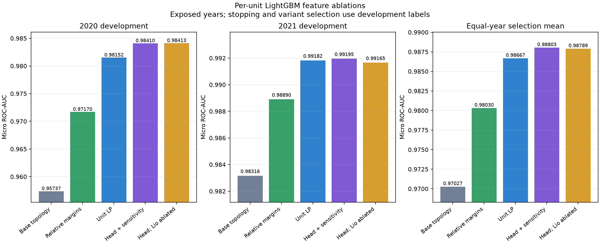

# Screenshot-inspired per-unit LightGBM study

## Status and scope

Completed within the authorized window. The full hydraulic feature block improves this LightGBM baseline on 2020/2021 and the exposed 2022 diagnostic. The retained TCN is stronger on the matched 2022 cases, so it remains the main candidate. One experimental LightGBM submission was generated. On November2 the user reported public score **.99322** for this CSV; this feedback was not independently retrieved and private performance remains unknown.

On November 1 the user authorized up to four hours to build and test an independent interpretation of another team's feature summary. Authorized window: 14:18:43-18:18:43 UTC; fitting cutoff: 18:08:43 UTC. The other team's `delivery/Report.ipynb`, source code, precise LP definitions and hyperparameters were unavailable. This study does **not** reproduce that implementation or attribute a score to it. All previous TCN/XGBoost sources, submissions and historical results are retained.

Runtime source: `analysis/lightgbm_hydraulic_20261101.ipynb`. Native plan, audit, fit logs, predictions, models and stopping curves: `outputs/lightgbm_development/20261101T141843Z_hydraulic/`. The ignored research controller is not a runtime dependency of the notebook.

## What is being tested

Fourteen separate binary LightGBM models fill disjoint generator columns. They do not average predictions, form a meta-learner or combine with the TCN. Each hourly row contains the known context of its own 168-hour scheduling case. Run numbers are mapping metadata, not inputs. Overlapping starts remain separate plans, not independent realizations of the same decision.

| Variant | Features per unit | Intervention |
|---|---:|---|
| `base_topology` | 279 | Retained economic, initial state, terminal value, inflow, constraint and named topology descriptors |
| `relative` | 313 | Add 34 within-case relative-value features |
| `unit_lp` | 340 | Add 18 plant LP channels and nine own-unit schedule summaries |
| `head_sensitivity` | 361 single-unit / 370 multi-unit | Add 21 projected-head/sensitivity descriptors, plus nine own-plant summaries for Tokke/Vinje |
| `head_no_lio_relative` | Lio 327; other units unchanged | Remove the 34 new relative channels only for Lio |

These are counts from actual matrices, not copied targets. The screenshot had a different base inventory and seven net-value pairs; our topology contains eight plant-to-receiving-reservoir groups. Its 307/325/364/355/323 counts therefore are not reproduced.

The screenshot refers to nine reservoirs but does not name them or define its seven net-value pairs. Our independent choice is one local-value margin per **plant**, derived from its named feeder reservoirs, plus all eight available plant intake/receiver value differences. Each is supplied hourly and averaged within its own week: `(9 + 8) * 2 = 34`. This is a different definition, not an assertion that the screenshot used the same channels. The common positive scale is the median absolute value of that case's 168 prices and nine plant-local terminal values, floored at 1 EUR/MWh. The scale uses no labels or fitted population statistic. Differences between local EUR/MWh water values are descriptive coordinates, not exact cascade opportunity costs.

Nine own-unit LP summaries are: discharge fraction, positive-flow proxy, weekly mean fraction, remaining mean fraction, elapsed mean fraction, remaining positive hours, elapsed positive hours, elapsed positive streak and remaining positive streak. A positive-flow proxy is not a physically feasible binary commitment decision. All summaries reset at the case boundary.

## Physical construction and limitations

The conservative LP follows the supplied named hydraulic graph. Parallel discharge variables distinguish the 14 units, with each unit's initial-head discharge capacity and energy conversion. Reservoir conservation, natural inflow (including the supplied river inflow), river minimum flows and soft reservoir minimum/maximum volumes are represented. Soft slack and equality residuals are recorded. No UC labels enter the solver.

The LP has 28 six-hour blocks, inheriting a measured-cost design from the TCN. All target/prediction rows remain hourly. Block-average prices and block-integrated flows approximate the hourly problem; block-end minimum volume uses the maximum requirement in that block. This does not guarantee hourly feasibility inside a block. The six-hour resolution is not established as optimal for LightGBM. Non-unit arcs use an inherited 1000 m3/s numerical upper bound; this is not a measured tunnel capacity. Soft storage violations cost 1e6 EUR/Mm3 in the proxy objective, an inherited large penalty rather than a verified SHOP penalty.

Terminal local energy values are converted to approximate cumulative downstream water values using the supplied generating routes/main-river flags and a 33-point initial-head best-point energy conversion. A second solve updates each block's head from the first LP's projected block-start storage. Two more solves use that same projected head and multiply terminal values by .95/1.05. Five percent is a finite-perturbation heuristic to expose sensitivity, not a tuned or guaranteed useful value. Their schedules provide sensitivity features inside each classifier; they are not additional learned predictors or an ensemble. One head update is not a converged nonlinear solution.

This is not SHOP: startup cost, binary minimum loading, exact head-loss/efficiency nonlinearities and hydraulic travel times are absent. Intake elevation is a capacity-weighted mean of feeder levels; tailwater is the maximum of the outlet elevation and receiving-reservoir levels. These are inherited geometric proxies rather than an exact tunnel hydraulic solution. Interpolation clips levels to the supplied volume/head curves. Similar units can have degenerate relaxed dispatch assignments; supervised learning must decide how useful those proxies are. The statement that relative margins hurt Lio is a hypothesis tested by ablation, not an established domain fact. Tree split-gain importance shows how the fitted trees use correlated inputs; it does not establish causal or independent feature value. Controlled ablations provide the relevant predictive comparison.

Only source-time observed storage and supplied horizon price/inflow/constraints enter a case; water values are taken at S+168h. Subsequent storage is projected by the LP, never read from the observed future volume table. The source follows the supplied task/data-definition documents. Non-fitting checks cover future-storage invariance, label invariance, case isolation, schema, 14-unit mapping, finite values, LP balance and discharge bounds.

## Training and evaluation choices

The initial parameter recipe is binary logloss, learning rate .05, 31 leaves, minimum 100 rows/leaf, L2=10, column fraction .9, row fraction .85 each iteration, histogram max_bin127, seed42 and four CPU threads. These are regularized starting heuristics, not demonstrated optimal values. Native logs retain all parameters, exact dependency versions, feature mappings, tree counts and timing. No class weighting or per-unit rank normalization is applied, preserving the probability scale used for cross-unit ranking. LightGBM requires no learned normalization.

Development uses purged chronological 2020/2021 folds: 1820/360 and 2186/359 fitting/scoring cases. Splits precede hourly expansion, and scoring horizons remain within their year. Per-unit logloss early stopping uses the same development year (patience60, cap800), while the feature variant is selected using equal-year mean official micro ROC-AUC. The learner parameters and stopping policy are shared; each variant selects its own tree budgets. These compare feature families under the same tuning procedure, not the causal effect of adding a column at a fixed tree count. Consequently these are **development tuning estimates**, not independent evaluation. They must not be presented as an unbiased comparison with another model's untouched test result. The declared near-tie heuristic prefers the simpler feature variant within .00002 of the largest mean; .00002 is not a confidence interval.

The requested full variant and the base reference are prioritized. Intermediate relative/unit-LP ablations are conditional on measured timing and the diagnostic/export reserve. Lio-only removal reuses the other 13 disjoint columns unchanged. A complete selected recipe is locked before exposed-2022 scoring, using fixed median development stopping counts per unit. All years already have project exposure. No new full LOYO or independent private evaluation is implied. Stages skipped or truncated for time must be reported explicitly.

The external references are primary documentation: [LightGBM parameters](https://lightgbm.readthedocs.io/en/stable/Parameters.html) defines binary logloss, tree capacity and thread controls; [LightGBM early stopping](https://lightgbm.readthedocs.io/en/stable/pythonapi/lightgbm.early_stopping.html) describes validation-based stopping. Our parameter values and selection thresholds are project choices, not recommendations proven by those pages. No external training data is used.

## Measured results

| Variant | 2020 micro AUC | 2021 micro AUC | Annual mean | Pooled development micro AUC |
|---|---:|---:|---:|---:|
| Base topology | .957368804 | .983163860 | .970266332 | .972523808 |
| Relative margins | .971702836 | .988900334 | .980301585 | .981586728 |
| Unit LP | .981515575 | .991824805 | .986670190 | .987302721 |
| **Head + sensitivity** | **.984097465** | **.991953689** | **.988025577** | **.988459393** |
| Head + sensitivity, remove Lio relative columns | .984125272 | .991653964 | .987889618 | .988294847 |

The full block was selected from equal-year mean before the new 2022 result. There were no time-gated skipped primary stages. Against the base it improves all 14 per-unit AUCs in 2020 and 13/14 in 2021. The remaining unit-level decline is not hidden by the positive overall metric; native per-unit values are in `per_unit_comparison.csv`. Pooled development micro AUC combines the 719 scoring cases from two different forward-fitted models. It is a calibration diagnostic, not the declared selection criterion or a score for one all-data model.

Removing relative columns for Lio helps 2020 global micro AUC by .000027808 but hurts 2021 by .000299725. Lio's own AUC changes .986705371 -> .986585327 in 2020 and .988334731 -> .983552712 in 2021. The overall annual mean falls by .000135959. This rejects that ablation for **our** feature definitions and stopping policy; it does not establish that the other group's different columns could never be redundant. The slight 2020 global improvement despite a lower Lio-only AUC illustrates the role of cross-unit rankings in micro AUC.

## Locked diagnostics and comparison with the retained TCN

| Fixed-budget 2022 recipe | Micro AUC | Fitting/scoring cases |
|---|---:|---:|
| LightGBM base control | .980720270 | 2551 / 359 |
| Selected LightGBM full block | .988133869 | 2551 / 359 |
| Retained .99334-public TCN recipe | **.990136901** | 2551 / 359 |

The full LightGBM block gains .007413599 over its base on this year, but loses .002003032 to the retained TCN. Exact fitting and scoring ID lists were matched against `outputs/tcn_loyo/20261029T103109Z_best_grouped/fold_2022/`; because this is the last year, that LOYO fold has the same fitting set as forward evaluation. Both recipes use fixed transferred training budgets and do not stop on 2022. They differ in architecture, features and historical tuning effort, so this is a comparison of retained recipes, not a pure architecture experiment or proof that one model family is universally superior.

An additional seed17 fit on 2021 uses **each unit's actual seed42/2021 selected tree count**, not the final median counts. It scores .992021477 against matched-budget seed42 .991953689, delta +.000067788. This is a limited two-seed diagnostic, not a seed distribution or independent confirmation. The source, seed42 configuration and exported CSV were not changed in response.

The extra base-2022/seed17 controls were declared at 15:04:21 UTC during primary fitting, before the complete base comparison, candidate lock and new 2022 result. They were conditional on remaining measured time, not in the original `plan.json`. They must not be described as original preregistered confirmation. All years remain exposed project data. The original plan, conditional extension and unchanged export hash are preserved.

## Frozen tree budgets and use

The selected full block uses the rounded median of the two development stopping counts for each unit. This transfers an observed budget to the larger all-data fit; it does not prove the optimum all-data tree count. No selected development model hit the 800-tree ceiling.

| Unit | Final trees |
|---|---:|
| Hogga_G1 | 214 |
| Tokke_G1 | 455 |
| Tokke_G2 | 250 |
| Tokke_G3 | 352 |
| Tokke_G4 | 384 |
| Lio_G1 | 228 |
| Byrte_G1 | 272 |
| Vinje_G1 | 279 |
| Vinje_G2 | 200 |
| Vinje_G3 | 316 |
| Haukeli_G1 | 109 |
| Songa_G1 | 228 |
| Kjela_G1 | 377 |
| Vesle Kjela_G1 | 232 |

There are 3896 fitted trees across 14 disjoint predictors. Each LightGBM predictor internally boosts multiple trees; the unit predictors do not average or stack their outputs. The chosen source embeds its measured configuration, checksum, raw hashes, feature schema hashes and exact dependency versions. Its implementation guard fingerprints executed feature/fitting functions, named graph, physical curves, target mapping and operational model settings. Changing a frozen tree count or LP resolution is rejected in the non-fitting check.

Notebook modes are `check` (default; no classifier fitting), `validate` (selected variant on the same development folds with stopping), `holdout` (exposed 2022 at fixed median counts) and `submit` (all 2922 labeled cases, predict the mapped 725 cases). Submit writes a new timestamped directory. Runtime code and the equivalent micro-AUC adapter are inline: no separate project Python source, pretrained weights or downloaded/cache artifacts are needed. The external supplied course metric was used to audit the adapter and native scores.

The final notebook was assembled after fitting by embedding the frozen configuration, guards and an equivalent inline metric adapter. Feature/fitting bytecode identities match the exact archived training source. Non-fitting availability, mapping, metric and guard checks passed after publication. A separate full Run All refit of the published notebook was **not** performed; repeat-fit and cross-machine bytewise reproducibility are not established. This remains experimental source, not the official Short-notebook delivery.

## Costs, integrity and artifacts

The study completed 172 classifier fits: two small smoke fits, 112 development fits (four variants x two years x 14 units), two Lio ablations, 14 selected-2022 fits, 14 all-data fits, 14 base-2022 controls and 14 seed17 fits. LP solves are deterministic feature calculations and are not counted as classifier fits. The last fitting process completed at 16:26:32.944272 UTC, before the 18:08:43 fitting cutoff. No fitting remains active.

The primary controller took 5837.85 seconds (about 97 minutes), including feature preprocessing and model comparisons. The all-data classifier stage took 672.11 seconds (about 11 minutes) **after LP precomputation**. The largest recorded model-end process RSS was 2.754 GiB; this is a sample, not a measured peak or total-system memory. All fits use four CPU threads. A standalone raw Run All wall time was not separately measured, and these timings must not be quoted as a direct end-to-end notebook benchmark.

The exported file is `outputs/lightgbm_hydraulic_20261101.csv`, 725 rows x 2353 columns including Run No, SHA256 `f6bc9a0c2db660dbc6ce771ee3b5c2020f43ea31cd75eaa7ff27cf730191e830`. Exact template order, IDs and finite probabilities in [0,1] passed. All 11 complete full-unit fold scores were recomputed with the provided course metric; the two assembled Lio replacement results were also recomputed in the summary. Source-time availability, label/future-storage invariance, case isolation, LP water balance and frozen-config rejection passed with classifier fitting/pretrained loading blocked. The figure was visually checked.

Native entry points: `integrity.json`, `publication_identity.json`, `checks/retained_check.json`, `development_comparison.csv`, `lio_comparison.json`, `per_unit_comparison.csv`, `resource_costs.csv`, `selected_configuration.json`, `frozen_runtime_configuration.json`, `tcn_2022_comparison.json`, `additional_diagnostic_results.json` and `export.json`. The exhaustive feature names for all variants are in `checks/feature_inventory.csv`; every actual fitted unit also records its exact column order. Pinned runtime: `environments/lightgbm_hydraulic.txt`.

Earlier TCN/XGBoost sources, requirements, README, datasets, previous submissions and the complete original experiment history are unchanged. No packages were installed, no Kaggle upload occurred and no commit/push was made. The course report, student/team metadata and official Short packaging remain unfinished. The best reported TCN public score remains .99334; the user subsequently reported public **.99322** for this LightGBM CSV (November2), with private performance unknown. Further development and all-year LOYO are documented separately in [the November2 study](lightgbm_net_commitment_20261102.md).

