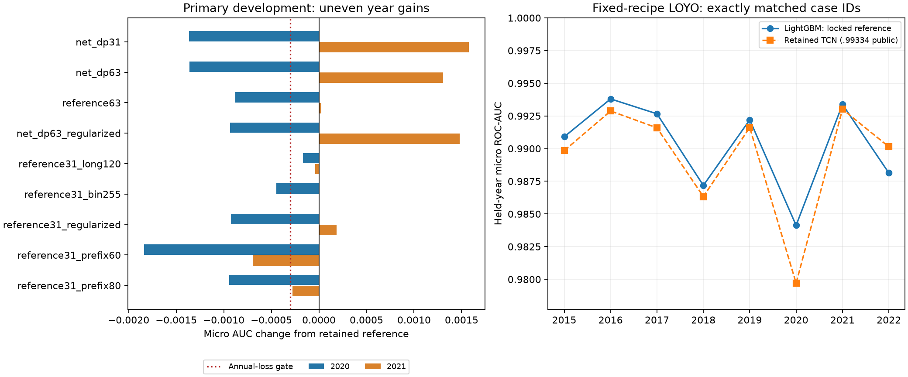

# LightGBM net opportunity, commitment proxies and all-year LOYO

## Status and authorization

All fitting completed within the authorized window; non-fitting publication/checks were finalized after the user resumed. The user reported .99322 for `outputs/lightgbm_hydraulic_20261101.csv` (SHA256 `f6bc9a0c2db660dbc6ce771ee3b5c2020f43ea31cd75eaa7ff27cf730191e830`) and requested improvements, earlier-year validation, a new submission and LOYO across all labeled years. This feedback is user-reported, not independently retrieved; it does not establish a private score.

Six-hour authorization: November 2, 01:28:58-07:28:58 UTC, fitting cutoff 07:18:58. Full eight-year LOYO and the final export take priority over optional model search. No installs, cross-model blending, upload, commit or push. Earlier sources, submissions, datasets and the complete original history remain preserved.

Native evidence: `outputs/lightgbm_development/20261102T012858Z_net_commitment/`. Experimental runtime source: `analysis/lightgbm_net_commitment_20261102.ipynb`. Research controllers and deterministic LP caches are ignored evidence, not notebook runtime dependencies or pretrained classifier artifacts.

## Hypotheses and feature definitions

The November 1 recipe remains the reference: 14 independent LightGBM classifiers, six-hour conservative unit LPs, projected-head correction and water-value sensitivity. New features retain its complete 361/370-channel inventory and add 34 channels, for **395 single-unit / 404 multi-unit features**. More physical detail is a hypothesis, not evidence of a predictive gain by itself.

The legacy one-node descriptor `price + plant_shadow / unit_energy` remains unchanged for comparability. It is not the complete unit-arc reduced profit. For a unit arc from plant node L to receiving node R, the new descriptors use:

`water_opportunity_cost = dual_R - dual_L` in EUR/Mm3;

`net_profit_per_Mm3 = hourly_price * unit_energy - water_opportunity_cost`;

`net_margin_per_MWh = hourly_price - water_opportunity_cost / unit_energy`.

External-sink dual value is zero. The sign and units follow the LP's outflow-minus-inflow conservation convention. Unit arc net profit is checked against the negated sum of lower/upper bound marginals (KKT stationarity tolerance 1e-4). This does not make the continuous LP an exact binary SHOP model.

Twelve new economic channels contain the water opportunity cost, projected head relative to initial head, min/mid/max-load net margins in EUR/MWh and normalized by within-case money scale, minimum discharge fraction, relaxed flow divided by minimum stable flow, a relaxed-flow-below-minimum flag and a positive minimum-load profit flag. The legal operating powers are p_min, midpoint(p_min,p_max), p_max. All supplied p_nom values equal p_max; SHOP documents p_nom as a droop rating, so it would not supply a distinct operating point. The midpoint amendment was recorded before classifier fitting, and the unchanged LP source was verified against the preflight snapshot.

Twenty-two DP channels contain nine binary proxy schedules, nine ON-versus-OFF max-marginal advantages, scenario consensus and the central schedule's weekly fraction, elapsed ON hours and remaining ON hours. Nine scenarios combine water-cost multipliers .95/1/1.05 with normalized switching persistence scales .01/.1/1. Each hour's ON emission takes the best proxy profit over the three legal loading points. OFF emission is zero. Initial/final state is free; there is no minimum uptime/downtime, ramping or rerouting of water after binarization. The DP is not guaranteed feasible for the hydraulic network and is never submitted directly as the target probabilities.

### Avoid mixing NOK startup costs with EUR prices

The supplied prices are EUR/MWh; [SHOP's generator documentation](https://docs.shop.sintef.energy/objects/generator/generator.html) describes startcost_const/stopcost_const in NOK, and p_min/p_max in MW. A supplied exchange-rate convention for this case generator is not established. No external FX data is used. Each generator's cost per MW is divided by the median cost per MW across supplied generators, cancelling the common cost currency. Profit is normalized by the case's price/value scale times the unit's maximum power. Persistence penalties use the dimensionless unit cost ratios and declared scenario scales. These are economic sensitivity coordinates, **not** reconstruction of actual monetary startup costs. The scales span two orders of magnitude as a heuristic; they are not validated optima or physical minimum run durations.

All dynamic features use only initial observed storage, supplied week inputs and S+168h water values. Updated head/storage and water-cost duals come from case-local LPs, not future observed storage or UC labels. The within-case money scale uses supplied prices and terminal values, not fitted population statistics. Physical metadata is fixed from the supplied topology; no external training data is added.

## Development protocol and time reserve

Primary tuning folds are the same purged 2020/2021 periods as the reference, split before hourly expansion. The exact reference predictions, IDs and parameters are reused and verified; they are not counted as fresh fits. Primary tree-count selection uses binary-logloss early stopping (patience60, cap1000), except the explicitly fixed longer-budget control and evaluation-only shorter prefixes. All newly fitted classifiers start cold. Primary scores are tuning estimates because the same year selects tree counts and feature/parameter recipes. The declared learner experiments are:

| Recipe | Features | Leaves | Minimum rows/leaf | Learning rate |
|---|---|---:|---:|---:|
| Reference31 | Existing head/sensitivity | 31 | 100 | .05 |
| Net/DP31 | Add net/DP channels | 31 | 100 | .05 |
| Net/DP63 | Add net/DP channels | 63 | 100 | .05 |
| Reference63 | Existing head/sensitivity | 63 | 100 | .05 |
| Conditional regularized net/DP63 | Add net/DP channels | 63 | 300 | .03 |

L2=10, row/column fractions .85/.9, max_bin127, seed42 and four CPU threads are otherwise retained. The original conditional trigger required a primary net/DP63 mean gain and sufficient time. After both new-feature recipes lost substantially on 2020 but gained on 2021, the trigger was explicitly broadened before the conditional scores were measured. This was adaptive development, not preregistered confirmation. Time-skipped stages must remain explicitly skipped, not be presented as negative quality results.

At primary lock, candidates must fit the measured projected budget for older stress folds, all eight LOYO fits, final export and audit margin. Runtime-ineligible recipes are distinguished from quality failures. Quality eligibility requires no primary-year loss greater than .0003 to the reference; selection uses equal-year mean micro AUC and prefers a simpler recipe within .00003 of the best. These are declared heuristic safeguards, not confidence intervals.

One proposal is locked before two new **chronological 2018/2019** stress comparisons against fresh reference fits. If its two-year stress mean loses more than .0001 or one stress year loses more than .0005, the reference is retained; alternatives are not reranked using those results. Final per-unit tree budgets are the rounded median of primary stopping counts. This transfers a measured budget to larger fits and does not prove an all-data optimum. All years already have project exposure. Before a complete older proposal/reference comparison or any LOYO scores, the older protocol was amended to use each recipe's fixed primary-median tree counts: no stopping on older scoring labels. An earlier baseline-only stopping run was archived under `older_stress_before_fixed_budget/` and is superseded, not additional fixed-protocol evidence.

## Adaptive controls and execution transparency

The three initial recipes were net/DP31, net/DP63 and reference63. The regularized net/DP63 candidate retained its originally specified parameters but received an amended eligibility trigger after the initial net results. Subsequently declared reference-feature controls tested minimum leaf300/LR.03, max_bin255, and max_bin63. Lower histogram resolution can regularize thresholds; higher resolution can separate closer price/physical boundaries. Neither direction is assumed better in advance.

Own November1 reference checkpoints were evaluated at .6/.8 of each unit's selected tree count after verifying that full-count predictions replayed bitwise for all 14 units and both years. These are 56 checkpoint evaluations, not 56 new fits or independent seed evidence. As both shorter prefixes lost, one adjacent1.2-count cold-fit control tested whether logloss stopping had under-trained for micro AUC. These directions were added adaptively before their respective results; the search was explicitly closed after bin63. All controls remain subject to the same quality gates and full-LOYO resource reserve. A stage skipped for time is not a measured failure.

Resource forecasts were refined using actual per-unit durations and chosen tree counts. For the unchanged reference, a previously measured 2551-case fixed fit (570.5592s) and 2922-case all-data fit (672.1123s) received a 1.5 safety factor. These are planning estimates, not newly measured round runtimes. The two older fitting sets together contain 2545 cases; their fixed-budget forecast scales accordingly. Audit and test-LP time is reserved separately.

Research controllers were restarted to activate declared extensions and repair resumption. Completed predictions were reused only after ID/parameter/score checks; partial folds were archived and restarted cold without classifier-weight loading. Predictor/feature functions were unchanged once classifier fitting began. The controller's local-variable scope error at the export boundary was corrected separately from model code; it could fail before a fit call but could not change fitted data or predictions. Exact controllers, interruptions, decisions and source snapshots remain in the ignored native evidence directory. None is a published-notebook runtime dependency.

## Fixed-recipe LOYO definition

After final recipe/budget lock, an all-data CSV is produced and then each year 2015-2022 receives a fresh cold fit. No LOYO result changes the candidate or CSV. Fitting case horizons must lie wholly before the held-year start or start at/after its end. Scoring case horizons must be wholly within the held year. This excludes overlapping plans, preserves the 168-hour horizon and yields 359 scoring starts per ordinary year / 360 per leap year: **2874 scoring cases**, with 48 cross-year starts excluded from scoring.

No held-year early stopping or model initialization from another fold is used. Learned tree bins and splits use fitting cases only. Earlier held years train on future labeled years: **LOYO is a transfer/interpolation diagnostic, not chronological forecasting**. Recipe selection has already seen some years, so these are OOF predictions conditional on a selected exposed recipe, not nested unbiased model-selection estimates. Mean annual micro AUC and pooled micro AUC are reported separately; per-unit values and exact case roles are retained. This round uses seed42 only; checkpoint reuse or identical-input refits do not establish seed stability. Millions of overlapping targets are not independent observations, so small AUC differences are not accompanied by naive cell-level confidence claims.

## Checks before fitting

The two-state DP matches exhaustive enumeration of all 64 state paths for six-hour toy cases, including conditional ON/OFF max-marginals. Unit reduced-profit identities and reservoir conservation pass. New feature availability tests explicitly clear caches and confirm invariance to future observed storage and flipped UC labels, as well as isolated-case versus batch equality. Every original feature is preserved exactly on the fixture. Tests cover all 14 units and actual 395/404 schemas. Research cache reuse is limited to deterministic LP inputs/results; no learned weights or held-label-dependent transformations are loaded.

## Measured results

The search retained **reference31**. No new feature/parameter recipe established a supported replacement under the declared quality/resource gates. The new cold all-data CSV is **byte-identical to the user-reported .99322 submission**. Do not spend a Kaggle submission on identical bytes expecting a different score.

| Recipe | 2020 micro AUC | 2021 micro AUC | Equal-year mean | Annual quality gate |
|---|---:|---:|---:|---|
| reference31 | 0.984097465 | 0.991953689 | 0.988025577 | pass |
| net_dp31 | 0.982730822 | 0.993527773 | 0.988129297 | fail |
| net_dp63 | 0.982735049 | 0.993260439 | 0.987997744 | fail |
| reference63 | 0.983217937 | 0.991976874 | 0.987597406 | fail |
| net_dp63_regularized | 0.983165304 | 0.993434702 | 0.988300003 | fail |
| reference31_long120 | 0.983930628 | 0.991916013 | 0.987923320 | pass |
| reference31_bin255 | 0.983648578 | 0.991954941 | 0.987801760 | fail |
| reference31_regularized | 0.983174185 | 0.992138127 | 0.987656156 | fail |
| reference31_prefix60 | 0.982259054 | 0.991257635 | 0.986758344 | fail |
| reference31_prefix80 | 0.983153036 | 0.991674493 | 0.987413765 | fail |

Higher average AUC alone did not promote net/DP: its 2020 loss exceeded .0003. The annual gate is a declared robustness preference, not statistical significance. Longer 120% training also lost both primary years; resource eligibility is separately recorded in `proposal_lock.json`. The optional bin63 control was **not run** because of the full-LOYO time reserve, so no quality conclusion is drawn for it. Shorter 60%/80% rows are own-model checkpoint evaluations, not fresh fits.

The net/DP31 loss is not only a cross-unit calibration effect: per-unit 2020 AUC falls by .005760 on Tokke_G2, .003170 on Tokke_G3, .002646 on Tokke_G4 and .002429 on Songa_G1. These are conditional diagnostic deltas, not causal feature importance; the full table is `primary_per_unit_deltas.csv` in native evidence.

### Earlier chronological validation

| Year | Fitting/scoring cases | Fixed-recipe micro AUC |
|---|---:|---:|
| 2018 | 1090/359 | 0.982436684 |
| 2019 | 1455/359 | 0.991861063 |

These are new cold fits with fixed primary-median budgets and purged chronological partitions. Since the proposal is the reference itself, one fit per year suffices; there is no artificial duplicate comparator. These measurements assess earlier-year weakness but do not demonstrate an improvement over an earlier-year baseline.

### All eight fixed LOYO folds

| Held year | Fitting/scoring cases | LightGBM micro AUC | Retained TCN micro AUC |
|---|---:|---:|---:|
| 2015 | 2557/359 | 0.990905288 | 0.989841487 |
| 2016 | 2550/360 | 0.993800674 | 0.992877718 |
| 2017 | 2551/359 | 0.992661067 | 0.991587756 |
| 2018 | 2551/359 | 0.987181088 | 0.986328212 |
| 2019 | 2551/359 | 0.992200432 | 0.991616129 |
| 2020 | 2550/360 | 0.984127432 | 0.979700929 |
| 2021 | 2551/359 | 0.993379090 | 0.993012253 |
| 2022 | 2551/359 | 0.988133869 | 0.990136901 |

LightGBM **mean annual micro AUC: 0.990298618**; **pooled OOF micro AUC: 0.990828693**. The two aggregate metrics differ because pooled AUC also compares scores between different years. There are 2874 unique scoring starts; 48 cross-year starts are excluded from scoring. The TCN comparison verifies exact fitting/scoring IDs in every year, but compares separately selected/exposed recipes rather than an unbiased model-family experiment. TCN mean/pooled values are .989387673/.989793683.

### Frozen source, CSV and resources

- Selected feature variant: `head_sensitivity`; 361 single-unit/370 multi-unit channels. The 34 new net/DP channels remain experimental code and are **not used** by the retained fitting recipe.
- Learner: 14 disjoint classifiers; 31 leaves, LR .05, minimum 100 rows/leaf, L2=10, max_bin 127, row/column fractions .85/.9, seed 42, four threads. These are retained measured settings, not a global optimum.
- Final tree counts: `{'Hogga_G1': 214, 'Tokke_G1': 455, 'Tokke_G2': 250, 'Tokke_G3': 352, 'Tokke_G4': 384, 'Lio_G1': 228, 'Byrte_G1': 272, 'Vinje_G1': 279, 'Vinje_G2': 200, 'Vinje_G3': 316, 'Haukeli_G1': 109, 'Songa_G1': 228, 'Kjela_G1': 377, 'Vesle Kjela_G1': 232}`. Total 3896; each unit transfers the rounded median of its 2020/2021 stopping counts.
- CSV: `outputs/lightgbm_net_commitment_20261102.csv`, 725 x 2353, SHA256 `f6bc9a0c2db660dbc6ce771ee3b5c2020f43ea31cd75eaa7ff27cf730191e830`.
- New all-data fit: 644.95s. Eight LOYO fits: 4539.40s total; individual range 562.03-582.01s. These figures do not include the initial raw-LP preprocessing, search, interrupted work, tests or final documentation.
- Source: `analysis/lightgbm_net_commitment_20261102.ipynb`; environment: `environments/lightgbm_net_commitment.txt`; non-fitting check: `.\.venv\Scripts\python.exe tests/check_lightgbm_net_commitment.py`.

The notebook is self-contained and defaults to check mode. Publication verifies executed feature/fitting implementation identity, exact schemas, raw hashes and actual fold IDs. It did not receive a second full published-notebook Run All fit or cross-machine reproduction. A research-only deterministic LP cache accelerated this round; it is not loaded by notebook runtime. Native per-unit tables, case roles, stopping curves, arrays, source snapshots and interruption logs remain preserved. Final integrity/non-fitting outcomes are recorded in the publication manifest. No uploads, installs, ensembling, commits or pushes occurred. Final report/official Short packaging and student metadata remain unfinished.

Independent integrity and published-source non-fitting checks passed. The latter performs zero real classifier fits (one mocked fit-adapter call), verifies outside-case exogenous/terminal/storage invariance, future-storage and label invariance, case isolation, exact LOYO coverage and official metric equivalence. Figure layout was visually inspected after moving the legend clear of all bars. All eight LOYO fitting/scoring ID sets match the retained TCN; LightGBM wins seven annual comparisons, while TCN wins 2022. This supports retaining distinct model candidates, not a private-performance guarantee.
