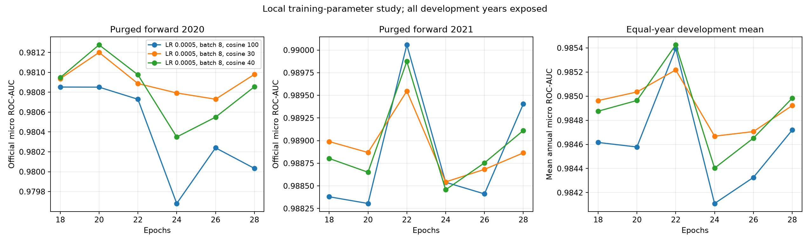
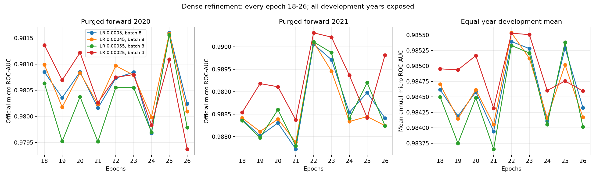

# October 30: local TCN training-parameter refinement

**Outcome: retain the existing recipe: initial learning rate 0.0005, batch 8, 22 epochs, cosine denominator 100.** None of the proposed replacements passed all decision checks, so no new all-data fit, notebook or submission was produced. The user-reported .99334 public source and CSV remain unchanged: `analysis/tcn_tuned_alternative_20261029.ipynb` and `outputs/tcn_tuned_alternative_20261029.csv`. This supports retaining the recipe among the tested alternatives; it does not prove a global optimum.

The user authorized up to four hours to investigate nearby learning rates, batch sizes and epoch budgets. One standalone shared TCN retains the .99334 public parent's architecture and all 913 hourly/182 static features. Public scores are user reports; no new Kaggle score is known.

Measured scope: **71 unique primary training recipes**, each scored on forward 2020 and 2021; 26 cold full-fold trajectories including diagnostic/reproduction fits; 158 unique saved checkpoint score files independently audited. Tiny functional proof fits are excluded from these counts. Repeated reference fits are reproducibility checks, not independent performance evidence.

## Predeclared design

Four LR/batch pairs: (.0005,8),(.0004,8),(.0006,8),(.000625,16). Checkpoints 16/18/20/22/24/26/28, seed 42, symmetric temporal CNN, BCE/AdamW, cosine denominator 100/floor .1, all other settings fixed. Cases are split before expansion; horizons are purged, scoring horizons stay inside each calendar year and scalers use fitting cases only. The actual target is official micro AUC, including cross-unit rankings. No held-out labels enter inputs or normalization.

One common LR/batch/epoch is ranked on the equal-weight mean of forward 2020 and 2021; recipes within .00002 of the best mean prefer the larger minimum neighboring-checkpoint mean, then proximity to 22, then lower LR. This rule favors a less isolated optimum among near ties. It is a declared heuristic, not a confidence test. The proposal is locked before 2022/seed 17 controls; those veto promotion rather than selecting a replacement. All years have prior project exposure.

## Conditional fine stage

The dense refinement was declared at 2026-10-30T00:57:36.271385+00:00, before the original proposal lock or its 2022/seed diagnostic scores. It depended only on a batch 8 twofold winner and prospective time margin, not on diagnostic outcomes. Four equally dense LR/batch trajectories (.0005,8),(.00045,8),(.00055,8),(.00025,4) were scored every epoch 18 through 26 on both forward years. The same mean/near-tie criterion selected a common recipe within this fine grid. Half LR with half batch is a heuristic to approximately preserve LR times updates per epoch; it is not an established optimal scaling law. The original study and all scores remain in `coarse_results.json`; fine locks/scores remain separately. No replacement was selected by searching the diagnostic years.

The dense-stage proposal was **LR 0.00025, batch 4, 22 epochs, cosine denominator 100**. It improved all three exposed years at seed 42, but failed the predeclared second-seed gate:

| Year | Incumbent, seed 42 | Batch-4 proposal, seed 42 | Change |
|---|---:|---:|---:|
| 2020 | 0.980729514 | 0.980747816 | +0.000018302 |
| 2021 | 0.990057626 | 0.990309033 | +0.000251408 |
| 2022 | 0.990136901 | 0.990656324 | +0.000519423 |

Matched 2021 seed 17: incumbent **0.989836348**, batch-4 proposal **0.989305079**, change **-0.000531269**. This candidate was rejected under the declared rule. It is not evidence that batch 4 is universally inferior.

The reference at 25 epochs scored .981599354 on 2020 but .988979922 on 2021, below the incumbent's equal-year mean. Dense sampling found a real missed local peak; it did not justify using a different stopping epoch for each year.

## Conditional learning-rate decay stage

Declared at 2026-10-30T01:53:44.686520+00:00, before the dense-stage proposal or diagnostic results. This stage required primary mean gain < .00015 and a prospective time margin. It held initial LR 0.0005/batch 8 fixed and compared cosine denominators 100/30/40 at epochs 18/20/22/24/26/28. The 100 reference reused exact matched predictions; 30/40 were new cold fits. The hypothesis was that lower late-training LR might reduce checkpoint variability; observed variability does not itself prove its cause. The original update function parameterizes the denominator through max_epochs, which also sets the maximum allowed epoch. Small-fit probability and continuation-RNG equivalence to the original notebook trainer passed with max_epochs 30.

Only a >.00002 twofold mean gain over the fine-stage proposal could replace it before new schedule diagnostics. Actual schedule-stage status: **complete_not_selected**. Prior 2022/seed results were already exposed; final-stage diagnostic outcomes did not select replacement settings. The plotted curves/table show the final selected primary stage. All stage comparisons remain in native CSV/JSON.

Denominator 30 places most decay near the 18-28 stopping range; 40 is a more gradual intermediate comparator to 100. With 2,186 fitting cases, batch 8 leaves a final minibatch of 2 cases. BCE uses a minibatch mean and AdamW updates after each batch, so a small final batch could contribute to checkpoint variance. This was not causally isolated; random reshuffling does not establish population bias. Neither drop_last nor loss weighting was changed.

A baseline-promotion rule was added at 2026-10-30T02:24:37.375604+00:00, before the fine seed 17 result and before schedule fitting: a fine candidate passing its own criteria becomes the supported incumbent. A new schedule candidate must then improve that fixed fine baseline on the three-year/seed checks; otherwise retain the exact supported incumbent, without trying replacement settings.

## Post-screen protocol amendment

Declared at 2026-10-30T03:02:36.461799+00:00. The schedule eligibility gate compared against the fine-stage primary peak even though that candidate failed its own seed 17 check; the actually supported incumbent was still the .99334 original. Eligibility was corrected after screening to evaluate the already locked schedule proposal against that supported original. No parameter was changed or reranked. The original three-year/seed 17 gate was frozen before either new-recipe diagnostic. All prior fine diagnostics and primary years were exposed, so this is adaptive development and not a preregistered confirmation. The original complete_not_selected schedule decision is preserved. This amendment and its timing must be disclosed in any course report.

## Actual measurements

| Setting | Initial LR | Batch | Cosine denominator | Epochs | Forward 2020 | Forward 2021 | Equal-year mean |
|---|---:|---:|---:|---:|---:|---:|---:|
| cosine30 | 0.0005 | 8 | 30 | 18 | 0.980937178 | 0.988989490 | 0.984963334 |
| cosine30 | 0.0005 | 8 | 30 | 20 | 0.981200835 | 0.988868620 | 0.985034728 |
| cosine30 | 0.0005 | 8 | 30 | 22 | 0.980887624 | 0.989547630 | 0.985217627 |
| cosine30 | 0.0005 | 8 | 30 | 24 | 0.980792850 | 0.988543785 | 0.984668317 |
| cosine30 | 0.0005 | 8 | 30 | 26 | 0.980729995 | 0.988682341 | 0.984706168 |
| cosine30 | 0.0005 | 8 | 30 | 28 | 0.980979961 | 0.988863982 | 0.984921971 |
| cosine40 | 0.0005 | 8 | 40 | 18 | 0.980947549 | 0.988802668 | 0.984875108 |
| cosine40 | 0.0005 | 8 | 40 | 20 | 0.981277401 | 0.988650773 | 0.984964087 |
| cosine40 | 0.0005 | 8 | 40 | 22 | 0.980976082 | 0.989874899 | 0.985425491 |
| cosine40 | 0.0005 | 8 | 40 | 24 | 0.980349527 | 0.988456695 | 0.984403111 |
| cosine40 | 0.0005 | 8 | 40 | 26 | 0.980549252 | 0.988754246 | 0.984651749 |
| cosine40 | 0.0005 | 8 | 40 | 28 | 0.980854833 | 0.989111059 | 0.984982946 |
| reference | 0.0005 | 8 | 100 | 18 | 0.980852375 | 0.988379630 | 0.984616002 |
| reference | 0.0005 | 8 | 100 | 20 | 0.980851363 | 0.988305501 | 0.984578432 |
| reference | 0.0005 | 8 | 100 | 22 | 0.980729514 | 0.990057626 | 0.985393570 |
| reference | 0.0005 | 8 | 100 | 24 | 0.979679960 | 0.988539824 | 0.984109892 |
| reference | 0.0005 | 8 | 100 | 26 | 0.980240440 | 0.988411337 | 0.984325889 |
| reference | 0.0005 | 8 | 100 | 28 | 0.980033327 | 0.989403861 | 0.984718594 |

Rejected schedule proposal: **LR 0.0005, batch 8, 22 epochs**.

Rejected proposal's cosine denominator/epoch ceiling: **40**; floor .1. The retained recipe still uses **100**.

| Year | Locked proposal | Incumbent LR 0.0005/b8/e22 | Change |
|---|---:|---:|---:|
| 2020 | 0.980976082 | 0.980729514 | +0.000246568 |
| 2021 | 0.989874899 | 0.990057626 | -0.000182727 |
| 2022 | 0.990002832 | 0.990136901 | -0.000134069 |

Matched 2021 seed 17 reference: 0.989836348; candidate change: -2.994512443155184e-05. Promotion criteria passed: **False**. Seed outcomes are limited stability evidence, not population uncertainty or a private-score estimate.

Per-generator comparisons are in `per_unit_comparison.csv`. These AUCs do not average to official micro AUC, which also depends on cross-unit rankings.

| Year | Units improved | Units declined | Tied/undefined |
|---|---:|---:|---:|
| 2020 | 7 | 7 | 0 |
| 2021 | 7 | 7 | 0 |
| 2022 | 9 | 5 | 0 |

## Export decision

No new submission was exported. Reason: Predeclared promotion criteria failed; incumbent retained. The incumbent source/submission is retained; lack of broad improvement is a valid negative result.

## Integrity and limits

Small cold-fit trajectory proofs matched every original weight/probability bitwise for batch 8/seed 42 and batch 16/seed 17, including continuation RNG. Full reference at 22 predictions matched original 2020/2021 exactly. All actual checkpoint scores were independently recomputed with provided `kaggle_metric.py`; partitions and source/CSV/history/environment hashes were audited.

The first helper launch was stopped during small proof/preprocessing work after detecting a seed-reference path lookup inconsistent with the native directory name. Its bytes/logs are archived; no full-fold result from that attempt enters selection. Corrected lookup uses the immutable native candidate record. No dataset, old notebook, submission or 5,246-line history was changed.

This is local tuning, not a global optimum. Adjacent starts overlap and are dependent; no claim of statistical significance is made. Batch changes update count and gradient noise together; learning-rate and epoch effects interact. The schedule was held at 100 in the first two stages and explicitly varied only in the later controlled stage. Prior LOYO results belong to the retained parent; no new recipe received full LOYO. Public/private split remains unknown.

Native plan, full curves/predictions/scalers/IDs and original hashes: `outputs/tcn_development/20261030T000742Z_local_parameters/`. Primary study runtime 183.43 minutes, excluding optional extended-seed fits and final export/audits.

Per-trajectory measured epoch times and derived update counts are in `resource_costs.csv` under the native round. Study update counts are derived from the actual fitting-case counts, batch sizes and saved epoch counts. No final all-data fit was run in this round.
