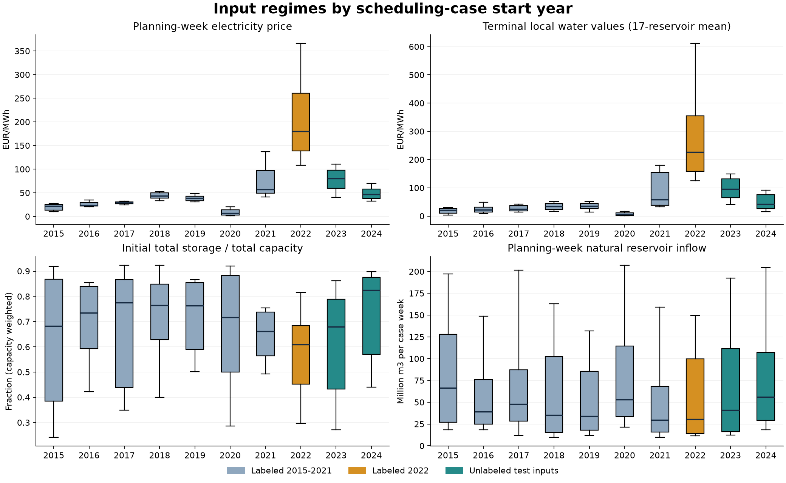
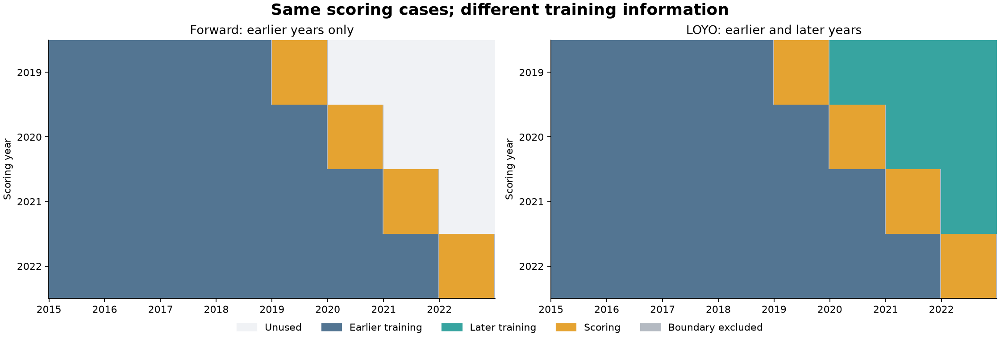
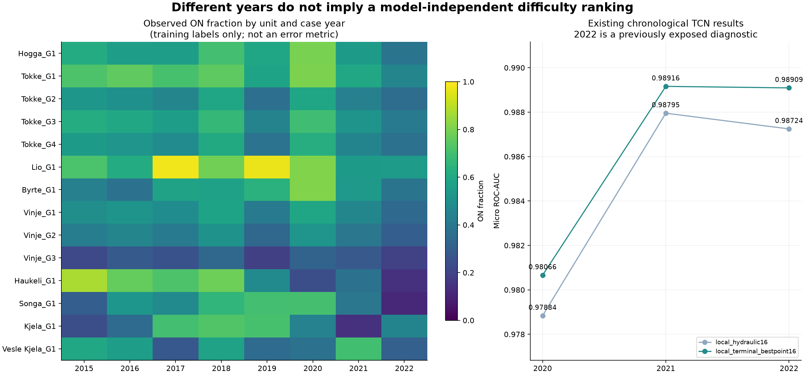
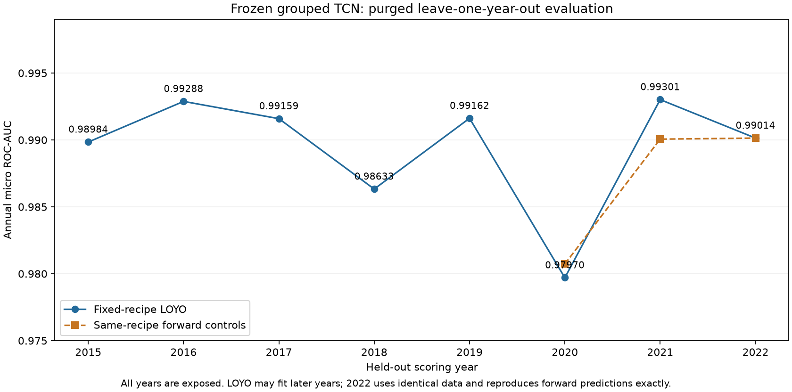
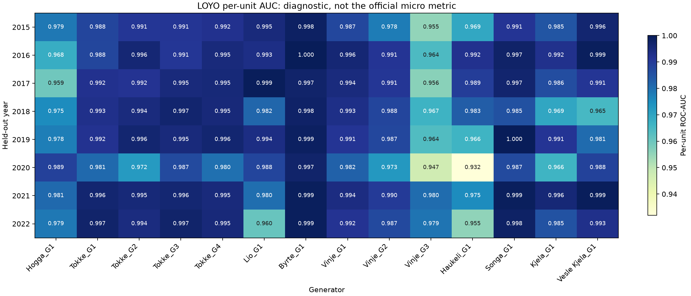

# Is 2022 uniquely difficult? Forward validation and LOYO

**For the frozen TCN recipe, 2020 and 2018 have the lowest measured LOYO AUC;
2022 is not uniquely difficult.** Leave-one-year-out (LOYO) is useful as a
supplementary regime-transfer test. A higher LOYO score would not establish a
better estimate of post-2022 performance.

The original EDA and partition audit below were run without fitting models or loading weights. A subsequent trained LOYO diagnostic is recorded at the end of this document. Reproduce the
plots and partition audits with [year_diagnostics.ipynb](../analysis/year_diagnostics.ipynb).
It reads supplied raw data, and optionally reads existing historical TCN scores.
The selected 0.99261 TCN notebook, its configuration and submissions are unchanged.

## What the supplied inputs show

These distributions use the inputs for each daily scheduling case: initial
storage at S, prices/inflows during [S,S+168h), and water values at S+168h.
Boxes show case quartiles and medians, with 10th/90th percentile whiskers.
Overlapping daily horizons are dependent; these are descriptive distributions,
not independent statistical replicates. Test-year inputs have no UC labels.

| Case-start year | Mean planning-week price, EUR/MWh | Mean terminal local water value, EUR/MWh | Mean initial total fill fraction |
|---|---:|---:|---:|
| 2020 | 9.30 | 7.99 | .677 |
| 2021 | 75.93 | 91.67 | .642 |
| 2022 | 211.24 | 295.51 | .576 |
| 2023 (test inputs) | 78.95 | 97.55 | .614 |
| 2024 (test inputs) | 50.15 | 50.27 | .727 |

Water values above are an unweighted mean of 17 local reservoir values, not
the model's converted network water cost. Fill fraction is capacity weighted.
2024 covers the supplied case starts through December 25, not all 366 starts.

The input changes are substantial in both directions: 2020 is unusually cheap,
whereas 2022 is unusually expensive and has lower mean initial storage. Test
inputs do not simply repeat the 2022 regime. The mean within-case fraction of
negative-price hours is about 2.0% in 2023 and 2.4% in 2024, versus below .1%
in each labeled year. These are observations, not explanations of UC errors.

## Why LOYO may score higher on earlier years

For a common scoring set, this audit requires each scoring case's whole
168-hour horizon to remain inside its year. Fitting cases with overlapping
horizons are removed. All partitions are checked by timestamps, not a fixed
row-count gap. Under this convention:

| Scoring year | Scoring cases | Forward fitting cases | LOYO fitting cases | Later-year cases added by LOYO |
|---|---:|---:|---:|---:|
| 2020 | 360 | 1,820 | 2,550 | 730 from 2021-2022 |
| 2021 | 359 | 2,186 | 2,551 | 365 from 2022 |
| 2022 | 359 | 2,551 | 2,551 | 0 |

LOYO changes both training-set size and regime coverage. For example, in the
2021 forward fold, **53.5%** of scoring cases' weekly mean prices fall outside
the fitting distribution's 1st-99th percentile interval. Including 2022 in LOYO
reduces that descriptive fraction to **0%**. For 2022 it remains **70.2%** under
both protocols, because their fitting cases are identical. The corresponding
terminal-value fractions for 2022 are **65.7%** under both protocols.

This is not a universal benefit: for low-price 2020, the price fraction outside
that interval is **56.9% forward versus 58.3% LOYO**. Adding later regimes does
not restore a missing low-price regime. These simple case summaries do not
measure coverage of the full 913/182 feature space or estimate ROC-AUC.

A plain leave-year-out group split is insufficient for overlapping cases.
Here, a scoring year's horizon coverage is [January 1, next January 1), so
previous-year starts whose horizons cross January 1 must be purged. If scoring
includes all December starts instead, its horizons extend into January and the
right-hand training boundary must be purged too. Learned scaling and any inner
stopping/calibration must also exclude the scored year.

## What the existing TCN scores say

The heatmap shows changes in observed ON fractions, not prediction accuracy.
The score panel reads preserved chronological results for two earlier recipes:

| Recipe | 2020 micro AUC | 2021 micro AUC | Exposed 2022 diagnostic |
|---|---:|---:|---:|
| Local hydraulic routing, v22 | .97883543 | .98795214 | .98724470 |
| Best-point terminal conversion, v32 | .98065880 | .98915965 | .98909166 |

For these TCNs, 2020 had the lowest measured score. V32's 2022 score was close
to its 2021 score. This does not disprove Jonas's experience with XGBoost;
year difficulty depends on the model, representations and training protocol.

These are not controlled tests of intrinsic year difficulty: fitting histories
and epoch budgets differ. The old 2022 diagnostic scored 365 starts, while the
development years scored 360/359 cases. The prospective partition table above
would score 359 starts in 2022. Do not compare those as identical samples.
That original EDA did not fit LOYO models or recompute 2022 UC scores; the trained results are recorded in the final section. These v22/v32 results
must not be attributed to the canonical v35 6-hour model.

## Recommended use of the two protocols

Use **purged forward validation as the primary estimate** of transfer from the
labeled period to later cases, with LOYO as a supplementary omitted-regime
diagnostic. This recommendation follows the actual post-2022 prediction setup;
it does not assume that LOYO is inherently invalid for every scheduling-surrogate
application. Scikit-learn likewise distinguishes forward time-series evaluation
from splits that fit on later observations and score earlier ones.
[TimeSeriesSplit documentation](https://scikit-learn.org/stable/modules/generated/sklearn.model_selection.TimeSeriesSplit.html).

Before a trained comparison, fix the recipe and compare protocols on the same
scoring cases, retaining separate inner stopping/tuning data. Report all annual
scores, worst year and per-unit diagnostics. Do not discard 2022 to raise an
average. Mean annual micro AUC and pooled out-of-fold micro AUC are different:
the latter also compares prediction scales across independently fitted models.

The claim that LOYO will be about .001 below public AUC remains Jonas's reported
experience, not a measured relationship for this TCN or a private-score estimate.
2020/2021 and 2022 already have project exposure; neither protocol makes them
pristine. Full-data submission fitting still uses all 2,922 supplied labels.

Raw summaries, all fitting/scoring case IDs, coverage tables, hashes and the
non-fitting manifest are under the directory identified by
`outputs/year_diagnostics/latest.json`. The notebook can regenerate raw-input
plots without historical outputs; it does not invent scores if those are absent.

## Trained LOYO diagnostic on the .99334 public recipe

The user requested actual LOYO fitting after the earlier non-fitting EDA. This round freezes the best user-reported public recipe: `analysis/tcn_tuned_alternative_20261029.ipynb`, LR .0005, batch 8, 22 epochs, seed 42, four neural threads. Each fold fits one fresh 368,506-parameter shared network using the unchanged 913 hourly/182 static channels. No tuning, early stopping, pretrained loading, ensemble or new Kaggle submission is involved. Original notebook/submission hashes remain unchanged.

The fixed 22-epoch budget was selected before this LOYO diagnostic. Earlier
parameter screening primarily used forward validation on 2021, followed by
comparisons of shortlisted recipes on exposed 2020 and 2022 too. For this
LR/batch recipe, the measured 11/22/33-epoch forward results were:

| Epochs | Forward 2020 | Forward 2021 | Forward 2022 |
|---|---:|---:|---:|
| 11 | .980538558 | .988065074 | .988953614 |
| 22 | .980729514 | .990057626 | .990136901 |
| 33 | .979305711 | .988538125 | .989485429 |

Thus 22 won among these three budgets on all three exposed years. This is not
an exhaustive epoch search or evidence that 22 is optimal for every LOYO fold
or the full-data fit. Nearby durations were not systematically compared. This
LOYO experiment evaluates the locked recipe, not a procedure that adaptively
selects training length. Such a procedure would require inner validation within
each fold's fitting years, with no held-year labels used to choose an epoch.

| Held-out year | Fitting cases | Scoring cases | Micro AUC | Raw fold seconds |
|---|---:|---:|---:|---:|
| 2015 | 2557 | 359 | 0.989841487 | 596.08 |
| 2016 | 2550 | 360 | 0.992877718 | 686.45 |
| 2017 | 2551 | 359 | 0.991587756 | 785.69 |
| 2018 | 2551 | 359 | 0.986328212 | 760.98 |
| 2019 | 2551 | 359 | 0.991616129 | 600.72 |
| 2020 | 2550 | 360 | 0.979700929 | 893.24 |
| 2021 | 2551 | 359 | 0.993012253 | 837.46 |
| 2022 | 2551 | 359 | 0.990136901 | 775.73 |

Equal-year mean micro AUC: **0.989387673**. Worst year: **2020**, **0.979700929**. Pooled OOF micro AUC on **2,874 cases**: **0.989793683**. The pooled score additionally compares probability scales between different fitted fold models; it is not the mean annual AUC or a private-leaderboard estimate.

### Matched forward comparison

| Year | Forward micro AUC | LOYO micro AUC | Difference |
|---|---:|---:|---:|
| 2020 | 0.980729514 | 0.979700929 | -0.001028585 |
| 2021 | 0.990057626 | 0.993012253 | +0.002954627 |
| 2022 | 0.990136901 | 0.990136901 | +0.000000000 |

These use identical scoring cases and the same learning recipe. LOYO adds later-year fitting cases in 2020/2021, changing training size, regime coverage, fitting-derived normalization and the number of optimizer updates at a fixed 22 epochs. Forward/LOYO update counts are 5,016/7,018 in 2020 and 6,028/7,018 in 2021; the comparison does not isolate the effect of extra years from those other changes. For 2022 there is no later labeled year: fitting/scoring IDs and raw predictions match the existing forward run **bitwise**, with 7,018 updates in both. This is a reproducibility control, not independent evidence. No rule connecting LOYO to public AUC is assumed.

### Per-unit behavior

Full annual per-unit AUC/logloss/Brier/prevalence metrics are preserved in `per_unit_annual_metrics.csv` in the native round. Per-unit AUCs must not be averaged to reconstruct micro AUC. A gray/n/a cell would indicate a single-class year for that unit, not an imputed score.

### Scope and limitations

Scoring horizons stay entirely inside the held-out calendar year. Fitting horizons must end before that year's start or begin after its end; overlapping cases are purged by timestamps. This excludes 48 year-crossing starts from OOF scoring, not from every fitting fold. Only deterministic label-free physical contexts are reused. Each scaler is fitted anew on its fold's fitting cases. Held-year UC labels are used only for scoring, never inputs, stopping or tuning.

All years already have project exposure, and the recipe was selected before this diagnostic using earlier local/public results. Earlier LOYO folds fit future observations relative to their scored year; post-2022 prediction still has no future labeled years. Therefore LOYO supplements forward validation rather than replacing it. The millions of overlapping hourly targets are dependent. The annual standard deviation is descriptive, not a confidence interval. Scores do not establish private performance or a grade.

Combined active-window research time: **112.14 minutes**, excluding the user pause; resumed driver runtime **89.06 minutes**. Peak process RSS across execution segments: **8.20 GiB**. LP contexts use up to four in-process workers with one solver thread each; neural fitting uses four threads. Timings include setup, deterministic feature generation, fitting, interpretation and scoring, and are not controlled hardware benchmarks.

The user required battery operation during the resumed segment. Observed epoch timings varied substantially, so cross-round runtime comparisons should not be attributed only to model or training-set differences. Power settings and thread counts were not changed.

The user paused the experiment after 2022 completed and while 2020 had run five epochs. The completed 2022 predictions and all native files were retained by hash. On explicit resume, the incomplete 2020 fit was archived and restarted cold; only the seven unfinished years were fitted. The first five restarted training losses and learning rates exactly match the archived partial fit. No checkpoint weights were loaded, and completed 2022 was not fitted again. The active-window total includes the interrupted work; calendar time across the pause is not reported as compute time.

Audited optimizer-update totals refer to the eight completed fits. The interrupted fit had five completed epochs and a potentially partial next epoch; its exact discarded step count was not saved and is not included in that total. Recorded peak-memory aggregation also checks its archived learning curve.

The first attempt stopped before any fitting because its audit counted the frozen notebook's two unlabeled test-schema probes alongside the 2,922 labeled LP contexts. The corrected audit selects labeled timestamps explicitly. The failed driver/log/state are preserved under `attempt1_probe_count_audit/`; no failed model score entered the results. Native evidence, cold-fit predictions, all fold IDs/scalers/curves, hashes and the operational plan are indexed by `outputs/tcn_loyo/latest.json`. The ignored bounded research driver reuses the immutable source's actual trainer; it is not a new routine model entry point or official Short notebook.
